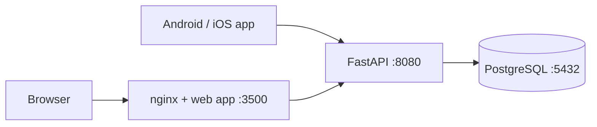

# ChitBook

Track chit funds from your phone: members, monthly payments, payouts, profit.

| Part | Tech | Where |
|---|---|---|
| API | Python 3.13 · FastAPI · SQLAlchemy 2 · Alembic | [apps/api](apps/api) |
| App (Android · iOS · web) | React Native · Expo SDK 58 · TypeScript | [apps/mobile](apps/mobile) |
| Database | PostgreSQL 18 (host, port 5432) | [docs/database.md](docs/database.md) |



## Quick start

```bash
cp .env.example .env           # fill in every value (docs/setup.md explains each one)
scripts/setup-db.sh            # once: creates the database, role and access rules
docker compose up -d --build   # API on :8080, web app on :3500
apps/api/.venv/bin/python scripts/smoke_test.py   # end-to-end check (after `cd apps/api && uv sync`)
```

- Web app: `http://<host>:3500`. Sign in with `ADMIN_USERNAME` / `ADMIN_PASSWORD` from `.env`.
- API docs (Swagger): `http://<host>:8080/api/docs`.
- Phone: `cd apps/mobile && npm install && EXPO_PUBLIC_API_BASE_URL=http://<host>:8080 npx expo start`, then scan the QR code with Expo Go.

## Everyday commands

| Task | Command |
|---|---|
| Start / stop | `docker compose up -d --build` · `docker compose down` |
| Logs | `docker compose logs -f api` (JSON on stdout; no log files) |
| API tests + lint + types | `cd apps/api && uv run pytest && uv run ruff check . && uv run mypy` |
| App tests + types + lint | `cd apps/mobile && npm test && npm run typecheck && npm run lint` |
| Regenerate docs | `scripts/gen-docs.sh` |
| Regenerate app API types | `scripts/gen-api-types.sh` |

## Documentation

Start at [docs/README.md](docs/README.md):

- [setup](docs/setup.md)
- [architecture](docs/architecture.md)
- [API reference](docs/api/README.md)
- [auth](docs/auth.md)
- [business rules](docs/domain/simple-chits.md)
- [debugging](docs/operations/logging-and-debugging.md)
- [project status](docs/project-status.md)

## Working with Claude Code

- [CLAUDE.md](CLAUDE.md) holds the project rules. Each app has its own `CLAUDE.md`.
- `.claude/` holds path-scoped **rules**, **skills** (`/add-api-endpoint`, `/run-stack`, `/debug-api-error`, …), review **agents** and safety **hooks**.
