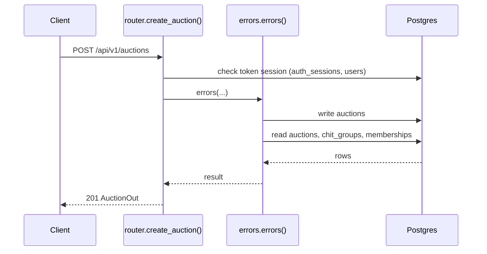
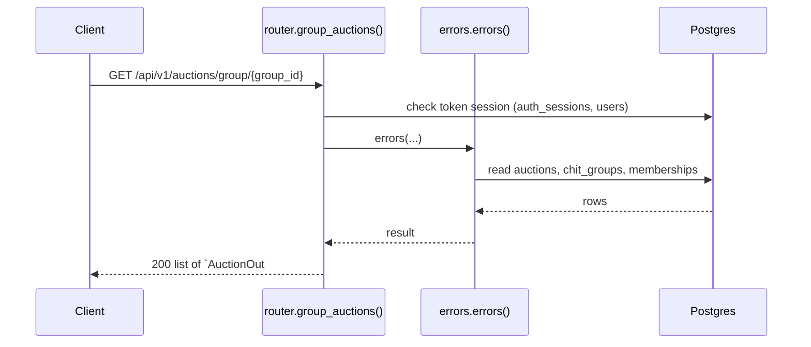
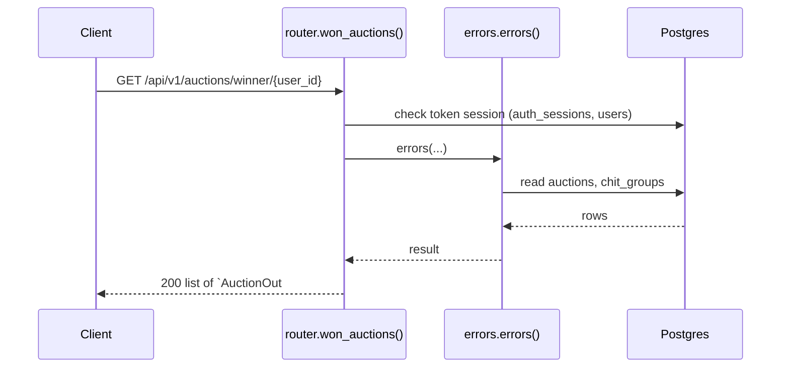
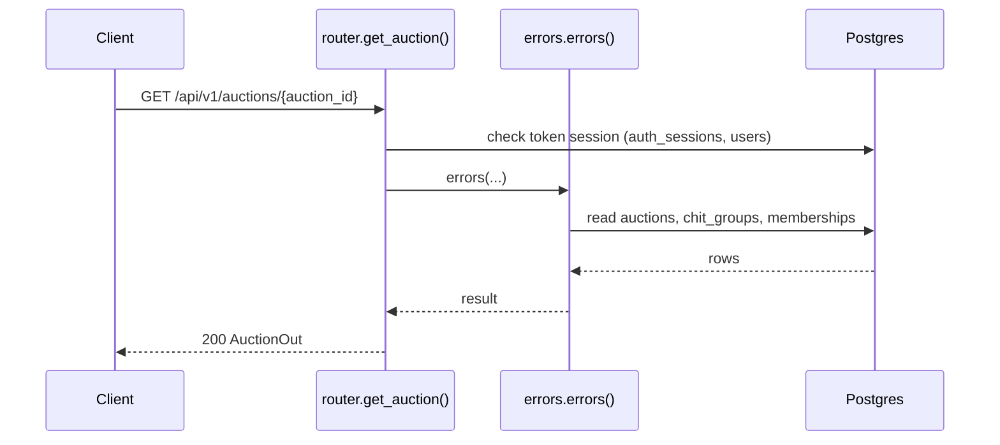
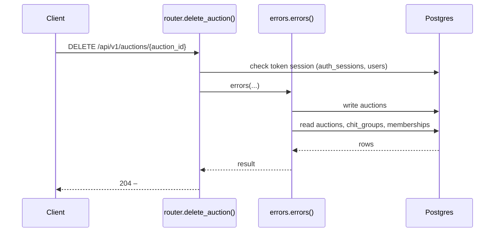

# Auctions API

> Generated by `scripts/gen_api_docs.py` from the code. Do not edit by hand; run `scripts/gen-docs.sh`.

## Overview

> Monthly auctions of a chit group: who won the pot, for how much, and the commission.

## Endpoints

| Method | Path | Summary |
|---|---|---|
| POST | [`/api/v1/auctions`](#post-apiv1auctions) | Record an auction |
| GET | [`/api/v1/auctions/group/{group_id}`](#get-apiv1auctionsgroupgroup_id) | A group's auctions |
| GET | [`/api/v1/auctions/winner/{user_id}`](#get-apiv1auctionswinneruser_id) | Auctions a user has won |
| GET | [`/api/v1/auctions/{auction_id}`](#get-apiv1auctionsauction_id) | Get an auction |
| DELETE | [`/api/v1/auctions/{auction_id}`](#delete-apiv1auctionsauction_id) | Delete an auction |

## Details

### `POST /api/v1/auctions`

Record an auction

- **Auth:** Bearer access token
- **Success:** `201` → `AuctionOut`
- **Router:** [`create_auction`](../../apps/api/src/chitbook_api/modules/auctions/router.py#L13) (router.py:13)
- **Calls:** [`errors`](../../apps/api/src/chitbook_api/core/errors.py#L234) (errors.py:234), [`create`](../../apps/api/src/chitbook_api/modules/auctions/service.py#L35) (service.py:35), [`now`](../../apps/api/src/chitbook_api/core/time.py#L14) (time.py:14), [`get_for_month`](../../apps/api/src/chitbook_api/modules/auctions/repository.py#L15) (repository.py:15), [`require_group`](../../apps/api/src/chitbook_api/modules/groups/service.py#L59) (service.py:59), [`get_group`](../../apps/api/src/chitbook_api/modules/groups/repository.py#L12) (repository.py:12), [`to_out`](../../apps/api/src/chitbook_api/modules/auctions/service.py#L19) (service.py:19)
- **Access checks:** `active_membership`, `require_group_admin`, `require_group_member`

**Request body**

| Field | Type | Required | Notes |
|---|---|---|---|
| `chitGroupId` | integer | yes |  |
| `winningMemberId` | integer | yes | User id of the winner (must be an active member) |
| `month` | string | yes | minLength=1; maxLength=20; e.g. 2026-08; one auction per month per group |
| `winningAmount` | number or string | yes | exclusiveMinimum=0.0 |
| `commission` | number or string | yes | minimum=0.0 |
| `auctionDate` | date-time or null | no | Default now |
| `remark` | string or null | no | maxLength=200 |

```json
{
  "chitGroupId": 1,
  "winningMemberId": 1,
  "month": "2026-08",
  "winningAmount": 25000.0,
  "commission": 25000.0,
  "auctionDate": "2026-08-01T10:30:00+05:30",
  "remark": "August contribution"
}
```

**Response `201`**

| Field | Type | Required | Notes |
|---|---|---|---|
| `id` | integer | yes |  |
| `month` | string | yes |  |
| `winningAmount` | number | yes |  |
| `commission` | number | yes |  |
| `auctionDate` | string | yes |  |
| `remark` | string or null | yes |  |
| `winningMemberId` | integer | yes |  |
| `winningMemberName` | string | yes |  |
| `chitGroupId` | integer | yes |  |
| `chitGroupName` | string | yes |  |
| `createdAt` | string | yes |  |
| `updatedAt` | string | yes |  |

```json
{
  "id": 1,
  "month": "2026-08",
  "winningAmount": 25000.0,
  "commission": 25000.0,
  "auctionDate": "2026-08-01T10:30:00+05:30",
  "remark": "August contribution",
  "winningMemberId": 1,
  "winningMemberName": "string",
  "chitGroupId": 1,
  "chitGroupName": "string",
  "createdAt": "2026-08-01T10:30:00+05:30",
  "updatedAt": "2026-08-01T10:30:00+05:30"
}
```

**Database**

- Writes: `auctions`
- Reads: `auctions`, `chit_groups`, `memberships`
- Token check reads `auth_sessions` + `users` (every signed-in request)

**Flow**



**Errors** (declared in the router with `responses=errors(...)`)

| HTTP | Code | Message | Exact problem / fix |
|---|---|---|---|
| 401 | `AUTH_REQUIRED` | Authentication required | No `Authorization: Bearer <token>` header. |
| 401 | `AUTH_TOKEN_INVALID` | Access token is invalid | Token malformed, signed with another JWT_SECRET (secret changed?), or user deleted. |
| 401 | `AUTH_TOKEN_EXPIRED` | Access token has expired | Access token older than ACCESS_TOKEN_TTL_MINUTES. Client should call /auth/refresh. |
| 401 | `AUTH_SESSION_REVOKED` | Session has been signed out | Device was signed out (logout, remote sign-out, password change or refresh-token reuse). |
| 403 | `NOT_GROUP_MEMBER` | You are not an active member of this group | Caller (or the target user) is not an ACTIVE member of the group. |
| 403 | `NOT_GROUP_ADMIN` | Group admin access is required | Caller is a member but not the group's ADMIN. |
| 404 | `GROUP_NOT_FOUND` | Chit group not found | Wrong group id or group code. |
| 409 | `AUCTION_EXISTS` | An auction already exists for this month in this group | The group already has an auction for that month. |
| 422 | `VALIDATION_ERROR` | Request data is invalid | Body/query/path does not match the schema. `details` lists each bad field and why. |
| 500 | `INTERNAL_ERROR` | An unexpected internal error occurred | A bug. Search `docker compose logs api` for the `requestId` and read the `request.unhandled_exception` line: it has the exception and stack trace. |
| 503 | `DB_UNAVAILABLE` | Database is unavailable | Postgres unreachable: host Postgres down, pg_hba.conf missing the Docker subnet, or wrong DB_* values in .env. See the `db.unavailable` log line. |

**Diagnose**

- Every response carries `X-Request-ID`; errors also return it as `error.requestId`.
- `docker compose logs api | grep <request_id>` shows the access line (`http.request`) and any error lines.
- Each error's exact problem is in the table above (from the router's `responses=errors(...)`).
- Log events on success: `auction.created (info)`
- 500 / 503: see [logging & debugging](../operations/logging-and-debugging.md).

---

### `GET /api/v1/auctions/group/{group_id}`

A group's auctions

- **Auth:** Bearer access token
- **Success:** `200` → list of `AuctionOut`
- **Router:** [`group_auctions`](../../apps/api/src/chitbook_api/modules/auctions/router.py#L31) (router.py:31)
- **Calls:** [`errors`](../../apps/api/src/chitbook_api/core/errors.py#L234) (errors.py:234), [`list_for_group`](../../apps/api/src/chitbook_api/modules/auctions/service.py#L64) (service.py:64), [`list_for_group`](../../apps/api/src/chitbook_api/modules/auctions/repository.py#L21) (repository.py:21), [`to_out`](../../apps/api/src/chitbook_api/modules/auctions/service.py#L19) (service.py:19)
- **Access checks:** `require_group_member`, `active_membership`

**Parameters**

| Name | In | Type | Required |
|---|---|---|---|
| `group_id` | path | integer | yes |

**Response `200`**

| Field | Type | Required | Notes |
|---|---|---|---|
| `id` | integer | yes |  |
| `month` | string | yes |  |
| `winningAmount` | number | yes |  |
| `commission` | number | yes |  |
| `auctionDate` | string | yes |  |
| `remark` | string or null | yes |  |
| `winningMemberId` | integer | yes |  |
| `winningMemberName` | string | yes |  |
| `chitGroupId` | integer | yes |  |
| `chitGroupName` | string | yes |  |
| `createdAt` | string | yes |  |
| `updatedAt` | string | yes |  |

```json
[
  {
    "id": 1,
    "month": "2026-08",
    "winningAmount": 25000.0,
    "commission": 25000.0,
    "auctionDate": "2026-08-01T10:30:00+05:30",
    "remark": "August contribution",
    "winningMemberId": 1,
    "winningMemberName": "string",
    "chitGroupId": 1,
    "chitGroupName": "string",
    "createdAt": "2026-08-01T10:30:00+05:30",
    "updatedAt": "2026-08-01T10:30:00+05:30"
  }
]
```

**Database**

- Writes: –
- Reads: `auctions`, `chit_groups`, `memberships`
- Token check reads `auth_sessions` + `users` (every signed-in request)

**Flow**



**Errors** (declared in the router with `responses=errors(...)`)

| HTTP | Code | Message | Exact problem / fix |
|---|---|---|---|
| 401 | `AUTH_REQUIRED` | Authentication required | No `Authorization: Bearer <token>` header. |
| 401 | `AUTH_TOKEN_INVALID` | Access token is invalid | Token malformed, signed with another JWT_SECRET (secret changed?), or user deleted. |
| 401 | `AUTH_TOKEN_EXPIRED` | Access token has expired | Access token older than ACCESS_TOKEN_TTL_MINUTES. Client should call /auth/refresh. |
| 401 | `AUTH_SESSION_REVOKED` | Session has been signed out | Device was signed out (logout, remote sign-out, password change or refresh-token reuse). |
| 403 | `NOT_GROUP_MEMBER` | You are not an active member of this group | Caller (or the target user) is not an ACTIVE member of the group. |
| 422 | `VALIDATION_ERROR` | Request data is invalid | Body/query/path does not match the schema. `details` lists each bad field and why. |
| 500 | `INTERNAL_ERROR` | An unexpected internal error occurred | A bug. Search `docker compose logs api` for the `requestId` and read the `request.unhandled_exception` line: it has the exception and stack trace. |
| 503 | `DB_UNAVAILABLE` | Database is unavailable | Postgres unreachable: host Postgres down, pg_hba.conf missing the Docker subnet, or wrong DB_* values in .env. See the `db.unavailable` log line. |

**Diagnose**

- Every response carries `X-Request-ID`; errors also return it as `error.requestId`.
- `docker compose logs api | grep <request_id>` shows the access line (`http.request`) and any error lines.
- Each error's exact problem is in the table above (from the router's `responses=errors(...)`).
- 500 / 503: see [logging & debugging](../operations/logging-and-debugging.md).

---

### `GET /api/v1/auctions/winner/{user_id}`

Auctions a user has won

- **Auth:** Bearer access token
- **Success:** `200` → list of `AuctionOut`
- **Router:** [`won_auctions`](../../apps/api/src/chitbook_api/modules/auctions/router.py#L41) (router.py:41)
- **Calls:** [`errors`](../../apps/api/src/chitbook_api/core/errors.py#L234) (errors.py:234), [`list_won_by`](../../apps/api/src/chitbook_api/modules/auctions/service.py#L69) (service.py:69), [`list_won_by`](../../apps/api/src/chitbook_api/modules/auctions/repository.py#L26) (repository.py:26), [`to_out`](../../apps/api/src/chitbook_api/modules/auctions/service.py#L19) (service.py:19)
- **Access checks:** `require_self_or_platform_admin`

**Parameters**

| Name | In | Type | Required |
|---|---|---|---|
| `user_id` | path | integer | yes |

**Response `200`**

| Field | Type | Required | Notes |
|---|---|---|---|
| `id` | integer | yes |  |
| `month` | string | yes |  |
| `winningAmount` | number | yes |  |
| `commission` | number | yes |  |
| `auctionDate` | string | yes |  |
| `remark` | string or null | yes |  |
| `winningMemberId` | integer | yes |  |
| `winningMemberName` | string | yes |  |
| `chitGroupId` | integer | yes |  |
| `chitGroupName` | string | yes |  |
| `createdAt` | string | yes |  |
| `updatedAt` | string | yes |  |

```json
[
  {
    "id": 1,
    "month": "2026-08",
    "winningAmount": 25000.0,
    "commission": 25000.0,
    "auctionDate": "2026-08-01T10:30:00+05:30",
    "remark": "August contribution",
    "winningMemberId": 1,
    "winningMemberName": "string",
    "chitGroupId": 1,
    "chitGroupName": "string",
    "createdAt": "2026-08-01T10:30:00+05:30",
    "updatedAt": "2026-08-01T10:30:00+05:30"
  }
]
```

**Database**

- Writes: –
- Reads: `auctions`, `chit_groups`
- Token check reads `auth_sessions` + `users` (every signed-in request)

**Flow**



**Errors** (declared in the router with `responses=errors(...)`)

| HTTP | Code | Message | Exact problem / fix |
|---|---|---|---|
| 401 | `AUTH_REQUIRED` | Authentication required | No `Authorization: Bearer <token>` header. |
| 401 | `AUTH_TOKEN_INVALID` | Access token is invalid | Token malformed, signed with another JWT_SECRET (secret changed?), or user deleted. |
| 401 | `AUTH_TOKEN_EXPIRED` | Access token has expired | Access token older than ACCESS_TOKEN_TTL_MINUTES. Client should call /auth/refresh. |
| 401 | `AUTH_SESSION_REVOKED` | Session has been signed out | Device was signed out (logout, remote sign-out, password change or refresh-token reuse). |
| 403 | `FORBIDDEN` | You do not have access to this resource | You may only access your own user data (unless platform ADMIN). |
| 422 | `VALIDATION_ERROR` | Request data is invalid | Body/query/path does not match the schema. `details` lists each bad field and why. |
| 500 | `INTERNAL_ERROR` | An unexpected internal error occurred | A bug. Search `docker compose logs api` for the `requestId` and read the `request.unhandled_exception` line: it has the exception and stack trace. |
| 503 | `DB_UNAVAILABLE` | Database is unavailable | Postgres unreachable: host Postgres down, pg_hba.conf missing the Docker subnet, or wrong DB_* values in .env. See the `db.unavailable` log line. |

**Diagnose**

- Every response carries `X-Request-ID`; errors also return it as `error.requestId`.
- `docker compose logs api | grep <request_id>` shows the access line (`http.request`) and any error lines.
- Each error's exact problem is in the table above (from the router's `responses=errors(...)`).
- 500 / 503: see [logging & debugging](../operations/logging-and-debugging.md).

---

### `GET /api/v1/auctions/{auction_id}`

Get an auction

- **Auth:** Bearer access token
- **Success:** `200` → `AuctionOut`
- **Router:** [`get_auction`](../../apps/api/src/chitbook_api/modules/auctions/router.py#L51) (router.py:51)
- **Calls:** [`errors`](../../apps/api/src/chitbook_api/core/errors.py#L234) (errors.py:234), [`get`](../../apps/api/src/chitbook_api/modules/auctions/service.py#L58) (service.py:58), [`_require`](../../apps/api/src/chitbook_api/modules/auctions/service.py#L28) (service.py:28), [`get`](../../apps/api/src/chitbook_api/modules/auctions/repository.py#L11) (repository.py:11), [`to_out`](../../apps/api/src/chitbook_api/modules/auctions/service.py#L19) (service.py:19)
- **Access checks:** `require_group_member`, `active_membership`

**Parameters**

| Name | In | Type | Required |
|---|---|---|---|
| `auction_id` | path | integer | yes |

**Response `200`**

| Field | Type | Required | Notes |
|---|---|---|---|
| `id` | integer | yes |  |
| `month` | string | yes |  |
| `winningAmount` | number | yes |  |
| `commission` | number | yes |  |
| `auctionDate` | string | yes |  |
| `remark` | string or null | yes |  |
| `winningMemberId` | integer | yes |  |
| `winningMemberName` | string | yes |  |
| `chitGroupId` | integer | yes |  |
| `chitGroupName` | string | yes |  |
| `createdAt` | string | yes |  |
| `updatedAt` | string | yes |  |

```json
{
  "id": 1,
  "month": "2026-08",
  "winningAmount": 25000.0,
  "commission": 25000.0,
  "auctionDate": "2026-08-01T10:30:00+05:30",
  "remark": "August contribution",
  "winningMemberId": 1,
  "winningMemberName": "string",
  "chitGroupId": 1,
  "chitGroupName": "string",
  "createdAt": "2026-08-01T10:30:00+05:30",
  "updatedAt": "2026-08-01T10:30:00+05:30"
}
```

**Database**

- Writes: –
- Reads: `auctions`, `chit_groups`, `memberships`
- Token check reads `auth_sessions` + `users` (every signed-in request)

**Flow**



**Errors** (declared in the router with `responses=errors(...)`)

| HTTP | Code | Message | Exact problem / fix |
|---|---|---|---|
| 401 | `AUTH_REQUIRED` | Authentication required | No `Authorization: Bearer <token>` header. |
| 401 | `AUTH_TOKEN_INVALID` | Access token is invalid | Token malformed, signed with another JWT_SECRET (secret changed?), or user deleted. |
| 401 | `AUTH_TOKEN_EXPIRED` | Access token has expired | Access token older than ACCESS_TOKEN_TTL_MINUTES. Client should call /auth/refresh. |
| 401 | `AUTH_SESSION_REVOKED` | Session has been signed out | Device was signed out (logout, remote sign-out, password change or refresh-token reuse). |
| 403 | `NOT_GROUP_MEMBER` | You are not an active member of this group | Caller (or the target user) is not an ACTIVE member of the group. |
| 404 | `AUCTION_NOT_FOUND` | Auction not found | Wrong auction id. |
| 422 | `VALIDATION_ERROR` | Request data is invalid | Body/query/path does not match the schema. `details` lists each bad field and why. |
| 500 | `INTERNAL_ERROR` | An unexpected internal error occurred | A bug. Search `docker compose logs api` for the `requestId` and read the `request.unhandled_exception` line: it has the exception and stack trace. |
| 503 | `DB_UNAVAILABLE` | Database is unavailable | Postgres unreachable: host Postgres down, pg_hba.conf missing the Docker subnet, or wrong DB_* values in .env. See the `db.unavailable` log line. |

**Diagnose**

- Every response carries `X-Request-ID`; errors also return it as `error.requestId`.
- `docker compose logs api | grep <request_id>` shows the access line (`http.request`) and any error lines.
- Each error's exact problem is in the table above (from the router's `responses=errors(...)`).
- 500 / 503: see [logging & debugging](../operations/logging-and-debugging.md).

---

### `DELETE /api/v1/auctions/{auction_id}`

Delete an auction

- **Auth:** Bearer access token
- **Success:** `204` → –
- **Router:** [`delete_auction`](../../apps/api/src/chitbook_api/modules/auctions/router.py#L63) (router.py:63)
- **Calls:** [`errors`](../../apps/api/src/chitbook_api/core/errors.py#L234) (errors.py:234), [`delete`](../../apps/api/src/chitbook_api/modules/auctions/service.py#L74) (service.py:74), [`_require`](../../apps/api/src/chitbook_api/modules/auctions/service.py#L28) (service.py:28), [`get`](../../apps/api/src/chitbook_api/modules/auctions/repository.py#L11) (repository.py:11)
- **Access checks:** `require_group_admin`, `require_group_member`, `active_membership`

**Parameters**

| Name | In | Type | Required |
|---|---|---|---|
| `auction_id` | path | integer | yes |

**Response `204`**: no body.

**Database**

- Writes: `auctions`
- Reads: `auctions`, `chit_groups`, `memberships`
- Token check reads `auth_sessions` + `users` (every signed-in request)
- Child rows are removed by `ON DELETE CASCADE` (see docs/database.md)

**Flow**



**Errors** (declared in the router with `responses=errors(...)`)

| HTTP | Code | Message | Exact problem / fix |
|---|---|---|---|
| 401 | `AUTH_REQUIRED` | Authentication required | No `Authorization: Bearer <token>` header. |
| 401 | `AUTH_TOKEN_INVALID` | Access token is invalid | Token malformed, signed with another JWT_SECRET (secret changed?), or user deleted. |
| 401 | `AUTH_TOKEN_EXPIRED` | Access token has expired | Access token older than ACCESS_TOKEN_TTL_MINUTES. Client should call /auth/refresh. |
| 401 | `AUTH_SESSION_REVOKED` | Session has been signed out | Device was signed out (logout, remote sign-out, password change or refresh-token reuse). |
| 403 | `NOT_GROUP_MEMBER` | You are not an active member of this group | Caller (or the target user) is not an ACTIVE member of the group. |
| 403 | `NOT_GROUP_ADMIN` | Group admin access is required | Caller is a member but not the group's ADMIN. |
| 404 | `AUCTION_NOT_FOUND` | Auction not found | Wrong auction id. |
| 422 | `VALIDATION_ERROR` | Request data is invalid | Body/query/path does not match the schema. `details` lists each bad field and why. |
| 500 | `INTERNAL_ERROR` | An unexpected internal error occurred | A bug. Search `docker compose logs api` for the `requestId` and read the `request.unhandled_exception` line: it has the exception and stack trace. |
| 503 | `DB_UNAVAILABLE` | Database is unavailable | Postgres unreachable: host Postgres down, pg_hba.conf missing the Docker subnet, or wrong DB_* values in .env. See the `db.unavailable` log line. |

**Diagnose**

- Every response carries `X-Request-ID`; errors also return it as `error.requestId`.
- `docker compose logs api | grep <request_id>` shows the access line (`http.request`) and any error lines.
- Each error's exact problem is in the table above (from the router's `responses=errors(...)`).
- Log events on success: `auction.deleted (info)`
- 500 / 503: see [logging & debugging](../operations/logging-and-debugging.md).

---

