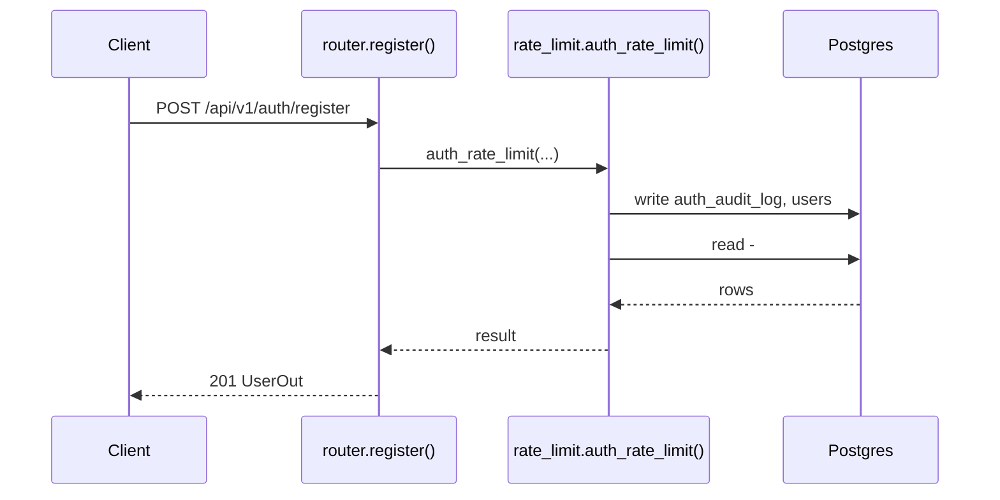
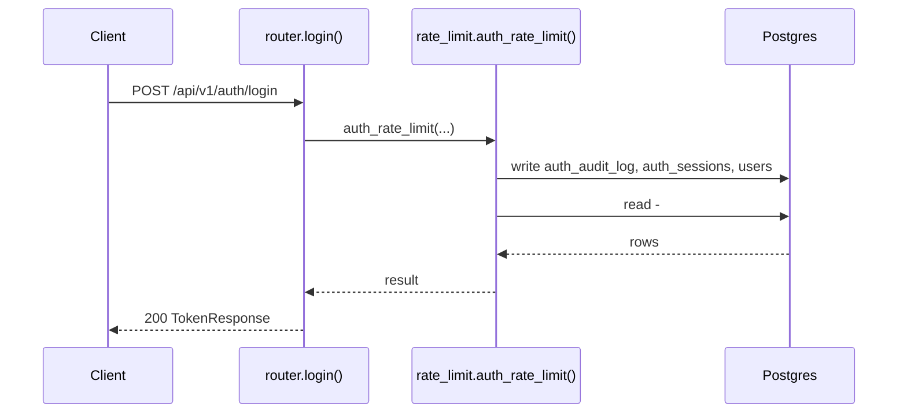
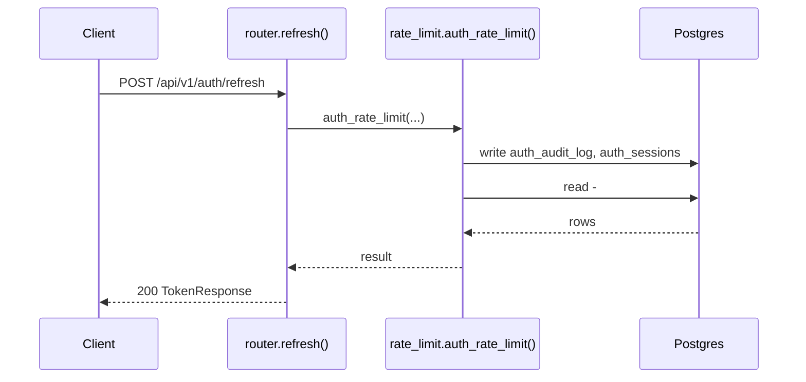
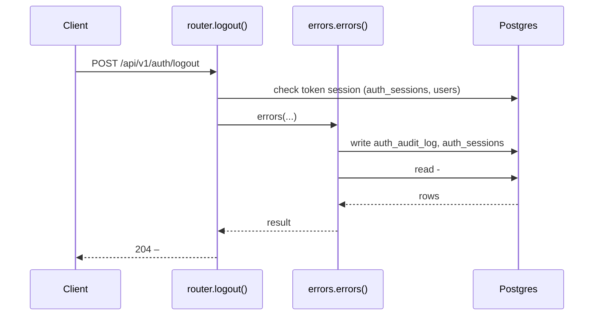
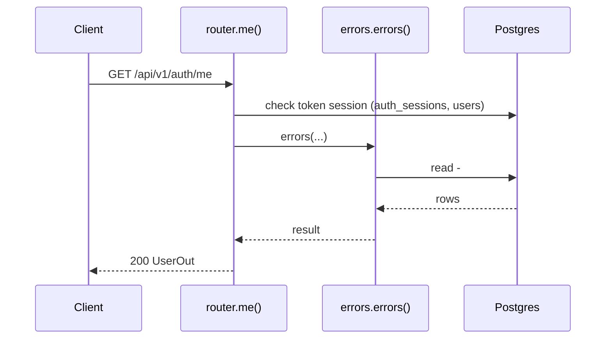
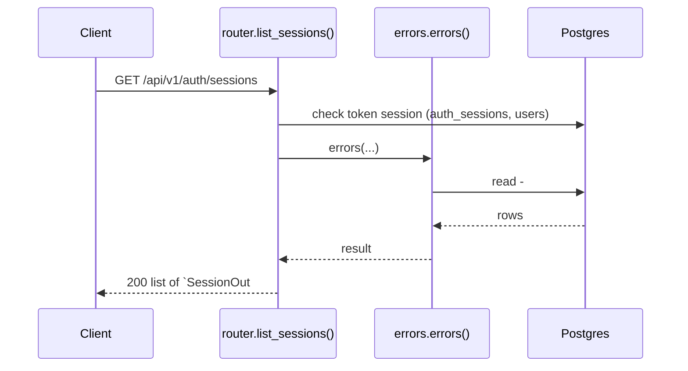
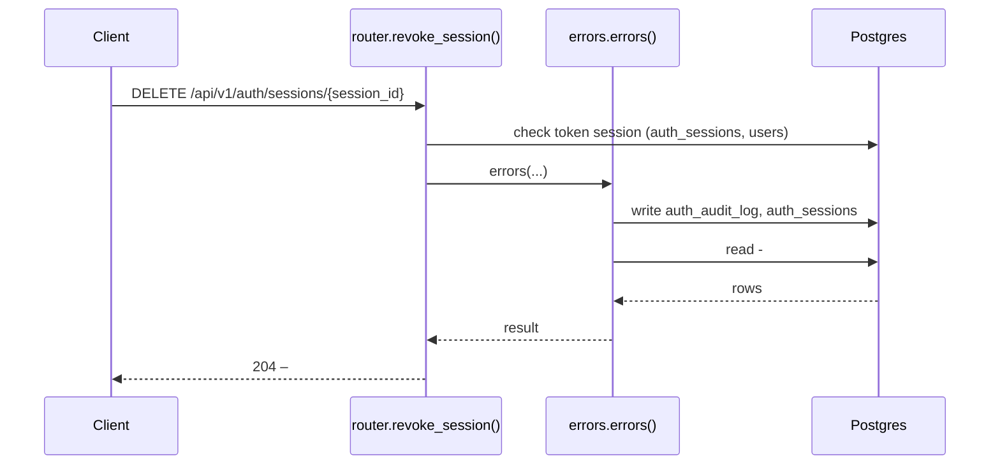

# Auth & sessions API

> Generated by `scripts/gen_api_docs.py` from the code. Do not edit by hand; run `scripts/gen-docs.sh`.

## Overview

> Login, refresh-token rotation (with reuse detection), logout, lockout and sessions.

## Endpoints

| Method | Path | Summary |
|---|---|---|
| POST | [`/api/v1/auth/register`](#post-apiv1authregister) | Create an account (always MEMBER role) |
| POST | [`/api/v1/auth/login`](#post-apiv1authlogin) | Sign in and get an access + refresh token |
| POST | [`/api/v1/auth/refresh`](#post-apiv1authrefresh) | Swap a refresh token for a new access + refresh token (rotation) |
| POST | [`/api/v1/auth/logout`](#post-apiv1authlogout) | Sign out this device |
| GET | [`/api/v1/auth/me`](#get-apiv1authme) | Get the signed-in user |
| GET | [`/api/v1/auth/sessions`](#get-apiv1authsessions) | List my signed-in devices |
| DELETE | [`/api/v1/auth/sessions/{session_id}`](#delete-apiv1authsessionssession_id) | Sign out one of my devices |

## Details

### `POST /api/v1/auth/register`

Create an account (always MEMBER role)

- **Auth:** public · rate limited per IP
- **Success:** `201` → `UserOut`
- **Router:** [`register`](../../apps/api/src/chitbook_api/modules/auth/router.py#L55) (router.py:55)
- **Calls:** [`auth_rate_limit`](../../apps/api/src/chitbook_api/core/rate_limit.py#L47) (rate_limit.py:47), [`errors`](../../apps/api/src/chitbook_api/core/errors.py#L234) (errors.py:234), [`record_event`](../../apps/api/src/chitbook_api/modules/auth/repository.py#L24) (repository.py:24), [`user_agent`](../../apps/api/src/chitbook_api/modules/auth/repository.py#L19) (repository.py:19), [`client_ip`](../../apps/api/src/chitbook_api/modules/auth/repository.py#L15) (repository.py:15), [`register`](../../apps/api/src/chitbook_api/modules/users/service.py#L23) (service.py:23), [`hash_password`](../../apps/api/src/chitbook_api/core/security.py#L33) (security.py:33), [`get_by_email`](../../apps/api/src/chitbook_api/modules/users/repository.py#L21) (repository.py:21)

**Request body**

| Field | Type | Required | Notes |
|---|---|---|---|
| `name` | string | yes | minLength=1; maxLength=100 |
| `username` | string | yes | pattern=^[A-Za-z0-9._-]{3,30}$; 3-30 letters, digits, . _ - |
| `email` | email | yes |  |
| `phone` | string or null | no | pattern=^\+?[0-9]{10,15}$ |
| `password` | string | yes | minLength=1; maxLength=128 |

```json
{
  "name": "Ravi Kumar",
  "username": "ravi",
  "email": "ravi@example.com",
  "phone": "9876543210",
  "password": "Ravi-pass-2026"
}
```

**Response `201`**

| Field | Type | Required | Notes |
|---|---|---|---|
| `id` | integer | yes |  |
| `name` | string | yes |  |
| `username` | string | yes |  |
| `phone` | string or null | yes |  |
| `email` | string | yes |  |
| `role` | UserRole | yes |  |
| `createdAt` | string | yes |  |
| `updatedAt` | string | yes |  |

```json
{
  "id": 1,
  "name": "Ravi Kumar",
  "username": "ravi",
  "phone": "9876543210",
  "email": "ravi@example.com",
  "role": "ADMIN",
  "createdAt": "2026-08-01T10:30:00+05:30",
  "updatedAt": "2026-08-01T10:30:00+05:30"
}
```

**Database**

- Writes: `auth_audit_log`, `users`
- Reads: `users`

**Flow**



**Errors** (declared in the router with `responses=errors(...)`)

| HTTP | Code | Message | Exact problem / fix |
|---|---|---|---|
| 409 | `USERNAME_TAKEN` | Username is already taken | Username already registered (usernames are case-insensitive). |
| 409 | `EMAIL_TAKEN` | Email is already registered | Email already registered. |
| 422 | `VALIDATION_ERROR` | Request data is invalid | Body/query/path does not match the schema. `details` lists each bad field and why. |
| 422 | `AUTH_WEAK_PASSWORD` | Password does not meet the password policy | Password under 8 chars, no letter+digit, too common, or equal to the username. |
| 429 | `RATE_LIMITED` | Too many requests, try again later | More than RATE_LIMIT_AUTH_PER_MINUTE calls from one IP in 60 s. Wait a minute. |
| 500 | `INTERNAL_ERROR` | An unexpected internal error occurred | A bug. Search `docker compose logs api` for the `requestId` and read the `request.unhandled_exception` line: it has the exception and stack trace. |
| 503 | `DB_UNAVAILABLE` | Database is unavailable | Postgres unreachable: host Postgres down, pg_hba.conf missing the Docker subnet, or wrong DB_* values in .env. See the `db.unavailable` log line. |

**Diagnose**

- Every response carries `X-Request-ID`; errors also return it as `error.requestId`.
- `docker compose logs api | grep <request_id>` shows the access line (`http.request`) and any error lines.
- Each error's exact problem is in the table above (from the router's `responses=errors(...)`).
- Log events on success: `rate_limit.exceeded (warning)`, `user.registered (info)`
- 500 / 503: see [logging & debugging](../operations/logging-and-debugging.md).

---

### `POST /api/v1/auth/login`

Sign in and get an access + refresh token

- **Auth:** public · rate limited per IP
- **Success:** `200` → `TokenResponse`
- **Router:** [`login`](../../apps/api/src/chitbook_api/modules/auth/router.py#L77) (router.py:77)
- **Calls:** [`auth_rate_limit`](../../apps/api/src/chitbook_api/core/rate_limit.py#L47) (rate_limit.py:47), [`errors`](../../apps/api/src/chitbook_api/core/errors.py#L234) (errors.py:234), [`login`](../../apps/api/src/chitbook_api/modules/auth/service.py#L71) (service.py:71), [`now`](../../apps/api/src/chitbook_api/core/time.py#L14) (time.py:14), [`_lockout_minutes`](../../apps/api/src/chitbook_api/modules/auth/service.py#L42) (service.py:42), [`record_event`](../../apps/api/src/chitbook_api/modules/auth/repository.py#L24) (repository.py:24), [`user_agent`](../../apps/api/src/chitbook_api/modules/auth/repository.py#L19) (repository.py:19), [`client_ip`](../../apps/api/src/chitbook_api/modules/auth/repository.py#L15) (repository.py:15)

**Request body**

| Field | Type | Required | Notes |
|---|---|---|---|
| `username` | string | yes | minLength=1; maxLength=100 |
| `password` | string | yes | minLength=1; maxLength=128 |
| `deviceName` | string or null | no | maxLength=100; Shown in the sessions list |
| `client` | ClientType | no |  |

```json
{
  "username": "ravi",
  "password": "Ravi-pass-2026",
  "deviceName": "Android app",
  "client": "mobile"
}
```

**Response `200`**

| Field | Type | Required | Notes |
|---|---|---|---|
| `accessToken` | string | yes |  |
| `tokenType` | string | no |  |
| `expiresIn` | integer | yes | Access token lifetime in seconds |
| `refreshToken` | string or null | yes | Null for web clients (cookie is used instead) |
| `refreshExpiresAt` | string | yes |  |
| `user` | UserOut | yes |  |

```json
{
  "accessToken": "eyJhbGciOiJIUzI1NiIs...",
  "tokenType": "Bearer",
  "expiresIn": 1,
  "refreshToken": "q7k8B9XG...",
  "refreshExpiresAt": "2026-08-01T10:30:00+05:30",
  "user": {
    "id": 1,
    "name": "Ravi Kumar",
    "username": "ravi",
    "phone": "9876543210",
    "email": "ravi@example.com",
    "role": "ADMIN",
    "createdAt": "2026-08-01T10:30:00+05:30",
    "updatedAt": "2026-08-01T10:30:00+05:30"
  }
}
```

**Database**

- Writes: `auth_audit_log`, `auth_sessions`, `users`
- Reads: `users`

**Flow**



**Errors** (declared in the router with `responses=errors(...)`)

| HTTP | Code | Message | Exact problem / fix |
|---|---|---|---|
| 401 | `AUTH_INVALID_CREDENTIALS` | Invalid username or password | Wrong username or password (unknown usernames give the same answer on purpose). |
| 422 | `VALIDATION_ERROR` | Request data is invalid | Body/query/path does not match the schema. `details` lists each bad field and why. |
| 429 | `AUTH_ACCOUNT_LOCKED` | Too many failed attempts. Try again later | Too many failed logins. `details.retryAfterSeconds` says when to retry. |
| 429 | `RATE_LIMITED` | Too many requests, try again later | More than RATE_LIMIT_AUTH_PER_MINUTE calls from one IP in 60 s. Wait a minute. |
| 500 | `INTERNAL_ERROR` | An unexpected internal error occurred | A bug. Search `docker compose logs api` for the `requestId` and read the `request.unhandled_exception` line: it has the exception and stack trace. |
| 503 | `DB_UNAVAILABLE` | Database is unavailable | Postgres unreachable: host Postgres down, pg_hba.conf missing the Docker subnet, or wrong DB_* values in .env. See the `db.unavailable` log line. |

**Diagnose**

- Every response carries `X-Request-ID`; errors also return it as `error.requestId`.
- `docker compose logs api | grep <request_id>` shows the access line (`http.request`) and any error lines.
- Each error's exact problem is in the table above (from the router's `responses=errors(...)`).
- Log events on success: `rate_limit.exceeded (warning)`, `auth.login_success (info)`, `auth.login_locked (warning)`, `auth.login_failed (warning)`
- 500 / 503: see [logging & debugging](../operations/logging-and-debugging.md).

---

### `POST /api/v1/auth/refresh`

Swap a refresh token for a new access + refresh token (rotation)

- **Auth:** public · rate limited per IP
- **Success:** `200` → `TokenResponse`
- **Router:** [`refresh`](../../apps/api/src/chitbook_api/modules/auth/router.py#L96) (router.py:96)
- **Calls:** [`auth_rate_limit`](../../apps/api/src/chitbook_api/core/rate_limit.py#L47) (rate_limit.py:47), [`errors`](../../apps/api/src/chitbook_api/core/errors.py#L234) (errors.py:234), [`refresh`](../../apps/api/src/chitbook_api/modules/auth/service.py#L119) (service.py:119), [`record_event`](../../apps/api/src/chitbook_api/modules/auth/repository.py#L24) (repository.py:24), [`user_agent`](../../apps/api/src/chitbook_api/modules/auth/repository.py#L19) (repository.py:19), [`client_ip`](../../apps/api/src/chitbook_api/modules/auth/repository.py#L15) (repository.py:15), [`revoke_family`](../../apps/api/src/chitbook_api/modules/auth/repository.py#L51) (repository.py:51), [`now`](../../apps/api/src/chitbook_api/core/time.py#L14) (time.py:14)

**Request body**

| Field | Type | Required | Notes |
|---|---|---|---|
| `refreshToken` | string or null | no | Mobile only; web sends the cookie |
| `client` | ClientType | no |  |

```json
{
  "refreshToken": "q7k8B9XG...",
  "client": "mobile"
}
```

**Response `200`**

| Field | Type | Required | Notes |
|---|---|---|---|
| `accessToken` | string | yes |  |
| `tokenType` | string | no |  |
| `expiresIn` | integer | yes | Access token lifetime in seconds |
| `refreshToken` | string or null | yes | Null for web clients (cookie is used instead) |
| `refreshExpiresAt` | string | yes |  |
| `user` | UserOut | yes |  |

```json
{
  "accessToken": "eyJhbGciOiJIUzI1NiIs...",
  "tokenType": "Bearer",
  "expiresIn": 1,
  "refreshToken": "q7k8B9XG...",
  "refreshExpiresAt": "2026-08-01T10:30:00+05:30",
  "user": {
    "id": 1,
    "name": "Ravi Kumar",
    "username": "ravi",
    "phone": "9876543210",
    "email": "ravi@example.com",
    "role": "ADMIN",
    "createdAt": "2026-08-01T10:30:00+05:30",
    "updatedAt": "2026-08-01T10:30:00+05:30"
  }
}
```

**Database**

- Writes: `auth_audit_log`, `auth_sessions`
- Reads: `auth_sessions`, `users`

**Flow**



**Errors** (declared in the router with `responses=errors(...)`)

| HTTP | Code | Message | Exact problem / fix |
|---|---|---|---|
| 401 | `AUTH_REFRESH_INVALID` | Refresh token is invalid or expired | Refresh token unknown, expired or revoked; web clients also need the X-Chitbook-Client header. |
| 401 | `AUTH_REFRESH_REUSED` | Refresh token was already used; all sessions in this chain were signed out | An old refresh token was presented again; the whole session chain was revoked (possible theft). |
| 422 | `VALIDATION_ERROR` | Request data is invalid | Body/query/path does not match the schema. `details` lists each bad field and why. |
| 429 | `RATE_LIMITED` | Too many requests, try again later | More than RATE_LIMIT_AUTH_PER_MINUTE calls from one IP in 60 s. Wait a minute. |
| 500 | `INTERNAL_ERROR` | An unexpected internal error occurred | A bug. Search `docker compose logs api` for the `requestId` and read the `request.unhandled_exception` line: it has the exception and stack trace. |
| 503 | `DB_UNAVAILABLE` | Database is unavailable | Postgres unreachable: host Postgres down, pg_hba.conf missing the Docker subnet, or wrong DB_* values in .env. See the `db.unavailable` log line. |

**Diagnose**

- Every response carries `X-Request-ID`; errors also return it as `error.requestId`.
- `docker compose logs api | grep <request_id>` shows the access line (`http.request`) and any error lines.
- Each error's exact problem is in the table above (from the router's `responses=errors(...)`).
- Log events on success: `rate_limit.exceeded (warning)`, `auth.refreshed (info)`, `auth.refresh_unknown_token (warning)`, `auth.refresh_reuse_detected (warning)`
- 500 / 503: see [logging & debugging](../operations/logging-and-debugging.md).

---

### `POST /api/v1/auth/logout`

Sign out this device

- **Auth:** Bearer access token
- **Success:** `204` → –
- **Router:** [`logout`](../../apps/api/src/chitbook_api/modules/auth/router.py#L120) (router.py:120)
- **Calls:** [`errors`](../../apps/api/src/chitbook_api/core/errors.py#L234) (errors.py:234), [`logout`](../../apps/api/src/chitbook_api/modules/auth/service.py#L158) (service.py:158), [`record_event`](../../apps/api/src/chitbook_api/modules/auth/repository.py#L24) (repository.py:24), [`user_agent`](../../apps/api/src/chitbook_api/modules/auth/repository.py#L19) (repository.py:19), [`client_ip`](../../apps/api/src/chitbook_api/modules/auth/repository.py#L15) (repository.py:15), [`revoke_family`](../../apps/api/src/chitbook_api/modules/auth/repository.py#L51) (repository.py:51), [`now`](../../apps/api/src/chitbook_api/core/time.py#L14) (time.py:14)

**Response `204`**: no body.

**Database**

- Writes: `auth_audit_log`, `auth_sessions`
- Reads: `auth_sessions`
- Token check reads `auth_sessions` + `users` (every signed-in request)

**Flow**



**Errors** (declared in the router with `responses=errors(...)`)

| HTTP | Code | Message | Exact problem / fix |
|---|---|---|---|
| 401 | `AUTH_REQUIRED` | Authentication required | No `Authorization: Bearer <token>` header. |
| 401 | `AUTH_TOKEN_INVALID` | Access token is invalid | Token malformed, signed with another JWT_SECRET (secret changed?), or user deleted. |
| 401 | `AUTH_TOKEN_EXPIRED` | Access token has expired | Access token older than ACCESS_TOKEN_TTL_MINUTES. Client should call /auth/refresh. |
| 401 | `AUTH_SESSION_REVOKED` | Session has been signed out | Device was signed out (logout, remote sign-out, password change or refresh-token reuse). |
| 500 | `INTERNAL_ERROR` | An unexpected internal error occurred | A bug. Search `docker compose logs api` for the `requestId` and read the `request.unhandled_exception` line: it has the exception and stack trace. |
| 503 | `DB_UNAVAILABLE` | Database is unavailable | Postgres unreachable: host Postgres down, pg_hba.conf missing the Docker subnet, or wrong DB_* values in .env. See the `db.unavailable` log line. |

**Diagnose**

- Every response carries `X-Request-ID`; errors also return it as `error.requestId`.
- `docker compose logs api | grep <request_id>` shows the access line (`http.request`) and any error lines.
- Each error's exact problem is in the table above (from the router's `responses=errors(...)`).
- Log events on success: `auth.logout (info)`
- 500 / 503: see [logging & debugging](../operations/logging-and-debugging.md).

---

### `GET /api/v1/auth/me`

Get the signed-in user

- **Auth:** Bearer access token
- **Success:** `200` → `UserOut`
- **Router:** [`me`](../../apps/api/src/chitbook_api/modules/auth/router.py#L131) (router.py:131)
- **Calls:** [`errors`](../../apps/api/src/chitbook_api/core/errors.py#L234) (errors.py:234)

**Response `200`**

| Field | Type | Required | Notes |
|---|---|---|---|
| `id` | integer | yes |  |
| `name` | string | yes |  |
| `username` | string | yes |  |
| `phone` | string or null | yes |  |
| `email` | string | yes |  |
| `role` | UserRole | yes |  |
| `createdAt` | string | yes |  |
| `updatedAt` | string | yes |  |

```json
{
  "id": 1,
  "name": "Ravi Kumar",
  "username": "ravi",
  "phone": "9876543210",
  "email": "ravi@example.com",
  "role": "ADMIN",
  "createdAt": "2026-08-01T10:30:00+05:30",
  "updatedAt": "2026-08-01T10:30:00+05:30"
}
```

**Database**

- Writes: –
- Reads: –
- Token check reads `auth_sessions` + `users` (every signed-in request)

**Flow**



**Errors** (declared in the router with `responses=errors(...)`)

| HTTP | Code | Message | Exact problem / fix |
|---|---|---|---|
| 401 | `AUTH_REQUIRED` | Authentication required | No `Authorization: Bearer <token>` header. |
| 401 | `AUTH_TOKEN_INVALID` | Access token is invalid | Token malformed, signed with another JWT_SECRET (secret changed?), or user deleted. |
| 401 | `AUTH_TOKEN_EXPIRED` | Access token has expired | Access token older than ACCESS_TOKEN_TTL_MINUTES. Client should call /auth/refresh. |
| 401 | `AUTH_SESSION_REVOKED` | Session has been signed out | Device was signed out (logout, remote sign-out, password change or refresh-token reuse). |
| 500 | `INTERNAL_ERROR` | An unexpected internal error occurred | A bug. Search `docker compose logs api` for the `requestId` and read the `request.unhandled_exception` line: it has the exception and stack trace. |
| 503 | `DB_UNAVAILABLE` | Database is unavailable | Postgres unreachable: host Postgres down, pg_hba.conf missing the Docker subnet, or wrong DB_* values in .env. See the `db.unavailable` log line. |

**Diagnose**

- Every response carries `X-Request-ID`; errors also return it as `error.requestId`.
- `docker compose logs api | grep <request_id>` shows the access line (`http.request`) and any error lines.
- Each error's exact problem is in the table above (from the router's `responses=errors(...)`).
- 500 / 503: see [logging & debugging](../operations/logging-and-debugging.md).

---

### `GET /api/v1/auth/sessions`

List my signed-in devices

- **Auth:** Bearer access token
- **Success:** `200` → list of `SessionOut`
- **Router:** [`list_sessions`](../../apps/api/src/chitbook_api/modules/auth/router.py#L136) (router.py:136)
- **Calls:** [`errors`](../../apps/api/src/chitbook_api/core/errors.py#L234) (errors.py:234), [`list_active`](../../apps/api/src/chitbook_api/modules/auth/repository.py#L64) (repository.py:64), [`now`](../../apps/api/src/chitbook_api/core/time.py#L14) (time.py:14)

**Response `200`**

| Field | Type | Required | Notes |
|---|---|---|---|
| `id` | uuid | yes | Session (device) id; use it to sign that device out |
| `deviceName` | string or null | yes |  |
| `userAgent` | string or null | yes |  |
| `ipAddress` | string or null | yes |  |
| `signedInAt` | string | yes |  |
| `lastUsedAt` | string or null | yes |  |
| `expiresAt` | string | yes |  |
| `current` | boolean | yes |  |

```json
[
  {
    "id": "8f6c1c1e-2d4b-4b8e-9a0e-3f5d2c7b9a11",
    "deviceName": "Android app",
    "userAgent": "string",
    "ipAddress": "string",
    "signedInAt": "2026-08-01T10:30:00+05:30",
    "lastUsedAt": "2026-08-01T10:30:00+05:30",
    "expiresAt": "2026-08-01T10:30:00+05:30",
    "current": false
  }
]
```

**Database**

- Writes: –
- Reads: –
- Token check reads `auth_sessions` + `users` (every signed-in request)

**Flow**



**Errors** (declared in the router with `responses=errors(...)`)

| HTTP | Code | Message | Exact problem / fix |
|---|---|---|---|
| 401 | `AUTH_REQUIRED` | Authentication required | No `Authorization: Bearer <token>` header. |
| 401 | `AUTH_TOKEN_INVALID` | Access token is invalid | Token malformed, signed with another JWT_SECRET (secret changed?), or user deleted. |
| 401 | `AUTH_TOKEN_EXPIRED` | Access token has expired | Access token older than ACCESS_TOKEN_TTL_MINUTES. Client should call /auth/refresh. |
| 401 | `AUTH_SESSION_REVOKED` | Session has been signed out | Device was signed out (logout, remote sign-out, password change or refresh-token reuse). |
| 500 | `INTERNAL_ERROR` | An unexpected internal error occurred | A bug. Search `docker compose logs api` for the `requestId` and read the `request.unhandled_exception` line: it has the exception and stack trace. |
| 503 | `DB_UNAVAILABLE` | Database is unavailable | Postgres unreachable: host Postgres down, pg_hba.conf missing the Docker subnet, or wrong DB_* values in .env. See the `db.unavailable` log line. |

**Diagnose**

- Every response carries `X-Request-ID`; errors also return it as `error.requestId`.
- `docker compose logs api | grep <request_id>` shows the access line (`http.request`) and any error lines.
- Each error's exact problem is in the table above (from the router's `responses=errors(...)`).
- 500 / 503: see [logging & debugging](../operations/logging-and-debugging.md).

---

### `DELETE /api/v1/auth/sessions/{session_id}`

Sign out one of my devices

- **Auth:** Bearer access token
- **Success:** `204` → –
- **Router:** [`revoke_session`](../../apps/api/src/chitbook_api/modules/auth/router.py#L160) (router.py:160)
- **Calls:** [`errors`](../../apps/api/src/chitbook_api/core/errors.py#L234) (errors.py:234), [`revoke_session`](../../apps/api/src/chitbook_api/modules/auth/service.py#L164) (service.py:164), [`revoke_family`](../../apps/api/src/chitbook_api/modules/auth/repository.py#L51) (repository.py:51), [`now`](../../apps/api/src/chitbook_api/core/time.py#L14) (time.py:14), [`record_event`](../../apps/api/src/chitbook_api/modules/auth/repository.py#L24) (repository.py:24), [`user_agent`](../../apps/api/src/chitbook_api/modules/auth/repository.py#L19) (repository.py:19), [`client_ip`](../../apps/api/src/chitbook_api/modules/auth/repository.py#L15) (repository.py:15)

**Parameters**

| Name | In | Type | Required |
|---|---|---|---|
| `session_id` | path | uuid | yes |

**Response `204`**: no body.

**Database**

- Writes: `auth_audit_log`, `auth_sessions`
- Reads: `auth_sessions`
- Token check reads `auth_sessions` + `users` (every signed-in request)
- Child rows are removed by `ON DELETE CASCADE` (see docs/database.md)

**Flow**



**Errors** (declared in the router with `responses=errors(...)`)

| HTTP | Code | Message | Exact problem / fix |
|---|---|---|---|
| 401 | `AUTH_REQUIRED` | Authentication required | No `Authorization: Bearer <token>` header. |
| 401 | `AUTH_TOKEN_INVALID` | Access token is invalid | Token malformed, signed with another JWT_SECRET (secret changed?), or user deleted. |
| 401 | `AUTH_TOKEN_EXPIRED` | Access token has expired | Access token older than ACCESS_TOKEN_TTL_MINUTES. Client should call /auth/refresh. |
| 401 | `AUTH_SESSION_REVOKED` | Session has been signed out | Device was signed out (logout, remote sign-out, password change or refresh-token reuse). |
| 404 | `AUTH_SESSION_NOT_FOUND` | Session not found | Session id not active for this user (already signed out?). |
| 422 | `VALIDATION_ERROR` | Request data is invalid | Body/query/path does not match the schema. `details` lists each bad field and why. |
| 500 | `INTERNAL_ERROR` | An unexpected internal error occurred | A bug. Search `docker compose logs api` for the `requestId` and read the `request.unhandled_exception` line: it has the exception and stack trace. |
| 503 | `DB_UNAVAILABLE` | Database is unavailable | Postgres unreachable: host Postgres down, pg_hba.conf missing the Docker subnet, or wrong DB_* values in .env. See the `db.unavailable` log line. |

**Diagnose**

- Every response carries `X-Request-ID`; errors also return it as `error.requestId`.
- `docker compose logs api | grep <request_id>` shows the access line (`http.request`) and any error lines.
- Each error's exact problem is in the table above (from the router's `responses=errors(...)`).
- Log events on success: `auth.session_revoked (info)`
- 500 / 503: see [logging & debugging](../operations/logging-and-debugging.md).

---

