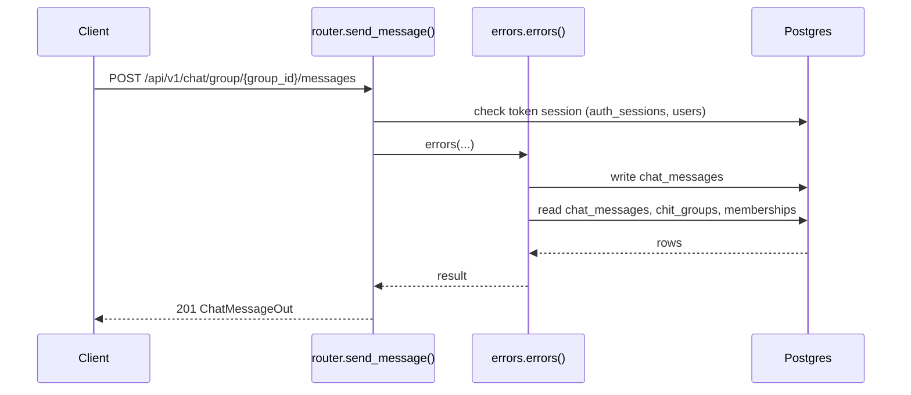
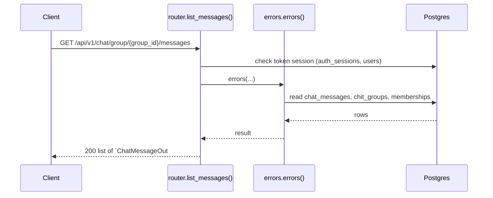

# Chat API

> Generated by `scripts/gen_api_docs.py` from the code. Do not edit by hand; run `scripts/gen-docs.sh`.

## Overview

> Group chat: active members can read and post; new messages are pushed live over WebSocket.

## Endpoints

| Method | Path | Summary |
|---|---|---|
| POST | [`/api/v1/chat/group/{group_id}/messages`](#post-apiv1chatgroupgroup_idmessages) | Send a message to a group |
| GET | [`/api/v1/chat/group/{group_id}/messages`](#get-apiv1chatgroupgroup_idmessages) | Latest messages, or only those after `afterId` |

## Details

### `POST /api/v1/chat/group/{group_id}/messages`

Send a message to a group

- **Auth:** Bearer access token
- **Success:** `201` → `ChatMessageOut`
- **Router:** [`send_message`](../../apps/api/src/chitbook_api/modules/chat/router.py#L25) (router.py:25)
- **Calls:** [`errors`](../../apps/api/src/chitbook_api/core/errors.py#L234) (errors.py:234), [`send`](../../apps/api/src/chitbook_api/modules/chat/service.py#L27) (service.py:27), [`publish`](../../apps/api/src/chitbook_api/modules/chat/hub.py#L68) (hub.py:68), [`require_group`](../../apps/api/src/chitbook_api/modules/groups/service.py#L59) (service.py:59), [`get_group`](../../apps/api/src/chitbook_api/modules/groups/repository.py#L12) (repository.py:12), [`to_out`](../../apps/api/src/chitbook_api/modules/chat/service.py#L20) (service.py:20)
- **Access checks:** `require_group_member`, `active_membership`

**Parameters**

| Name | In | Type | Required |
|---|---|---|---|
| `group_id` | path | integer | yes |

**Request body**

| Field | Type | Required | Notes |
|---|---|---|---|
| `content` | string | yes | minLength=1; maxLength=1000 |

```json
{
  "content": "Meeting at 7pm"
}
```

**Response `201`**

| Field | Type | Required | Notes |
|---|---|---|---|
| `id` | integer | yes |  |
| `chitGroupId` | integer | yes |  |
| `senderId` | integer | yes |  |
| `senderName` | string | yes |  |
| `content` | string | yes |  |
| `messageType` | string | yes |  |
| `createdAt` | string | yes |  |

```json
{
  "id": 1,
  "chitGroupId": 1,
  "senderId": 1,
  "senderName": "string",
  "content": "Meeting at 7pm",
  "messageType": "string",
  "createdAt": "2026-08-01T10:30:00+05:30"
}
```

**Database**

- Writes: `chat_messages`
- Reads: `chat_messages`, `chit_groups`, `memberships`
- Token check reads `auth_sessions` + `users` (every signed-in request)

**Flow**



**Errors** (declared in the router with `responses=errors(...)`)

| HTTP | Code | Message | Exact problem / fix |
|---|---|---|---|
| 401 | `AUTH_REQUIRED` | Authentication required | No `Authorization: Bearer <token>` header. |
| 401 | `AUTH_TOKEN_INVALID` | Access token is invalid | Token malformed, signed with another JWT_SECRET (secret changed?), or user deleted. |
| 401 | `AUTH_TOKEN_EXPIRED` | Access token has expired | Access token older than ACCESS_TOKEN_TTL_MINUTES. Client should call /auth/refresh. |
| 401 | `AUTH_SESSION_REVOKED` | Session has been signed out | Device was signed out (logout, remote sign-out, password change or refresh-token reuse). |
| 403 | `NOT_GROUP_MEMBER` | You are not an active member of this group | Caller (or the target user) is not an ACTIVE member of the group. |
| 404 | `GROUP_NOT_FOUND` | Chit group not found | Wrong group id or group code. |
| 422 | `VALIDATION_ERROR` | Request data is invalid | Body/query/path does not match the schema. `details` lists each bad field and why. |
| 500 | `INTERNAL_ERROR` | An unexpected internal error occurred | A bug. Search `docker compose logs api` for the `requestId` and read the `request.unhandled_exception` line: it has the exception and stack trace. |
| 503 | `DB_UNAVAILABLE` | Database is unavailable | Postgres unreachable: host Postgres down, pg_hba.conf missing the Docker subnet, or wrong DB_* values in .env. See the `db.unavailable` log line. |

**Diagnose**

- Every response carries `X-Request-ID`; errors also return it as `error.requestId`.
- `docker compose logs api | grep <request_id>` shows the access line (`http.request`) and any error lines.
- Each error's exact problem is in the table above (from the router's `responses=errors(...)`).
- Log events on success: `chat.message_sent (info)`
- 500 / 503: see [logging & debugging](../operations/logging-and-debugging.md).

---

### `GET /api/v1/chat/group/{group_id}/messages`

Latest messages, or only those after `afterId`

- **Auth:** Bearer access token
- **Success:** `200` → list of `ChatMessageOut`
- **Router:** [`list_messages`](../../apps/api/src/chitbook_api/modules/chat/router.py#L38) (router.py:38)
- **Calls:** [`errors`](../../apps/api/src/chitbook_api/core/errors.py#L234) (errors.py:234), [`list_messages`](../../apps/api/src/chitbook_api/modules/chat/service.py#L42) (service.py:42), [`to_out`](../../apps/api/src/chitbook_api/modules/chat/service.py#L20) (service.py:20)
- **Access checks:** `require_group_member`, `active_membership`

**Parameters**

| Name | In | Type | Required |
|---|---|---|---|
| `group_id` | path | integer | yes |
| `afterId` | query | integer or null | no |

**Response `200`**

| Field | Type | Required | Notes |
|---|---|---|---|
| `id` | integer | yes |  |
| `chitGroupId` | integer | yes |  |
| `senderId` | integer | yes |  |
| `senderName` | string | yes |  |
| `content` | string | yes |  |
| `messageType` | string | yes |  |
| `createdAt` | string | yes |  |

```json
[
  {
    "id": 1,
    "chitGroupId": 1,
    "senderId": 1,
    "senderName": "string",
    "content": "Meeting at 7pm",
    "messageType": "string",
    "createdAt": "2026-08-01T10:30:00+05:30"
  }
]
```

**Database**

- Writes: –
- Reads: `chat_messages`, `chit_groups`, `memberships`
- Token check reads `auth_sessions` + `users` (every signed-in request)

**Flow**



**Errors** (declared in the router with `responses=errors(...)`)

| HTTP | Code | Message | Exact problem / fix |
|---|---|---|---|
| 401 | `AUTH_REQUIRED` | Authentication required | No `Authorization: Bearer <token>` header. |
| 401 | `AUTH_TOKEN_INVALID` | Access token is invalid | Token malformed, signed with another JWT_SECRET (secret changed?), or user deleted. |
| 401 | `AUTH_TOKEN_EXPIRED` | Access token has expired | Access token older than ACCESS_TOKEN_TTL_MINUTES. Client should call /auth/refresh. |
| 401 | `AUTH_SESSION_REVOKED` | Session has been signed out | Device was signed out (logout, remote sign-out, password change or refresh-token reuse). |
| 403 | `NOT_GROUP_MEMBER` | You are not an active member of this group | Caller (or the target user) is not an ACTIVE member of the group. |
| 422 | `VALIDATION_ERROR` | Request data is invalid | Body/query/path does not match the schema. `details` lists each bad field and why. |
| 500 | `INTERNAL_ERROR` | An unexpected internal error occurred | A bug. Search `docker compose logs api` for the `requestId` and read the `request.unhandled_exception` line: it has the exception and stack trace. |
| 503 | `DB_UNAVAILABLE` | Database is unavailable | Postgres unreachable: host Postgres down, pg_hba.conf missing the Docker subnet, or wrong DB_* values in .env. See the `db.unavailable` log line. |

**Diagnose**

- Every response carries `X-Request-ID`; errors also return it as `error.requestId`.
- `docker compose logs api | grep <request_id>` shows the access line (`http.request`) and any error lines.
- Each error's exact problem is in the table above (from the router's `responses=errors(...)`).
- 500 / 503: see [logging & debugging](../operations/logging-and-debugging.md).

---

