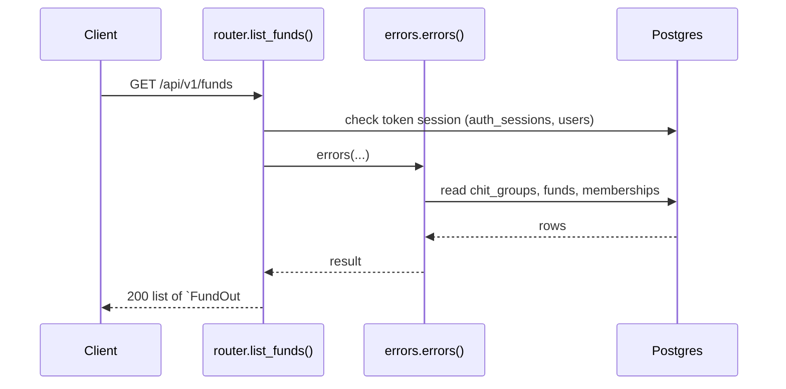
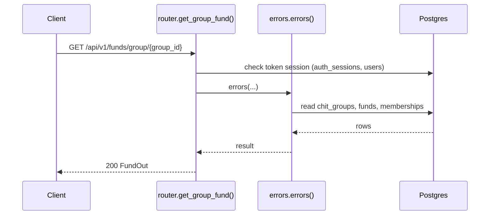
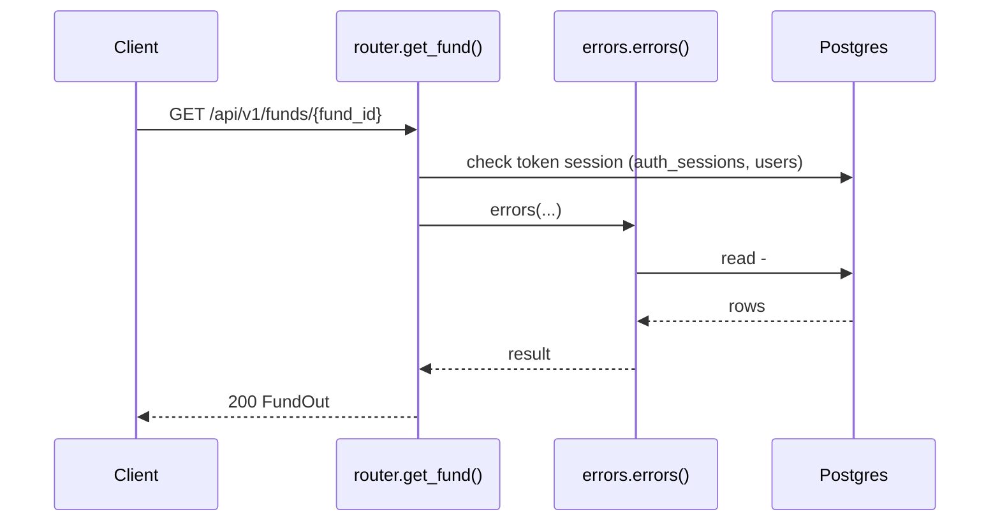
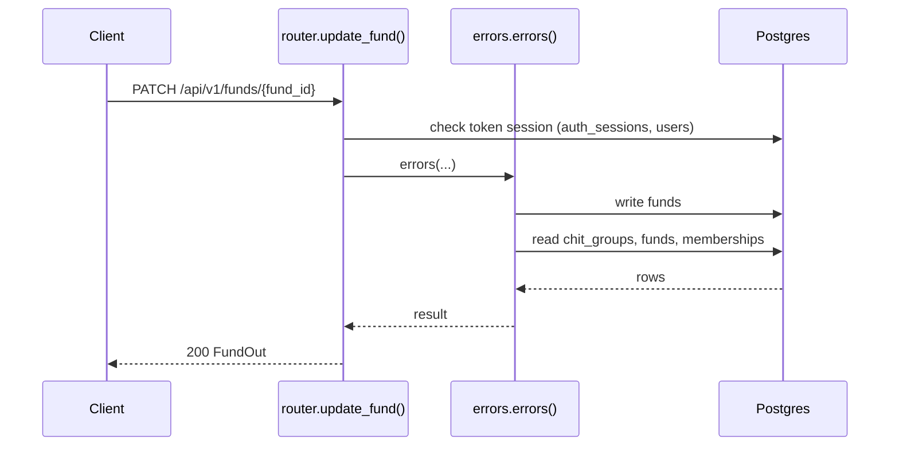

# Funds API

> Generated by `scripts/gen_api_docs.py` from the code. Do not edit by hand; run `scripts/gen-docs.sh`.

## Overview

> The pooled fund of each chit group. Members can read it; group admins can change it.

## Endpoints

| Method | Path | Summary |
|---|---|---|
| GET | [`/api/v1/funds`](#get-apiv1funds) | Funds of the groups I belong to |
| GET | [`/api/v1/funds/group/{group_id}`](#get-apiv1fundsgroupgroup_id) | A group's fund |
| GET | [`/api/v1/funds/{fund_id}`](#get-apiv1fundsfund_id) | Get a fund |
| PATCH | [`/api/v1/funds/{fund_id}`](#patch-apiv1fundsfund_id) | Update fund amount and/or interest rate |

## Details

### `GET /api/v1/funds`

Funds of the groups I belong to

- **Auth:** Bearer access token
- **Success:** `200` → list of `FundOut`
- **Router:** [`list_funds`](../../apps/api/src/chitbook_api/modules/funds/router.py#L13) (router.py:13)
- **Calls:** [`errors`](../../apps/api/src/chitbook_api/core/errors.py#L234) (errors.py:234), [`list_visible`](../../apps/api/src/chitbook_api/modules/funds/service.py#L33) (service.py:33), [`list_for_groups`](../../apps/api/src/chitbook_api/modules/funds/repository.py#L19) (repository.py:19), [`to_out`](../../apps/api/src/chitbook_api/modules/funds/service.py#L18) (service.py:18), [`visible_group_ids`](../../apps/api/src/chitbook_api/modules/groups/service.py#L248) (service.py:248), [`list_groups`](../../apps/api/src/chitbook_api/modules/groups/repository.py#L20) (repository.py:20)

**Response `200`**

| Field | Type | Required | Notes |
|---|---|---|---|
| `id` | integer | yes |  |
| `name` | string | yes |  |
| `totalAmount` | number | yes |  |
| `cyclePeriod` | integer | yes |  |
| `interestRate` | number | yes |  |
| `chitGroupId` | integer | yes |  |
| `chitGroupName` | string | yes |  |
| `createdAt` | string | yes |  |
| `updatedAt` | string | yes |  |

```json
[
  {
    "id": 1,
    "name": "Ravi Kumar",
    "totalAmount": 25000.0,
    "cyclePeriod": 1,
    "interestRate": 5.0,
    "chitGroupId": 1,
    "chitGroupName": "string",
    "createdAt": "2026-08-01T10:30:00+05:30",
    "updatedAt": "2026-08-01T10:30:00+05:30"
  }
]
```

**Database**

- Writes: –
- Reads: `chit_groups`, `funds`, `memberships`
- Token check reads `auth_sessions` + `users` (every signed-in request)

**Flow**



**Errors** (declared in the router with `responses=errors(...)`)

| HTTP | Code | Message | Exact problem / fix |
|---|---|---|---|
| 401 | `AUTH_REQUIRED` | Authentication required | No `Authorization: Bearer <token>` header. |
| 401 | `AUTH_TOKEN_INVALID` | Access token is invalid | Token malformed, signed with another JWT_SECRET (secret changed?), or user deleted. |
| 401 | `AUTH_TOKEN_EXPIRED` | Access token has expired | Access token older than ACCESS_TOKEN_TTL_MINUTES. Client should call /auth/refresh. |
| 401 | `AUTH_SESSION_REVOKED` | Session has been signed out | Device was signed out (logout, remote sign-out, password change or refresh-token reuse). |
| 500 | `INTERNAL_ERROR` | An unexpected internal error occurred | A bug. Search `docker compose logs api` for the `requestId` and read the `request.unhandled_exception` line: it has the exception and stack trace. |
| 503 | `DB_UNAVAILABLE` | Database is unavailable | Postgres unreachable: host Postgres down, pg_hba.conf missing the Docker subnet, or wrong DB_* values in .env. See the `db.unavailable` log line. |

**Diagnose**

- Every response carries `X-Request-ID`; errors also return it as `error.requestId`.
- `docker compose logs api | grep <request_id>` shows the access line (`http.request`) and any error lines.
- Each error's exact problem is in the table above (from the router's `responses=errors(...)`).
- 500 / 503: see [logging & debugging](../operations/logging-and-debugging.md).

---

### `GET /api/v1/funds/group/{group_id}`

A group's fund

- **Auth:** Bearer access token
- **Success:** `200` → `FundOut`
- **Router:** [`get_group_fund`](../../apps/api/src/chitbook_api/modules/funds/router.py#L20) (router.py:20)
- **Calls:** [`errors`](../../apps/api/src/chitbook_api/core/errors.py#L234) (errors.py:234), [`get_by_group`](../../apps/api/src/chitbook_api/modules/funds/service.py#L44) (service.py:44), [`get_by_group`](../../apps/api/src/chitbook_api/modules/funds/repository.py#L15) (repository.py:15), [`to_out`](../../apps/api/src/chitbook_api/modules/funds/service.py#L18) (service.py:18)
- **Access checks:** `require_group_member`, `active_membership`

**Parameters**

| Name | In | Type | Required |
|---|---|---|---|
| `group_id` | path | integer | yes |

**Response `200`**

| Field | Type | Required | Notes |
|---|---|---|---|
| `id` | integer | yes |  |
| `name` | string | yes |  |
| `totalAmount` | number | yes |  |
| `cyclePeriod` | integer | yes |  |
| `interestRate` | number | yes |  |
| `chitGroupId` | integer | yes |  |
| `chitGroupName` | string | yes |  |
| `createdAt` | string | yes |  |
| `updatedAt` | string | yes |  |

```json
{
  "id": 1,
  "name": "Ravi Kumar",
  "totalAmount": 25000.0,
  "cyclePeriod": 1,
  "interestRate": 5.0,
  "chitGroupId": 1,
  "chitGroupName": "string",
  "createdAt": "2026-08-01T10:30:00+05:30",
  "updatedAt": "2026-08-01T10:30:00+05:30"
}
```

**Database**

- Writes: –
- Reads: `chit_groups`, `funds`, `memberships`
- Token check reads `auth_sessions` + `users` (every signed-in request)

**Flow**



**Errors** (declared in the router with `responses=errors(...)`)

| HTTP | Code | Message | Exact problem / fix |
|---|---|---|---|
| 401 | `AUTH_REQUIRED` | Authentication required | No `Authorization: Bearer <token>` header. |
| 401 | `AUTH_TOKEN_INVALID` | Access token is invalid | Token malformed, signed with another JWT_SECRET (secret changed?), or user deleted. |
| 401 | `AUTH_TOKEN_EXPIRED` | Access token has expired | Access token older than ACCESS_TOKEN_TTL_MINUTES. Client should call /auth/refresh. |
| 401 | `AUTH_SESSION_REVOKED` | Session has been signed out | Device was signed out (logout, remote sign-out, password change or refresh-token reuse). |
| 403 | `NOT_GROUP_MEMBER` | You are not an active member of this group | Caller (or the target user) is not an ACTIVE member of the group. |
| 404 | `FUND_NOT_FOUND` | Fund not found | Wrong fund id / group has no fund. |
| 422 | `VALIDATION_ERROR` | Request data is invalid | Body/query/path does not match the schema. `details` lists each bad field and why. |
| 500 | `INTERNAL_ERROR` | An unexpected internal error occurred | A bug. Search `docker compose logs api` for the `requestId` and read the `request.unhandled_exception` line: it has the exception and stack trace. |
| 503 | `DB_UNAVAILABLE` | Database is unavailable | Postgres unreachable: host Postgres down, pg_hba.conf missing the Docker subnet, or wrong DB_* values in .env. See the `db.unavailable` log line. |

**Diagnose**

- Every response carries `X-Request-ID`; errors also return it as `error.requestId`.
- `docker compose logs api | grep <request_id>` shows the access line (`http.request`) and any error lines.
- Each error's exact problem is in the table above (from the router's `responses=errors(...)`).
- 500 / 503: see [logging & debugging](../operations/logging-and-debugging.md).

---

### `GET /api/v1/funds/{fund_id}`

Get a fund

- **Auth:** Bearer access token
- **Success:** `200` → `FundOut`
- **Router:** [`get_fund`](../../apps/api/src/chitbook_api/modules/funds/router.py#L32) (router.py:32)
- **Calls:** [`errors`](../../apps/api/src/chitbook_api/core/errors.py#L234) (errors.py:234), [`get`](../../apps/api/src/chitbook_api/modules/funds/service.py#L38) (service.py:38), [`_require`](../../apps/api/src/chitbook_api/modules/funds/service.py#L26) (service.py:26), [`get`](../../apps/api/src/chitbook_api/modules/funds/repository.py#L11) (repository.py:11), [`to_out`](../../apps/api/src/chitbook_api/modules/funds/service.py#L18) (service.py:18)
- **Access checks:** `require_group_member`, `active_membership`

**Parameters**

| Name | In | Type | Required |
|---|---|---|---|
| `fund_id` | path | integer | yes |

**Response `200`**

| Field | Type | Required | Notes |
|---|---|---|---|
| `id` | integer | yes |  |
| `name` | string | yes |  |
| `totalAmount` | number | yes |  |
| `cyclePeriod` | integer | yes |  |
| `interestRate` | number | yes |  |
| `chitGroupId` | integer | yes |  |
| `chitGroupName` | string | yes |  |
| `createdAt` | string | yes |  |
| `updatedAt` | string | yes |  |

```json
{
  "id": 1,
  "name": "Ravi Kumar",
  "totalAmount": 25000.0,
  "cyclePeriod": 1,
  "interestRate": 5.0,
  "chitGroupId": 1,
  "chitGroupName": "string",
  "createdAt": "2026-08-01T10:30:00+05:30",
  "updatedAt": "2026-08-01T10:30:00+05:30"
}
```

**Database**: no SQL recorded (the endpoint does not use the database, or no test calls it).

**Flow**



**Errors** (declared in the router with `responses=errors(...)`)

| HTTP | Code | Message | Exact problem / fix |
|---|---|---|---|
| 401 | `AUTH_REQUIRED` | Authentication required | No `Authorization: Bearer <token>` header. |
| 401 | `AUTH_TOKEN_INVALID` | Access token is invalid | Token malformed, signed with another JWT_SECRET (secret changed?), or user deleted. |
| 401 | `AUTH_TOKEN_EXPIRED` | Access token has expired | Access token older than ACCESS_TOKEN_TTL_MINUTES. Client should call /auth/refresh. |
| 401 | `AUTH_SESSION_REVOKED` | Session has been signed out | Device was signed out (logout, remote sign-out, password change or refresh-token reuse). |
| 403 | `NOT_GROUP_MEMBER` | You are not an active member of this group | Caller (or the target user) is not an ACTIVE member of the group. |
| 404 | `FUND_NOT_FOUND` | Fund not found | Wrong fund id / group has no fund. |
| 422 | `VALIDATION_ERROR` | Request data is invalid | Body/query/path does not match the schema. `details` lists each bad field and why. |
| 500 | `INTERNAL_ERROR` | An unexpected internal error occurred | A bug. Search `docker compose logs api` for the `requestId` and read the `request.unhandled_exception` line: it has the exception and stack trace. |
| 503 | `DB_UNAVAILABLE` | Database is unavailable | Postgres unreachable: host Postgres down, pg_hba.conf missing the Docker subnet, or wrong DB_* values in .env. See the `db.unavailable` log line. |

**Diagnose**

- Every response carries `X-Request-ID`; errors also return it as `error.requestId`.
- `docker compose logs api | grep <request_id>` shows the access line (`http.request`) and any error lines.
- Each error's exact problem is in the table above (from the router's `responses=errors(...)`).
- 500 / 503: see [logging & debugging](../operations/logging-and-debugging.md).

---

### `PATCH /api/v1/funds/{fund_id}`

Update fund amount and/or interest rate

- **Auth:** Bearer access token
- **Success:** `200` → `FundOut`
- **Router:** [`update_fund`](../../apps/api/src/chitbook_api/modules/funds/router.py#L44) (router.py:44)
- **Calls:** [`errors`](../../apps/api/src/chitbook_api/core/errors.py#L234) (errors.py:234), [`update`](../../apps/api/src/chitbook_api/modules/funds/service.py#L52) (service.py:52), [`_require`](../../apps/api/src/chitbook_api/modules/funds/service.py#L26) (service.py:26), [`get`](../../apps/api/src/chitbook_api/modules/funds/repository.py#L11) (repository.py:11), [`to_out`](../../apps/api/src/chitbook_api/modules/funds/service.py#L18) (service.py:18)
- **Access checks:** `require_group_admin`, `require_group_member`, `active_membership`

**Parameters**

| Name | In | Type | Required |
|---|---|---|---|
| `fund_id` | path | integer | yes |

**Request body**

| Field | Type | Required | Notes |
|---|---|---|---|
| `totalAmount` | number or string or null | no | minimum=0.0 |
| `interestRate` | number or string or null | no | minimum=0.0; maximum=100.0 |

```json
{
  "totalAmount": 25000.0,
  "interestRate": 5.0
}
```

**Response `200`**

| Field | Type | Required | Notes |
|---|---|---|---|
| `id` | integer | yes |  |
| `name` | string | yes |  |
| `totalAmount` | number | yes |  |
| `cyclePeriod` | integer | yes |  |
| `interestRate` | number | yes |  |
| `chitGroupId` | integer | yes |  |
| `chitGroupName` | string | yes |  |
| `createdAt` | string | yes |  |
| `updatedAt` | string | yes |  |

```json
{
  "id": 1,
  "name": "Ravi Kumar",
  "totalAmount": 25000.0,
  "cyclePeriod": 1,
  "interestRate": 5.0,
  "chitGroupId": 1,
  "chitGroupName": "string",
  "createdAt": "2026-08-01T10:30:00+05:30",
  "updatedAt": "2026-08-01T10:30:00+05:30"
}
```

**Database**

- Writes: `funds`
- Reads: `chit_groups`, `funds`, `memberships`
- Token check reads `auth_sessions` + `users` (every signed-in request)

**Flow**



**Errors** (declared in the router with `responses=errors(...)`)

| HTTP | Code | Message | Exact problem / fix |
|---|---|---|---|
| 401 | `AUTH_REQUIRED` | Authentication required | No `Authorization: Bearer <token>` header. |
| 401 | `AUTH_TOKEN_INVALID` | Access token is invalid | Token malformed, signed with another JWT_SECRET (secret changed?), or user deleted. |
| 401 | `AUTH_TOKEN_EXPIRED` | Access token has expired | Access token older than ACCESS_TOKEN_TTL_MINUTES. Client should call /auth/refresh. |
| 401 | `AUTH_SESSION_REVOKED` | Session has been signed out | Device was signed out (logout, remote sign-out, password change or refresh-token reuse). |
| 403 | `NOT_GROUP_MEMBER` | You are not an active member of this group | Caller (or the target user) is not an ACTIVE member of the group. |
| 403 | `NOT_GROUP_ADMIN` | Group admin access is required | Caller is a member but not the group's ADMIN. |
| 404 | `FUND_NOT_FOUND` | Fund not found | Wrong fund id / group has no fund. |
| 422 | `VALIDATION_ERROR` | Request data is invalid | Body/query/path does not match the schema. `details` lists each bad field and why. |
| 500 | `INTERNAL_ERROR` | An unexpected internal error occurred | A bug. Search `docker compose logs api` for the `requestId` and read the `request.unhandled_exception` line: it has the exception and stack trace. |
| 503 | `DB_UNAVAILABLE` | Database is unavailable | Postgres unreachable: host Postgres down, pg_hba.conf missing the Docker subnet, or wrong DB_* values in .env. See the `db.unavailable` log line. |

**Diagnose**

- Every response carries `X-Request-ID`; errors also return it as `error.requestId`.
- `docker compose logs api | grep <request_id>` shows the access line (`http.request`) and any error lines.
- Each error's exact problem is in the table above (from the router's `responses=errors(...)`).
- Log events on success: `fund.updated (info)`
- 500 / 503: see [logging & debugging](../operations/logging-and-debugging.md).

---

