# Chit groups & memberships API

> Generated by `scripts/gen_api_docs.py` from the code. Do not edit by hand; run `scripts/gen-docs.sh`.

## Overview

> Chit groups (auction-style groups with codes) and their memberships.

## Endpoints

| Method | Path | Summary |
|---|---|---|
| POST | [`/api/v1/groups`](#post-apiv1groups) | Create a chit group |
| GET | [`/api/v1/groups`](#get-apiv1groups) | List my groups (search by name / filter by status) |
| POST | [`/api/v1/groups/join`](#post-apiv1groupsjoin) | Ask to join a group by its code |
| GET | [`/api/v1/groups/memberships/user/{user_id}`](#get-apiv1groupsmembershipsuseruser_id) | A user's memberships |
| GET | [`/api/v1/groups/by-code/{group_code}`](#get-apiv1groupsby-codegroup_code) | Get a group by its code |
| GET | [`/api/v1/groups/{group_id}`](#get-apiv1groupsgroup_id) | Get a group |
| PATCH | [`/api/v1/groups/{group_id}`](#patch-apiv1groupsgroup_id) | Update group settings |
| PUT | [`/api/v1/groups/{group_id}/status`](#put-apiv1groupsgroup_idstatus) | Change group status |
| DELETE | [`/api/v1/groups/{group_id}`](#delete-apiv1groupsgroup_id) | Delete a group |
| GET | [`/api/v1/groups/{group_id}/members`](#get-apiv1groupsgroup_idmembers) | List group members |
| POST | [`/api/v1/groups/{group_id}/members`](#post-apiv1groupsgroup_idmembers) | Add a user to the group |
| PUT | [`/api/v1/groups/{group_id}/members/{user_id}/status`](#put-apiv1groupsgroup_idmembersuser_idstatus) | Approve / suspend / deactivate a member |
| DELETE | [`/api/v1/groups/{group_id}/members/{user_id}`](#delete-apiv1groupsgroup_idmembersuser_id) | Remove a member |

## Details

### `POST /api/v1/groups`

Create a chit group

- **Auth:** Bearer access token
- **Success:** `201` → `GroupOut`
- **Router:** [`create_group`](../../apps/api/src/chitbook_api/modules/groups/router.py#L26) (router.py:26)
- **Calls:** [`errors`](../../apps/api/src/chitbook_api/core/errors.py#L234) (errors.py:234), [`create`](../../apps/api/src/chitbook_api/modules/groups/service.py#L69) (service.py:69), [`now`](../../apps/api/src/chitbook_api/core/time.py#L14) (time.py:14), [`to_group_out`](../../apps/api/src/chitbook_api/modules/groups/service.py#L27) (service.py:27)

**Request body**

| Field | Type | Required | Notes |
|---|---|---|---|
| `name` | string | yes | minLength=1; maxLength=100 |
| `duration` | integer | yes | minimum=1.0; maximum=120.0; Months |
| `monthlyAmount` | number or string | yes | exclusiveMinimum=0.0 |
| `totalMembers` | integer | yes | minimum=1.0; maximum=500.0; Member limit |
| `startDate` | date-time or null | no | Default now |

```json
{
  "name": "Ravi Kumar",
  "duration": 20,
  "monthlyAmount": 25000.0,
  "totalMembers": 20,
  "startDate": "2026-08-01T10:30:00+05:30"
}
```

**Response `201`**

| Field | Type | Required | Notes |
|---|---|---|---|
| `id` | integer | yes |  |
| `groupCode` | string | yes |  |
| `name` | string | yes |  |
| `duration` | integer | yes |  |
| `monthlyAmount` | number | yes |  |
| `totalMembers` | integer | yes |  |
| `startDate` | string | yes |  |
| `status` | GroupStatus | yes |  |
| `fundId` | integer or null | yes |  |
| `createdAt` | string | yes |  |
| `updatedAt` | string | yes |  |

```json
{
  "id": 1,
  "groupCode": "CHIT3F5A7C",
  "name": "Ravi Kumar",
  "duration": 20,
  "monthlyAmount": 25000.0,
  "totalMembers": 20,
  "startDate": "2026-08-01T10:30:00+05:30",
  "status": "PENDING",
  "fundId": 1,
  "createdAt": "2026-08-01T10:30:00+05:30",
  "updatedAt": "2026-08-01T10:30:00+05:30"
}
```

**Database**

- Writes: `chit_groups`, `funds`, `memberships`
- Reads: `chit_groups`
- Token check reads `auth_sessions` + `users` (every signed-in request)

**Flow**

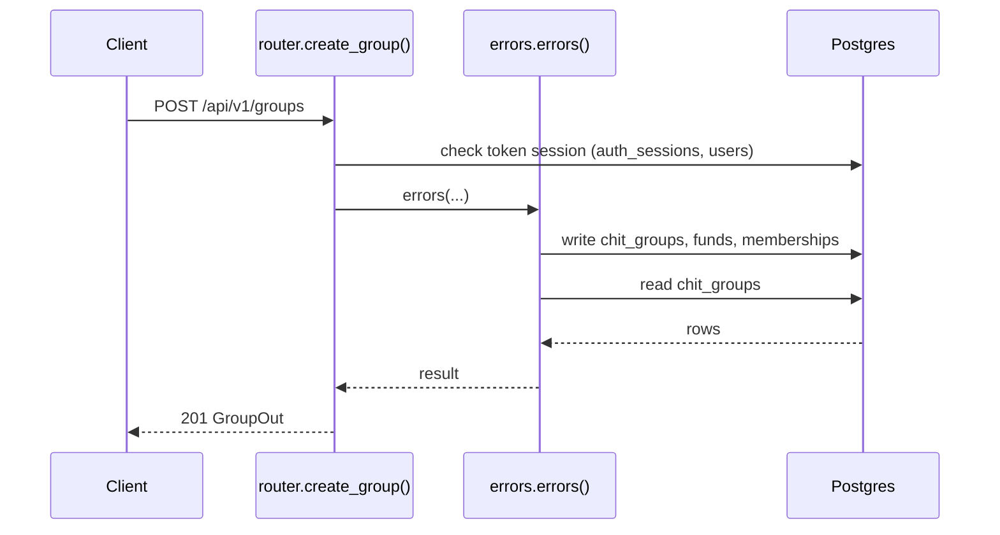

**Errors** (declared in the router with `responses=errors(...)`)

| HTTP | Code | Message | Exact problem / fix |
|---|---|---|---|
| 401 | `AUTH_REQUIRED` | Authentication required | No `Authorization: Bearer <token>` header. |
| 401 | `AUTH_TOKEN_INVALID` | Access token is invalid | Token malformed, signed with another JWT_SECRET (secret changed?), or user deleted. |
| 401 | `AUTH_TOKEN_EXPIRED` | Access token has expired | Access token older than ACCESS_TOKEN_TTL_MINUTES. Client should call /auth/refresh. |
| 401 | `AUTH_SESSION_REVOKED` | Session has been signed out | Device was signed out (logout, remote sign-out, password change or refresh-token reuse). |
| 422 | `VALIDATION_ERROR` | Request data is invalid | Body/query/path does not match the schema. `details` lists each bad field and why. |
| 500 | `INTERNAL_ERROR` | An unexpected internal error occurred | A bug. Search `docker compose logs api` for the `requestId` and read the `request.unhandled_exception` line: it has the exception and stack trace. |
| 503 | `DB_UNAVAILABLE` | Database is unavailable | Postgres unreachable: host Postgres down, pg_hba.conf missing the Docker subnet, or wrong DB_* values in .env. See the `db.unavailable` log line. |

**Diagnose**

- Every response carries `X-Request-ID`; errors also return it as `error.requestId`.
- `docker compose logs api | grep <request_id>` shows the access line (`http.request`) and any error lines.
- Each error's exact problem is in the table above (from the router's `responses=errors(...)`).
- Log events on success: `group.created (info)`
- 500 / 503: see [logging & debugging](../operations/logging-and-debugging.md).

---

### `GET /api/v1/groups`

List my groups (search by name / filter by status)

- **Auth:** Bearer access token
- **Success:** `200` → list of `GroupOut`
- **Router:** [`list_groups`](../../apps/api/src/chitbook_api/modules/groups/router.py#L37) (router.py:37)
- **Calls:** [`errors`](../../apps/api/src/chitbook_api/core/errors.py#L234) (errors.py:234), [`list_visible`](../../apps/api/src/chitbook_api/modules/groups/service.py#L115) (service.py:115), [`to_group_out`](../../apps/api/src/chitbook_api/modules/groups/service.py#L27) (service.py:27), [`fund_ids_for`](../../apps/api/src/chitbook_api/modules/groups/repository.py#L36) (repository.py:36), [`list_groups`](../../apps/api/src/chitbook_api/modules/groups/repository.py#L20) (repository.py:20)

**Parameters**

| Name | In | Type | Required |
|---|---|---|---|
| `name` | query | string or null | no |
| `status` | query | GroupStatus or null | no |

**Response `200`**

| Field | Type | Required | Notes |
|---|---|---|---|
| `id` | integer | yes |  |
| `groupCode` | string | yes |  |
| `name` | string | yes |  |
| `duration` | integer | yes |  |
| `monthlyAmount` | number | yes |  |
| `totalMembers` | integer | yes |  |
| `startDate` | string | yes |  |
| `status` | GroupStatus | yes |  |
| `fundId` | integer or null | yes |  |
| `createdAt` | string | yes |  |
| `updatedAt` | string | yes |  |

```json
[
  {
    "id": 1,
    "groupCode": "CHIT3F5A7C",
    "name": "Ravi Kumar",
    "duration": 20,
    "monthlyAmount": 25000.0,
    "totalMembers": 20,
    "startDate": "2026-08-01T10:30:00+05:30",
    "status": "PENDING",
    "fundId": 1,
    "createdAt": "2026-08-01T10:30:00+05:30",
    "updatedAt": "2026-08-01T10:30:00+05:30"
  }
]
```

**Database**

- Writes: –
- Reads: `chit_groups`, `funds`, `memberships`
- Token check reads `auth_sessions` + `users` (every signed-in request)

**Flow**

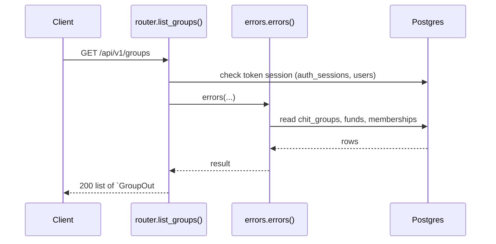

**Errors** (declared in the router with `responses=errors(...)`)

| HTTP | Code | Message | Exact problem / fix |
|---|---|---|---|
| 401 | `AUTH_REQUIRED` | Authentication required | No `Authorization: Bearer <token>` header. |
| 401 | `AUTH_TOKEN_INVALID` | Access token is invalid | Token malformed, signed with another JWT_SECRET (secret changed?), or user deleted. |
| 401 | `AUTH_TOKEN_EXPIRED` | Access token has expired | Access token older than ACCESS_TOKEN_TTL_MINUTES. Client should call /auth/refresh. |
| 401 | `AUTH_SESSION_REVOKED` | Session has been signed out | Device was signed out (logout, remote sign-out, password change or refresh-token reuse). |
| 422 | `VALIDATION_ERROR` | Request data is invalid | Body/query/path does not match the schema. `details` lists each bad field and why. |
| 500 | `INTERNAL_ERROR` | An unexpected internal error occurred | A bug. Search `docker compose logs api` for the `requestId` and read the `request.unhandled_exception` line: it has the exception and stack trace. |
| 503 | `DB_UNAVAILABLE` | Database is unavailable | Postgres unreachable: host Postgres down, pg_hba.conf missing the Docker subnet, or wrong DB_* values in .env. See the `db.unavailable` log line. |

**Diagnose**

- Every response carries `X-Request-ID`; errors also return it as `error.requestId`.
- `docker compose logs api | grep <request_id>` shows the access line (`http.request`) and any error lines.
- Each error's exact problem is in the table above (from the router's `responses=errors(...)`).
- 500 / 503: see [logging & debugging](../operations/logging-and-debugging.md).

---

### `POST /api/v1/groups/join`

Ask to join a group by its code

- **Auth:** Bearer access token
- **Success:** `201` → `MembershipOut`
- **Router:** [`join_group`](../../apps/api/src/chitbook_api/modules/groups/router.py#L52) (router.py:52)
- **Calls:** [`errors`](../../apps/api/src/chitbook_api/core/errors.py#L234) (errors.py:234), [`join_by_code`](../../apps/api/src/chitbook_api/modules/groups/service.py#L177) (service.py:177), [`create_notification`](../../apps/api/src/chitbook_api/modules/notifications/service.py#L24) (service.py:24), [`now`](../../apps/api/src/chitbook_api/core/time.py#L14) (time.py:14), [`count_members`](../../apps/api/src/chitbook_api/modules/groups/repository.py#L61) (repository.py:61), [`active_admin_user_ids`](../../apps/api/src/chitbook_api/modules/groups/repository.py#L68) (repository.py:68), [`get_membership`](../../apps/api/src/chitbook_api/modules/groups/repository.py#L43) (repository.py:43), [`get_group_by_code`](../../apps/api/src/chitbook_api/modules/groups/repository.py#L16) (repository.py:16)

**Request body**

| Field | Type | Required | Notes |
|---|---|---|---|
| `groupCode` | string | yes | minLength=4; maxLength=20 |

```json
{
  "groupCode": "CHIT3F5A7C"
}
```

**Response `201`**

| Field | Type | Required | Notes |
|---|---|---|---|
| `id` | integer | yes |  |
| `userId` | integer | yes |  |
| `userName` | string | yes |  |
| `chitGroupId` | integer | yes |  |
| `chitGroupName` | string | yes |  |
| `chitGroupCode` | string | yes |  |
| `monthlyAmount` | number | yes |  |
| `duration` | integer | yes |  |
| `totalMembers` | integer | yes |  |
| `startDate` | string | yes |  |
| `joinDate` | string | yes |  |
| `status` | MembershipStatus | yes |  |
| `role` | GroupRole | yes |  |

```json
{
  "id": 1,
  "userId": 1,
  "userName": "ravi",
  "chitGroupId": 1,
  "chitGroupName": "string",
  "chitGroupCode": "string",
  "monthlyAmount": 25000.0,
  "duration": 20,
  "totalMembers": 20,
  "startDate": "2026-08-01T10:30:00+05:30",
  "joinDate": "2026-08-01T10:30:00+05:30",
  "status": "PENDING",
  "role": "ADMIN"
}
```

**Database**

- Writes: `memberships`, `notifications`
- Reads: `chit_groups`, `memberships`
- Token check reads `auth_sessions` + `users` (every signed-in request)

**Flow**

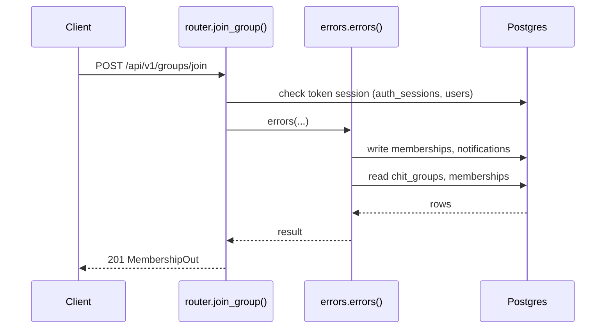

**Errors** (declared in the router with `responses=errors(...)`)

| HTTP | Code | Message | Exact problem / fix |
|---|---|---|---|
| 401 | `AUTH_REQUIRED` | Authentication required | No `Authorization: Bearer <token>` header. |
| 401 | `AUTH_TOKEN_INVALID` | Access token is invalid | Token malformed, signed with another JWT_SECRET (secret changed?), or user deleted. |
| 401 | `AUTH_TOKEN_EXPIRED` | Access token has expired | Access token older than ACCESS_TOKEN_TTL_MINUTES. Client should call /auth/refresh. |
| 401 | `AUTH_SESSION_REVOKED` | Session has been signed out | Device was signed out (logout, remote sign-out, password change or refresh-token reuse). |
| 404 | `GROUP_NOT_FOUND` | Chit group not found | Wrong group id or group code. |
| 409 | `MEMBERSHIP_EXISTS` | User is already associated with this group | User already belongs to the group. |
| 409 | `MEMBERSHIP_PENDING` | A join request for this group is already pending | A join request is already waiting for approval. |
| 409 | `GROUP_FULL` | Chit group has reached its member limit | Member count reached `totalMembers`. |
| 422 | `VALIDATION_ERROR` | Request data is invalid | Body/query/path does not match the schema. `details` lists each bad field and why. |
| 500 | `INTERNAL_ERROR` | An unexpected internal error occurred | A bug. Search `docker compose logs api` for the `requestId` and read the `request.unhandled_exception` line: it has the exception and stack trace. |
| 503 | `DB_UNAVAILABLE` | Database is unavailable | Postgres unreachable: host Postgres down, pg_hba.conf missing the Docker subnet, or wrong DB_* values in .env. See the `db.unavailable` log line. |

**Diagnose**

- Every response carries `X-Request-ID`; errors also return it as `error.requestId`.
- `docker compose logs api | grep <request_id>` shows the access line (`http.request`) and any error lines.
- Each error's exact problem is in the table above (from the router's `responses=errors(...)`).
- Log events on success: `membership.join_requested (info)`, `notification.created (info)`
- 500 / 503: see [logging & debugging](../operations/logging-and-debugging.md).

---

### `GET /api/v1/groups/memberships/user/{user_id}`

A user's memberships

- **Auth:** Bearer access token
- **Success:** `200` → list of `MembershipOut`
- **Router:** [`user_memberships`](../../apps/api/src/chitbook_api/modules/groups/router.py#L70) (router.py:70)
- **Calls:** [`errors`](../../apps/api/src/chitbook_api/core/errors.py#L234) (errors.py:234), [`list_user_memberships`](../../apps/api/src/chitbook_api/modules/groups/service.py#L223) (service.py:223), [`list_user_memberships`](../../apps/api/src/chitbook_api/modules/groups/repository.py#L56) (repository.py:56), [`to_membership_out`](../../apps/api/src/chitbook_api/modules/groups/service.py#L35) (service.py:35)
- **Access checks:** `require_self_or_platform_admin`

**Parameters**

| Name | In | Type | Required |
|---|---|---|---|
| `user_id` | path | integer | yes |

**Response `200`**

| Field | Type | Required | Notes |
|---|---|---|---|
| `id` | integer | yes |  |
| `userId` | integer | yes |  |
| `userName` | string | yes |  |
| `chitGroupId` | integer | yes |  |
| `chitGroupName` | string | yes |  |
| `chitGroupCode` | string | yes |  |
| `monthlyAmount` | number | yes |  |
| `duration` | integer | yes |  |
| `totalMembers` | integer | yes |  |
| `startDate` | string | yes |  |
| `joinDate` | string | yes |  |
| `status` | MembershipStatus | yes |  |
| `role` | GroupRole | yes |  |

```json
[
  {
    "id": 1,
    "userId": 1,
    "userName": "ravi",
    "chitGroupId": 1,
    "chitGroupName": "string",
    "chitGroupCode": "string",
    "monthlyAmount": 25000.0,
    "duration": 20,
    "totalMembers": 20,
    "startDate": "2026-08-01T10:30:00+05:30",
    "joinDate": "2026-08-01T10:30:00+05:30",
    "status": "PENDING",
    "role": "ADMIN"
  }
]
```

**Database**: no SQL recorded (the endpoint does not use the database, or no test calls it).

**Flow**

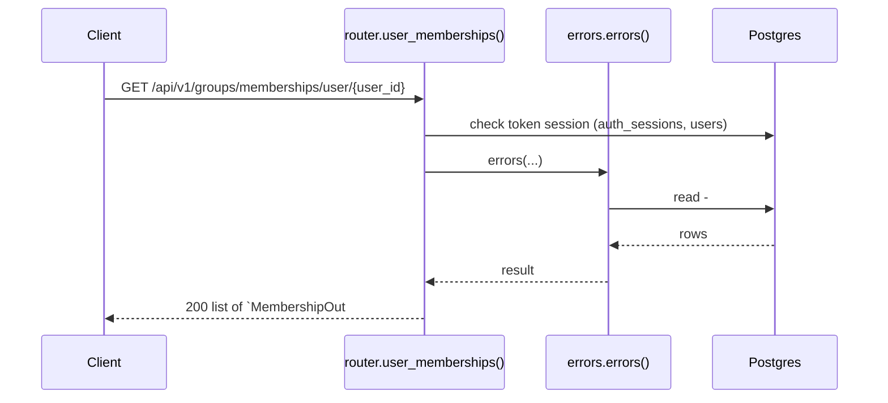

**Errors** (declared in the router with `responses=errors(...)`)

| HTTP | Code | Message | Exact problem / fix |
|---|---|---|---|
| 401 | `AUTH_REQUIRED` | Authentication required | No `Authorization: Bearer <token>` header. |
| 401 | `AUTH_TOKEN_INVALID` | Access token is invalid | Token malformed, signed with another JWT_SECRET (secret changed?), or user deleted. |
| 401 | `AUTH_TOKEN_EXPIRED` | Access token has expired | Access token older than ACCESS_TOKEN_TTL_MINUTES. Client should call /auth/refresh. |
| 401 | `AUTH_SESSION_REVOKED` | Session has been signed out | Device was signed out (logout, remote sign-out, password change or refresh-token reuse). |
| 403 | `FORBIDDEN` | You do not have access to this resource | You may only access your own user data (unless platform ADMIN). |
| 422 | `VALIDATION_ERROR` | Request data is invalid | Body/query/path does not match the schema. `details` lists each bad field and why. |
| 500 | `INTERNAL_ERROR` | An unexpected internal error occurred | A bug. Search `docker compose logs api` for the `requestId` and read the `request.unhandled_exception` line: it has the exception and stack trace. |
| 503 | `DB_UNAVAILABLE` | Database is unavailable | Postgres unreachable: host Postgres down, pg_hba.conf missing the Docker subnet, or wrong DB_* values in .env. See the `db.unavailable` log line. |

**Diagnose**

- Every response carries `X-Request-ID`; errors also return it as `error.requestId`.
- `docker compose logs api | grep <request_id>` shows the access line (`http.request`) and any error lines.
- Each error's exact problem is in the table above (from the router's `responses=errors(...)`).
- 500 / 503: see [logging & debugging](../operations/logging-and-debugging.md).

---

### `GET /api/v1/groups/by-code/{group_code}`

Get a group by its code

- **Auth:** Bearer access token
- **Success:** `200` → `GroupOut`
- **Router:** [`get_group_by_code`](../../apps/api/src/chitbook_api/modules/groups/router.py#L80) (router.py:80)
- **Calls:** [`errors`](../../apps/api/src/chitbook_api/core/errors.py#L234) (errors.py:234), [`get_by_code`](../../apps/api/src/chitbook_api/modules/groups/service.py#L107) (service.py:107), [`_with_fund`](../../apps/api/src/chitbook_api/modules/groups/service.py#L54) (service.py:54), [`fund_ids_for`](../../apps/api/src/chitbook_api/modules/groups/repository.py#L36) (repository.py:36), [`to_group_out`](../../apps/api/src/chitbook_api/modules/groups/service.py#L27) (service.py:27), [`get_group_by_code`](../../apps/api/src/chitbook_api/modules/groups/repository.py#L16) (repository.py:16)
- **Access checks:** `require_group_member`, `active_membership`

**Parameters**

| Name | In | Type | Required |
|---|---|---|---|
| `group_code` | path | string | yes |

**Response `200`**

| Field | Type | Required | Notes |
|---|---|---|---|
| `id` | integer | yes |  |
| `groupCode` | string | yes |  |
| `name` | string | yes |  |
| `duration` | integer | yes |  |
| `monthlyAmount` | number | yes |  |
| `totalMembers` | integer | yes |  |
| `startDate` | string | yes |  |
| `status` | GroupStatus | yes |  |
| `fundId` | integer or null | yes |  |
| `createdAt` | string | yes |  |
| `updatedAt` | string | yes |  |

```json
{
  "id": 1,
  "groupCode": "CHIT3F5A7C",
  "name": "Ravi Kumar",
  "duration": 20,
  "monthlyAmount": 25000.0,
  "totalMembers": 20,
  "startDate": "2026-08-01T10:30:00+05:30",
  "status": "PENDING",
  "fundId": 1,
  "createdAt": "2026-08-01T10:30:00+05:30",
  "updatedAt": "2026-08-01T10:30:00+05:30"
}
```

**Database**: no SQL recorded (the endpoint does not use the database, or no test calls it).

**Flow**

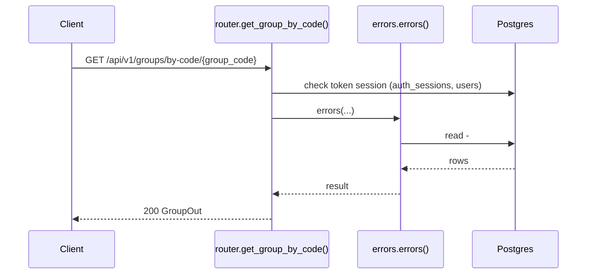

**Errors** (declared in the router with `responses=errors(...)`)

| HTTP | Code | Message | Exact problem / fix |
|---|---|---|---|
| 401 | `AUTH_REQUIRED` | Authentication required | No `Authorization: Bearer <token>` header. |
| 401 | `AUTH_TOKEN_INVALID` | Access token is invalid | Token malformed, signed with another JWT_SECRET (secret changed?), or user deleted. |
| 401 | `AUTH_TOKEN_EXPIRED` | Access token has expired | Access token older than ACCESS_TOKEN_TTL_MINUTES. Client should call /auth/refresh. |
| 401 | `AUTH_SESSION_REVOKED` | Session has been signed out | Device was signed out (logout, remote sign-out, password change or refresh-token reuse). |
| 403 | `NOT_GROUP_MEMBER` | You are not an active member of this group | Caller (or the target user) is not an ACTIVE member of the group. |
| 404 | `GROUP_NOT_FOUND` | Chit group not found | Wrong group id or group code. |
| 422 | `VALIDATION_ERROR` | Request data is invalid | Body/query/path does not match the schema. `details` lists each bad field and why. |
| 500 | `INTERNAL_ERROR` | An unexpected internal error occurred | A bug. Search `docker compose logs api` for the `requestId` and read the `request.unhandled_exception` line: it has the exception and stack trace. |
| 503 | `DB_UNAVAILABLE` | Database is unavailable | Postgres unreachable: host Postgres down, pg_hba.conf missing the Docker subnet, or wrong DB_* values in .env. See the `db.unavailable` log line. |

**Diagnose**

- Every response carries `X-Request-ID`; errors also return it as `error.requestId`.
- `docker compose logs api | grep <request_id>` shows the access line (`http.request`) and any error lines.
- Each error's exact problem is in the table above (from the router's `responses=errors(...)`).
- 500 / 503: see [logging & debugging](../operations/logging-and-debugging.md).

---

### `GET /api/v1/groups/{group_id}`

Get a group

- **Auth:** Bearer access token
- **Success:** `200` → `GroupOut`
- **Router:** [`get_group`](../../apps/api/src/chitbook_api/modules/groups/router.py#L92) (router.py:92)
- **Calls:** [`errors`](../../apps/api/src/chitbook_api/core/errors.py#L234) (errors.py:234), [`get`](../../apps/api/src/chitbook_api/modules/groups/service.py#L101) (service.py:101), [`_with_fund`](../../apps/api/src/chitbook_api/modules/groups/service.py#L54) (service.py:54), [`fund_ids_for`](../../apps/api/src/chitbook_api/modules/groups/repository.py#L36) (repository.py:36), [`to_group_out`](../../apps/api/src/chitbook_api/modules/groups/service.py#L27) (service.py:27), [`require_group`](../../apps/api/src/chitbook_api/modules/groups/service.py#L59) (service.py:59), [`get_group`](../../apps/api/src/chitbook_api/modules/groups/repository.py#L12) (repository.py:12)
- **Access checks:** `require_group_member`, `active_membership`

**Parameters**

| Name | In | Type | Required |
|---|---|---|---|
| `group_id` | path | integer | yes |

**Response `200`**

| Field | Type | Required | Notes |
|---|---|---|---|
| `id` | integer | yes |  |
| `groupCode` | string | yes |  |
| `name` | string | yes |  |
| `duration` | integer | yes |  |
| `monthlyAmount` | number | yes |  |
| `totalMembers` | integer | yes |  |
| `startDate` | string | yes |  |
| `status` | GroupStatus | yes |  |
| `fundId` | integer or null | yes |  |
| `createdAt` | string | yes |  |
| `updatedAt` | string | yes |  |

```json
{
  "id": 1,
  "groupCode": "CHIT3F5A7C",
  "name": "Ravi Kumar",
  "duration": 20,
  "monthlyAmount": 25000.0,
  "totalMembers": 20,
  "startDate": "2026-08-01T10:30:00+05:30",
  "status": "PENDING",
  "fundId": 1,
  "createdAt": "2026-08-01T10:30:00+05:30",
  "updatedAt": "2026-08-01T10:30:00+05:30"
}
```

**Database**

- Writes: –
- Reads: `chit_groups`, `funds`, `memberships`
- Token check reads `auth_sessions` + `users` (every signed-in request)

**Flow**

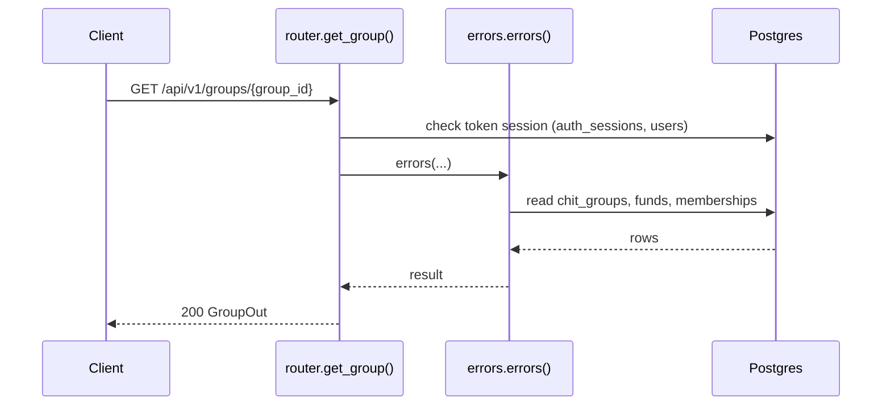

**Errors** (declared in the router with `responses=errors(...)`)

| HTTP | Code | Message | Exact problem / fix |
|---|---|---|---|
| 401 | `AUTH_REQUIRED` | Authentication required | No `Authorization: Bearer <token>` header. |
| 401 | `AUTH_TOKEN_INVALID` | Access token is invalid | Token malformed, signed with another JWT_SECRET (secret changed?), or user deleted. |
| 401 | `AUTH_TOKEN_EXPIRED` | Access token has expired | Access token older than ACCESS_TOKEN_TTL_MINUTES. Client should call /auth/refresh. |
| 401 | `AUTH_SESSION_REVOKED` | Session has been signed out | Device was signed out (logout, remote sign-out, password change or refresh-token reuse). |
| 403 | `NOT_GROUP_MEMBER` | You are not an active member of this group | Caller (or the target user) is not an ACTIVE member of the group. |
| 404 | `GROUP_NOT_FOUND` | Chit group not found | Wrong group id or group code. |
| 422 | `VALIDATION_ERROR` | Request data is invalid | Body/query/path does not match the schema. `details` lists each bad field and why. |
| 500 | `INTERNAL_ERROR` | An unexpected internal error occurred | A bug. Search `docker compose logs api` for the `requestId` and read the `request.unhandled_exception` line: it has the exception and stack trace. |
| 503 | `DB_UNAVAILABLE` | Database is unavailable | Postgres unreachable: host Postgres down, pg_hba.conf missing the Docker subnet, or wrong DB_* values in .env. See the `db.unavailable` log line. |

**Diagnose**

- Every response carries `X-Request-ID`; errors also return it as `error.requestId`.
- `docker compose logs api | grep <request_id>` shows the access line (`http.request`) and any error lines.
- Each error's exact problem is in the table above (from the router's `responses=errors(...)`).
- 500 / 503: see [logging & debugging](../operations/logging-and-debugging.md).

---

### `PATCH /api/v1/groups/{group_id}`

Update group settings

- **Auth:** Bearer access token
- **Success:** `200` → `GroupOut`
- **Router:** [`update_group`](../../apps/api/src/chitbook_api/modules/groups/router.py#L104) (router.py:104)
- **Calls:** [`errors`](../../apps/api/src/chitbook_api/core/errors.py#L234) (errors.py:234), [`update`](../../apps/api/src/chitbook_api/modules/groups/service.py#L124) (service.py:124), [`_with_fund`](../../apps/api/src/chitbook_api/modules/groups/service.py#L54) (service.py:54), [`fund_ids_for`](../../apps/api/src/chitbook_api/modules/groups/repository.py#L36) (repository.py:36), [`to_group_out`](../../apps/api/src/chitbook_api/modules/groups/service.py#L27) (service.py:27), [`require_group`](../../apps/api/src/chitbook_api/modules/groups/service.py#L59) (service.py:59), [`get_group`](../../apps/api/src/chitbook_api/modules/groups/repository.py#L12) (repository.py:12)
- **Access checks:** `require_group_admin`, `require_group_member`, `active_membership`

**Parameters**

| Name | In | Type | Required |
|---|---|---|---|
| `group_id` | path | integer | yes |

**Request body**

| Field | Type | Required | Notes |
|---|---|---|---|
| `name` | string or null | no | minLength=1; maxLength=100 |
| `duration` | integer or null | no | minimum=1.0; maximum=120.0 |
| `monthlyAmount` | number or string or null | no | exclusiveMinimum=0.0 |
| `totalMembers` | integer or null | no | minimum=1.0; maximum=500.0 |
| `startDate` | date-time or null | no |  |

```json
{
  "name": "Ravi Kumar",
  "duration": 20,
  "monthlyAmount": 25000.0,
  "totalMembers": 20,
  "startDate": "2026-08-01T10:30:00+05:30"
}
```

**Response `200`**

| Field | Type | Required | Notes |
|---|---|---|---|
| `id` | integer | yes |  |
| `groupCode` | string | yes |  |
| `name` | string | yes |  |
| `duration` | integer | yes |  |
| `monthlyAmount` | number | yes |  |
| `totalMembers` | integer | yes |  |
| `startDate` | string | yes |  |
| `status` | GroupStatus | yes |  |
| `fundId` | integer or null | yes |  |
| `createdAt` | string | yes |  |
| `updatedAt` | string | yes |  |

```json
{
  "id": 1,
  "groupCode": "CHIT3F5A7C",
  "name": "Ravi Kumar",
  "duration": 20,
  "monthlyAmount": 25000.0,
  "totalMembers": 20,
  "startDate": "2026-08-01T10:30:00+05:30",
  "status": "PENDING",
  "fundId": 1,
  "createdAt": "2026-08-01T10:30:00+05:30",
  "updatedAt": "2026-08-01T10:30:00+05:30"
}
```

**Database**

- Writes: –
- Reads: `chit_groups`, `memberships`
- Token check reads `auth_sessions` + `users` (every signed-in request)

**Flow**

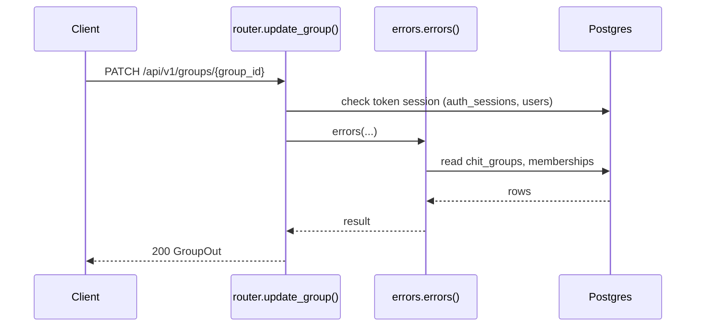

**Errors** (declared in the router with `responses=errors(...)`)

| HTTP | Code | Message | Exact problem / fix |
|---|---|---|---|
| 401 | `AUTH_REQUIRED` | Authentication required | No `Authorization: Bearer <token>` header. |
| 401 | `AUTH_TOKEN_INVALID` | Access token is invalid | Token malformed, signed with another JWT_SECRET (secret changed?), or user deleted. |
| 401 | `AUTH_TOKEN_EXPIRED` | Access token has expired | Access token older than ACCESS_TOKEN_TTL_MINUTES. Client should call /auth/refresh. |
| 401 | `AUTH_SESSION_REVOKED` | Session has been signed out | Device was signed out (logout, remote sign-out, password change or refresh-token reuse). |
| 403 | `NOT_GROUP_MEMBER` | You are not an active member of this group | Caller (or the target user) is not an ACTIVE member of the group. |
| 403 | `NOT_GROUP_ADMIN` | Group admin access is required | Caller is a member but not the group's ADMIN. |
| 404 | `GROUP_NOT_FOUND` | Chit group not found | Wrong group id or group code. |
| 422 | `VALIDATION_ERROR` | Request data is invalid | Body/query/path does not match the schema. `details` lists each bad field and why. |
| 500 | `INTERNAL_ERROR` | An unexpected internal error occurred | A bug. Search `docker compose logs api` for the `requestId` and read the `request.unhandled_exception` line: it has the exception and stack trace. |
| 503 | `DB_UNAVAILABLE` | Database is unavailable | Postgres unreachable: host Postgres down, pg_hba.conf missing the Docker subnet, or wrong DB_* values in .env. See the `db.unavailable` log line. |

**Diagnose**

- Every response carries `X-Request-ID`; errors also return it as `error.requestId`.
- `docker compose logs api | grep <request_id>` shows the access line (`http.request`) and any error lines.
- Each error's exact problem is in the table above (from the router's `responses=errors(...)`).
- Log events on success: `group.updated (info)`
- 500 / 503: see [logging & debugging](../operations/logging-and-debugging.md).

---

### `PUT /api/v1/groups/{group_id}/status`

Change group status

- **Auth:** Bearer access token
- **Success:** `200` → `GroupOut`
- **Router:** [`set_group_status`](../../apps/api/src/chitbook_api/modules/groups/router.py#L114) (router.py:114)
- **Calls:** [`errors`](../../apps/api/src/chitbook_api/core/errors.py#L234) (errors.py:234), [`set_status`](../../apps/api/src/chitbook_api/modules/groups/service.py#L137) (service.py:137), [`_with_fund`](../../apps/api/src/chitbook_api/modules/groups/service.py#L54) (service.py:54), [`fund_ids_for`](../../apps/api/src/chitbook_api/modules/groups/repository.py#L36) (repository.py:36), [`to_group_out`](../../apps/api/src/chitbook_api/modules/groups/service.py#L27) (service.py:27), [`require_group`](../../apps/api/src/chitbook_api/modules/groups/service.py#L59) (service.py:59), [`get_group`](../../apps/api/src/chitbook_api/modules/groups/repository.py#L12) (repository.py:12)
- **Access checks:** `require_group_admin`, `require_group_member`, `active_membership`

**Parameters**

| Name | In | Type | Required |
|---|---|---|---|
| `group_id` | path | integer | yes |

**Request body**

| Field | Type | Required | Notes |
|---|---|---|---|
| `status` | GroupStatus | yes |  |

```json
{
  "status": "PENDING"
}
```

**Response `200`**

| Field | Type | Required | Notes |
|---|---|---|---|
| `id` | integer | yes |  |
| `groupCode` | string | yes |  |
| `name` | string | yes |  |
| `duration` | integer | yes |  |
| `monthlyAmount` | number | yes |  |
| `totalMembers` | integer | yes |  |
| `startDate` | string | yes |  |
| `status` | GroupStatus | yes |  |
| `fundId` | integer or null | yes |  |
| `createdAt` | string | yes |  |
| `updatedAt` | string | yes |  |

```json
{
  "id": 1,
  "groupCode": "CHIT3F5A7C",
  "name": "Ravi Kumar",
  "duration": 20,
  "monthlyAmount": 25000.0,
  "totalMembers": 20,
  "startDate": "2026-08-01T10:30:00+05:30",
  "status": "PENDING",
  "fundId": 1,
  "createdAt": "2026-08-01T10:30:00+05:30",
  "updatedAt": "2026-08-01T10:30:00+05:30"
}
```

**Database**: no SQL recorded (the endpoint does not use the database, or no test calls it).

**Flow**

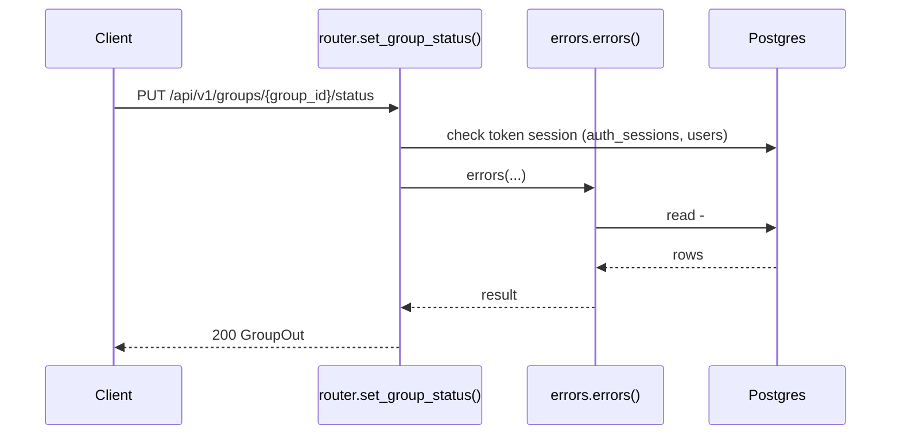

**Errors** (declared in the router with `responses=errors(...)`)

| HTTP | Code | Message | Exact problem / fix |
|---|---|---|---|
| 401 | `AUTH_REQUIRED` | Authentication required | No `Authorization: Bearer <token>` header. |
| 401 | `AUTH_TOKEN_INVALID` | Access token is invalid | Token malformed, signed with another JWT_SECRET (secret changed?), or user deleted. |
| 401 | `AUTH_TOKEN_EXPIRED` | Access token has expired | Access token older than ACCESS_TOKEN_TTL_MINUTES. Client should call /auth/refresh. |
| 401 | `AUTH_SESSION_REVOKED` | Session has been signed out | Device was signed out (logout, remote sign-out, password change or refresh-token reuse). |
| 403 | `NOT_GROUP_MEMBER` | You are not an active member of this group | Caller (or the target user) is not an ACTIVE member of the group. |
| 403 | `NOT_GROUP_ADMIN` | Group admin access is required | Caller is a member but not the group's ADMIN. |
| 404 | `GROUP_NOT_FOUND` | Chit group not found | Wrong group id or group code. |
| 422 | `VALIDATION_ERROR` | Request data is invalid | Body/query/path does not match the schema. `details` lists each bad field and why. |
| 500 | `INTERNAL_ERROR` | An unexpected internal error occurred | A bug. Search `docker compose logs api` for the `requestId` and read the `request.unhandled_exception` line: it has the exception and stack trace. |
| 503 | `DB_UNAVAILABLE` | Database is unavailable | Postgres unreachable: host Postgres down, pg_hba.conf missing the Docker subnet, or wrong DB_* values in .env. See the `db.unavailable` log line. |

**Diagnose**

- Every response carries `X-Request-ID`; errors also return it as `error.requestId`.
- `docker compose logs api | grep <request_id>` shows the access line (`http.request`) and any error lines.
- Each error's exact problem is in the table above (from the router's `responses=errors(...)`).
- Log events on success: `group.status_changed (info)`
- 500 / 503: see [logging & debugging](../operations/logging-and-debugging.md).

---

### `DELETE /api/v1/groups/{group_id}`

Delete a group

- **Auth:** Bearer access token
- **Success:** `204` → –
- **Router:** [`delete_group`](../../apps/api/src/chitbook_api/modules/groups/router.py#L126) (router.py:126)
- **Calls:** [`errors`](../../apps/api/src/chitbook_api/core/errors.py#L234) (errors.py:234), [`delete`](../../apps/api/src/chitbook_api/modules/groups/service.py#L147) (service.py:147), [`require_group`](../../apps/api/src/chitbook_api/modules/groups/service.py#L59) (service.py:59), [`get_group`](../../apps/api/src/chitbook_api/modules/groups/repository.py#L12) (repository.py:12)
- **Access checks:** `require_group_admin`, `require_group_member`, `active_membership`

**Parameters**

| Name | In | Type | Required |
|---|---|---|---|
| `group_id` | path | integer | yes |

**Response `204`**: no body.

**Database**

- Writes: `chit_groups`
- Reads: `chit_groups`, `memberships`
- Token check reads `auth_sessions` + `users` (every signed-in request)
- Child rows are removed by `ON DELETE CASCADE` (see docs/database.md)

**Flow**

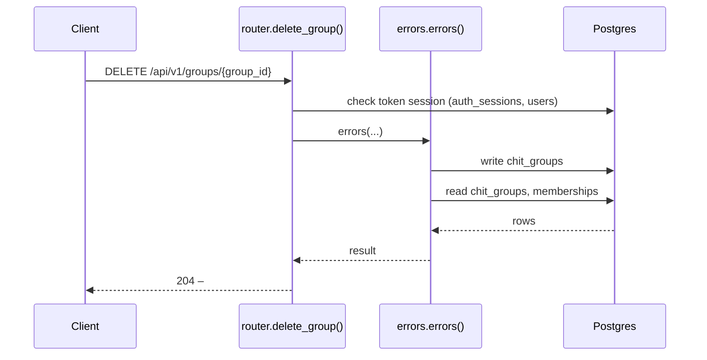

**Errors** (declared in the router with `responses=errors(...)`)

| HTTP | Code | Message | Exact problem / fix |
|---|---|---|---|
| 401 | `AUTH_REQUIRED` | Authentication required | No `Authorization: Bearer <token>` header. |
| 401 | `AUTH_TOKEN_INVALID` | Access token is invalid | Token malformed, signed with another JWT_SECRET (secret changed?), or user deleted. |
| 401 | `AUTH_TOKEN_EXPIRED` | Access token has expired | Access token older than ACCESS_TOKEN_TTL_MINUTES. Client should call /auth/refresh. |
| 401 | `AUTH_SESSION_REVOKED` | Session has been signed out | Device was signed out (logout, remote sign-out, password change or refresh-token reuse). |
| 403 | `NOT_GROUP_MEMBER` | You are not an active member of this group | Caller (or the target user) is not an ACTIVE member of the group. |
| 403 | `NOT_GROUP_ADMIN` | Group admin access is required | Caller is a member but not the group's ADMIN. |
| 404 | `GROUP_NOT_FOUND` | Chit group not found | Wrong group id or group code. |
| 422 | `VALIDATION_ERROR` | Request data is invalid | Body/query/path does not match the schema. `details` lists each bad field and why. |
| 500 | `INTERNAL_ERROR` | An unexpected internal error occurred | A bug. Search `docker compose logs api` for the `requestId` and read the `request.unhandled_exception` line: it has the exception and stack trace. |
| 503 | `DB_UNAVAILABLE` | Database is unavailable | Postgres unreachable: host Postgres down, pg_hba.conf missing the Docker subnet, or wrong DB_* values in .env. See the `db.unavailable` log line. |

**Diagnose**

- Every response carries `X-Request-ID`; errors also return it as `error.requestId`.
- `docker compose logs api | grep <request_id>` shows the access line (`http.request`) and any error lines.
- Each error's exact problem is in the table above (from the router's `responses=errors(...)`).
- Log events on success: `group.deleted (info)`
- 500 / 503: see [logging & debugging](../operations/logging-and-debugging.md).

---

### `GET /api/v1/groups/{group_id}/members`

List group members

- **Auth:** Bearer access token
- **Success:** `200` → list of `MembershipOut`
- **Router:** [`list_members`](../../apps/api/src/chitbook_api/modules/groups/router.py#L136) (router.py:136)
- **Calls:** [`errors`](../../apps/api/src/chitbook_api/core/errors.py#L234) (errors.py:234), [`list_members`](../../apps/api/src/chitbook_api/modules/groups/service.py#L215) (service.py:215), [`list_members`](../../apps/api/src/chitbook_api/modules/groups/repository.py#L49) (repository.py:49), [`to_membership_out`](../../apps/api/src/chitbook_api/modules/groups/service.py#L35) (service.py:35), [`require_group`](../../apps/api/src/chitbook_api/modules/groups/service.py#L59) (service.py:59), [`get_group`](../../apps/api/src/chitbook_api/modules/groups/repository.py#L12) (repository.py:12)
- **Access checks:** `is_group_admin`, `active_membership`, `require_group_member`

**Parameters**

| Name | In | Type | Required |
|---|---|---|---|
| `group_id` | path | integer | yes |

**Response `200`**

| Field | Type | Required | Notes |
|---|---|---|---|
| `id` | integer | yes |  |
| `userId` | integer | yes |  |
| `userName` | string | yes |  |
| `chitGroupId` | integer | yes |  |
| `chitGroupName` | string | yes |  |
| `chitGroupCode` | string | yes |  |
| `monthlyAmount` | number | yes |  |
| `duration` | integer | yes |  |
| `totalMembers` | integer | yes |  |
| `startDate` | string | yes |  |
| `joinDate` | string | yes |  |
| `status` | MembershipStatus | yes |  |
| `role` | GroupRole | yes |  |

```json
[
  {
    "id": 1,
    "userId": 1,
    "userName": "ravi",
    "chitGroupId": 1,
    "chitGroupName": "string",
    "chitGroupCode": "string",
    "monthlyAmount": 25000.0,
    "duration": 20,
    "totalMembers": 20,
    "startDate": "2026-08-01T10:30:00+05:30",
    "joinDate": "2026-08-01T10:30:00+05:30",
    "status": "PENDING",
    "role": "ADMIN"
  }
]
```

**Database**

- Writes: –
- Reads: `chit_groups`, `memberships`
- Token check reads `auth_sessions` + `users` (every signed-in request)

**Flow**

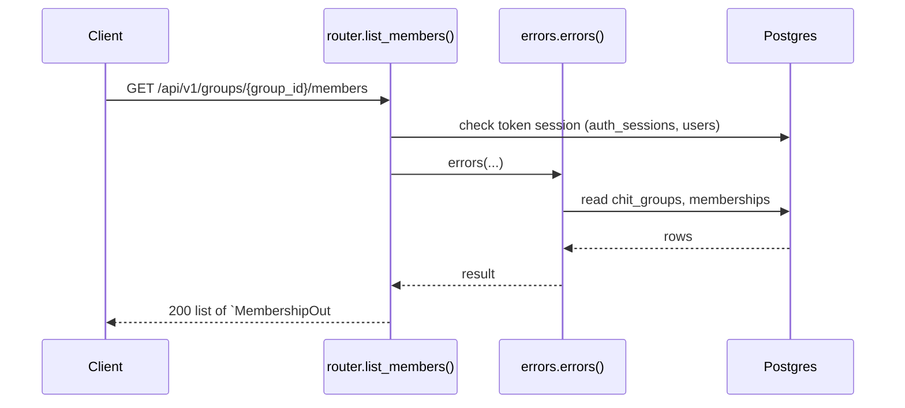

**Errors** (declared in the router with `responses=errors(...)`)

| HTTP | Code | Message | Exact problem / fix |
|---|---|---|---|
| 401 | `AUTH_REQUIRED` | Authentication required | No `Authorization: Bearer <token>` header. |
| 401 | `AUTH_TOKEN_INVALID` | Access token is invalid | Token malformed, signed with another JWT_SECRET (secret changed?), or user deleted. |
| 401 | `AUTH_TOKEN_EXPIRED` | Access token has expired | Access token older than ACCESS_TOKEN_TTL_MINUTES. Client should call /auth/refresh. |
| 401 | `AUTH_SESSION_REVOKED` | Session has been signed out | Device was signed out (logout, remote sign-out, password change or refresh-token reuse). |
| 403 | `NOT_GROUP_MEMBER` | You are not an active member of this group | Caller (or the target user) is not an ACTIVE member of the group. |
| 404 | `GROUP_NOT_FOUND` | Chit group not found | Wrong group id or group code. |
| 422 | `VALIDATION_ERROR` | Request data is invalid | Body/query/path does not match the schema. `details` lists each bad field and why. |
| 500 | `INTERNAL_ERROR` | An unexpected internal error occurred | A bug. Search `docker compose logs api` for the `requestId` and read the `request.unhandled_exception` line: it has the exception and stack trace. |
| 503 | `DB_UNAVAILABLE` | Database is unavailable | Postgres unreachable: host Postgres down, pg_hba.conf missing the Docker subnet, or wrong DB_* values in .env. See the `db.unavailable` log line. |

**Diagnose**

- Every response carries `X-Request-ID`; errors also return it as `error.requestId`.
- `docker compose logs api | grep <request_id>` shows the access line (`http.request`) and any error lines.
- Each error's exact problem is in the table above (from the router's `responses=errors(...)`).
- 500 / 503: see [logging & debugging](../operations/logging-and-debugging.md).

---

### `POST /api/v1/groups/{group_id}/members`

Add a user to the group

- **Auth:** Bearer access token
- **Success:** `201` → `MembershipOut`
- **Router:** [`add_member`](../../apps/api/src/chitbook_api/modules/groups/router.py#L148) (router.py:148)
- **Calls:** [`errors`](../../apps/api/src/chitbook_api/core/errors.py#L234) (errors.py:234), [`add_member`](../../apps/api/src/chitbook_api/modules/groups/service.py#L157) (service.py:157), [`now`](../../apps/api/src/chitbook_api/core/time.py#L14) (time.py:14), [`count_members`](../../apps/api/src/chitbook_api/modules/groups/repository.py#L61) (repository.py:61), [`get_membership`](../../apps/api/src/chitbook_api/modules/groups/repository.py#L43) (repository.py:43), [`get_by_id`](../../apps/api/src/chitbook_api/modules/users/repository.py#L13) (repository.py:13), [`require_group`](../../apps/api/src/chitbook_api/modules/groups/service.py#L59) (service.py:59), [`get_group`](../../apps/api/src/chitbook_api/modules/groups/repository.py#L12) (repository.py:12)
- **Access checks:** `require_group_admin`, `require_group_member`, `active_membership`

**Parameters**

| Name | In | Type | Required |
|---|---|---|---|
| `group_id` | path | integer | yes |

**Request body**

| Field | Type | Required | Notes |
|---|---|---|---|
| `userId` | integer | yes |  |

```json
{
  "userId": 1
}
```

**Response `201`**

| Field | Type | Required | Notes |
|---|---|---|---|
| `id` | integer | yes |  |
| `userId` | integer | yes |  |
| `userName` | string | yes |  |
| `chitGroupId` | integer | yes |  |
| `chitGroupName` | string | yes |  |
| `chitGroupCode` | string | yes |  |
| `monthlyAmount` | number | yes |  |
| `duration` | integer | yes |  |
| `totalMembers` | integer | yes |  |
| `startDate` | string | yes |  |
| `joinDate` | string | yes |  |
| `status` | MembershipStatus | yes |  |
| `role` | GroupRole | yes |  |

```json
{
  "id": 1,
  "userId": 1,
  "userName": "ravi",
  "chitGroupId": 1,
  "chitGroupName": "string",
  "chitGroupCode": "string",
  "monthlyAmount": 25000.0,
  "duration": 20,
  "totalMembers": 20,
  "startDate": "2026-08-01T10:30:00+05:30",
  "joinDate": "2026-08-01T10:30:00+05:30",
  "status": "PENDING",
  "role": "ADMIN"
}
```

**Database**

- Writes: `memberships`
- Reads: `chit_groups`, `memberships`
- Token check reads `auth_sessions` + `users` (every signed-in request)

**Flow**

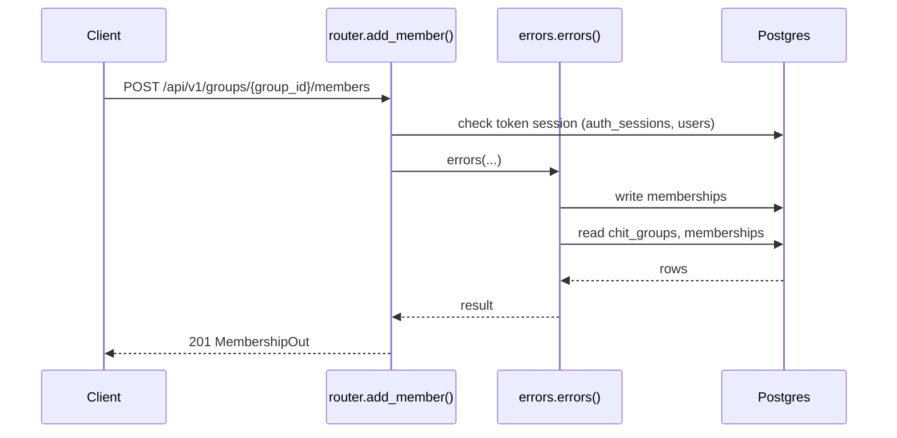

**Errors** (declared in the router with `responses=errors(...)`)

| HTTP | Code | Message | Exact problem / fix |
|---|---|---|---|
| 401 | `AUTH_REQUIRED` | Authentication required | No `Authorization: Bearer <token>` header. |
| 401 | `AUTH_TOKEN_INVALID` | Access token is invalid | Token malformed, signed with another JWT_SECRET (secret changed?), or user deleted. |
| 401 | `AUTH_TOKEN_EXPIRED` | Access token has expired | Access token older than ACCESS_TOKEN_TTL_MINUTES. Client should call /auth/refresh. |
| 401 | `AUTH_SESSION_REVOKED` | Session has been signed out | Device was signed out (logout, remote sign-out, password change or refresh-token reuse). |
| 403 | `NOT_GROUP_MEMBER` | You are not an active member of this group | Caller (or the target user) is not an ACTIVE member of the group. |
| 403 | `NOT_GROUP_ADMIN` | Group admin access is required | Caller is a member but not the group's ADMIN. |
| 404 | `GROUP_NOT_FOUND` | Chit group not found | Wrong group id or group code. |
| 404 | `USER_NOT_FOUND` | User not found | No user with that id/username. |
| 409 | `MEMBERSHIP_EXISTS` | User is already associated with this group | User already belongs to the group. |
| 409 | `GROUP_FULL` | Chit group has reached its member limit | Member count reached `totalMembers`. |
| 422 | `VALIDATION_ERROR` | Request data is invalid | Body/query/path does not match the schema. `details` lists each bad field and why. |
| 500 | `INTERNAL_ERROR` | An unexpected internal error occurred | A bug. Search `docker compose logs api` for the `requestId` and read the `request.unhandled_exception` line: it has the exception and stack trace. |
| 503 | `DB_UNAVAILABLE` | Database is unavailable | Postgres unreachable: host Postgres down, pg_hba.conf missing the Docker subnet, or wrong DB_* values in .env. See the `db.unavailable` log line. |

**Diagnose**

- Every response carries `X-Request-ID`; errors also return it as `error.requestId`.
- `docker compose logs api | grep <request_id>` shows the access line (`http.request`) and any error lines.
- Each error's exact problem is in the table above (from the router's `responses=errors(...)`).
- Log events on success: `membership.added (info)`
- 500 / 503: see [logging & debugging](../operations/logging-and-debugging.md).

---

### `PUT /api/v1/groups/{group_id}/members/{user_id}/status`

Approve / suspend / deactivate a member

- **Auth:** Bearer access token
- **Success:** `200` → `MembershipOut`
- **Router:** [`set_member_status`](../../apps/api/src/chitbook_api/modules/groups/router.py#L166) (router.py:166)
- **Calls:** [`errors`](../../apps/api/src/chitbook_api/core/errors.py#L234) (errors.py:234), [`set_member_status`](../../apps/api/src/chitbook_api/modules/groups/service.py#L228) (service.py:228), [`count_members`](../../apps/api/src/chitbook_api/modules/groups/repository.py#L61) (repository.py:61), [`get_membership`](../../apps/api/src/chitbook_api/modules/groups/repository.py#L43) (repository.py:43), [`to_membership_out`](../../apps/api/src/chitbook_api/modules/groups/service.py#L35) (service.py:35)
- **Access checks:** `require_group_admin`, `require_group_member`, `active_membership`

**Parameters**

| Name | In | Type | Required |
|---|---|---|---|
| `group_id` | path | integer | yes |
| `user_id` | path | integer | yes |

**Request body**

| Field | Type | Required | Notes |
|---|---|---|---|
| `status` | MembershipStatus | yes |  |

```json
{
  "status": "PENDING"
}
```

**Response `200`**

| Field | Type | Required | Notes |
|---|---|---|---|
| `id` | integer | yes |  |
| `userId` | integer | yes |  |
| `userName` | string | yes |  |
| `chitGroupId` | integer | yes |  |
| `chitGroupName` | string | yes |  |
| `chitGroupCode` | string | yes |  |
| `monthlyAmount` | number | yes |  |
| `duration` | integer | yes |  |
| `totalMembers` | integer | yes |  |
| `startDate` | string | yes |  |
| `joinDate` | string | yes |  |
| `status` | MembershipStatus | yes |  |
| `role` | GroupRole | yes |  |

```json
{
  "id": 1,
  "userId": 1,
  "userName": "ravi",
  "chitGroupId": 1,
  "chitGroupName": "string",
  "chitGroupCode": "string",
  "monthlyAmount": 25000.0,
  "duration": 20,
  "totalMembers": 20,
  "startDate": "2026-08-01T10:30:00+05:30",
  "joinDate": "2026-08-01T10:30:00+05:30",
  "status": "PENDING",
  "role": "ADMIN"
}
```

**Database**

- Writes: `memberships`
- Reads: `chit_groups`, `memberships`
- Token check reads `auth_sessions` + `users` (every signed-in request)

**Flow**

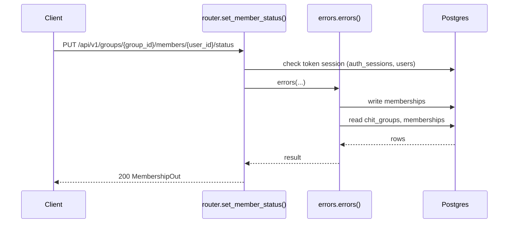

**Errors** (declared in the router with `responses=errors(...)`)

| HTTP | Code | Message | Exact problem / fix |
|---|---|---|---|
| 401 | `AUTH_REQUIRED` | Authentication required | No `Authorization: Bearer <token>` header. |
| 401 | `AUTH_TOKEN_INVALID` | Access token is invalid | Token malformed, signed with another JWT_SECRET (secret changed?), or user deleted. |
| 401 | `AUTH_TOKEN_EXPIRED` | Access token has expired | Access token older than ACCESS_TOKEN_TTL_MINUTES. Client should call /auth/refresh. |
| 401 | `AUTH_SESSION_REVOKED` | Session has been signed out | Device was signed out (logout, remote sign-out, password change or refresh-token reuse). |
| 403 | `NOT_GROUP_MEMBER` | You are not an active member of this group | Caller (or the target user) is not an ACTIVE member of the group. |
| 403 | `NOT_GROUP_ADMIN` | Group admin access is required | Caller is a member but not the group's ADMIN. |
| 404 | `MEMBERSHIP_NOT_FOUND` | Membership not found | User is not in that group. |
| 409 | `GROUP_FULL` | Chit group has reached its member limit | Member count reached `totalMembers`. |
| 422 | `VALIDATION_ERROR` | Request data is invalid | Body/query/path does not match the schema. `details` lists each bad field and why. |
| 500 | `INTERNAL_ERROR` | An unexpected internal error occurred | A bug. Search `docker compose logs api` for the `requestId` and read the `request.unhandled_exception` line: it has the exception and stack trace. |
| 503 | `DB_UNAVAILABLE` | Database is unavailable | Postgres unreachable: host Postgres down, pg_hba.conf missing the Docker subnet, or wrong DB_* values in .env. See the `db.unavailable` log line. |

**Diagnose**

- Every response carries `X-Request-ID`; errors also return it as `error.requestId`.
- `docker compose logs api | grep <request_id>` shows the access line (`http.request`) and any error lines.
- Each error's exact problem is in the table above (from the router's `responses=errors(...)`).
- Log events on success: `membership.status_changed (info)`
- 500 / 503: see [logging & debugging](../operations/logging-and-debugging.md).

---

### `DELETE /api/v1/groups/{group_id}/members/{user_id}`

Remove a member

- **Auth:** Bearer access token
- **Success:** `204` → –
- **Router:** [`remove_member`](../../apps/api/src/chitbook_api/modules/groups/router.py#L185) (router.py:185)
- **Calls:** [`errors`](../../apps/api/src/chitbook_api/core/errors.py#L234) (errors.py:234), [`remove_member`](../../apps/api/src/chitbook_api/modules/groups/service.py#L206) (service.py:206), [`get_membership`](../../apps/api/src/chitbook_api/modules/groups/repository.py#L43) (repository.py:43)
- **Access checks:** `require_group_admin`, `require_group_member`, `active_membership`

**Parameters**

| Name | In | Type | Required |
|---|---|---|---|
| `group_id` | path | integer | yes |
| `user_id` | path | integer | yes |

**Response `204`**: no body.

**Database**

- Writes: `memberships`
- Reads: `chit_groups`, `memberships`
- Token check reads `auth_sessions` + `users` (every signed-in request)
- Child rows are removed by `ON DELETE CASCADE` (see docs/database.md)

**Flow**

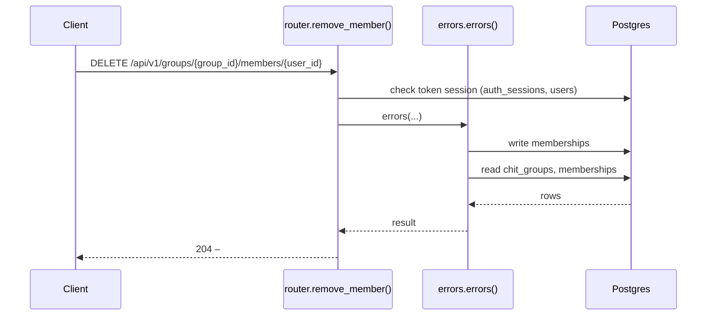

**Errors** (declared in the router with `responses=errors(...)`)

| HTTP | Code | Message | Exact problem / fix |
|---|---|---|---|
| 401 | `AUTH_REQUIRED` | Authentication required | No `Authorization: Bearer <token>` header. |
| 401 | `AUTH_TOKEN_INVALID` | Access token is invalid | Token malformed, signed with another JWT_SECRET (secret changed?), or user deleted. |
| 401 | `AUTH_TOKEN_EXPIRED` | Access token has expired | Access token older than ACCESS_TOKEN_TTL_MINUTES. Client should call /auth/refresh. |
| 401 | `AUTH_SESSION_REVOKED` | Session has been signed out | Device was signed out (logout, remote sign-out, password change or refresh-token reuse). |
| 403 | `NOT_GROUP_MEMBER` | You are not an active member of this group | Caller (or the target user) is not an ACTIVE member of the group. |
| 403 | `NOT_GROUP_ADMIN` | Group admin access is required | Caller is a member but not the group's ADMIN. |
| 404 | `MEMBERSHIP_NOT_FOUND` | Membership not found | User is not in that group. |
| 422 | `VALIDATION_ERROR` | Request data is invalid | Body/query/path does not match the schema. `details` lists each bad field and why. |
| 500 | `INTERNAL_ERROR` | An unexpected internal error occurred | A bug. Search `docker compose logs api` for the `requestId` and read the `request.unhandled_exception` line: it has the exception and stack trace. |
| 503 | `DB_UNAVAILABLE` | Database is unavailable | Postgres unreachable: host Postgres down, pg_hba.conf missing the Docker subnet, or wrong DB_* values in .env. See the `db.unavailable` log line. |

**Diagnose**

- Every response carries `X-Request-ID`; errors also return it as `error.requestId`.
- `docker compose logs api | grep <request_id>` shows the access line (`http.request`) and any error lines.
- Each error's exact problem is in the table above (from the router's `responses=errors(...)`).
- Log events on success: `membership.removed (info)`
- 500 / 503: see [logging & debugging](../operations/logging-and-debugging.md).

---

