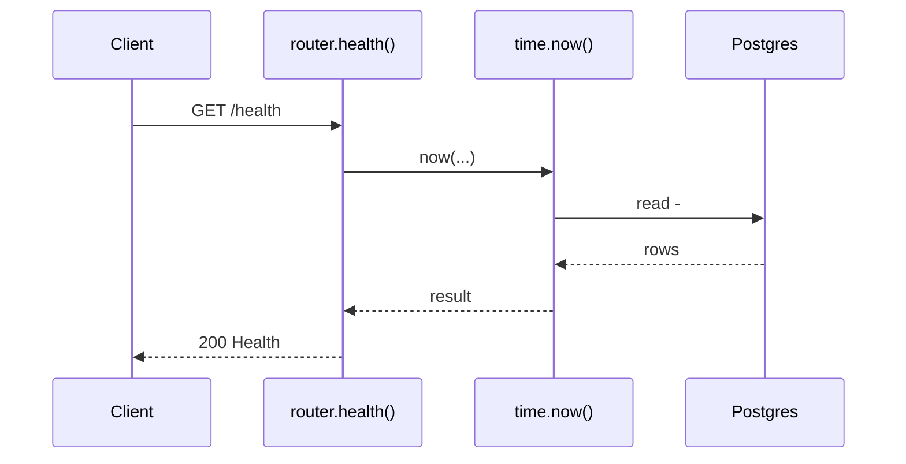
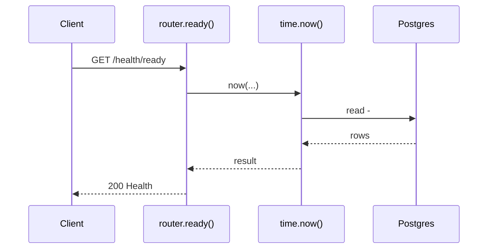

# Health API

> Generated by `scripts/gen_api_docs.py` from the code. Do not edit by hand; run `scripts/gen-docs.sh`.

## Endpoints

| Method | Path | Summary |
|---|---|---|
| GET | [`/health`](#get-health) | Liveness: the process is up |
| GET | [`/health/ready`](#get-healthready) | Readiness: the database answers |

## Details

### `GET /health`

Liveness: the process is up

- **Auth:** public
- **Success:** `200` → `Health`
- **Router:** [`health`](../../apps/api/src/chitbook_api/modules/health/router.py#L20) (router.py:20)
- **Calls:** [`now`](../../apps/api/src/chitbook_api/core/time.py#L14) (time.py:14), [`errors`](../../apps/api/src/chitbook_api/core/errors.py#L234) (errors.py:234)

**Response `200`**

| Field | Type | Required | Notes |
|---|---|---|---|
| `status` | string | yes |  |
| `time` | string | yes |  |
| `database` | string or null | no |  |

```json
{
  "status": "string",
  "time": "string",
  "database": "string"
}
```

**Database**: no SQL recorded (the endpoint does not use the database, or no test calls it).

**Flow**



**Errors** (declared in the router with `responses=errors(...)`)

| HTTP | Code | Message | Exact problem / fix |
|---|---|---|---|
| 500 | `INTERNAL_ERROR` | An unexpected internal error occurred | A bug. Search `docker compose logs api` for the `requestId` and read the `request.unhandled_exception` line: it has the exception and stack trace. |
| 503 | `DB_UNAVAILABLE` | Database is unavailable | Postgres unreachable: host Postgres down, pg_hba.conf missing the Docker subnet, or wrong DB_* values in .env. See the `db.unavailable` log line. |

**Diagnose**

- Every response carries `X-Request-ID`; errors also return it as `error.requestId`.
- `docker compose logs api | grep <request_id>` shows the access line (`http.request`) and any error lines.
- Each error's exact problem is in the table above (from the router's `responses=errors(...)`).
- 500 / 503: see [logging & debugging](../operations/logging-and-debugging.md).

---

### `GET /health/ready`

Readiness: the database answers

- **Auth:** public
- **Success:** `200` → `Health`
- **Router:** [`ready`](../../apps/api/src/chitbook_api/modules/health/router.py#L25) (router.py:25)
- **Calls:** [`now`](../../apps/api/src/chitbook_api/core/time.py#L14) (time.py:14), [`errors`](../../apps/api/src/chitbook_api/core/errors.py#L234) (errors.py:234)

**Response `200`**

| Field | Type | Required | Notes |
|---|---|---|---|
| `status` | string | yes |  |
| `time` | string | yes |  |
| `database` | string or null | no |  |

```json
{
  "status": "string",
  "time": "string",
  "database": "string"
}
```

**Database**

- Writes: –
- Reads: –

**Flow**



**Errors** (declared in the router with `responses=errors(...)`)

| HTTP | Code | Message | Exact problem / fix |
|---|---|---|---|
| 500 | `INTERNAL_ERROR` | An unexpected internal error occurred | A bug. Search `docker compose logs api` for the `requestId` and read the `request.unhandled_exception` line: it has the exception and stack trace. |
| 503 | `DB_UNAVAILABLE` | Database is unavailable | Postgres unreachable: host Postgres down, pg_hba.conf missing the Docker subnet, or wrong DB_* values in .env. See the `db.unavailable` log line. |

**Diagnose**

- Every response carries `X-Request-ID`; errors also return it as `error.requestId`.
- `docker compose logs api | grep <request_id>` shows the access line (`http.request`) and any error lines.
- Each error's exact problem is in the table above (from the router's `responses=errors(...)`).
- 500 / 503: see [logging & debugging](../operations/logging-and-debugging.md).

---

