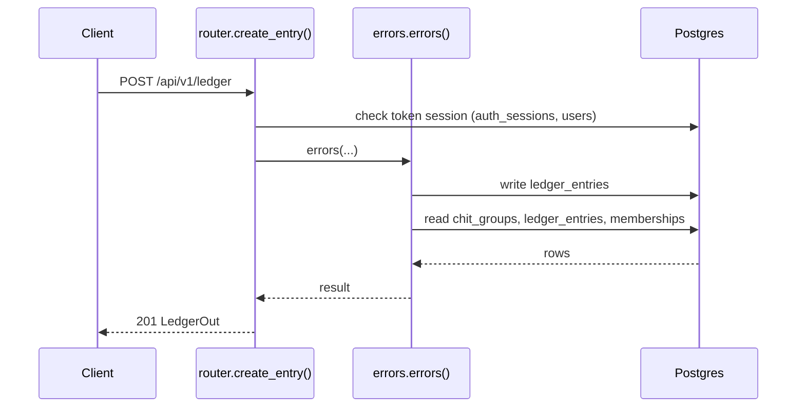
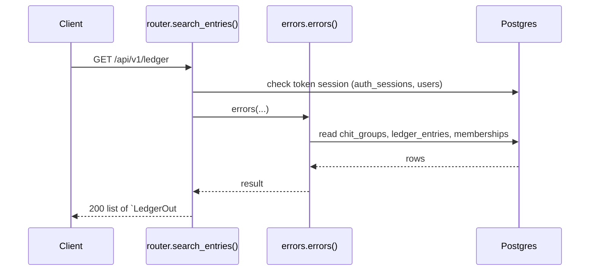
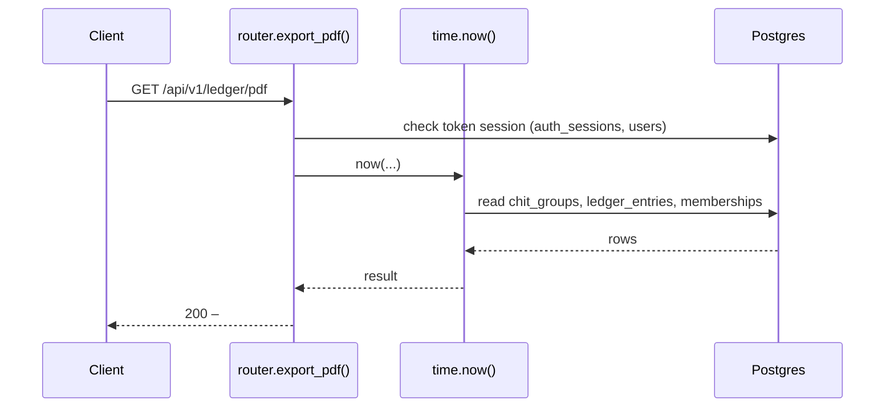
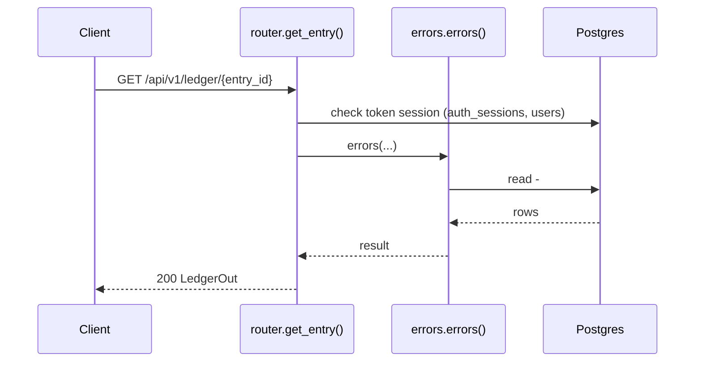

# Ledger API

> Generated by `scripts/gen_api_docs.py` from the code. Do not edit by hand; run `scripts/gen-docs.sh`.

## Overview

> Credit/debit ledger per member per group, plus PDF export.

## Endpoints

| Method | Path | Summary |
|---|---|---|
| POST | [`/api/v1/ledger`](#post-apiv1ledger) | Add a ledger entry |
| GET | [`/api/v1/ledger`](#get-apiv1ledger) | Search ledger entries by group and/or user |
| GET | [`/api/v1/ledger/pdf`](#get-apiv1ledgerpdf) | Download ledger entries as PDF |
| GET | [`/api/v1/ledger/{entry_id}`](#get-apiv1ledgerentry_id) | Get a ledger entry |

## Details

### `POST /api/v1/ledger`

Add a ledger entry

- **Auth:** Bearer access token
- **Success:** `201` → `LedgerOut`
- **Router:** [`create_entry`](../../apps/api/src/chitbook_api/modules/ledger/router.py#L28) (router.py:28)
- **Calls:** [`errors`](../../apps/api/src/chitbook_api/core/errors.py#L234) (errors.py:234), [`create`](../../apps/api/src/chitbook_api/modules/ledger/service.py#L28) (service.py:28), [`now`](../../apps/api/src/chitbook_api/core/time.py#L14) (time.py:14), [`get_by_id`](../../apps/api/src/chitbook_api/modules/users/repository.py#L13) (repository.py:13), [`require_group`](../../apps/api/src/chitbook_api/modules/groups/service.py#L59) (service.py:59), [`get_group`](../../apps/api/src/chitbook_api/modules/groups/repository.py#L12) (repository.py:12), [`to_out`](../../apps/api/src/chitbook_api/modules/ledger/service.py#L20) (service.py:20)
- **Access checks:** `require_group_admin`, `require_group_member`, `active_membership`

**Request body**

| Field | Type | Required | Notes |
|---|---|---|---|
| `userId` | integer | yes |  |
| `chitGroupId` | integer | yes |  |
| `entryType` | EntryType | yes |  |
| `amount` | number or string | yes | exclusiveMinimum=0.0 |
| `entryDate` | date-time or null | no | Default now |
| `remark` | string or null | no | maxLength=255 |
| `referenceId` | string or null | no | maxLength=50; Related payment/auction id |

```json
{
  "userId": 1,
  "chitGroupId": 1,
  "entryType": "CREDIT",
  "amount": 25000.0,
  "entryDate": "2026-08-01T10:30:00+05:30",
  "remark": "August contribution",
  "referenceId": "string"
}
```

**Response `201`**

| Field | Type | Required | Notes |
|---|---|---|---|
| `id` | integer | yes |  |
| `entryType` | EntryType | yes |  |
| `amount` | number | yes |  |
| `entryDate` | string | yes |  |
| `remark` | string or null | yes |  |
| `referenceId` | string or null | yes |  |
| `userId` | integer | yes |  |
| `userName` | string | yes |  |
| `chitGroupId` | integer | yes |  |
| `chitGroupName` | string | yes |  |
| `createdAt` | string | yes |  |
| `updatedAt` | string | yes |  |

```json
{
  "id": 1,
  "entryType": "CREDIT",
  "amount": 25000.0,
  "entryDate": "2026-08-01T10:30:00+05:30",
  "remark": "August contribution",
  "referenceId": "string",
  "userId": 1,
  "userName": "ravi",
  "chitGroupId": 1,
  "chitGroupName": "string",
  "createdAt": "2026-08-01T10:30:00+05:30",
  "updatedAt": "2026-08-01T10:30:00+05:30"
}
```

**Database**

- Writes: `ledger_entries`
- Reads: `chit_groups`, `ledger_entries`, `memberships`
- Token check reads `auth_sessions` + `users` (every signed-in request)

**Flow**



**Errors** (declared in the router with `responses=errors(...)`)

| HTTP | Code | Message | Exact problem / fix |
|---|---|---|---|
| 401 | `AUTH_REQUIRED` | Authentication required | No `Authorization: Bearer <token>` header. |
| 401 | `AUTH_TOKEN_INVALID` | Access token is invalid | Token malformed, signed with another JWT_SECRET (secret changed?), or user deleted. |
| 401 | `AUTH_TOKEN_EXPIRED` | Access token has expired | Access token older than ACCESS_TOKEN_TTL_MINUTES. Client should call /auth/refresh. |
| 401 | `AUTH_SESSION_REVOKED` | Session has been signed out | Device was signed out (logout, remote sign-out, password change or refresh-token reuse). |
| 403 | `NOT_GROUP_MEMBER` | You are not an active member of this group | Caller (or the target user) is not an ACTIVE member of the group. |
| 403 | `NOT_GROUP_ADMIN` | Group admin access is required | Caller is a member but not the group's ADMIN. |
| 404 | `GROUP_NOT_FOUND` | Chit group not found | Wrong group id or group code. |
| 404 | `USER_NOT_FOUND` | User not found | No user with that id/username. |
| 422 | `VALIDATION_ERROR` | Request data is invalid | Body/query/path does not match the schema. `details` lists each bad field and why. |
| 500 | `INTERNAL_ERROR` | An unexpected internal error occurred | A bug. Search `docker compose logs api` for the `requestId` and read the `request.unhandled_exception` line: it has the exception and stack trace. |
| 503 | `DB_UNAVAILABLE` | Database is unavailable | Postgres unreachable: host Postgres down, pg_hba.conf missing the Docker subnet, or wrong DB_* values in .env. See the `db.unavailable` log line. |

**Diagnose**

- Every response carries `X-Request-ID`; errors also return it as `error.requestId`.
- `docker compose logs api | grep <request_id>` shows the access line (`http.request`) and any error lines.
- Each error's exact problem is in the table above (from the router's `responses=errors(...)`).
- Log events on success: `ledger.entry_created (info)`
- 500 / 503: see [logging & debugging](../operations/logging-and-debugging.md).

---

### `GET /api/v1/ledger`

Search ledger entries by group and/or user

- **Auth:** Bearer access token
- **Success:** `200` → list of `LedgerOut`
- **Router:** [`search_entries`](../../apps/api/src/chitbook_api/modules/ledger/router.py#L46) (router.py:46)
- **Calls:** [`errors`](../../apps/api/src/chitbook_api/core/errors.py#L234) (errors.py:234), [`search`](../../apps/api/src/chitbook_api/modules/ledger/service.py#L71) (service.py:71), [`search`](../../apps/api/src/chitbook_api/modules/ledger/repository.py#L15) (repository.py:15), [`to_out`](../../apps/api/src/chitbook_api/modules/ledger/service.py#L20) (service.py:20), [`_check_scope`](../../apps/api/src/chitbook_api/modules/ledger/service.py#L59) (service.py:59)
- **Access checks:** `require_platform_admin`, `require_self_or_platform_admin`, `require_group_admin`, `require_group_member`, `active_membership`, `require_self_or_group_admin`

**Parameters**

| Name | In | Type | Required |
|---|---|---|---|
| `groupId` | query | integer or null | no |
| `userId` | query | integer or null | no |

**Response `200`**

| Field | Type | Required | Notes |
|---|---|---|---|
| `id` | integer | yes |  |
| `entryType` | EntryType | yes |  |
| `amount` | number | yes |  |
| `entryDate` | string | yes |  |
| `remark` | string or null | yes |  |
| `referenceId` | string or null | yes |  |
| `userId` | integer | yes |  |
| `userName` | string | yes |  |
| `chitGroupId` | integer | yes |  |
| `chitGroupName` | string | yes |  |
| `createdAt` | string | yes |  |
| `updatedAt` | string | yes |  |

```json
[
  {
    "id": 1,
    "entryType": "CREDIT",
    "amount": 25000.0,
    "entryDate": "2026-08-01T10:30:00+05:30",
    "remark": "August contribution",
    "referenceId": "string",
    "userId": 1,
    "userName": "ravi",
    "chitGroupId": 1,
    "chitGroupName": "string",
    "createdAt": "2026-08-01T10:30:00+05:30",
    "updatedAt": "2026-08-01T10:30:00+05:30"
  }
]
```

**Database**

- Writes: –
- Reads: `chit_groups`, `ledger_entries`, `memberships`
- Token check reads `auth_sessions` + `users` (every signed-in request)

**Flow**



**Errors** (declared in the router with `responses=errors(...)`)

| HTTP | Code | Message | Exact problem / fix |
|---|---|---|---|
| 401 | `AUTH_REQUIRED` | Authentication required | No `Authorization: Bearer <token>` header. |
| 401 | `AUTH_TOKEN_INVALID` | Access token is invalid | Token malformed, signed with another JWT_SECRET (secret changed?), or user deleted. |
| 401 | `AUTH_TOKEN_EXPIRED` | Access token has expired | Access token older than ACCESS_TOKEN_TTL_MINUTES. Client should call /auth/refresh. |
| 401 | `AUTH_SESSION_REVOKED` | Session has been signed out | Device was signed out (logout, remote sign-out, password change or refresh-token reuse). |
| 403 | `ADMIN_REQUIRED` | Platform admin access is required | Only platform ADMIN users may call this. |
| 403 | `FORBIDDEN` | You do not have access to this resource | You may only access your own user data (unless platform ADMIN). |
| 403 | `NOT_GROUP_MEMBER` | You are not an active member of this group | Caller (or the target user) is not an ACTIVE member of the group. |
| 403 | `NOT_GROUP_ADMIN` | Group admin access is required | Caller is a member but not the group's ADMIN. |
| 422 | `VALIDATION_ERROR` | Request data is invalid | Body/query/path does not match the schema. `details` lists each bad field and why. |
| 500 | `INTERNAL_ERROR` | An unexpected internal error occurred | A bug. Search `docker compose logs api` for the `requestId` and read the `request.unhandled_exception` line: it has the exception and stack trace. |
| 503 | `DB_UNAVAILABLE` | Database is unavailable | Postgres unreachable: host Postgres down, pg_hba.conf missing the Docker subnet, or wrong DB_* values in .env. See the `db.unavailable` log line. |

**Diagnose**

- Every response carries `X-Request-ID`; errors also return it as `error.requestId`.
- `docker compose logs api | grep <request_id>` shows the access line (`http.request`) and any error lines.
- Each error's exact problem is in the table above (from the router's `responses=errors(...)`).
- 500 / 503: see [logging & debugging](../operations/logging-and-debugging.md).

---

### `GET /api/v1/ledger/pdf`

Download ledger entries as PDF

- **Auth:** Bearer access token
- **Success:** `200` → –
- **Router:** [`export_pdf`](../../apps/api/src/chitbook_api/modules/ledger/router.py#L58) (router.py:58)
- **Calls:** [`now`](../../apps/api/src/chitbook_api/core/time.py#L14) (time.py:14), [`errors`](../../apps/api/src/chitbook_api/core/errors.py#L234) (errors.py:234), [`export_pdf`](../../apps/api/src/chitbook_api/modules/ledger/service.py#L78) (service.py:78), [`search`](../../apps/api/src/chitbook_api/modules/ledger/repository.py#L15) (repository.py:15), [`_check_scope`](../../apps/api/src/chitbook_api/modules/ledger/service.py#L59) (service.py:59), [`render`](../../apps/api/src/chitbook_api/modules/ledger/pdf.py#L18) (pdf.py:18), [`to_app_tz`](../../apps/api/src/chitbook_api/core/time.py#L23) (time.py:23)
- **Access checks:** `require_platform_admin`, `require_self_or_platform_admin`, `require_group_admin`, `require_group_member`, `active_membership`, `require_self_or_group_admin`

**Parameters**

| Name | In | Type | Required |
|---|---|---|---|
| `groupId` | query | integer or null | no |
| `userId` | query | integer or null | no |

**Database**

- Writes: –
- Reads: `chit_groups`, `ledger_entries`, `memberships`
- Token check reads `auth_sessions` + `users` (every signed-in request)

**Flow**



**Errors** (declared in the router with `responses=errors(...)`)

| HTTP | Code | Message | Exact problem / fix |
|---|---|---|---|
| 401 | `AUTH_REQUIRED` | Authentication required | No `Authorization: Bearer <token>` header. |
| 401 | `AUTH_TOKEN_INVALID` | Access token is invalid | Token malformed, signed with another JWT_SECRET (secret changed?), or user deleted. |
| 401 | `AUTH_TOKEN_EXPIRED` | Access token has expired | Access token older than ACCESS_TOKEN_TTL_MINUTES. Client should call /auth/refresh. |
| 401 | `AUTH_SESSION_REVOKED` | Session has been signed out | Device was signed out (logout, remote sign-out, password change or refresh-token reuse). |
| 403 | `ADMIN_REQUIRED` | Platform admin access is required | Only platform ADMIN users may call this. |
| 403 | `FORBIDDEN` | You do not have access to this resource | You may only access your own user data (unless platform ADMIN). |
| 403 | `NOT_GROUP_MEMBER` | You are not an active member of this group | Caller (or the target user) is not an ACTIVE member of the group. |
| 403 | `NOT_GROUP_ADMIN` | Group admin access is required | Caller is a member but not the group's ADMIN. |
| 422 | `VALIDATION_ERROR` | Request data is invalid | Body/query/path does not match the schema. `details` lists each bad field and why. |
| 500 | `INTERNAL_ERROR` | An unexpected internal error occurred | A bug. Search `docker compose logs api` for the `requestId` and read the `request.unhandled_exception` line: it has the exception and stack trace. |
| 503 | `DB_UNAVAILABLE` | Database is unavailable | Postgres unreachable: host Postgres down, pg_hba.conf missing the Docker subnet, or wrong DB_* values in .env. See the `db.unavailable` log line. |

**Diagnose**

- Every response carries `X-Request-ID`; errors also return it as `error.requestId`.
- `docker compose logs api | grep <request_id>` shows the access line (`http.request`) and any error lines.
- Each error's exact problem is in the table above (from the router's `responses=errors(...)`).
- Log events on success: `ledger.pdf_exported (info)`
- 500 / 503: see [logging & debugging](../operations/logging-and-debugging.md).

---

### `GET /api/v1/ledger/{entry_id}`

Get a ledger entry

- **Auth:** Bearer access token
- **Success:** `200` → `LedgerOut`
- **Router:** [`get_entry`](../../apps/api/src/chitbook_api/modules/ledger/router.py#L79) (router.py:79)
- **Calls:** [`errors`](../../apps/api/src/chitbook_api/core/errors.py#L234) (errors.py:234), [`get`](../../apps/api/src/chitbook_api/modules/ledger/service.py#L51) (service.py:51), [`get`](../../apps/api/src/chitbook_api/modules/ledger/repository.py#L11) (repository.py:11), [`to_out`](../../apps/api/src/chitbook_api/modules/ledger/service.py#L20) (service.py:20)
- **Access checks:** `require_self_or_group_admin`, `require_group_member`, `active_membership`, `require_group_admin`

**Parameters**

| Name | In | Type | Required |
|---|---|---|---|
| `entry_id` | path | integer | yes |

**Response `200`**

| Field | Type | Required | Notes |
|---|---|---|---|
| `id` | integer | yes |  |
| `entryType` | EntryType | yes |  |
| `amount` | number | yes |  |
| `entryDate` | string | yes |  |
| `remark` | string or null | yes |  |
| `referenceId` | string or null | yes |  |
| `userId` | integer | yes |  |
| `userName` | string | yes |  |
| `chitGroupId` | integer | yes |  |
| `chitGroupName` | string | yes |  |
| `createdAt` | string | yes |  |
| `updatedAt` | string | yes |  |

```json
{
  "id": 1,
  "entryType": "CREDIT",
  "amount": 25000.0,
  "entryDate": "2026-08-01T10:30:00+05:30",
  "remark": "August contribution",
  "referenceId": "string",
  "userId": 1,
  "userName": "ravi",
  "chitGroupId": 1,
  "chitGroupName": "string",
  "createdAt": "2026-08-01T10:30:00+05:30",
  "updatedAt": "2026-08-01T10:30:00+05:30"
}
```

**Database**: no SQL recorded (the endpoint does not use the database, or no test calls it).

**Flow**



**Errors** (declared in the router with `responses=errors(...)`)

| HTTP | Code | Message | Exact problem / fix |
|---|---|---|---|
| 401 | `AUTH_REQUIRED` | Authentication required | No `Authorization: Bearer <token>` header. |
| 401 | `AUTH_TOKEN_INVALID` | Access token is invalid | Token malformed, signed with another JWT_SECRET (secret changed?), or user deleted. |
| 401 | `AUTH_TOKEN_EXPIRED` | Access token has expired | Access token older than ACCESS_TOKEN_TTL_MINUTES. Client should call /auth/refresh. |
| 401 | `AUTH_SESSION_REVOKED` | Session has been signed out | Device was signed out (logout, remote sign-out, password change or refresh-token reuse). |
| 403 | `NOT_GROUP_MEMBER` | You are not an active member of this group | Caller (or the target user) is not an ACTIVE member of the group. |
| 403 | `NOT_GROUP_ADMIN` | Group admin access is required | Caller is a member but not the group's ADMIN. |
| 404 | `LEDGER_NOT_FOUND` | Ledger entry not found | Wrong ledger entry id. |
| 422 | `VALIDATION_ERROR` | Request data is invalid | Body/query/path does not match the schema. `details` lists each bad field and why. |
| 500 | `INTERNAL_ERROR` | An unexpected internal error occurred | A bug. Search `docker compose logs api` for the `requestId` and read the `request.unhandled_exception` line: it has the exception and stack trace. |
| 503 | `DB_UNAVAILABLE` | Database is unavailable | Postgres unreachable: host Postgres down, pg_hba.conf missing the Docker subnet, or wrong DB_* values in .env. See the `db.unavailable` log line. |

**Diagnose**

- Every response carries `X-Request-ID`; errors also return it as `error.requestId`.
- `docker compose logs api | grep <request_id>` shows the access line (`http.request`) and any error lines.
- Each error's exact problem is in the table above (from the router's `responses=errors(...)`).
- 500 / 503: see [logging & debugging](../operations/logging-and-debugging.md).

---

