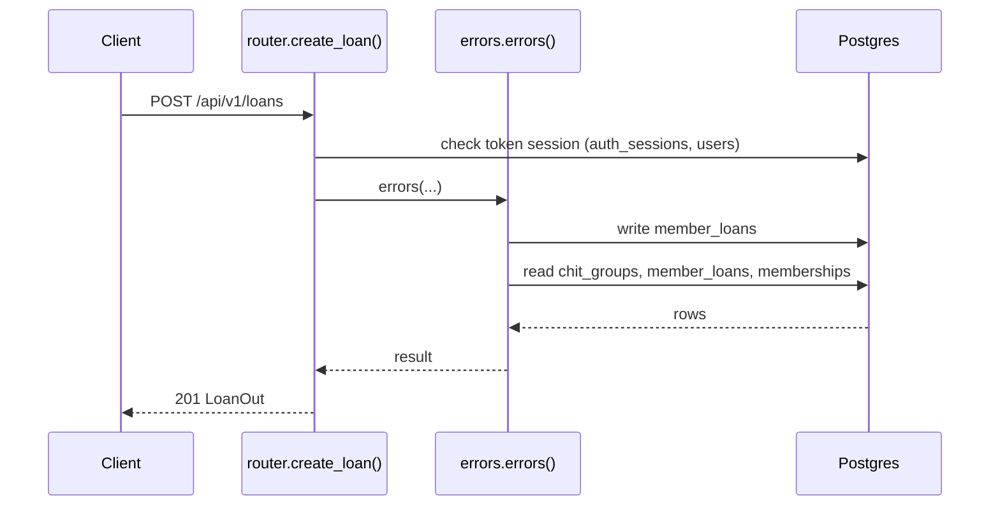
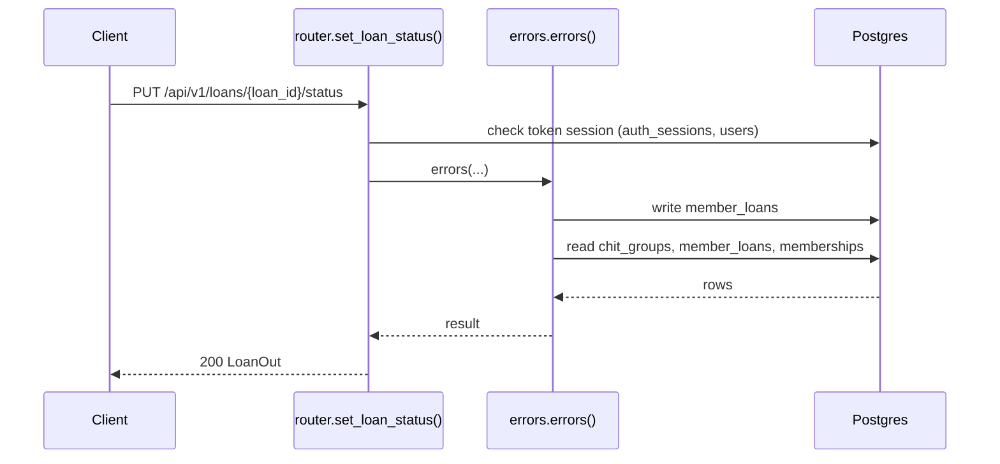
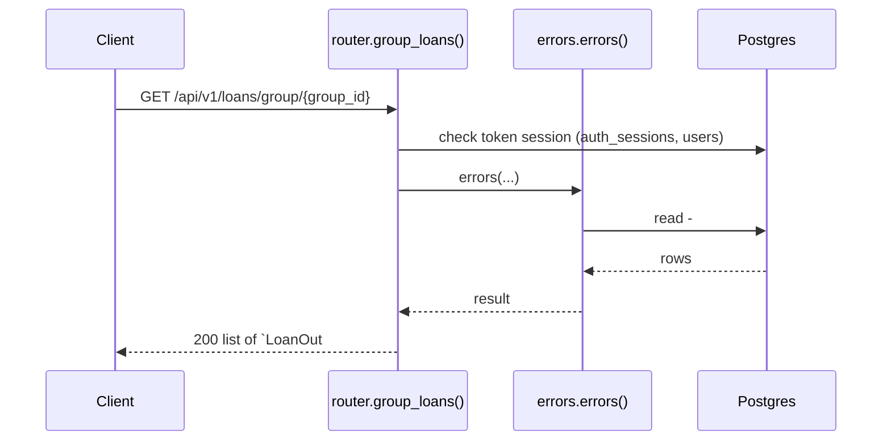
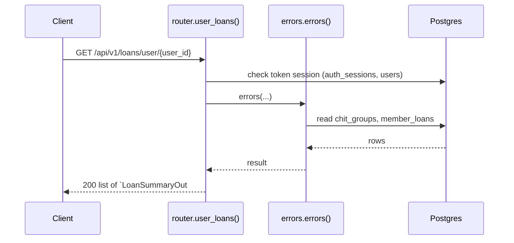
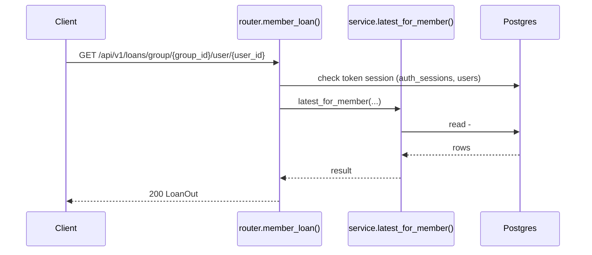
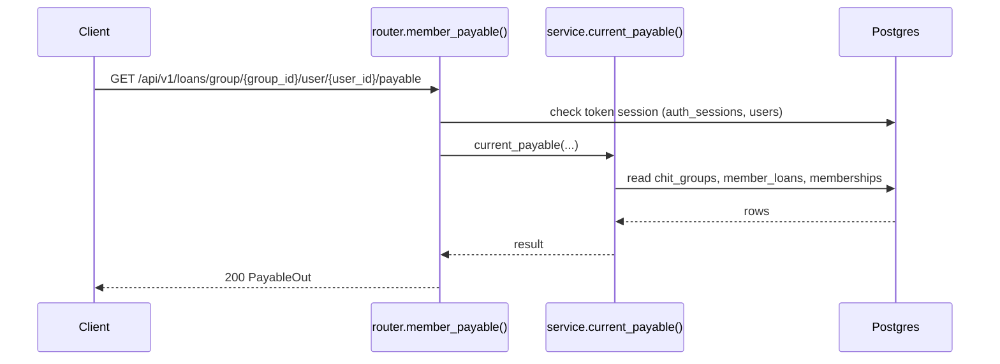

# Loans API

> Generated by `scripts/gen_api_docs.py` from the code. Do not edit by hand; run `scripts/gen-docs.sh`.

## Overview

> Loans given to members from a group's fund, with simple daily interest.
>
> current_payable = principal + principal x annual_rate% x days_elapsed / 36500
> (days counted in IST calendar days; PAID/CLOSED loans keep the value frozen at closing).

## Endpoints

| Method | Path | Summary |
|---|---|---|
| POST | [`/api/v1/loans`](#post-apiv1loans) | Give a loan to a member |
| PUT | [`/api/v1/loans/{loan_id}/status`](#put-apiv1loansloan_idstatus) | Change loan status (PAID/CLOSED freezes it) |
| GET | [`/api/v1/loans/group/{group_id}`](#get-apiv1loansgroupgroup_id) | All loans in a group |
| GET | [`/api/v1/loans/user/{user_id}`](#get-apiv1loansuseruser_id) | A user's loans across groups |
| GET | [`/api/v1/loans/group/{group_id}/user/{user_id}`](#get-apiv1loansgroupgroup_iduseruser_id) | A member's latest loan in a group |
| GET | [`/api/v1/loans/group/{group_id}/user/{user_id}/payable`](#get-apiv1loansgroupgroup_iduseruser_idpayable) | What a member owes on their latest loan today |

## Details

### `POST /api/v1/loans`

Give a loan to a member

- **Auth:** Bearer access token
- **Success:** `201` → `LoanOut`
- **Router:** [`create_loan`](../../apps/api/src/chitbook_api/modules/loans/router.py#L26) (router.py:26)
- **Calls:** [`errors`](../../apps/api/src/chitbook_api/core/errors.py#L234) (errors.py:234), [`create`](../../apps/api/src/chitbook_api/modules/loans/service.py#L70) (service.py:70), [`now`](../../apps/api/src/chitbook_api/core/time.py#L14) (time.py:14), [`require_group`](../../apps/api/src/chitbook_api/modules/groups/service.py#L59) (service.py:59), [`get_group`](../../apps/api/src/chitbook_api/modules/groups/repository.py#L12) (repository.py:12), [`to_out`](../../apps/api/src/chitbook_api/modules/loans/service.py#L37) (service.py:37), [`current_payable`](../../apps/api/src/chitbook_api/modules/loans/service.py#L27) (service.py:27), [`to_app_tz`](../../apps/api/src/chitbook_api/core/time.py#L23) (time.py:23)
- **Access checks:** `active_membership`, `require_group_admin`, `require_group_member`

**Request body**

| Field | Type | Required | Notes |
|---|---|---|---|
| `userId` | integer | yes |  |
| `chitGroupId` | integer | yes |  |
| `principal` | number or string | yes | exclusiveMinimum=0.0 |
| `interestRate` | number or string | yes | minimum=0.0; maximum=100.0; Annual % |
| `tenureMonths` | number or string | yes | maximum=240.0; exclusiveMinimum=0.0 |
| `startDate` | date-time or null | no | Default now |
| `endDate` | date-time or null | no |  |

```json
{
  "userId": 1,
  "chitGroupId": 1,
  "principal": 25000.0,
  "interestRate": 5.0,
  "tenureMonths": 25000.0,
  "startDate": "2026-08-01T10:30:00+05:30",
  "endDate": "2026-08-01T10:30:00+05:30"
}
```

**Response `201`**

| Field | Type | Required | Notes |
|---|---|---|---|
| `id` | integer | yes |  |
| `principal` | number | yes |  |
| `interestRate` | number | yes |  |
| `tenureMonths` | number | yes |  |
| `currentPayable` | number | yes | Principal + simple daily interest up to today |
| `startDate` | string | yes |  |
| `endDate` | string or null | yes |  |
| `status` | LoanStatus | yes |  |
| `chitGroupId` | integer | yes |  |
| `chitGroupName` | string | yes |  |
| `chitGroupCode` | string | yes |  |
| `userId` | integer | yes |  |
| `userName` | string | yes |  |
| `createdAt` | string | yes |  |
| `updatedAt` | string | yes |  |

```json
{
  "id": 1,
  "principal": 25000.0,
  "interestRate": 5.0,
  "tenureMonths": 25000.0,
  "currentPayable": 25000.0,
  "startDate": "2026-08-01T10:30:00+05:30",
  "endDate": "2026-08-01T10:30:00+05:30",
  "status": "ACTIVE",
  "chitGroupId": 1,
  "chitGroupName": "string",
  "chitGroupCode": "string",
  "userId": 1,
  "userName": "ravi",
  "createdAt": "2026-08-01T10:30:00+05:30",
  "updatedAt": "2026-08-01T10:30:00+05:30"
}
```

**Database**

- Writes: `member_loans`
- Reads: `chit_groups`, `member_loans`, `memberships`
- Token check reads `auth_sessions` + `users` (every signed-in request)

**Flow**



**Errors** (declared in the router with `responses=errors(...)`)

| HTTP | Code | Message | Exact problem / fix |
|---|---|---|---|
| 401 | `AUTH_REQUIRED` | Authentication required | No `Authorization: Bearer <token>` header. |
| 401 | `AUTH_TOKEN_INVALID` | Access token is invalid | Token malformed, signed with another JWT_SECRET (secret changed?), or user deleted. |
| 401 | `AUTH_TOKEN_EXPIRED` | Access token has expired | Access token older than ACCESS_TOKEN_TTL_MINUTES. Client should call /auth/refresh. |
| 401 | `AUTH_SESSION_REVOKED` | Session has been signed out | Device was signed out (logout, remote sign-out, password change or refresh-token reuse). |
| 403 | `NOT_GROUP_MEMBER` | You are not an active member of this group | Caller (or the target user) is not an ACTIVE member of the group. |
| 403 | `NOT_GROUP_ADMIN` | Group admin access is required | Caller is a member but not the group's ADMIN. |
| 404 | `GROUP_NOT_FOUND` | Chit group not found | Wrong group id or group code. |
| 422 | `VALIDATION_ERROR` | Request data is invalid | Body/query/path does not match the schema. `details` lists each bad field and why. |
| 500 | `INTERNAL_ERROR` | An unexpected internal error occurred | A bug. Search `docker compose logs api` for the `requestId` and read the `request.unhandled_exception` line: it has the exception and stack trace. |
| 503 | `DB_UNAVAILABLE` | Database is unavailable | Postgres unreachable: host Postgres down, pg_hba.conf missing the Docker subnet, or wrong DB_* values in .env. See the `db.unavailable` log line. |

**Diagnose**

- Every response carries `X-Request-ID`; errors also return it as `error.requestId`.
- `docker compose logs api | grep <request_id>` shows the access line (`http.request`) and any error lines.
- Each error's exact problem is in the table above (from the router's `responses=errors(...)`).
- Log events on success: `loan.created (info)`
- 500 / 503: see [logging & debugging](../operations/logging-and-debugging.md).

---

### `PUT /api/v1/loans/{loan_id}/status`

Change loan status (PAID/CLOSED freezes it)

- **Auth:** Bearer access token
- **Success:** `200` → `LoanOut`
- **Router:** [`set_loan_status`](../../apps/api/src/chitbook_api/modules/loans/router.py#L43) (router.py:43)
- **Calls:** [`errors`](../../apps/api/src/chitbook_api/core/errors.py#L234) (errors.py:234), [`set_status`](../../apps/api/src/chitbook_api/modules/loans/service.py#L93) (service.py:93), [`current_payable`](../../apps/api/src/chitbook_api/modules/loans/service.py#L27) (service.py:27), [`to_app_tz`](../../apps/api/src/chitbook_api/core/time.py#L23) (time.py:23), [`today`](../../apps/api/src/chitbook_api/core/time.py#L19) (time.py:19), [`now`](../../apps/api/src/chitbook_api/core/time.py#L14) (time.py:14), [`get`](../../apps/api/src/chitbook_api/modules/loans/repository.py#L11) (repository.py:11), [`to_out`](../../apps/api/src/chitbook_api/modules/loans/service.py#L37) (service.py:37)
- **Access checks:** `require_group_admin`, `require_group_member`, `active_membership`

**Parameters**

| Name | In | Type | Required |
|---|---|---|---|
| `loan_id` | path | integer | yes |

**Request body**

| Field | Type | Required | Notes |
|---|---|---|---|
| `status` | LoanStatus | yes |  |

```json
{
  "status": "ACTIVE"
}
```

**Response `200`**

| Field | Type | Required | Notes |
|---|---|---|---|
| `id` | integer | yes |  |
| `principal` | number | yes |  |
| `interestRate` | number | yes |  |
| `tenureMonths` | number | yes |  |
| `currentPayable` | number | yes | Principal + simple daily interest up to today |
| `startDate` | string | yes |  |
| `endDate` | string or null | yes |  |
| `status` | LoanStatus | yes |  |
| `chitGroupId` | integer | yes |  |
| `chitGroupName` | string | yes |  |
| `chitGroupCode` | string | yes |  |
| `userId` | integer | yes |  |
| `userName` | string | yes |  |
| `createdAt` | string | yes |  |
| `updatedAt` | string | yes |  |

```json
{
  "id": 1,
  "principal": 25000.0,
  "interestRate": 5.0,
  "tenureMonths": 25000.0,
  "currentPayable": 25000.0,
  "startDate": "2026-08-01T10:30:00+05:30",
  "endDate": "2026-08-01T10:30:00+05:30",
  "status": "ACTIVE",
  "chitGroupId": 1,
  "chitGroupName": "string",
  "chitGroupCode": "string",
  "userId": 1,
  "userName": "ravi",
  "createdAt": "2026-08-01T10:30:00+05:30",
  "updatedAt": "2026-08-01T10:30:00+05:30"
}
```

**Database**

- Writes: `member_loans`
- Reads: `chit_groups`, `member_loans`, `memberships`
- Token check reads `auth_sessions` + `users` (every signed-in request)

**Flow**



**Errors** (declared in the router with `responses=errors(...)`)

| HTTP | Code | Message | Exact problem / fix |
|---|---|---|---|
| 401 | `AUTH_REQUIRED` | Authentication required | No `Authorization: Bearer <token>` header. |
| 401 | `AUTH_TOKEN_INVALID` | Access token is invalid | Token malformed, signed with another JWT_SECRET (secret changed?), or user deleted. |
| 401 | `AUTH_TOKEN_EXPIRED` | Access token has expired | Access token older than ACCESS_TOKEN_TTL_MINUTES. Client should call /auth/refresh. |
| 401 | `AUTH_SESSION_REVOKED` | Session has been signed out | Device was signed out (logout, remote sign-out, password change or refresh-token reuse). |
| 403 | `NOT_GROUP_MEMBER` | You are not an active member of this group | Caller (or the target user) is not an ACTIVE member of the group. |
| 403 | `NOT_GROUP_ADMIN` | Group admin access is required | Caller is a member but not the group's ADMIN. |
| 404 | `LOAN_NOT_FOUND` | Loan not found | No loan for that id / member. |
| 422 | `VALIDATION_ERROR` | Request data is invalid | Body/query/path does not match the schema. `details` lists each bad field and why. |
| 500 | `INTERNAL_ERROR` | An unexpected internal error occurred | A bug. Search `docker compose logs api` for the `requestId` and read the `request.unhandled_exception` line: it has the exception and stack trace. |
| 503 | `DB_UNAVAILABLE` | Database is unavailable | Postgres unreachable: host Postgres down, pg_hba.conf missing the Docker subnet, or wrong DB_* values in .env. See the `db.unavailable` log line. |

**Diagnose**

- Every response carries `X-Request-ID`; errors also return it as `error.requestId`.
- `docker compose logs api | grep <request_id>` shows the access line (`http.request`) and any error lines.
- Each error's exact problem is in the table above (from the router's `responses=errors(...)`).
- Log events on success: `loan.status_changed (info)`
- 500 / 503: see [logging & debugging](../operations/logging-and-debugging.md).

---

### `GET /api/v1/loans/group/{group_id}`

All loans in a group

- **Auth:** Bearer access token
- **Success:** `200` → list of `LoanOut`
- **Router:** [`group_loans`](../../apps/api/src/chitbook_api/modules/loans/router.py#L61) (router.py:61)
- **Calls:** [`errors`](../../apps/api/src/chitbook_api/core/errors.py#L234) (errors.py:234), [`list_for_group`](../../apps/api/src/chitbook_api/modules/loans/service.py#L107) (service.py:107), [`list_for_group`](../../apps/api/src/chitbook_api/modules/loans/repository.py#L15) (repository.py:15), [`to_out`](../../apps/api/src/chitbook_api/modules/loans/service.py#L37) (service.py:37), [`current_payable`](../../apps/api/src/chitbook_api/modules/loans/service.py#L27) (service.py:27), [`to_app_tz`](../../apps/api/src/chitbook_api/core/time.py#L23) (time.py:23), [`today`](../../apps/api/src/chitbook_api/core/time.py#L19) (time.py:19), [`now`](../../apps/api/src/chitbook_api/core/time.py#L14) (time.py:14)
- **Access checks:** `require_group_admin`, `require_group_member`, `active_membership`

**Parameters**

| Name | In | Type | Required |
|---|---|---|---|
| `group_id` | path | integer | yes |

**Response `200`**

| Field | Type | Required | Notes |
|---|---|---|---|
| `id` | integer | yes |  |
| `principal` | number | yes |  |
| `interestRate` | number | yes |  |
| `tenureMonths` | number | yes |  |
| `currentPayable` | number | yes | Principal + simple daily interest up to today |
| `startDate` | string | yes |  |
| `endDate` | string or null | yes |  |
| `status` | LoanStatus | yes |  |
| `chitGroupId` | integer | yes |  |
| `chitGroupName` | string | yes |  |
| `chitGroupCode` | string | yes |  |
| `userId` | integer | yes |  |
| `userName` | string | yes |  |
| `createdAt` | string | yes |  |
| `updatedAt` | string | yes |  |

```json
[
  {
    "id": 1,
    "principal": 25000.0,
    "interestRate": 5.0,
    "tenureMonths": 25000.0,
    "currentPayable": 25000.0,
    "startDate": "2026-08-01T10:30:00+05:30",
    "endDate": "2026-08-01T10:30:00+05:30",
    "status": "ACTIVE",
    "chitGroupId": 1,
    "chitGroupName": "string",
    "chitGroupCode": "string",
    "userId": 1,
    "userName": "ravi",
    "createdAt": "2026-08-01T10:30:00+05:30",
    "updatedAt": "2026-08-01T10:30:00+05:30"
  }
]
```

**Database**: no SQL recorded (the endpoint does not use the database, or no test calls it).

**Flow**



**Errors** (declared in the router with `responses=errors(...)`)

| HTTP | Code | Message | Exact problem / fix |
|---|---|---|---|
| 401 | `AUTH_REQUIRED` | Authentication required | No `Authorization: Bearer <token>` header. |
| 401 | `AUTH_TOKEN_INVALID` | Access token is invalid | Token malformed, signed with another JWT_SECRET (secret changed?), or user deleted. |
| 401 | `AUTH_TOKEN_EXPIRED` | Access token has expired | Access token older than ACCESS_TOKEN_TTL_MINUTES. Client should call /auth/refresh. |
| 401 | `AUTH_SESSION_REVOKED` | Session has been signed out | Device was signed out (logout, remote sign-out, password change or refresh-token reuse). |
| 403 | `NOT_GROUP_MEMBER` | You are not an active member of this group | Caller (or the target user) is not an ACTIVE member of the group. |
| 403 | `NOT_GROUP_ADMIN` | Group admin access is required | Caller is a member but not the group's ADMIN. |
| 422 | `VALIDATION_ERROR` | Request data is invalid | Body/query/path does not match the schema. `details` lists each bad field and why. |
| 500 | `INTERNAL_ERROR` | An unexpected internal error occurred | A bug. Search `docker compose logs api` for the `requestId` and read the `request.unhandled_exception` line: it has the exception and stack trace. |
| 503 | `DB_UNAVAILABLE` | Database is unavailable | Postgres unreachable: host Postgres down, pg_hba.conf missing the Docker subnet, or wrong DB_* values in .env. See the `db.unavailable` log line. |

**Diagnose**

- Every response carries `X-Request-ID`; errors also return it as `error.requestId`.
- `docker compose logs api | grep <request_id>` shows the access line (`http.request`) and any error lines.
- Each error's exact problem is in the table above (from the router's `responses=errors(...)`).
- 500 / 503: see [logging & debugging](../operations/logging-and-debugging.md).

---

### `GET /api/v1/loans/user/{user_id}`

A user's loans across groups

- **Auth:** Bearer access token
- **Success:** `200` → list of `LoanSummaryOut`
- **Router:** [`user_loans`](../../apps/api/src/chitbook_api/modules/loans/router.py#L73) (router.py:73)
- **Calls:** [`errors`](../../apps/api/src/chitbook_api/core/errors.py#L234) (errors.py:234), [`list_for_user`](../../apps/api/src/chitbook_api/modules/loans/service.py#L112) (service.py:112), [`list_for_user`](../../apps/api/src/chitbook_api/modules/loans/repository.py#L22) (repository.py:22), [`to_summary`](../../apps/api/src/chitbook_api/modules/loans/service.py#L58) (service.py:58), [`to_app_tz`](../../apps/api/src/chitbook_api/core/time.py#L23) (time.py:23), [`today`](../../apps/api/src/chitbook_api/core/time.py#L19) (time.py:19), [`now`](../../apps/api/src/chitbook_api/core/time.py#L14) (time.py:14), [`current_payable`](../../apps/api/src/chitbook_api/modules/loans/service.py#L27) (service.py:27)
- **Access checks:** `require_self_or_platform_admin`

**Parameters**

| Name | In | Type | Required |
|---|---|---|---|
| `user_id` | path | integer | yes |

**Response `200`**

| Field | Type | Required | Notes |
|---|---|---|---|
| `loanId` | integer | yes |  |
| `chitGroupId` | integer | yes |  |
| `chitGroupName` | string | yes |  |
| `chitGroupCode` | string | yes |  |
| `principal` | number | yes |  |
| `currentPayable` | number | yes |  |
| `status` | LoanStatus | yes |  |
| `daysRemaining` | integer or null | yes |  |

```json
[
  {
    "loanId": 1,
    "chitGroupId": 1,
    "chitGroupName": "string",
    "chitGroupCode": "string",
    "principal": 25000.0,
    "currentPayable": 25000.0,
    "status": "ACTIVE",
    "daysRemaining": 1
  }
]
```

**Database**

- Writes: –
- Reads: `chit_groups`, `member_loans`
- Token check reads `auth_sessions` + `users` (every signed-in request)

**Flow**



**Errors** (declared in the router with `responses=errors(...)`)

| HTTP | Code | Message | Exact problem / fix |
|---|---|---|---|
| 401 | `AUTH_REQUIRED` | Authentication required | No `Authorization: Bearer <token>` header. |
| 401 | `AUTH_TOKEN_INVALID` | Access token is invalid | Token malformed, signed with another JWT_SECRET (secret changed?), or user deleted. |
| 401 | `AUTH_TOKEN_EXPIRED` | Access token has expired | Access token older than ACCESS_TOKEN_TTL_MINUTES. Client should call /auth/refresh. |
| 401 | `AUTH_SESSION_REVOKED` | Session has been signed out | Device was signed out (logout, remote sign-out, password change or refresh-token reuse). |
| 403 | `FORBIDDEN` | You do not have access to this resource | You may only access your own user data (unless platform ADMIN). |
| 422 | `VALIDATION_ERROR` | Request data is invalid | Body/query/path does not match the schema. `details` lists each bad field and why. |
| 500 | `INTERNAL_ERROR` | An unexpected internal error occurred | A bug. Search `docker compose logs api` for the `requestId` and read the `request.unhandled_exception` line: it has the exception and stack trace. |
| 503 | `DB_UNAVAILABLE` | Database is unavailable | Postgres unreachable: host Postgres down, pg_hba.conf missing the Docker subnet, or wrong DB_* values in .env. See the `db.unavailable` log line. |

**Diagnose**

- Every response carries `X-Request-ID`; errors also return it as `error.requestId`.
- `docker compose logs api | grep <request_id>` shows the access line (`http.request`) and any error lines.
- Each error's exact problem is in the table above (from the router's `responses=errors(...)`).
- 500 / 503: see [logging & debugging](../operations/logging-and-debugging.md).

---

### `GET /api/v1/loans/group/{group_id}/user/{user_id}`

A member's latest loan in a group

- **Auth:** Bearer access token
- **Success:** `200` → `LoanOut`
- **Router:** [`member_loan`](../../apps/api/src/chitbook_api/modules/loans/router.py#L83) (router.py:83)
- **Calls:** [`latest_for_member`](../../apps/api/src/chitbook_api/modules/loans/service.py#L117) (service.py:117), [`latest_for_member`](../../apps/api/src/chitbook_api/modules/loans/repository.py#L27) (repository.py:27), [`errors`](../../apps/api/src/chitbook_api/core/errors.py#L234) (errors.py:234), [`to_out`](../../apps/api/src/chitbook_api/modules/loans/service.py#L37) (service.py:37), [`current_payable`](../../apps/api/src/chitbook_api/modules/loans/service.py#L27) (service.py:27), [`to_app_tz`](../../apps/api/src/chitbook_api/core/time.py#L23) (time.py:23), [`today`](../../apps/api/src/chitbook_api/core/time.py#L19) (time.py:19), [`now`](../../apps/api/src/chitbook_api/core/time.py#L14) (time.py:14)
- **Access checks:** `require_self_or_group_admin`, `require_group_member`, `active_membership`, `require_group_admin`

**Parameters**

| Name | In | Type | Required |
|---|---|---|---|
| `group_id` | path | integer | yes |
| `user_id` | path | integer | yes |

**Response `200`**

| Field | Type | Required | Notes |
|---|---|---|---|
| `id` | integer | yes |  |
| `principal` | number | yes |  |
| `interestRate` | number | yes |  |
| `tenureMonths` | number | yes |  |
| `currentPayable` | number | yes | Principal + simple daily interest up to today |
| `startDate` | string | yes |  |
| `endDate` | string or null | yes |  |
| `status` | LoanStatus | yes |  |
| `chitGroupId` | integer | yes |  |
| `chitGroupName` | string | yes |  |
| `chitGroupCode` | string | yes |  |
| `userId` | integer | yes |  |
| `userName` | string | yes |  |
| `createdAt` | string | yes |  |
| `updatedAt` | string | yes |  |

```json
{
  "id": 1,
  "principal": 25000.0,
  "interestRate": 5.0,
  "tenureMonths": 25000.0,
  "currentPayable": 25000.0,
  "startDate": "2026-08-01T10:30:00+05:30",
  "endDate": "2026-08-01T10:30:00+05:30",
  "status": "ACTIVE",
  "chitGroupId": 1,
  "chitGroupName": "string",
  "chitGroupCode": "string",
  "userId": 1,
  "userName": "ravi",
  "createdAt": "2026-08-01T10:30:00+05:30",
  "updatedAt": "2026-08-01T10:30:00+05:30"
}
```

**Database**: no SQL recorded (the endpoint does not use the database, or no test calls it).

**Flow**



**Errors** (declared in the router with `responses=errors(...)`)

| HTTP | Code | Message | Exact problem / fix |
|---|---|---|---|
| 401 | `AUTH_REQUIRED` | Authentication required | No `Authorization: Bearer <token>` header. |
| 401 | `AUTH_TOKEN_INVALID` | Access token is invalid | Token malformed, signed with another JWT_SECRET (secret changed?), or user deleted. |
| 401 | `AUTH_TOKEN_EXPIRED` | Access token has expired | Access token older than ACCESS_TOKEN_TTL_MINUTES. Client should call /auth/refresh. |
| 401 | `AUTH_SESSION_REVOKED` | Session has been signed out | Device was signed out (logout, remote sign-out, password change or refresh-token reuse). |
| 403 | `NOT_GROUP_MEMBER` | You are not an active member of this group | Caller (or the target user) is not an ACTIVE member of the group. |
| 403 | `NOT_GROUP_ADMIN` | Group admin access is required | Caller is a member but not the group's ADMIN. |
| 404 | `LOAN_NOT_FOUND` | Loan not found | No loan for that id / member. |
| 422 | `VALIDATION_ERROR` | Request data is invalid | Body/query/path does not match the schema. `details` lists each bad field and why. |
| 500 | `INTERNAL_ERROR` | An unexpected internal error occurred | A bug. Search `docker compose logs api` for the `requestId` and read the `request.unhandled_exception` line: it has the exception and stack trace. |
| 503 | `DB_UNAVAILABLE` | Database is unavailable | Postgres unreachable: host Postgres down, pg_hba.conf missing the Docker subnet, or wrong DB_* values in .env. See the `db.unavailable` log line. |

**Diagnose**

- Every response carries `X-Request-ID`; errors also return it as `error.requestId`.
- `docker compose logs api | grep <request_id>` shows the access line (`http.request`) and any error lines.
- Each error's exact problem is in the table above (from the router's `responses=errors(...)`).
- 500 / 503: see [logging & debugging](../operations/logging-and-debugging.md).

---

### `GET /api/v1/loans/group/{group_id}/user/{user_id}/payable`

What a member owes on their latest loan today

- **Auth:** Bearer access token
- **Success:** `200` → `PayableOut`
- **Router:** [`member_payable`](../../apps/api/src/chitbook_api/modules/loans/router.py#L93) (router.py:93)
- **Calls:** [`current_payable`](../../apps/api/src/chitbook_api/modules/loans/service.py#L27) (service.py:27), [`to_app_tz`](../../apps/api/src/chitbook_api/core/time.py#L23) (time.py:23), [`today`](../../apps/api/src/chitbook_api/core/time.py#L19) (time.py:19), [`now`](../../apps/api/src/chitbook_api/core/time.py#L14) (time.py:14), [`errors`](../../apps/api/src/chitbook_api/core/errors.py#L234) (errors.py:234), [`latest_for_member`](../../apps/api/src/chitbook_api/modules/loans/service.py#L117) (service.py:117), [`latest_for_member`](../../apps/api/src/chitbook_api/modules/loans/repository.py#L27) (repository.py:27)
- **Access checks:** `require_self_or_group_admin`, `require_group_member`, `active_membership`, `require_group_admin`

**Parameters**

| Name | In | Type | Required |
|---|---|---|---|
| `group_id` | path | integer | yes |
| `user_id` | path | integer | yes |

**Response `200`**

| Field | Type | Required | Notes |
|---|---|---|---|
| `loanId` | integer | yes |  |
| `currentPayable` | number | yes |  |

```json
{
  "loanId": 1,
  "currentPayable": 25000.0
}
```

**Database**

- Writes: –
- Reads: `chit_groups`, `member_loans`, `memberships`
- Token check reads `auth_sessions` + `users` (every signed-in request)

**Flow**



**Errors** (declared in the router with `responses=errors(...)`)

| HTTP | Code | Message | Exact problem / fix |
|---|---|---|---|
| 401 | `AUTH_REQUIRED` | Authentication required | No `Authorization: Bearer <token>` header. |
| 401 | `AUTH_TOKEN_INVALID` | Access token is invalid | Token malformed, signed with another JWT_SECRET (secret changed?), or user deleted. |
| 401 | `AUTH_TOKEN_EXPIRED` | Access token has expired | Access token older than ACCESS_TOKEN_TTL_MINUTES. Client should call /auth/refresh. |
| 401 | `AUTH_SESSION_REVOKED` | Session has been signed out | Device was signed out (logout, remote sign-out, password change or refresh-token reuse). |
| 403 | `NOT_GROUP_MEMBER` | You are not an active member of this group | Caller (or the target user) is not an ACTIVE member of the group. |
| 403 | `NOT_GROUP_ADMIN` | Group admin access is required | Caller is a member but not the group's ADMIN. |
| 404 | `LOAN_NOT_FOUND` | Loan not found | No loan for that id / member. |
| 422 | `VALIDATION_ERROR` | Request data is invalid | Body/query/path does not match the schema. `details` lists each bad field and why. |
| 500 | `INTERNAL_ERROR` | An unexpected internal error occurred | A bug. Search `docker compose logs api` for the `requestId` and read the `request.unhandled_exception` line: it has the exception and stack trace. |
| 503 | `DB_UNAVAILABLE` | Database is unavailable | Postgres unreachable: host Postgres down, pg_hba.conf missing the Docker subnet, or wrong DB_* values in .env. See the `db.unavailable` log line. |

**Diagnose**

- Every response carries `X-Request-ID`; errors also return it as `error.requestId`.
- `docker compose logs api | grep <request_id>` shows the access line (`http.request`) and any error lines.
- Each error's exact problem is in the table above (from the router's `responses=errors(...)`).
- 500 / 503: see [logging & debugging](../operations/logging-and-debugging.md).

---

