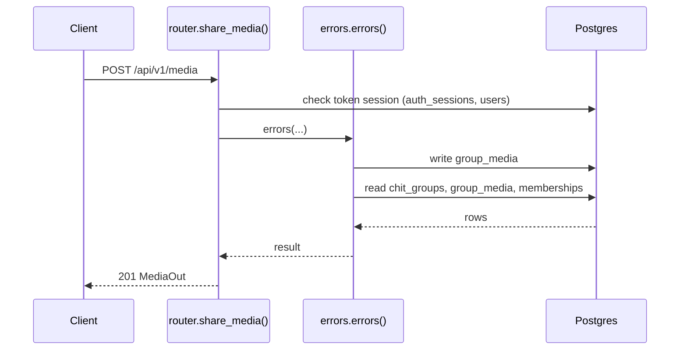
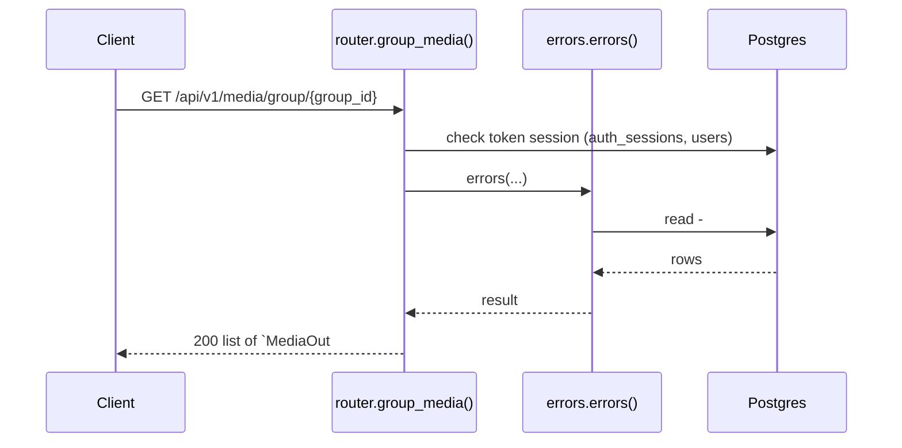
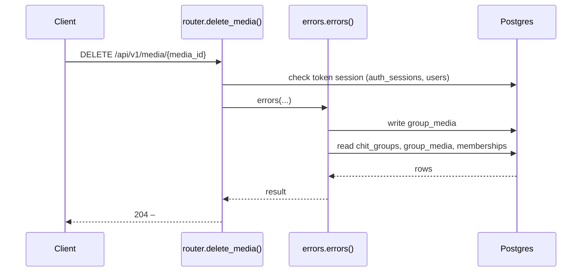

# Media API

> Generated by `scripts/gen_api_docs.py` from the code. Do not edit by hand; run `scripts/gen-docs.sh`.

## Overview

> Photos/videos shared in a group. Stores the link only; files are hosted elsewhere.

## Endpoints

| Method | Path | Summary |
|---|---|---|
| POST | [`/api/v1/media`](#post-apiv1media) | Share a photo/video link |
| GET | [`/api/v1/media/group/{group_id}`](#get-apiv1mediagroupgroup_id) | A group's shared media |
| DELETE | [`/api/v1/media/{media_id}`](#delete-apiv1mediamedia_id) | Delete shared media |

## Details

### `POST /api/v1/media`

Share a photo/video link

- **Auth:** Bearer access token
- **Success:** `201` → `MediaOut`
- **Router:** [`share_media`](../../apps/api/src/chitbook_api/modules/media/router.py#L13) (router.py:13)
- **Calls:** [`errors`](../../apps/api/src/chitbook_api/core/errors.py#L234) (errors.py:234), [`create`](../../apps/api/src/chitbook_api/modules/media/service.py#L31) (service.py:31), [`require_group`](../../apps/api/src/chitbook_api/modules/groups/service.py#L59) (service.py:59), [`get_group`](../../apps/api/src/chitbook_api/modules/groups/repository.py#L12) (repository.py:12), [`to_out`](../../apps/api/src/chitbook_api/modules/media/service.py#L18) (service.py:18)
- **Access checks:** `require_group_member`, `active_membership`

**Request body**

| Field | Type | Required | Notes |
|---|---|---|---|
| `groupId` | integer | yes |  |
| `url` | uri | yes | minLength=1; maxLength=2083; Where the photo/video is hosted (http/https) |
| `caption` | string | yes | minLength=1; maxLength=255 |
| `mediaType` | MediaType | yes |  |

```json
{
  "groupId": 1,
  "url": "https://example.com/photo.jpg",
  "caption": "Monthly meeting",
  "mediaType": "IMAGE"
}
```

**Response `201`**

| Field | Type | Required | Notes |
|---|---|---|---|
| `id` | integer | yes |  |
| `groupId` | integer | yes |  |
| `uploaderId` | integer | yes |  |
| `uploaderName` | string | yes |  |
| `url` | string | yes |  |
| `caption` | string | yes |  |
| `mediaType` | MediaType | yes |  |
| `createdAt` | string | yes |  |

```json
{
  "id": 1,
  "groupId": 1,
  "uploaderId": 1,
  "uploaderName": "string",
  "url": "string",
  "caption": "Monthly meeting",
  "mediaType": "IMAGE",
  "createdAt": "2026-08-01T10:30:00+05:30"
}
```

**Database**

- Writes: `group_media`
- Reads: `chit_groups`, `group_media`, `memberships`
- Token check reads `auth_sessions` + `users` (every signed-in request)

**Flow**



**Errors** (declared in the router with `responses=errors(...)`)

| HTTP | Code | Message | Exact problem / fix |
|---|---|---|---|
| 401 | `AUTH_REQUIRED` | Authentication required | No `Authorization: Bearer <token>` header. |
| 401 | `AUTH_TOKEN_INVALID` | Access token is invalid | Token malformed, signed with another JWT_SECRET (secret changed?), or user deleted. |
| 401 | `AUTH_TOKEN_EXPIRED` | Access token has expired | Access token older than ACCESS_TOKEN_TTL_MINUTES. Client should call /auth/refresh. |
| 401 | `AUTH_SESSION_REVOKED` | Session has been signed out | Device was signed out (logout, remote sign-out, password change or refresh-token reuse). |
| 403 | `NOT_GROUP_MEMBER` | You are not an active member of this group | Caller (or the target user) is not an ACTIVE member of the group. |
| 404 | `GROUP_NOT_FOUND` | Chit group not found | Wrong group id or group code. |
| 422 | `VALIDATION_ERROR` | Request data is invalid | Body/query/path does not match the schema. `details` lists each bad field and why. |
| 500 | `INTERNAL_ERROR` | An unexpected internal error occurred | A bug. Search `docker compose logs api` for the `requestId` and read the `request.unhandled_exception` line: it has the exception and stack trace. |
| 503 | `DB_UNAVAILABLE` | Database is unavailable | Postgres unreachable: host Postgres down, pg_hba.conf missing the Docker subnet, or wrong DB_* values in .env. See the `db.unavailable` log line. |

**Diagnose**

- Every response carries `X-Request-ID`; errors also return it as `error.requestId`.
- `docker compose logs api | grep <request_id>` shows the access line (`http.request`) and any error lines.
- Each error's exact problem is in the table above (from the router's `responses=errors(...)`).
- Log events on success: `media.shared (info)`
- 500 / 503: see [logging & debugging](../operations/logging-and-debugging.md).

---

### `GET /api/v1/media/group/{group_id}`

A group's shared media

- **Auth:** Bearer access token
- **Success:** `200` → list of `MediaOut`
- **Router:** [`group_media`](../../apps/api/src/chitbook_api/modules/media/router.py#L26) (router.py:26)
- **Calls:** [`errors`](../../apps/api/src/chitbook_api/core/errors.py#L234) (errors.py:234), [`list_for_group`](../../apps/api/src/chitbook_api/modules/media/service.py#L48) (service.py:48), [`to_out`](../../apps/api/src/chitbook_api/modules/media/service.py#L18) (service.py:18)
- **Access checks:** `require_group_member`, `active_membership`

**Parameters**

| Name | In | Type | Required |
|---|---|---|---|
| `group_id` | path | integer | yes |

**Response `200`**

| Field | Type | Required | Notes |
|---|---|---|---|
| `id` | integer | yes |  |
| `groupId` | integer | yes |  |
| `uploaderId` | integer | yes |  |
| `uploaderName` | string | yes |  |
| `url` | string | yes |  |
| `caption` | string | yes |  |
| `mediaType` | MediaType | yes |  |
| `createdAt` | string | yes |  |

```json
[
  {
    "id": 1,
    "groupId": 1,
    "uploaderId": 1,
    "uploaderName": "string",
    "url": "string",
    "caption": "Monthly meeting",
    "mediaType": "IMAGE",
    "createdAt": "2026-08-01T10:30:00+05:30"
  }
]
```

**Database**: no SQL recorded (the endpoint does not use the database, or no test calls it).

**Flow**



**Errors** (declared in the router with `responses=errors(...)`)

| HTTP | Code | Message | Exact problem / fix |
|---|---|---|---|
| 401 | `AUTH_REQUIRED` | Authentication required | No `Authorization: Bearer <token>` header. |
| 401 | `AUTH_TOKEN_INVALID` | Access token is invalid | Token malformed, signed with another JWT_SECRET (secret changed?), or user deleted. |
| 401 | `AUTH_TOKEN_EXPIRED` | Access token has expired | Access token older than ACCESS_TOKEN_TTL_MINUTES. Client should call /auth/refresh. |
| 401 | `AUTH_SESSION_REVOKED` | Session has been signed out | Device was signed out (logout, remote sign-out, password change or refresh-token reuse). |
| 403 | `NOT_GROUP_MEMBER` | You are not an active member of this group | Caller (or the target user) is not an ACTIVE member of the group. |
| 422 | `VALIDATION_ERROR` | Request data is invalid | Body/query/path does not match the schema. `details` lists each bad field and why. |
| 500 | `INTERNAL_ERROR` | An unexpected internal error occurred | A bug. Search `docker compose logs api` for the `requestId` and read the `request.unhandled_exception` line: it has the exception and stack trace. |
| 503 | `DB_UNAVAILABLE` | Database is unavailable | Postgres unreachable: host Postgres down, pg_hba.conf missing the Docker subnet, or wrong DB_* values in .env. See the `db.unavailable` log line. |

**Diagnose**

- Every response carries `X-Request-ID`; errors also return it as `error.requestId`.
- `docker compose logs api | grep <request_id>` shows the access line (`http.request`) and any error lines.
- Each error's exact problem is in the table above (from the router's `responses=errors(...)`).
- 500 / 503: see [logging & debugging](../operations/logging-and-debugging.md).

---

### `DELETE /api/v1/media/{media_id}`

Delete shared media

- **Auth:** Bearer access token
- **Success:** `204` → –
- **Router:** [`delete_media`](../../apps/api/src/chitbook_api/modules/media/router.py#L36) (router.py:36)
- **Calls:** [`errors`](../../apps/api/src/chitbook_api/core/errors.py#L234) (errors.py:234), [`delete`](../../apps/api/src/chitbook_api/modules/media/service.py#L56) (service.py:56)
- **Access checks:** `require_group_admin`, `require_group_member`, `active_membership`

**Parameters**

| Name | In | Type | Required |
|---|---|---|---|
| `media_id` | path | integer | yes |

**Response `204`**: no body.

**Database**

- Writes: `group_media`
- Reads: `chit_groups`, `group_media`, `memberships`
- Token check reads `auth_sessions` + `users` (every signed-in request)
- Child rows are removed by `ON DELETE CASCADE` (see docs/database.md)

**Flow**



**Errors** (declared in the router with `responses=errors(...)`)

| HTTP | Code | Message | Exact problem / fix |
|---|---|---|---|
| 401 | `AUTH_REQUIRED` | Authentication required | No `Authorization: Bearer <token>` header. |
| 401 | `AUTH_TOKEN_INVALID` | Access token is invalid | Token malformed, signed with another JWT_SECRET (secret changed?), or user deleted. |
| 401 | `AUTH_TOKEN_EXPIRED` | Access token has expired | Access token older than ACCESS_TOKEN_TTL_MINUTES. Client should call /auth/refresh. |
| 401 | `AUTH_SESSION_REVOKED` | Session has been signed out | Device was signed out (logout, remote sign-out, password change or refresh-token reuse). |
| 403 | `NOT_GROUP_MEMBER` | You are not an active member of this group | Caller (or the target user) is not an ACTIVE member of the group. |
| 403 | `NOT_GROUP_ADMIN` | Group admin access is required | Caller is a member but not the group's ADMIN. |
| 404 | `MEDIA_NOT_FOUND` | Media not found | Wrong media id. |
| 422 | `VALIDATION_ERROR` | Request data is invalid | Body/query/path does not match the schema. `details` lists each bad field and why. |
| 500 | `INTERNAL_ERROR` | An unexpected internal error occurred | A bug. Search `docker compose logs api` for the `requestId` and read the `request.unhandled_exception` line: it has the exception and stack trace. |
| 503 | `DB_UNAVAILABLE` | Database is unavailable | Postgres unreachable: host Postgres down, pg_hba.conf missing the Docker subnet, or wrong DB_* values in .env. See the `db.unavailable` log line. |

**Diagnose**

- Every response carries `X-Request-ID`; errors also return it as `error.requestId`.
- `docker compose logs api | grep <request_id>` shows the access line (`http.request`) and any error lines.
- Each error's exact problem is in the table above (from the router's `responses=errors(...)`).
- Log events on success: `media.deleted (info)`
- 500 / 503: see [logging & debugging](../operations/logging-and-debugging.md).

---

