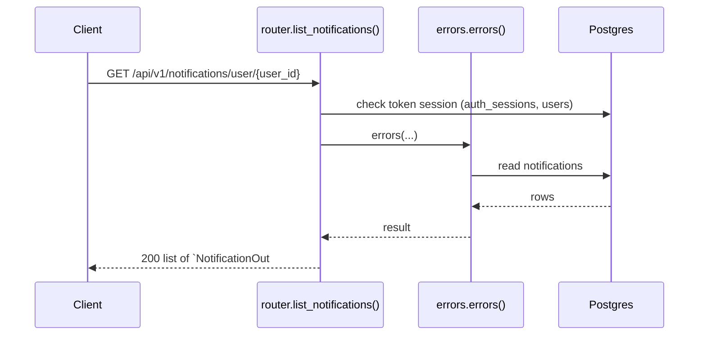
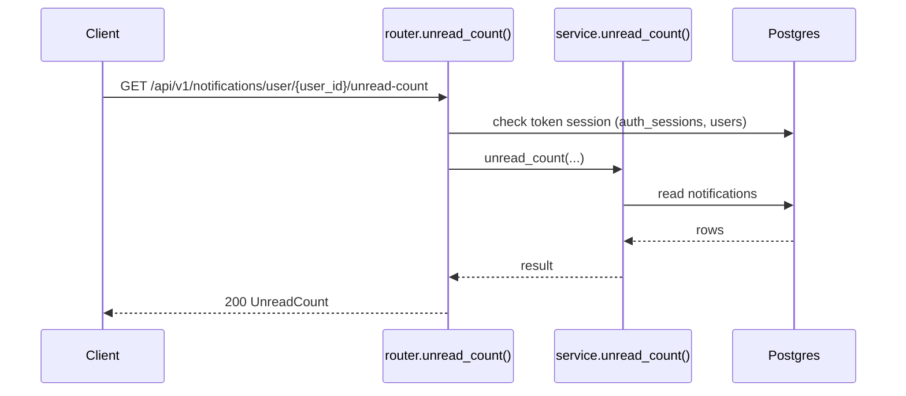
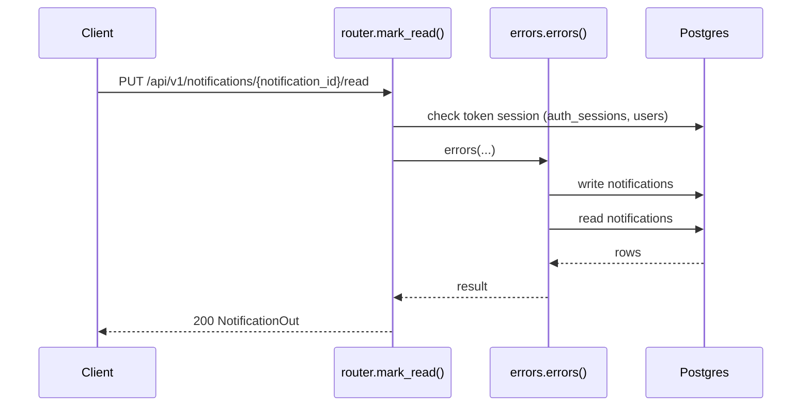
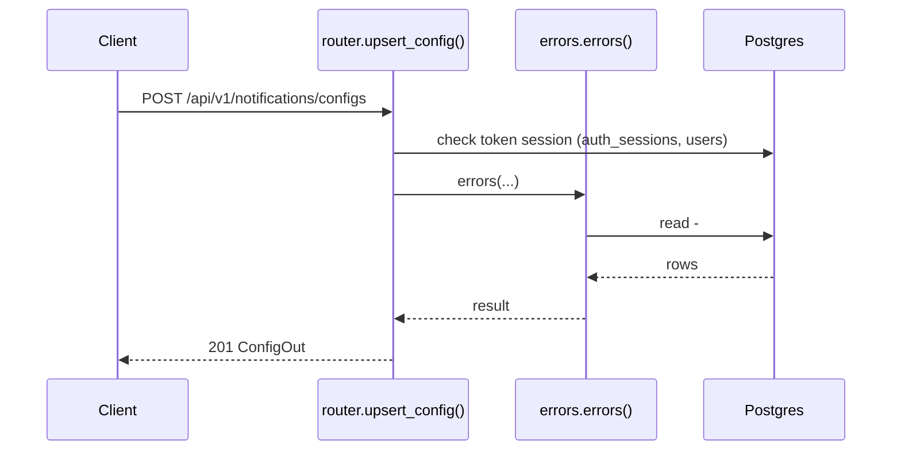
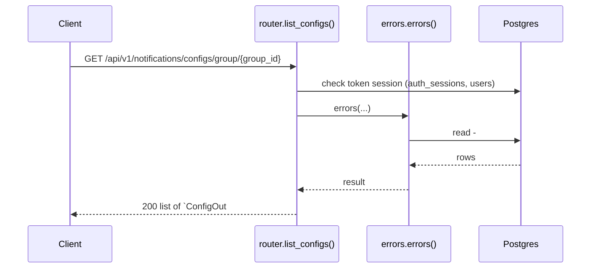
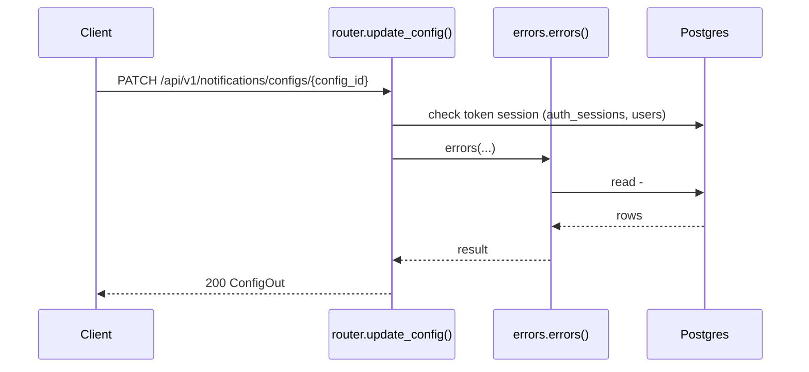

# Notifications API

> Generated by `scripts/gen_api_docs.py` from the code. Do not edit by hand; run `scripts/gen-docs.sh`.

## Overview

> In-app notifications and per-group reminder rules.

## Endpoints

| Method | Path | Summary |
|---|---|---|
| GET | [`/api/v1/notifications/user/{user_id}`](#get-apiv1notificationsuseruser_id) | A user's notifications |
| GET | [`/api/v1/notifications/user/{user_id}/unread-count`](#get-apiv1notificationsuseruser_idunread-count) | Unread notification count |
| PUT | [`/api/v1/notifications/{notification_id}/read`](#put-apiv1notificationsnotification_idread) | Mark a notification read |
| POST | [`/api/v1/notifications/configs`](#post-apiv1notificationsconfigs) | Create or replace a group reminder rule |
| GET | [`/api/v1/notifications/configs/group/{group_id}`](#get-apiv1notificationsconfigsgroupgroup_id) | A group's reminder rules |
| PATCH | [`/api/v1/notifications/configs/{config_id}`](#patch-apiv1notificationsconfigsconfig_id) | Update a reminder rule |

## Details

### `GET /api/v1/notifications/user/{user_id}`

A user's notifications

- **Auth:** Bearer access token
- **Success:** `200` → list of `NotificationOut`
- **Router:** [`list_notifications`](../../apps/api/src/chitbook_api/modules/notifications/router.py#L23) (router.py:23)
- **Calls:** [`errors`](../../apps/api/src/chitbook_api/core/errors.py#L234) (errors.py:234), [`list_for_user`](../../apps/api/src/chitbook_api/modules/notifications/service.py#L32) (service.py:32), [`list_for_user`](../../apps/api/src/chitbook_api/modules/notifications/repository.py#L11) (repository.py:11), [`to_out`](../../apps/api/src/chitbook_api/modules/notifications/service.py#L17) (service.py:17)
- **Access checks:** `require_self_or_platform_admin`

**Parameters**

| Name | In | Type | Required |
|---|---|---|---|
| `user_id` | path | integer | yes |
| `unreadOnly` | query | boolean | no |

**Response `200`**

| Field | Type | Required | Notes |
|---|---|---|---|
| `id` | integer | yes |  |
| `message` | string | yes |  |
| `type` | string | yes |  |
| `status` | NotificationStatus | yes |  |
| `userId` | integer | yes |  |
| `userName` | string | yes |  |
| `createdAt` | string | yes |  |

```json
[
  {
    "id": 1,
    "message": "string",
    "type": "string",
    "status": "UNREAD",
    "userId": 1,
    "userName": "ravi",
    "createdAt": "2026-08-01T10:30:00+05:30"
  }
]
```

**Database**

- Writes: –
- Reads: `notifications`
- Token check reads `auth_sessions` + `users` (every signed-in request)

**Flow**



**Errors** (declared in the router with `responses=errors(...)`)

| HTTP | Code | Message | Exact problem / fix |
|---|---|---|---|
| 401 | `AUTH_REQUIRED` | Authentication required | No `Authorization: Bearer <token>` header. |
| 401 | `AUTH_TOKEN_INVALID` | Access token is invalid | Token malformed, signed with another JWT_SECRET (secret changed?), or user deleted. |
| 401 | `AUTH_TOKEN_EXPIRED` | Access token has expired | Access token older than ACCESS_TOKEN_TTL_MINUTES. Client should call /auth/refresh. |
| 401 | `AUTH_SESSION_REVOKED` | Session has been signed out | Device was signed out (logout, remote sign-out, password change or refresh-token reuse). |
| 403 | `FORBIDDEN` | You do not have access to this resource | You may only access your own user data (unless platform ADMIN). |
| 422 | `VALIDATION_ERROR` | Request data is invalid | Body/query/path does not match the schema. `details` lists each bad field and why. |
| 500 | `INTERNAL_ERROR` | An unexpected internal error occurred | A bug. Search `docker compose logs api` for the `requestId` and read the `request.unhandled_exception` line: it has the exception and stack trace. |
| 503 | `DB_UNAVAILABLE` | Database is unavailable | Postgres unreachable: host Postgres down, pg_hba.conf missing the Docker subnet, or wrong DB_* values in .env. See the `db.unavailable` log line. |

**Diagnose**

- Every response carries `X-Request-ID`; errors also return it as `error.requestId`.
- `docker compose logs api | grep <request_id>` shows the access line (`http.request`) and any error lines.
- Each error's exact problem is in the table above (from the router's `responses=errors(...)`).
- 500 / 503: see [logging & debugging](../operations/logging-and-debugging.md).

---

### `GET /api/v1/notifications/user/{user_id}/unread-count`

Unread notification count

- **Auth:** Bearer access token
- **Success:** `200` → `UnreadCount`
- **Router:** [`unread_count`](../../apps/api/src/chitbook_api/modules/notifications/router.py#L38) (router.py:38)
- **Calls:** [`unread_count`](../../apps/api/src/chitbook_api/modules/notifications/service.py#L39) (service.py:39), [`count_unread`](../../apps/api/src/chitbook_api/modules/notifications/repository.py#L20) (repository.py:20), [`errors`](../../apps/api/src/chitbook_api/core/errors.py#L234) (errors.py:234)
- **Access checks:** `require_self_or_platform_admin`

**Parameters**

| Name | In | Type | Required |
|---|---|---|---|
| `user_id` | path | integer | yes |

**Response `200`**

| Field | Type | Required | Notes |
|---|---|---|---|
| `count` | integer | yes |  |

```json
{
  "count": 1
}
```

**Database**

- Writes: –
- Reads: `notifications`
- Token check reads `auth_sessions` + `users` (every signed-in request)

**Flow**



**Errors** (declared in the router with `responses=errors(...)`)

| HTTP | Code | Message | Exact problem / fix |
|---|---|---|---|
| 401 | `AUTH_REQUIRED` | Authentication required | No `Authorization: Bearer <token>` header. |
| 401 | `AUTH_TOKEN_INVALID` | Access token is invalid | Token malformed, signed with another JWT_SECRET (secret changed?), or user deleted. |
| 401 | `AUTH_TOKEN_EXPIRED` | Access token has expired | Access token older than ACCESS_TOKEN_TTL_MINUTES. Client should call /auth/refresh. |
| 401 | `AUTH_SESSION_REVOKED` | Session has been signed out | Device was signed out (logout, remote sign-out, password change or refresh-token reuse). |
| 403 | `FORBIDDEN` | You do not have access to this resource | You may only access your own user data (unless platform ADMIN). |
| 422 | `VALIDATION_ERROR` | Request data is invalid | Body/query/path does not match the schema. `details` lists each bad field and why. |
| 500 | `INTERNAL_ERROR` | An unexpected internal error occurred | A bug. Search `docker compose logs api` for the `requestId` and read the `request.unhandled_exception` line: it has the exception and stack trace. |
| 503 | `DB_UNAVAILABLE` | Database is unavailable | Postgres unreachable: host Postgres down, pg_hba.conf missing the Docker subnet, or wrong DB_* values in .env. See the `db.unavailable` log line. |

**Diagnose**

- Every response carries `X-Request-ID`; errors also return it as `error.requestId`.
- `docker compose logs api | grep <request_id>` shows the access line (`http.request`) and any error lines.
- Each error's exact problem is in the table above (from the router's `responses=errors(...)`).
- 500 / 503: see [logging & debugging](../operations/logging-and-debugging.md).

---

### `PUT /api/v1/notifications/{notification_id}/read`

Mark a notification read

- **Auth:** Bearer access token
- **Success:** `200` → `NotificationOut`
- **Router:** [`mark_read`](../../apps/api/src/chitbook_api/modules/notifications/router.py#L48) (router.py:48)
- **Calls:** [`errors`](../../apps/api/src/chitbook_api/core/errors.py#L234) (errors.py:234), [`mark_read`](../../apps/api/src/chitbook_api/modules/notifications/service.py#L44) (service.py:44), [`to_out`](../../apps/api/src/chitbook_api/modules/notifications/service.py#L17) (service.py:17)
- **Access checks:** `require_self_or_platform_admin`

**Parameters**

| Name | In | Type | Required |
|---|---|---|---|
| `notification_id` | path | integer | yes |

**Response `200`**

| Field | Type | Required | Notes |
|---|---|---|---|
| `id` | integer | yes |  |
| `message` | string | yes |  |
| `type` | string | yes |  |
| `status` | NotificationStatus | yes |  |
| `userId` | integer | yes |  |
| `userName` | string | yes |  |
| `createdAt` | string | yes |  |

```json
{
  "id": 1,
  "message": "string",
  "type": "string",
  "status": "UNREAD",
  "userId": 1,
  "userName": "ravi",
  "createdAt": "2026-08-01T10:30:00+05:30"
}
```

**Database**

- Writes: `notifications`
- Reads: `notifications`
- Token check reads `auth_sessions` + `users` (every signed-in request)

**Flow**



**Errors** (declared in the router with `responses=errors(...)`)

| HTTP | Code | Message | Exact problem / fix |
|---|---|---|---|
| 401 | `AUTH_REQUIRED` | Authentication required | No `Authorization: Bearer <token>` header. |
| 401 | `AUTH_TOKEN_INVALID` | Access token is invalid | Token malformed, signed with another JWT_SECRET (secret changed?), or user deleted. |
| 401 | `AUTH_TOKEN_EXPIRED` | Access token has expired | Access token older than ACCESS_TOKEN_TTL_MINUTES. Client should call /auth/refresh. |
| 401 | `AUTH_SESSION_REVOKED` | Session has been signed out | Device was signed out (logout, remote sign-out, password change or refresh-token reuse). |
| 403 | `FORBIDDEN` | You do not have access to this resource | You may only access your own user data (unless platform ADMIN). |
| 404 | `NOTIFICATION_NOT_FOUND` | Notification not found | Wrong notification id. |
| 422 | `VALIDATION_ERROR` | Request data is invalid | Body/query/path does not match the schema. `details` lists each bad field and why. |
| 500 | `INTERNAL_ERROR` | An unexpected internal error occurred | A bug. Search `docker compose logs api` for the `requestId` and read the `request.unhandled_exception` line: it has the exception and stack trace. |
| 503 | `DB_UNAVAILABLE` | Database is unavailable | Postgres unreachable: host Postgres down, pg_hba.conf missing the Docker subnet, or wrong DB_* values in .env. See the `db.unavailable` log line. |

**Diagnose**

- Every response carries `X-Request-ID`; errors also return it as `error.requestId`.
- `docker compose logs api | grep <request_id>` shows the access line (`http.request`) and any error lines.
- Each error's exact problem is in the table above (from the router's `responses=errors(...)`).
- 500 / 503: see [logging & debugging](../operations/logging-and-debugging.md).

---

### `POST /api/v1/notifications/configs`

Create or replace a group reminder rule

- **Auth:** Bearer access token
- **Success:** `201` → `ConfigOut`
- **Router:** [`upsert_config`](../../apps/api/src/chitbook_api/modules/notifications/router.py#L60) (router.py:60)
- **Calls:** [`errors`](../../apps/api/src/chitbook_api/core/errors.py#L234) (errors.py:234), [`upsert_config`](../../apps/api/src/chitbook_api/modules/notifications/service.py#L54) (service.py:54), [`get_config_by_type`](../../apps/api/src/chitbook_api/modules/notifications/repository.py#L29) (repository.py:29)
- **Access checks:** `require_group_admin`, `require_group_member`, `active_membership`

**Request body**

| Field | Type | Required | Notes |
|---|---|---|---|
| `chitGroupId` | integer | yes |  |
| `notificationType` | string | yes | minLength=1; maxLength=50; e.g. PAYMENT_REMINDER, LOAN_DUE |
| `advanceDays` | integer | yes | minimum=0.0; maximum=60.0 |
| `enabled` | boolean | no |  |
| `messageTemplate` | string or null | no | maxLength=500 |
| `recurringDay` | integer or null | no | minimum=1.0; maximum=31.0 |

```json
{
  "chitGroupId": 1,
  "notificationType": "string",
  "advanceDays": 1,
  "enabled": true,
  "messageTemplate": "string",
  "recurringDay": 1
}
```

**Response `201`**

| Field | Type | Required | Notes |
|---|---|---|---|
| `id` | integer | yes |  |
| `chitGroupId` | integer | yes |  |
| `notificationType` | string | yes |  |
| `advanceDays` | integer | yes |  |
| `enabled` | boolean | yes |  |
| `messageTemplate` | string or null | yes |  |
| `recurringDay` | integer or null | yes |  |
| `createdAt` | string | yes |  |
| `updatedAt` | string | yes |  |

```json
{
  "id": 1,
  "chitGroupId": 1,
  "notificationType": "string",
  "advanceDays": 1,
  "enabled": true,
  "messageTemplate": "string",
  "recurringDay": 1,
  "createdAt": "2026-08-01T10:30:00+05:30",
  "updatedAt": "2026-08-01T10:30:00+05:30"
}
```

**Database**: no SQL recorded (the endpoint does not use the database, or no test calls it).

**Flow**



**Errors** (declared in the router with `responses=errors(...)`)

| HTTP | Code | Message | Exact problem / fix |
|---|---|---|---|
| 401 | `AUTH_REQUIRED` | Authentication required | No `Authorization: Bearer <token>` header. |
| 401 | `AUTH_TOKEN_INVALID` | Access token is invalid | Token malformed, signed with another JWT_SECRET (secret changed?), or user deleted. |
| 401 | `AUTH_TOKEN_EXPIRED` | Access token has expired | Access token older than ACCESS_TOKEN_TTL_MINUTES. Client should call /auth/refresh. |
| 401 | `AUTH_SESSION_REVOKED` | Session has been signed out | Device was signed out (logout, remote sign-out, password change or refresh-token reuse). |
| 403 | `NOT_GROUP_MEMBER` | You are not an active member of this group | Caller (or the target user) is not an ACTIVE member of the group. |
| 403 | `NOT_GROUP_ADMIN` | Group admin access is required | Caller is a member but not the group's ADMIN. |
| 422 | `VALIDATION_ERROR` | Request data is invalid | Body/query/path does not match the schema. `details` lists each bad field and why. |
| 500 | `INTERNAL_ERROR` | An unexpected internal error occurred | A bug. Search `docker compose logs api` for the `requestId` and read the `request.unhandled_exception` line: it has the exception and stack trace. |
| 503 | `DB_UNAVAILABLE` | Database is unavailable | Postgres unreachable: host Postgres down, pg_hba.conf missing the Docker subnet, or wrong DB_* values in .env. See the `db.unavailable` log line. |

**Diagnose**

- Every response carries `X-Request-ID`; errors also return it as `error.requestId`.
- `docker compose logs api | grep <request_id>` shows the access line (`http.request`) and any error lines.
- Each error's exact problem is in the table above (from the router's `responses=errors(...)`).
- Log events on success: `notification_config.saved (info)`
- 500 / 503: see [logging & debugging](../operations/logging-and-debugging.md).

---

### `GET /api/v1/notifications/configs/group/{group_id}`

A group's reminder rules

- **Auth:** Bearer access token
- **Success:** `200` → list of `ConfigOut`
- **Router:** [`list_configs`](../../apps/api/src/chitbook_api/modules/notifications/router.py#L71) (router.py:71)
- **Calls:** [`errors`](../../apps/api/src/chitbook_api/core/errors.py#L234) (errors.py:234), [`list_configs`](../../apps/api/src/chitbook_api/modules/notifications/service.py#L76) (service.py:76), [`list_configs`](../../apps/api/src/chitbook_api/modules/notifications/repository.py#L40) (repository.py:40)
- **Access checks:** `require_group_admin`, `require_group_member`, `active_membership`

**Parameters**

| Name | In | Type | Required |
|---|---|---|---|
| `group_id` | path | integer | yes |

**Response `200`**

| Field | Type | Required | Notes |
|---|---|---|---|
| `id` | integer | yes |  |
| `chitGroupId` | integer | yes |  |
| `notificationType` | string | yes |  |
| `advanceDays` | integer | yes |  |
| `enabled` | boolean | yes |  |
| `messageTemplate` | string or null | yes |  |
| `recurringDay` | integer or null | yes |  |
| `createdAt` | string | yes |  |
| `updatedAt` | string | yes |  |

```json
[
  {
    "id": 1,
    "chitGroupId": 1,
    "notificationType": "string",
    "advanceDays": 1,
    "enabled": true,
    "messageTemplate": "string",
    "recurringDay": 1,
    "createdAt": "2026-08-01T10:30:00+05:30",
    "updatedAt": "2026-08-01T10:30:00+05:30"
  }
]
```

**Database**: no SQL recorded (the endpoint does not use the database, or no test calls it).

**Flow**



**Errors** (declared in the router with `responses=errors(...)`)

| HTTP | Code | Message | Exact problem / fix |
|---|---|---|---|
| 401 | `AUTH_REQUIRED` | Authentication required | No `Authorization: Bearer <token>` header. |
| 401 | `AUTH_TOKEN_INVALID` | Access token is invalid | Token malformed, signed with another JWT_SECRET (secret changed?), or user deleted. |
| 401 | `AUTH_TOKEN_EXPIRED` | Access token has expired | Access token older than ACCESS_TOKEN_TTL_MINUTES. Client should call /auth/refresh. |
| 401 | `AUTH_SESSION_REVOKED` | Session has been signed out | Device was signed out (logout, remote sign-out, password change or refresh-token reuse). |
| 403 | `NOT_GROUP_MEMBER` | You are not an active member of this group | Caller (or the target user) is not an ACTIVE member of the group. |
| 403 | `NOT_GROUP_ADMIN` | Group admin access is required | Caller is a member but not the group's ADMIN. |
| 422 | `VALIDATION_ERROR` | Request data is invalid | Body/query/path does not match the schema. `details` lists each bad field and why. |
| 500 | `INTERNAL_ERROR` | An unexpected internal error occurred | A bug. Search `docker compose logs api` for the `requestId` and read the `request.unhandled_exception` line: it has the exception and stack trace. |
| 503 | `DB_UNAVAILABLE` | Database is unavailable | Postgres unreachable: host Postgres down, pg_hba.conf missing the Docker subnet, or wrong DB_* values in .env. See the `db.unavailable` log line. |

**Diagnose**

- Every response carries `X-Request-ID`; errors also return it as `error.requestId`.
- `docker compose logs api | grep <request_id>` shows the access line (`http.request`) and any error lines.
- Each error's exact problem is in the table above (from the router's `responses=errors(...)`).
- 500 / 503: see [logging & debugging](../operations/logging-and-debugging.md).

---

### `PATCH /api/v1/notifications/configs/{config_id}`

Update a reminder rule

- **Auth:** Bearer access token
- **Success:** `200` → `ConfigOut`
- **Router:** [`update_config`](../../apps/api/src/chitbook_api/modules/notifications/router.py#L81) (router.py:81)
- **Calls:** [`errors`](../../apps/api/src/chitbook_api/core/errors.py#L234) (errors.py:234), [`update_config`](../../apps/api/src/chitbook_api/modules/notifications/service.py#L81) (service.py:81)
- **Access checks:** `require_group_admin`, `require_group_member`, `active_membership`

**Parameters**

| Name | In | Type | Required |
|---|---|---|---|
| `config_id` | path | integer | yes |

**Request body**

| Field | Type | Required | Notes |
|---|---|---|---|
| `advanceDays` | integer or null | no | minimum=0.0; maximum=60.0 |
| `enabled` | boolean or null | no |  |
| `messageTemplate` | string or null | no | maxLength=500 |
| `recurringDay` | integer or null | no | minimum=1.0; maximum=31.0 |

```json
{
  "advanceDays": 1,
  "enabled": true,
  "messageTemplate": "string",
  "recurringDay": 1
}
```

**Response `200`**

| Field | Type | Required | Notes |
|---|---|---|---|
| `id` | integer | yes |  |
| `chitGroupId` | integer | yes |  |
| `notificationType` | string | yes |  |
| `advanceDays` | integer | yes |  |
| `enabled` | boolean | yes |  |
| `messageTemplate` | string or null | yes |  |
| `recurringDay` | integer or null | yes |  |
| `createdAt` | string | yes |  |
| `updatedAt` | string | yes |  |

```json
{
  "id": 1,
  "chitGroupId": 1,
  "notificationType": "string",
  "advanceDays": 1,
  "enabled": true,
  "messageTemplate": "string",
  "recurringDay": 1,
  "createdAt": "2026-08-01T10:30:00+05:30",
  "updatedAt": "2026-08-01T10:30:00+05:30"
}
```

**Database**: no SQL recorded (the endpoint does not use the database, or no test calls it).

**Flow**



**Errors** (declared in the router with `responses=errors(...)`)

| HTTP | Code | Message | Exact problem / fix |
|---|---|---|---|
| 401 | `AUTH_REQUIRED` | Authentication required | No `Authorization: Bearer <token>` header. |
| 401 | `AUTH_TOKEN_INVALID` | Access token is invalid | Token malformed, signed with another JWT_SECRET (secret changed?), or user deleted. |
| 401 | `AUTH_TOKEN_EXPIRED` | Access token has expired | Access token older than ACCESS_TOKEN_TTL_MINUTES. Client should call /auth/refresh. |
| 401 | `AUTH_SESSION_REVOKED` | Session has been signed out | Device was signed out (logout, remote sign-out, password change or refresh-token reuse). |
| 403 | `NOT_GROUP_MEMBER` | You are not an active member of this group | Caller (or the target user) is not an ACTIVE member of the group. |
| 403 | `NOT_GROUP_ADMIN` | Group admin access is required | Caller is a member but not the group's ADMIN. |
| 404 | `NOTIFICATION_CONFIG_NOT_FOUND` | Notification config not found | Wrong config id. |
| 422 | `VALIDATION_ERROR` | Request data is invalid | Body/query/path does not match the schema. `details` lists each bad field and why. |
| 500 | `INTERNAL_ERROR` | An unexpected internal error occurred | A bug. Search `docker compose logs api` for the `requestId` and read the `request.unhandled_exception` line: it has the exception and stack trace. |
| 503 | `DB_UNAVAILABLE` | Database is unavailable | Postgres unreachable: host Postgres down, pg_hba.conf missing the Docker subnet, or wrong DB_* values in .env. See the `db.unavailable` log line. |

**Diagnose**

- Every response carries `X-Request-ID`; errors also return it as `error.requestId`.
- `docker compose logs api | grep <request_id>` shows the access line (`http.request`) and any error lines.
- Each error's exact problem is in the table above (from the router's `responses=errors(...)`).
- Log events on success: `notification_config.updated (info)`
- 500 / 503: see [logging & debugging](../operations/logging-and-debugging.md).

---

