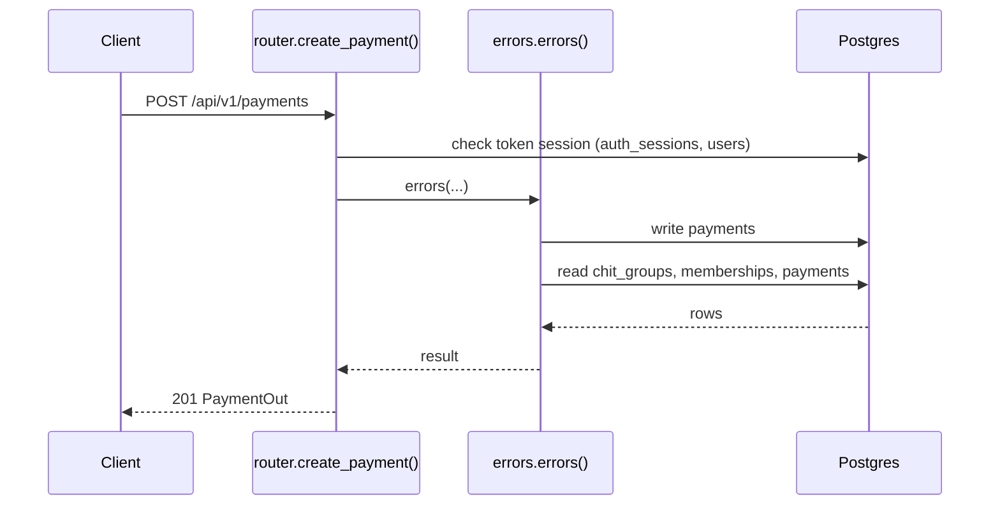
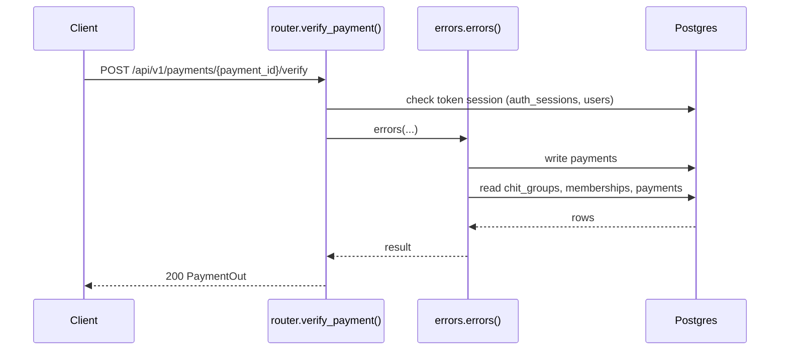
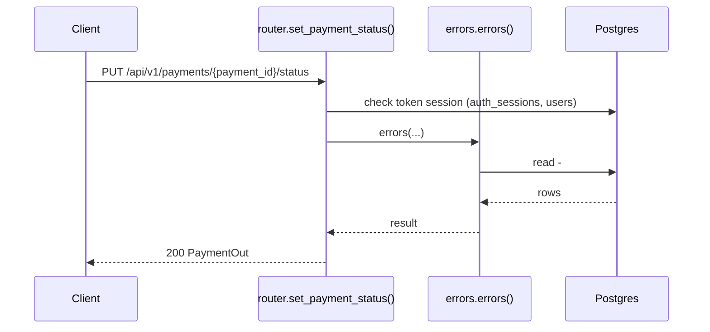
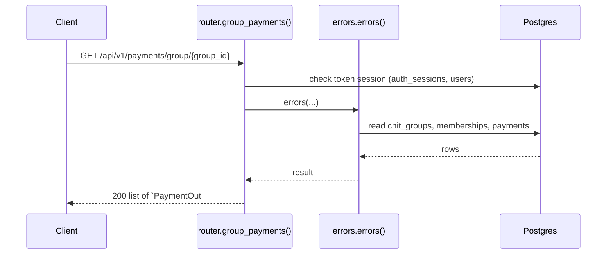
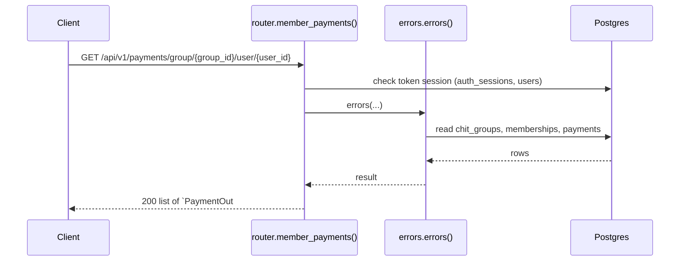

# Payments API

> Generated by `scripts/gen_api_docs.py` from the code. Do not edit by hand; run `scripts/gen-docs.sh`.

## Overview

> Monthly contributions paid into a chit group, and their verification.

## Endpoints

| Method | Path | Summary |
|---|---|---|
| POST | [`/api/v1/payments`](#post-apiv1payments) | Record a payment |
| POST | [`/api/v1/payments/{payment_id}/verify`](#post-apiv1paymentspayment_idverify) | Mark a payment verified |
| PUT | [`/api/v1/payments/{payment_id}/status`](#put-apiv1paymentspayment_idstatus) | Change a payment's status |
| GET | [`/api/v1/payments/group/{group_id}`](#get-apiv1paymentsgroupgroup_id) | All payments of a group |
| GET | [`/api/v1/payments/group/{group_id}/user/{user_id}`](#get-apiv1paymentsgroupgroup_iduseruser_id) | One member's payments in a group |

## Details

### `POST /api/v1/payments`

Record a payment

- **Auth:** Bearer access token
- **Success:** `201` → `PaymentOut`
- **Router:** [`create_payment`](../../apps/api/src/chitbook_api/modules/payments/router.py#L15) (router.py:15)
- **Calls:** [`errors`](../../apps/api/src/chitbook_api/core/errors.py#L234) (errors.py:234), [`create`](../../apps/api/src/chitbook_api/modules/payments/service.py#L49) (service.py:49), [`now`](../../apps/api/src/chitbook_api/core/time.py#L14) (time.py:14), [`_can_manage_payments`](../../apps/api/src/chitbook_api/modules/payments/service.py#L31) (service.py:31), [`get_by_id`](../../apps/api/src/chitbook_api/modules/users/repository.py#L13) (repository.py:13), [`_reload`](../../apps/api/src/chitbook_api/modules/payments/service.py#L43) (service.py:43), [`to_out`](../../apps/api/src/chitbook_api/modules/payments/service.py#L21) (service.py:21), [`require_group`](../../apps/api/src/chitbook_api/modules/groups/service.py#L59) (service.py:59)
- **Access checks:** `is_group_admin`, `active_membership`

**Request body**

| Field | Type | Required | Notes |
|---|---|---|---|
| `userId` | integer | yes | Member who paid (yourself unless you are a group admin/accountant) |
| `chitGroupId` | integer | yes |  |
| `month` | string | yes | minLength=1; maxLength=15; e.g. 2026-08 |
| `amountPaid` | number or string | yes | exclusiveMinimum=0.0 |
| `paymentDate` | date-time or null | no | Default now |
| `mode` | string | yes | minLength=1; maxLength=20; CASH, UPI, BANK_TRANSFER, ... |

```json
{
  "userId": 1,
  "chitGroupId": 1,
  "month": "2026-08",
  "amountPaid": 25000.0,
  "paymentDate": "2026-08-01T10:30:00+05:30",
  "mode": "UPI"
}
```

**Response `201`**

| Field | Type | Required | Notes |
|---|---|---|---|
| `id` | integer | yes |  |
| `month` | string | yes |  |
| `amountPaid` | number | yes |  |
| `paymentDate` | string | yes |  |
| `mode` | string | yes |  |
| `status` | PaymentStatus | yes |  |
| `userId` | integer | yes |  |
| `userName` | string | yes |  |
| `chitGroupId` | integer | yes |  |
| `chitGroupName` | string | yes |  |
| `verified` | boolean | yes |  |
| `verifiedByUserId` | integer or null | yes |  |
| `verifiedByUserName` | string or null | yes |  |
| `verifiedAt` | string or null | yes |  |
| `createdAt` | string | yes |  |
| `updatedAt` | string | yes |  |

```json
{
  "id": 1,
  "month": "2026-08",
  "amountPaid": 25000.0,
  "paymentDate": "2026-08-01T10:30:00+05:30",
  "mode": "UPI",
  "status": "PENDING",
  "userId": 1,
  "userName": "ravi",
  "chitGroupId": 1,
  "chitGroupName": "string",
  "verified": false,
  "verifiedByUserId": 1,
  "verifiedByUserName": "string",
  "verifiedAt": "2026-08-01T10:30:00+05:30",
  "createdAt": "2026-08-01T10:30:00+05:30",
  "updatedAt": "2026-08-01T10:30:00+05:30"
}
```

**Database**

- Writes: `payments`
- Reads: `chit_groups`, `memberships`, `payments`
- Token check reads `auth_sessions` + `users` (every signed-in request)

**Flow**



**Errors** (declared in the router with `responses=errors(...)`)

| HTTP | Code | Message | Exact problem / fix |
|---|---|---|---|
| 401 | `AUTH_REQUIRED` | Authentication required | No `Authorization: Bearer <token>` header. |
| 401 | `AUTH_TOKEN_INVALID` | Access token is invalid | Token malformed, signed with another JWT_SECRET (secret changed?), or user deleted. |
| 401 | `AUTH_TOKEN_EXPIRED` | Access token has expired | Access token older than ACCESS_TOKEN_TTL_MINUTES. Client should call /auth/refresh. |
| 401 | `AUTH_SESSION_REVOKED` | Session has been signed out | Device was signed out (logout, remote sign-out, password change or refresh-token reuse). |
| 403 | `PAYMENT_NOT_ALLOWED` | You can only record payments for yourself unless you administer this group | Members may only record their own payments. |
| 403 | `PAYMENT_MEMBER_INACTIVE` | Payments can only be recorded for active group members | The paying user is not an ACTIVE member. |
| 404 | `GROUP_NOT_FOUND` | Chit group not found | Wrong group id or group code. |
| 404 | `USER_NOT_FOUND` | User not found | No user with that id/username. |
| 422 | `VALIDATION_ERROR` | Request data is invalid | Body/query/path does not match the schema. `details` lists each bad field and why. |
| 500 | `INTERNAL_ERROR` | An unexpected internal error occurred | A bug. Search `docker compose logs api` for the `requestId` and read the `request.unhandled_exception` line: it has the exception and stack trace. |
| 503 | `DB_UNAVAILABLE` | Database is unavailable | Postgres unreachable: host Postgres down, pg_hba.conf missing the Docker subnet, or wrong DB_* values in .env. See the `db.unavailable` log line. |

**Diagnose**

- Every response carries `X-Request-ID`; errors also return it as `error.requestId`.
- `docker compose logs api | grep <request_id>` shows the access line (`http.request`) and any error lines.
- Each error's exact problem is in the table above (from the router's `responses=errors(...)`).
- Log events on success: `payment.recorded (info)`
- 500 / 503: see [logging & debugging](../operations/logging-and-debugging.md).

---

### `POST /api/v1/payments/{payment_id}/verify`

Mark a payment verified

- **Auth:** Bearer access token
- **Success:** `200` → `PaymentOut`
- **Router:** [`verify_payment`](../../apps/api/src/chitbook_api/modules/payments/router.py#L33) (router.py:33)
- **Calls:** [`errors`](../../apps/api/src/chitbook_api/core/errors.py#L234) (errors.py:234), [`verify`](../../apps/api/src/chitbook_api/modules/payments/service.py#L76) (service.py:76), [`_can_manage_payments`](../../apps/api/src/chitbook_api/modules/payments/service.py#L31) (service.py:31), [`_reload`](../../apps/api/src/chitbook_api/modules/payments/service.py#L43) (service.py:43), [`to_out`](../../apps/api/src/chitbook_api/modules/payments/service.py#L21) (service.py:21), [`_require`](../../apps/api/src/chitbook_api/modules/payments/service.py#L36) (service.py:36), [`get`](../../apps/api/src/chitbook_api/modules/payments/repository.py#L13) (repository.py:13), [`now`](../../apps/api/src/chitbook_api/core/time.py#L14) (time.py:14)
- **Access checks:** `is_group_admin`, `active_membership`

**Parameters**

| Name | In | Type | Required |
|---|---|---|---|
| `payment_id` | path | integer | yes |

**Response `200`**

| Field | Type | Required | Notes |
|---|---|---|---|
| `id` | integer | yes |  |
| `month` | string | yes |  |
| `amountPaid` | number | yes |  |
| `paymentDate` | string | yes |  |
| `mode` | string | yes |  |
| `status` | PaymentStatus | yes |  |
| `userId` | integer | yes |  |
| `userName` | string | yes |  |
| `chitGroupId` | integer | yes |  |
| `chitGroupName` | string | yes |  |
| `verified` | boolean | yes |  |
| `verifiedByUserId` | integer or null | yes |  |
| `verifiedByUserName` | string or null | yes |  |
| `verifiedAt` | string or null | yes |  |
| `createdAt` | string | yes |  |
| `updatedAt` | string | yes |  |

```json
{
  "id": 1,
  "month": "2026-08",
  "amountPaid": 25000.0,
  "paymentDate": "2026-08-01T10:30:00+05:30",
  "mode": "UPI",
  "status": "PENDING",
  "userId": 1,
  "userName": "ravi",
  "chitGroupId": 1,
  "chitGroupName": "string",
  "verified": false,
  "verifiedByUserId": 1,
  "verifiedByUserName": "string",
  "verifiedAt": "2026-08-01T10:30:00+05:30",
  "createdAt": "2026-08-01T10:30:00+05:30",
  "updatedAt": "2026-08-01T10:30:00+05:30"
}
```

**Database**

- Writes: `payments`
- Reads: `chit_groups`, `memberships`, `payments`
- Token check reads `auth_sessions` + `users` (every signed-in request)

**Flow**



**Errors** (declared in the router with `responses=errors(...)`)

| HTTP | Code | Message | Exact problem / fix |
|---|---|---|---|
| 401 | `AUTH_REQUIRED` | Authentication required | No `Authorization: Bearer <token>` header. |
| 401 | `AUTH_TOKEN_INVALID` | Access token is invalid | Token malformed, signed with another JWT_SECRET (secret changed?), or user deleted. |
| 401 | `AUTH_TOKEN_EXPIRED` | Access token has expired | Access token older than ACCESS_TOKEN_TTL_MINUTES. Client should call /auth/refresh. |
| 401 | `AUTH_SESSION_REVOKED` | Session has been signed out | Device was signed out (logout, remote sign-out, password change or refresh-token reuse). |
| 403 | `PAYMENT_VERIFY_NOT_ALLOWED` | Only a group admin, accountant or platform admin can verify payments | Only group admins, ACCOUNTANT users or platform admins verify payments. |
| 404 | `PAYMENT_NOT_FOUND` | Payment not found | Wrong payment id. |
| 422 | `VALIDATION_ERROR` | Request data is invalid | Body/query/path does not match the schema. `details` lists each bad field and why. |
| 500 | `INTERNAL_ERROR` | An unexpected internal error occurred | A bug. Search `docker compose logs api` for the `requestId` and read the `request.unhandled_exception` line: it has the exception and stack trace. |
| 503 | `DB_UNAVAILABLE` | Database is unavailable | Postgres unreachable: host Postgres down, pg_hba.conf missing the Docker subnet, or wrong DB_* values in .env. See the `db.unavailable` log line. |

**Diagnose**

- Every response carries `X-Request-ID`; errors also return it as `error.requestId`.
- `docker compose logs api | grep <request_id>` shows the access line (`http.request`) and any error lines.
- Each error's exact problem is in the table above (from the router's `responses=errors(...)`).
- Log events on success: `payment.verified (info)`
- 500 / 503: see [logging & debugging](../operations/logging-and-debugging.md).

---

### `PUT /api/v1/payments/{payment_id}/status`

Change a payment's status

- **Auth:** Bearer access token
- **Success:** `200` → `PaymentOut`
- **Router:** [`set_payment_status`](../../apps/api/src/chitbook_api/modules/payments/router.py#L45) (router.py:45)
- **Calls:** [`errors`](../../apps/api/src/chitbook_api/core/errors.py#L234) (errors.py:234), [`set_status`](../../apps/api/src/chitbook_api/modules/payments/service.py#L89) (service.py:89), [`_reload`](../../apps/api/src/chitbook_api/modules/payments/service.py#L43) (service.py:43), [`to_out`](../../apps/api/src/chitbook_api/modules/payments/service.py#L21) (service.py:21), [`_require`](../../apps/api/src/chitbook_api/modules/payments/service.py#L36) (service.py:36), [`get`](../../apps/api/src/chitbook_api/modules/payments/repository.py#L13) (repository.py:13)
- **Access checks:** `require_group_admin`, `require_group_member`, `active_membership`

**Parameters**

| Name | In | Type | Required |
|---|---|---|---|
| `payment_id` | path | integer | yes |

**Request body**

| Field | Type | Required | Notes |
|---|---|---|---|
| `status` | PaymentStatus | yes |  |

```json
{
  "status": "PENDING"
}
```

**Response `200`**

| Field | Type | Required | Notes |
|---|---|---|---|
| `id` | integer | yes |  |
| `month` | string | yes |  |
| `amountPaid` | number | yes |  |
| `paymentDate` | string | yes |  |
| `mode` | string | yes |  |
| `status` | PaymentStatus | yes |  |
| `userId` | integer | yes |  |
| `userName` | string | yes |  |
| `chitGroupId` | integer | yes |  |
| `chitGroupName` | string | yes |  |
| `verified` | boolean | yes |  |
| `verifiedByUserId` | integer or null | yes |  |
| `verifiedByUserName` | string or null | yes |  |
| `verifiedAt` | string or null | yes |  |
| `createdAt` | string | yes |  |
| `updatedAt` | string | yes |  |

```json
{
  "id": 1,
  "month": "2026-08",
  "amountPaid": 25000.0,
  "paymentDate": "2026-08-01T10:30:00+05:30",
  "mode": "UPI",
  "status": "PENDING",
  "userId": 1,
  "userName": "ravi",
  "chitGroupId": 1,
  "chitGroupName": "string",
  "verified": false,
  "verifiedByUserId": 1,
  "verifiedByUserName": "string",
  "verifiedAt": "2026-08-01T10:30:00+05:30",
  "createdAt": "2026-08-01T10:30:00+05:30",
  "updatedAt": "2026-08-01T10:30:00+05:30"
}
```

**Database**: no SQL recorded (the endpoint does not use the database, or no test calls it).

**Flow**



**Errors** (declared in the router with `responses=errors(...)`)

| HTTP | Code | Message | Exact problem / fix |
|---|---|---|---|
| 401 | `AUTH_REQUIRED` | Authentication required | No `Authorization: Bearer <token>` header. |
| 401 | `AUTH_TOKEN_INVALID` | Access token is invalid | Token malformed, signed with another JWT_SECRET (secret changed?), or user deleted. |
| 401 | `AUTH_TOKEN_EXPIRED` | Access token has expired | Access token older than ACCESS_TOKEN_TTL_MINUTES. Client should call /auth/refresh. |
| 401 | `AUTH_SESSION_REVOKED` | Session has been signed out | Device was signed out (logout, remote sign-out, password change or refresh-token reuse). |
| 403 | `NOT_GROUP_MEMBER` | You are not an active member of this group | Caller (or the target user) is not an ACTIVE member of the group. |
| 403 | `NOT_GROUP_ADMIN` | Group admin access is required | Caller is a member but not the group's ADMIN. |
| 404 | `PAYMENT_NOT_FOUND` | Payment not found | Wrong payment id. |
| 422 | `VALIDATION_ERROR` | Request data is invalid | Body/query/path does not match the schema. `details` lists each bad field and why. |
| 500 | `INTERNAL_ERROR` | An unexpected internal error occurred | A bug. Search `docker compose logs api` for the `requestId` and read the `request.unhandled_exception` line: it has the exception and stack trace. |
| 503 | `DB_UNAVAILABLE` | Database is unavailable | Postgres unreachable: host Postgres down, pg_hba.conf missing the Docker subnet, or wrong DB_* values in .env. See the `db.unavailable` log line. |

**Diagnose**

- Every response carries `X-Request-ID`; errors also return it as `error.requestId`.
- `docker compose logs api | grep <request_id>` shows the access line (`http.request`) and any error lines.
- Each error's exact problem is in the table above (from the router's `responses=errors(...)`).
- Log events on success: `payment.status_changed (info)`
- 500 / 503: see [logging & debugging](../operations/logging-and-debugging.md).

---

### `GET /api/v1/payments/group/{group_id}`

All payments of a group

- **Auth:** Bearer access token
- **Success:** `200` → list of `PaymentOut`
- **Router:** [`group_payments`](../../apps/api/src/chitbook_api/modules/payments/router.py#L57) (router.py:57)
- **Calls:** [`errors`](../../apps/api/src/chitbook_api/core/errors.py#L234) (errors.py:234), [`list_for_group`](../../apps/api/src/chitbook_api/modules/payments/service.py#L100) (service.py:100), [`list_for_group`](../../apps/api/src/chitbook_api/modules/payments/repository.py#L17) (repository.py:17), [`to_out`](../../apps/api/src/chitbook_api/modules/payments/service.py#L21) (service.py:21)
- **Access checks:** `require_group_admin`, `require_group_member`, `active_membership`

**Parameters**

| Name | In | Type | Required |
|---|---|---|---|
| `group_id` | path | integer | yes |

**Response `200`**

| Field | Type | Required | Notes |
|---|---|---|---|
| `id` | integer | yes |  |
| `month` | string | yes |  |
| `amountPaid` | number | yes |  |
| `paymentDate` | string | yes |  |
| `mode` | string | yes |  |
| `status` | PaymentStatus | yes |  |
| `userId` | integer | yes |  |
| `userName` | string | yes |  |
| `chitGroupId` | integer | yes |  |
| `chitGroupName` | string | yes |  |
| `verified` | boolean | yes |  |
| `verifiedByUserId` | integer or null | yes |  |
| `verifiedByUserName` | string or null | yes |  |
| `verifiedAt` | string or null | yes |  |
| `createdAt` | string | yes |  |
| `updatedAt` | string | yes |  |

```json
[
  {
    "id": 1,
    "month": "2026-08",
    "amountPaid": 25000.0,
    "paymentDate": "2026-08-01T10:30:00+05:30",
    "mode": "UPI",
    "status": "PENDING",
    "userId": 1,
    "userName": "ravi",
    "chitGroupId": 1,
    "chitGroupName": "string",
    "verified": false,
    "verifiedByUserId": 1,
    "verifiedByUserName": "string",
    "verifiedAt": "2026-08-01T10:30:00+05:30",
    "createdAt": "2026-08-01T10:30:00+05:30",
    "updatedAt": "2026-08-01T10:30:00+05:30"
  }
]
```

**Database**

- Writes: –
- Reads: `chit_groups`, `memberships`, `payments`
- Token check reads `auth_sessions` + `users` (every signed-in request)

**Flow**



**Errors** (declared in the router with `responses=errors(...)`)

| HTTP | Code | Message | Exact problem / fix |
|---|---|---|---|
| 401 | `AUTH_REQUIRED` | Authentication required | No `Authorization: Bearer <token>` header. |
| 401 | `AUTH_TOKEN_INVALID` | Access token is invalid | Token malformed, signed with another JWT_SECRET (secret changed?), or user deleted. |
| 401 | `AUTH_TOKEN_EXPIRED` | Access token has expired | Access token older than ACCESS_TOKEN_TTL_MINUTES. Client should call /auth/refresh. |
| 401 | `AUTH_SESSION_REVOKED` | Session has been signed out | Device was signed out (logout, remote sign-out, password change or refresh-token reuse). |
| 403 | `NOT_GROUP_MEMBER` | You are not an active member of this group | Caller (or the target user) is not an ACTIVE member of the group. |
| 403 | `NOT_GROUP_ADMIN` | Group admin access is required | Caller is a member but not the group's ADMIN. |
| 422 | `VALIDATION_ERROR` | Request data is invalid | Body/query/path does not match the schema. `details` lists each bad field and why. |
| 500 | `INTERNAL_ERROR` | An unexpected internal error occurred | A bug. Search `docker compose logs api` for the `requestId` and read the `request.unhandled_exception` line: it has the exception and stack trace. |
| 503 | `DB_UNAVAILABLE` | Database is unavailable | Postgres unreachable: host Postgres down, pg_hba.conf missing the Docker subnet, or wrong DB_* values in .env. See the `db.unavailable` log line. |

**Diagnose**

- Every response carries `X-Request-ID`; errors also return it as `error.requestId`.
- `docker compose logs api | grep <request_id>` shows the access line (`http.request`) and any error lines.
- Each error's exact problem is in the table above (from the router's `responses=errors(...)`).
- 500 / 503: see [logging & debugging](../operations/logging-and-debugging.md).

---

### `GET /api/v1/payments/group/{group_id}/user/{user_id}`

One member's payments in a group

- **Auth:** Bearer access token
- **Success:** `200` → list of `PaymentOut`
- **Router:** [`member_payments`](../../apps/api/src/chitbook_api/modules/payments/router.py#L67) (router.py:67)
- **Calls:** [`errors`](../../apps/api/src/chitbook_api/core/errors.py#L234) (errors.py:234), [`list_for_member`](../../apps/api/src/chitbook_api/modules/payments/service.py#L105) (service.py:105), [`list_for_group`](../../apps/api/src/chitbook_api/modules/payments/repository.py#L17) (repository.py:17), [`to_out`](../../apps/api/src/chitbook_api/modules/payments/service.py#L21) (service.py:21)
- **Access checks:** `require_self_or_group_admin`, `require_group_member`, `active_membership`, `require_group_admin`

**Parameters**

| Name | In | Type | Required |
|---|---|---|---|
| `group_id` | path | integer | yes |
| `user_id` | path | integer | yes |

**Response `200`**

| Field | Type | Required | Notes |
|---|---|---|---|
| `id` | integer | yes |  |
| `month` | string | yes |  |
| `amountPaid` | number | yes |  |
| `paymentDate` | string | yes |  |
| `mode` | string | yes |  |
| `status` | PaymentStatus | yes |  |
| `userId` | integer | yes |  |
| `userName` | string | yes |  |
| `chitGroupId` | integer | yes |  |
| `chitGroupName` | string | yes |  |
| `verified` | boolean | yes |  |
| `verifiedByUserId` | integer or null | yes |  |
| `verifiedByUserName` | string or null | yes |  |
| `verifiedAt` | string or null | yes |  |
| `createdAt` | string | yes |  |
| `updatedAt` | string | yes |  |

```json
[
  {
    "id": 1,
    "month": "2026-08",
    "amountPaid": 25000.0,
    "paymentDate": "2026-08-01T10:30:00+05:30",
    "mode": "UPI",
    "status": "PENDING",
    "userId": 1,
    "userName": "ravi",
    "chitGroupId": 1,
    "chitGroupName": "string",
    "verified": false,
    "verifiedByUserId": 1,
    "verifiedByUserName": "string",
    "verifiedAt": "2026-08-01T10:30:00+05:30",
    "createdAt": "2026-08-01T10:30:00+05:30",
    "updatedAt": "2026-08-01T10:30:00+05:30"
  }
]
```

**Database**

- Writes: –
- Reads: `chit_groups`, `memberships`, `payments`
- Token check reads `auth_sessions` + `users` (every signed-in request)

**Flow**



**Errors** (declared in the router with `responses=errors(...)`)

| HTTP | Code | Message | Exact problem / fix |
|---|---|---|---|
| 401 | `AUTH_REQUIRED` | Authentication required | No `Authorization: Bearer <token>` header. |
| 401 | `AUTH_TOKEN_INVALID` | Access token is invalid | Token malformed, signed with another JWT_SECRET (secret changed?), or user deleted. |
| 401 | `AUTH_TOKEN_EXPIRED` | Access token has expired | Access token older than ACCESS_TOKEN_TTL_MINUTES. Client should call /auth/refresh. |
| 401 | `AUTH_SESSION_REVOKED` | Session has been signed out | Device was signed out (logout, remote sign-out, password change or refresh-token reuse). |
| 403 | `NOT_GROUP_MEMBER` | You are not an active member of this group | Caller (or the target user) is not an ACTIVE member of the group. |
| 403 | `NOT_GROUP_ADMIN` | Group admin access is required | Caller is a member but not the group's ADMIN. |
| 422 | `VALIDATION_ERROR` | Request data is invalid | Body/query/path does not match the schema. `details` lists each bad field and why. |
| 500 | `INTERNAL_ERROR` | An unexpected internal error occurred | A bug. Search `docker compose logs api` for the `requestId` and read the `request.unhandled_exception` line: it has the exception and stack trace. |
| 503 | `DB_UNAVAILABLE` | Database is unavailable | Postgres unreachable: host Postgres down, pg_hba.conf missing the Docker subnet, or wrong DB_* values in .env. See the `db.unavailable` log line. |

**Diagnose**

- Every response carries `X-Request-ID`; errors also return it as `error.requestId`.
- `docker compose logs api | grep <request_id>` shows the access line (`http.request`) and any error lines.
- Each error's exact problem is in the table above (from the router's `responses=errors(...)`).
- 500 / 503: see [logging & debugging](../operations/logging-and-debugging.md).

---

