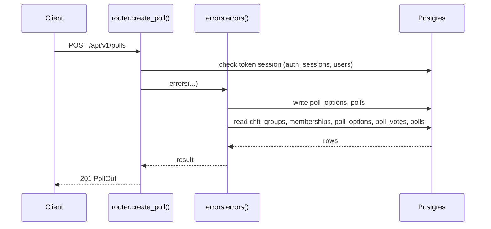
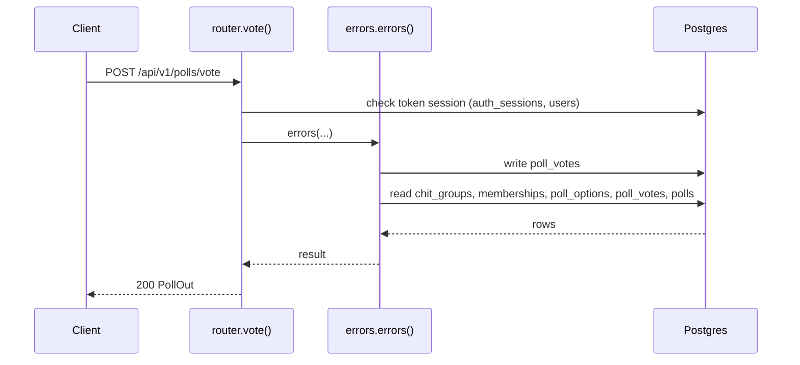
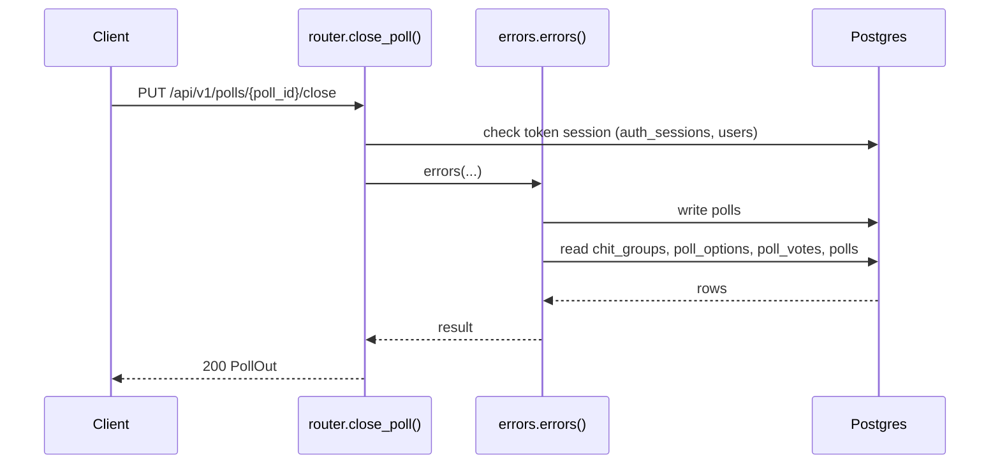
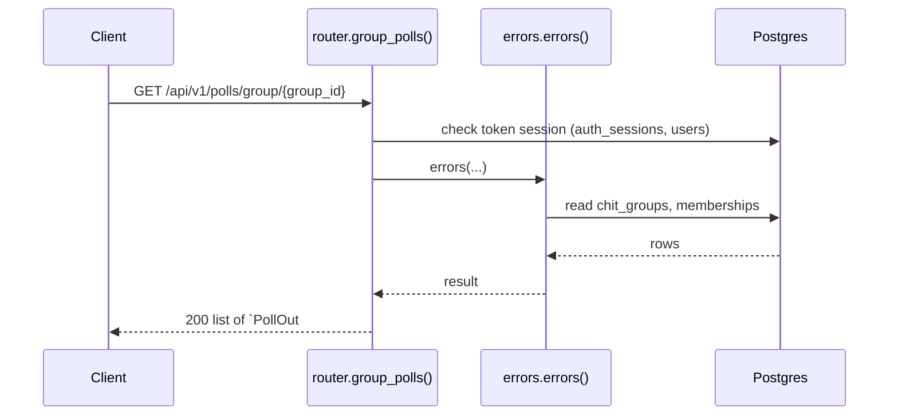

# Polls API

> Generated by `scripts/gen_api_docs.py` from the code. Do not edit by hand; run `scripts/gen-docs.sh`.

## Overview

> Group polls: any active member can create a poll and vote once per poll.

## Endpoints

| Method | Path | Summary |
|---|---|---|
| POST | [`/api/v1/polls`](#post-apiv1polls) | Create a poll in a group |
| POST | [`/api/v1/polls/vote`](#post-apiv1pollsvote) | Vote once in a poll |
| PUT | [`/api/v1/polls/{poll_id}/close`](#put-apiv1pollspoll_idclose) | Close a poll (creator or group admin) |
| GET | [`/api/v1/polls/group/{group_id}`](#get-apiv1pollsgroupgroup_id) | A group's polls with vote counts |

## Details

### `POST /api/v1/polls`

Create a poll in a group

- **Auth:** Bearer access token
- **Success:** `201` → `PollOut`
- **Router:** [`create_poll`](../../apps/api/src/chitbook_api/modules/polls/router.py#L13) (router.py:13)
- **Calls:** [`errors`](../../apps/api/src/chitbook_api/core/errors.py#L234) (errors.py:234), [`create`](../../apps/api/src/chitbook_api/modules/polls/service.py#L59) (service.py:59), [`_to_out`](../../apps/api/src/chitbook_api/modules/polls/service.py#L21) (service.py:21), [`_effective_status`](../../apps/api/src/chitbook_api/modules/polls/service.py#L46) (service.py:46), [`now`](../../apps/api/src/chitbook_api/core/time.py#L14) (time.py:14), [`my_votes`](../../apps/api/src/chitbook_api/modules/polls/repository.py#L32) (repository.py:32), [`vote_counts`](../../apps/api/src/chitbook_api/modules/polls/repository.py#L20) (repository.py:20), [`require_group`](../../apps/api/src/chitbook_api/modules/groups/service.py#L59) (service.py:59)
- **Access checks:** `require_group_member`, `active_membership`

**Request body**

| Field | Type | Required | Notes |
|---|---|---|---|
| `groupId` | integer | yes |  |
| `question` | string | yes | minLength=1; maxLength=255 |
| `options` | list[string] | yes |  |
| `expiresAt` | date-time or null | no |  |

```json
{
  "groupId": 1,
  "question": "Meet on Sunday?",
  "options": [
    "string"
  ],
  "expiresAt": "2026-08-01T10:30:00+05:30"
}
```

**Response `201`**

| Field | Type | Required | Notes |
|---|---|---|---|
| `id` | integer | yes |  |
| `groupId` | integer | yes |  |
| `groupName` | string | yes |  |
| `creatorId` | integer | yes |  |
| `creatorName` | string | yes |  |
| `question` | string | yes |  |
| `status` | PollStatus | yes |  |
| `expiresAt` | string or null | yes |  |
| `createdAt` | string | yes |  |
| `options` | list[PollOptionOut] | yes |  |
| `myVoteOptionId` | integer or null | yes |  |

```json
{
  "id": 1,
  "groupId": 1,
  "groupName": "string",
  "creatorId": 1,
  "creatorName": "string",
  "question": "Meet on Sunday?",
  "status": "OPEN",
  "expiresAt": "2026-08-01T10:30:00+05:30",
  "createdAt": "2026-08-01T10:30:00+05:30",
  "options": [
    {
      "id": 1,
      "optionText": "string",
      "voteCount": 1
    }
  ],
  "myVoteOptionId": 1
}
```

**Database**

- Writes: `poll_options`, `polls`
- Reads: `chit_groups`, `memberships`, `poll_options`, `poll_votes`, `polls`
- Token check reads `auth_sessions` + `users` (every signed-in request)

**Flow**



**Errors** (declared in the router with `responses=errors(...)`)

| HTTP | Code | Message | Exact problem / fix |
|---|---|---|---|
| 401 | `AUTH_REQUIRED` | Authentication required | No `Authorization: Bearer <token>` header. |
| 401 | `AUTH_TOKEN_INVALID` | Access token is invalid | Token malformed, signed with another JWT_SECRET (secret changed?), or user deleted. |
| 401 | `AUTH_TOKEN_EXPIRED` | Access token has expired | Access token older than ACCESS_TOKEN_TTL_MINUTES. Client should call /auth/refresh. |
| 401 | `AUTH_SESSION_REVOKED` | Session has been signed out | Device was signed out (logout, remote sign-out, password change or refresh-token reuse). |
| 403 | `NOT_GROUP_MEMBER` | You are not an active member of this group | Caller (or the target user) is not an ACTIVE member of the group. |
| 404 | `GROUP_NOT_FOUND` | Chit group not found | Wrong group id or group code. |
| 422 | `VALIDATION_ERROR` | Request data is invalid | Body/query/path does not match the schema. `details` lists each bad field and why. |
| 500 | `INTERNAL_ERROR` | An unexpected internal error occurred | A bug. Search `docker compose logs api` for the `requestId` and read the `request.unhandled_exception` line: it has the exception and stack trace. |
| 503 | `DB_UNAVAILABLE` | Database is unavailable | Postgres unreachable: host Postgres down, pg_hba.conf missing the Docker subnet, or wrong DB_* values in .env. See the `db.unavailable` log line. |

**Diagnose**

- Every response carries `X-Request-ID`; errors also return it as `error.requestId`.
- `docker compose logs api | grep <request_id>` shows the access line (`http.request`) and any error lines.
- Each error's exact problem is in the table above (from the router's `responses=errors(...)`).
- Log events on success: `poll.created (info)`
- 500 / 503: see [logging & debugging](../operations/logging-and-debugging.md).

---

### `POST /api/v1/polls/vote`

Vote once in a poll

- **Auth:** Bearer access token
- **Success:** `200` → `PollOut`
- **Router:** [`vote`](../../apps/api/src/chitbook_api/modules/polls/router.py#L26) (router.py:26)
- **Calls:** [`errors`](../../apps/api/src/chitbook_api/core/errors.py#L234) (errors.py:234), [`vote`](../../apps/api/src/chitbook_api/modules/polls/service.py#L77) (service.py:77), [`_to_out`](../../apps/api/src/chitbook_api/modules/polls/service.py#L21) (service.py:21), [`_effective_status`](../../apps/api/src/chitbook_api/modules/polls/service.py#L46) (service.py:46), [`now`](../../apps/api/src/chitbook_api/core/time.py#L14) (time.py:14), [`my_votes`](../../apps/api/src/chitbook_api/modules/polls/repository.py#L32) (repository.py:32), [`vote_counts`](../../apps/api/src/chitbook_api/modules/polls/repository.py#L20) (repository.py:20), [`get_vote`](../../apps/api/src/chitbook_api/modules/polls/repository.py#L44) (repository.py:44)
- **Access checks:** `require_group_member`, `active_membership`

**Request body**

| Field | Type | Required | Notes |
|---|---|---|---|
| `pollId` | integer | yes |  |
| `optionId` | integer | yes |  |

```json
{
  "pollId": 1,
  "optionId": 1
}
```

**Response `200`**

| Field | Type | Required | Notes |
|---|---|---|---|
| `id` | integer | yes |  |
| `groupId` | integer | yes |  |
| `groupName` | string | yes |  |
| `creatorId` | integer | yes |  |
| `creatorName` | string | yes |  |
| `question` | string | yes |  |
| `status` | PollStatus | yes |  |
| `expiresAt` | string or null | yes |  |
| `createdAt` | string | yes |  |
| `options` | list[PollOptionOut] | yes |  |
| `myVoteOptionId` | integer or null | yes |  |

```json
{
  "id": 1,
  "groupId": 1,
  "groupName": "string",
  "creatorId": 1,
  "creatorName": "string",
  "question": "Meet on Sunday?",
  "status": "OPEN",
  "expiresAt": "2026-08-01T10:30:00+05:30",
  "createdAt": "2026-08-01T10:30:00+05:30",
  "options": [
    {
      "id": 1,
      "optionText": "string",
      "voteCount": 1
    }
  ],
  "myVoteOptionId": 1
}
```

**Database**

- Writes: `poll_votes`
- Reads: `chit_groups`, `memberships`, `poll_options`, `poll_votes`, `polls`
- Token check reads `auth_sessions` + `users` (every signed-in request)

**Flow**



**Errors** (declared in the router with `responses=errors(...)`)

| HTTP | Code | Message | Exact problem / fix |
|---|---|---|---|
| 400 | `POLL_OPTION_INVALID` | Option does not belong to this poll | Option belongs to another poll. |
| 401 | `AUTH_REQUIRED` | Authentication required | No `Authorization: Bearer <token>` header. |
| 401 | `AUTH_TOKEN_INVALID` | Access token is invalid | Token malformed, signed with another JWT_SECRET (secret changed?), or user deleted. |
| 401 | `AUTH_TOKEN_EXPIRED` | Access token has expired | Access token older than ACCESS_TOKEN_TTL_MINUTES. Client should call /auth/refresh. |
| 401 | `AUTH_SESSION_REVOKED` | Session has been signed out | Device was signed out (logout, remote sign-out, password change or refresh-token reuse). |
| 403 | `NOT_GROUP_MEMBER` | You are not an active member of this group | Caller (or the target user) is not an ACTIVE member of the group. |
| 404 | `POLL_NOT_FOUND` | Poll not found | Wrong poll id. |
| 409 | `POLL_CLOSED` | Poll is closed | Poll closed or past `expiresAt`. |
| 409 | `POLL_ALREADY_VOTED` | You have already voted in this poll | One vote per user per poll. |
| 422 | `VALIDATION_ERROR` | Request data is invalid | Body/query/path does not match the schema. `details` lists each bad field and why. |
| 500 | `INTERNAL_ERROR` | An unexpected internal error occurred | A bug. Search `docker compose logs api` for the `requestId` and read the `request.unhandled_exception` line: it has the exception and stack trace. |
| 503 | `DB_UNAVAILABLE` | Database is unavailable | Postgres unreachable: host Postgres down, pg_hba.conf missing the Docker subnet, or wrong DB_* values in .env. See the `db.unavailable` log line. |

**Diagnose**

- Every response carries `X-Request-ID`; errors also return it as `error.requestId`.
- `docker compose logs api | grep <request_id>` shows the access line (`http.request`) and any error lines.
- Each error's exact problem is in the table above (from the router's `responses=errors(...)`).
- Log events on success: `poll.voted (info)`
- 500 / 503: see [logging & debugging](../operations/logging-and-debugging.md).

---

### `PUT /api/v1/polls/{poll_id}/close`

Close a poll (creator or group admin)

- **Auth:** Bearer access token
- **Success:** `200` → `PollOut`
- **Router:** [`close_poll`](../../apps/api/src/chitbook_api/modules/polls/router.py#L44) (router.py:44)
- **Calls:** [`errors`](../../apps/api/src/chitbook_api/core/errors.py#L234) (errors.py:234), [`close`](../../apps/api/src/chitbook_api/modules/polls/service.py#L92) (service.py:92), [`_to_out`](../../apps/api/src/chitbook_api/modules/polls/service.py#L21) (service.py:21), [`_effective_status`](../../apps/api/src/chitbook_api/modules/polls/service.py#L46) (service.py:46), [`now`](../../apps/api/src/chitbook_api/core/time.py#L14) (time.py:14), [`my_votes`](../../apps/api/src/chitbook_api/modules/polls/repository.py#L32) (repository.py:32), [`vote_counts`](../../apps/api/src/chitbook_api/modules/polls/repository.py#L20) (repository.py:20), [`_require`](../../apps/api/src/chitbook_api/modules/polls/service.py#L52) (service.py:52)
- **Access checks:** `require_group_admin`, `require_group_member`, `active_membership`

**Parameters**

| Name | In | Type | Required |
|---|---|---|---|
| `poll_id` | path | integer | yes |

**Response `200`**

| Field | Type | Required | Notes |
|---|---|---|---|
| `id` | integer | yes |  |
| `groupId` | integer | yes |  |
| `groupName` | string | yes |  |
| `creatorId` | integer | yes |  |
| `creatorName` | string | yes |  |
| `question` | string | yes |  |
| `status` | PollStatus | yes |  |
| `expiresAt` | string or null | yes |  |
| `createdAt` | string | yes |  |
| `options` | list[PollOptionOut] | yes |  |
| `myVoteOptionId` | integer or null | yes |  |

```json
{
  "id": 1,
  "groupId": 1,
  "groupName": "string",
  "creatorId": 1,
  "creatorName": "string",
  "question": "Meet on Sunday?",
  "status": "OPEN",
  "expiresAt": "2026-08-01T10:30:00+05:30",
  "createdAt": "2026-08-01T10:30:00+05:30",
  "options": [
    {
      "id": 1,
      "optionText": "string",
      "voteCount": 1
    }
  ],
  "myVoteOptionId": 1
}
```

**Database**

- Writes: `polls`
- Reads: `chit_groups`, `poll_options`, `poll_votes`, `polls`
- Token check reads `auth_sessions` + `users` (every signed-in request)

**Flow**



**Errors** (declared in the router with `responses=errors(...)`)

| HTTP | Code | Message | Exact problem / fix |
|---|---|---|---|
| 401 | `AUTH_REQUIRED` | Authentication required | No `Authorization: Bearer <token>` header. |
| 401 | `AUTH_TOKEN_INVALID` | Access token is invalid | Token malformed, signed with another JWT_SECRET (secret changed?), or user deleted. |
| 401 | `AUTH_TOKEN_EXPIRED` | Access token has expired | Access token older than ACCESS_TOKEN_TTL_MINUTES. Client should call /auth/refresh. |
| 401 | `AUTH_SESSION_REVOKED` | Session has been signed out | Device was signed out (logout, remote sign-out, password change or refresh-token reuse). |
| 403 | `NOT_GROUP_MEMBER` | You are not an active member of this group | Caller (or the target user) is not an ACTIVE member of the group. |
| 403 | `NOT_GROUP_ADMIN` | Group admin access is required | Caller is a member but not the group's ADMIN. |
| 404 | `POLL_NOT_FOUND` | Poll not found | Wrong poll id. |
| 422 | `VALIDATION_ERROR` | Request data is invalid | Body/query/path does not match the schema. `details` lists each bad field and why. |
| 500 | `INTERNAL_ERROR` | An unexpected internal error occurred | A bug. Search `docker compose logs api` for the `requestId` and read the `request.unhandled_exception` line: it has the exception and stack trace. |
| 503 | `DB_UNAVAILABLE` | Database is unavailable | Postgres unreachable: host Postgres down, pg_hba.conf missing the Docker subnet, or wrong DB_* values in .env. See the `db.unavailable` log line. |

**Diagnose**

- Every response carries `X-Request-ID`; errors also return it as `error.requestId`.
- `docker compose logs api | grep <request_id>` shows the access line (`http.request`) and any error lines.
- Each error's exact problem is in the table above (from the router's `responses=errors(...)`).
- Log events on success: `poll.closed (info)`
- 500 / 503: see [logging & debugging](../operations/logging-and-debugging.md).

---

### `GET /api/v1/polls/group/{group_id}`

A group's polls with vote counts

- **Auth:** Bearer access token
- **Success:** `200` → list of `PollOut`
- **Router:** [`group_polls`](../../apps/api/src/chitbook_api/modules/polls/router.py#L60) (router.py:60)
- **Calls:** [`errors`](../../apps/api/src/chitbook_api/core/errors.py#L234) (errors.py:234), [`list_for_group`](../../apps/api/src/chitbook_api/modules/polls/service.py#L102) (service.py:102), [`list_for_group`](../../apps/api/src/chitbook_api/modules/polls/repository.py#L15) (repository.py:15), [`_to_out`](../../apps/api/src/chitbook_api/modules/polls/service.py#L21) (service.py:21), [`_effective_status`](../../apps/api/src/chitbook_api/modules/polls/service.py#L46) (service.py:46), [`now`](../../apps/api/src/chitbook_api/core/time.py#L14) (time.py:14), [`my_votes`](../../apps/api/src/chitbook_api/modules/polls/repository.py#L32) (repository.py:32), [`vote_counts`](../../apps/api/src/chitbook_api/modules/polls/repository.py#L20) (repository.py:20)
- **Access checks:** `require_group_member`, `active_membership`

**Parameters**

| Name | In | Type | Required |
|---|---|---|---|
| `group_id` | path | integer | yes |

**Response `200`**

| Field | Type | Required | Notes |
|---|---|---|---|
| `id` | integer | yes |  |
| `groupId` | integer | yes |  |
| `groupName` | string | yes |  |
| `creatorId` | integer | yes |  |
| `creatorName` | string | yes |  |
| `question` | string | yes |  |
| `status` | PollStatus | yes |  |
| `expiresAt` | string or null | yes |  |
| `createdAt` | string | yes |  |
| `options` | list[PollOptionOut] | yes |  |
| `myVoteOptionId` | integer or null | yes |  |

```json
[
  {
    "id": 1,
    "groupId": 1,
    "groupName": "string",
    "creatorId": 1,
    "creatorName": "string",
    "question": "Meet on Sunday?",
    "status": "OPEN",
    "expiresAt": "2026-08-01T10:30:00+05:30",
    "createdAt": "2026-08-01T10:30:00+05:30",
    "options": [
      {
        "id": 1,
        "optionText": "string",
        "voteCount": 1
      }
    ],
    "myVoteOptionId": 1
  }
]
```

**Database**

- Writes: –
- Reads: `chit_groups`, `memberships`
- Token check reads `auth_sessions` + `users` (every signed-in request)

**Flow**



**Errors** (declared in the router with `responses=errors(...)`)

| HTTP | Code | Message | Exact problem / fix |
|---|---|---|---|
| 401 | `AUTH_REQUIRED` | Authentication required | No `Authorization: Bearer <token>` header. |
| 401 | `AUTH_TOKEN_INVALID` | Access token is invalid | Token malformed, signed with another JWT_SECRET (secret changed?), or user deleted. |
| 401 | `AUTH_TOKEN_EXPIRED` | Access token has expired | Access token older than ACCESS_TOKEN_TTL_MINUTES. Client should call /auth/refresh. |
| 401 | `AUTH_SESSION_REVOKED` | Session has been signed out | Device was signed out (logout, remote sign-out, password change or refresh-token reuse). |
| 403 | `NOT_GROUP_MEMBER` | You are not an active member of this group | Caller (or the target user) is not an ACTIVE member of the group. |
| 422 | `VALIDATION_ERROR` | Request data is invalid | Body/query/path does not match the schema. `details` lists each bad field and why. |
| 500 | `INTERNAL_ERROR` | An unexpected internal error occurred | A bug. Search `docker compose logs api` for the `requestId` and read the `request.unhandled_exception` line: it has the exception and stack trace. |
| 503 | `DB_UNAVAILABLE` | Database is unavailable | Postgres unreachable: host Postgres down, pg_hba.conf missing the Docker subnet, or wrong DB_* values in .env. See the `db.unavailable` log line. |

**Diagnose**

- Every response carries `X-Request-ID`; errors also return it as `error.requestId`.
- `docker compose logs api | grep <request_id>` shows the access line (`http.request`) and any error lines.
- Each error's exact problem is in the table above (from the router's `responses=errors(...)`).
- 500 / 503: see [logging & debugging](../operations/logging-and-debugging.md).

---

