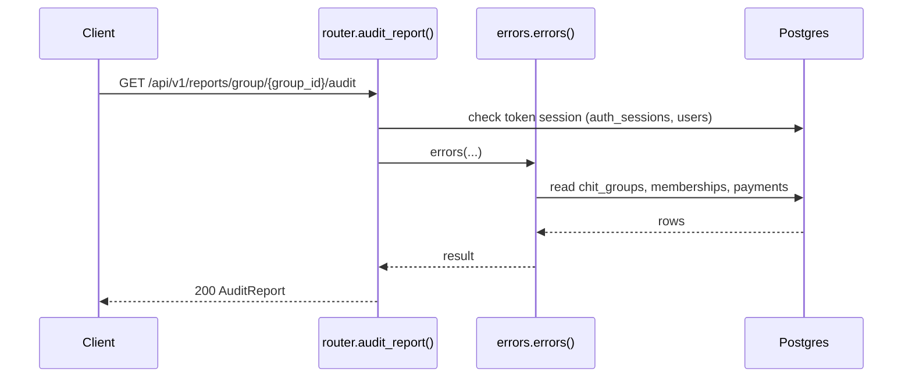
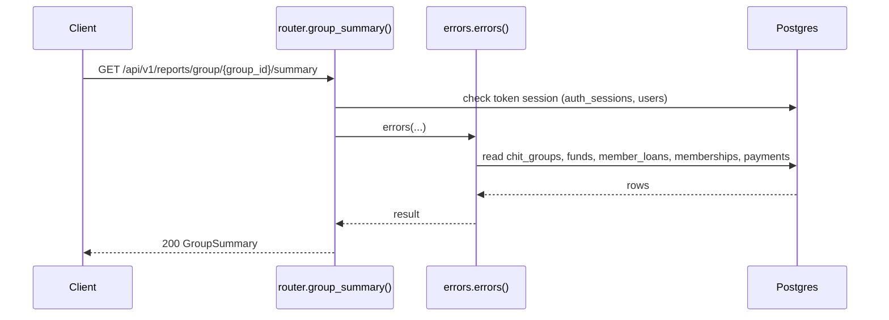
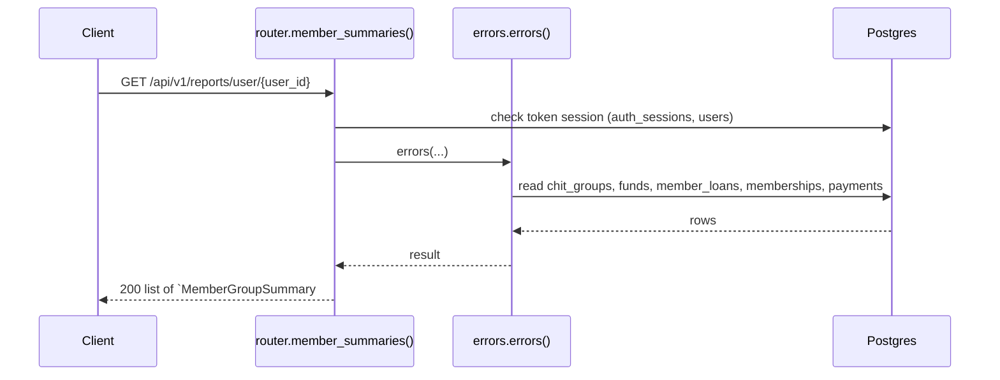

# Reports API

> Generated by `scripts/gen_api_docs.py` from the code. Do not edit by hand; run `scripts/gen-docs.sh`.

## Overview

> Financial reports for chit groups, calculated live from payments, loans and funds.
>
> - total_contributions_collected = sum of COMPLETED payments dated up to the end of today (IST)
> - total_loans_outstanding       = sum of current_payable over the group's loans
> - fund_balance_approx           = the fund's total_amount (or contributions - loans if no fund)
> - estimated_profit_share        = (fund_balance - contributions + loans) / active member count

## Endpoints

| Method | Path | Summary |
|---|---|---|
| GET | [`/api/v1/reports/group/{group_id}/audit`](#get-apiv1reportsgroupgroup_idaudit) | Unverified payments (group admin) |
| GET | [`/api/v1/reports/group/{group_id}/summary`](#get-apiv1reportsgroupgroup_idsummary) | Group financial summary |
| GET | [`/api/v1/reports/user/{user_id}`](#get-apiv1reportsuseruser_id) | A member's summary per group |

## Details

### `GET /api/v1/reports/group/{group_id}/audit`

Unverified payments (group admin)

- **Auth:** Bearer access token
- **Success:** `200` → `AuditReport`
- **Router:** [`audit_report`](../../apps/api/src/chitbook_api/modules/reports/router.py#L13) (router.py:13)
- **Calls:** [`errors`](../../apps/api/src/chitbook_api/core/errors.py#L234) (errors.py:234), [`audit`](../../apps/api/src/chitbook_api/modules/reports/service.py#L37) (service.py:37), [`to_out`](../../apps/api/src/chitbook_api/modules/payments/service.py#L21) (service.py:21), [`unverified_for_group`](../../apps/api/src/chitbook_api/modules/payments/repository.py#L26) (repository.py:26), [`unverified_totals`](../../apps/api/src/chitbook_api/modules/payments/repository.py#L36) (repository.py:36), [`require_group`](../../apps/api/src/chitbook_api/modules/groups/service.py#L59) (service.py:59), [`get_group`](../../apps/api/src/chitbook_api/modules/groups/repository.py#L12) (repository.py:12)
- **Access checks:** `require_group_admin`, `require_group_member`, `active_membership`

**Parameters**

| Name | In | Type | Required |
|---|---|---|---|
| `group_id` | path | integer | yes |

**Response `200`**

| Field | Type | Required | Notes |
|---|---|---|---|
| `groupId` | integer | yes |  |
| `groupName` | string | yes |  |
| `unverifiedPaymentsCount` | integer | yes |  |
| `totalUnverifiedAmount` | number | yes |  |
| `recentUnverifiedPayments` | list[PaymentOut] | yes |  |

```json
{
  "groupId": 1,
  "groupName": "string",
  "unverifiedPaymentsCount": 1,
  "totalUnverifiedAmount": 25000.0,
  "recentUnverifiedPayments": [
    {
      "id": 1,
      "month": "2026-08",
      "amountPaid": 25000.0,
      "paymentDate": "2026-08-01T10:30:00+05:30",
      "mode": "UPI",
      "status": "PENDING",
      "userId": 1,
      "userName": "ravi",
      "chitGroupId": 1,
      "chitGroupName": "string",
      "verified": false,
      "verifiedByUserId": 1,
      "verifiedByUserName": "string",
      "verifiedAt": "2026-08-01T10:30:00+05:30",
      "createdAt": "2026-08-01T10:30:00+05:30",
      "updatedAt": "2026-08-01T10:30:00+05:30"
    }
  ]
}
```

**Database**

- Writes: –
- Reads: `chit_groups`, `memberships`, `payments`
- Token check reads `auth_sessions` + `users` (every signed-in request)

**Flow**



**Errors** (declared in the router with `responses=errors(...)`)

| HTTP | Code | Message | Exact problem / fix |
|---|---|---|---|
| 401 | `AUTH_REQUIRED` | Authentication required | No `Authorization: Bearer <token>` header. |
| 401 | `AUTH_TOKEN_INVALID` | Access token is invalid | Token malformed, signed with another JWT_SECRET (secret changed?), or user deleted. |
| 401 | `AUTH_TOKEN_EXPIRED` | Access token has expired | Access token older than ACCESS_TOKEN_TTL_MINUTES. Client should call /auth/refresh. |
| 401 | `AUTH_SESSION_REVOKED` | Session has been signed out | Device was signed out (logout, remote sign-out, password change or refresh-token reuse). |
| 403 | `NOT_GROUP_MEMBER` | You are not an active member of this group | Caller (or the target user) is not an ACTIVE member of the group. |
| 403 | `NOT_GROUP_ADMIN` | Group admin access is required | Caller is a member but not the group's ADMIN. |
| 404 | `GROUP_NOT_FOUND` | Chit group not found | Wrong group id or group code. |
| 422 | `VALIDATION_ERROR` | Request data is invalid | Body/query/path does not match the schema. `details` lists each bad field and why. |
| 500 | `INTERNAL_ERROR` | An unexpected internal error occurred | A bug. Search `docker compose logs api` for the `requestId` and read the `request.unhandled_exception` line: it has the exception and stack trace. |
| 503 | `DB_UNAVAILABLE` | Database is unavailable | Postgres unreachable: host Postgres down, pg_hba.conf missing the Docker subnet, or wrong DB_* values in .env. See the `db.unavailable` log line. |

**Diagnose**

- Every response carries `X-Request-ID`; errors also return it as `error.requestId`.
- `docker compose logs api | grep <request_id>` shows the access line (`http.request`) and any error lines.
- Each error's exact problem is in the table above (from the router's `responses=errors(...)`).
- 500 / 503: see [logging & debugging](../operations/logging-and-debugging.md).

---

### `GET /api/v1/reports/group/{group_id}/summary`

Group financial summary

- **Auth:** Bearer access token
- **Success:** `200` → `GroupSummary`
- **Router:** [`group_summary`](../../apps/api/src/chitbook_api/modules/reports/router.py#L29) (router.py:29)
- **Calls:** [`errors`](../../apps/api/src/chitbook_api/core/errors.py#L234) (errors.py:234), [`group_summary`](../../apps/api/src/chitbook_api/modules/reports/service.py#L70) (service.py:70), [`_group_summary`](../../apps/api/src/chitbook_api/modules/reports/service.py#L51) (service.py:51), [`list_for_group`](../../apps/api/src/chitbook_api/modules/loans/repository.py#L15) (repository.py:15), [`count_members`](../../apps/api/src/chitbook_api/modules/groups/repository.py#L61) (repository.py:61), [`today`](../../apps/api/src/chitbook_api/core/time.py#L19) (time.py:19), [`now`](../../apps/api/src/chitbook_api/core/time.py#L14) (time.py:14), [`current_payable`](../../apps/api/src/chitbook_api/modules/loans/service.py#L27) (service.py:27)
- **Access checks:** `require_group_member`, `active_membership`

**Parameters**

| Name | In | Type | Required |
|---|---|---|---|
| `group_id` | path | integer | yes |

**Response `200`**

| Field | Type | Required | Notes |
|---|---|---|---|
| `chitGroupId` | integer | yes |  |
| `chitGroupName` | string | yes |  |
| `chitGroupCode` | string | yes |  |
| `totalMembers` | integer | yes |  |
| `monthlyContributionAmount` | number | yes |  |
| `totalContributionsCollected` | number | yes |  |
| `totalLoansOutstanding` | number | yes |  |
| `fundBalanceApprox` | number | yes |  |
| `asOfDate` | date | yes |  |

```json
{
  "chitGroupId": 1,
  "chitGroupName": "string",
  "chitGroupCode": "string",
  "totalMembers": 20,
  "monthlyContributionAmount": 25000.0,
  "totalContributionsCollected": 25000.0,
  "totalLoansOutstanding": 25000.0,
  "fundBalanceApprox": 25000.0,
  "asOfDate": "2026-08-01T10:30:00+05:30"
}
```

**Database**

- Writes: –
- Reads: `chit_groups`, `funds`, `member_loans`, `memberships`, `payments`
- Token check reads `auth_sessions` + `users` (every signed-in request)

**Flow**



**Errors** (declared in the router with `responses=errors(...)`)

| HTTP | Code | Message | Exact problem / fix |
|---|---|---|---|
| 401 | `AUTH_REQUIRED` | Authentication required | No `Authorization: Bearer <token>` header. |
| 401 | `AUTH_TOKEN_INVALID` | Access token is invalid | Token malformed, signed with another JWT_SECRET (secret changed?), or user deleted. |
| 401 | `AUTH_TOKEN_EXPIRED` | Access token has expired | Access token older than ACCESS_TOKEN_TTL_MINUTES. Client should call /auth/refresh. |
| 401 | `AUTH_SESSION_REVOKED` | Session has been signed out | Device was signed out (logout, remote sign-out, password change or refresh-token reuse). |
| 403 | `NOT_GROUP_MEMBER` | You are not an active member of this group | Caller (or the target user) is not an ACTIVE member of the group. |
| 404 | `GROUP_NOT_FOUND` | Chit group not found | Wrong group id or group code. |
| 422 | `VALIDATION_ERROR` | Request data is invalid | Body/query/path does not match the schema. `details` lists each bad field and why. |
| 500 | `INTERNAL_ERROR` | An unexpected internal error occurred | A bug. Search `docker compose logs api` for the `requestId` and read the `request.unhandled_exception` line: it has the exception and stack trace. |
| 503 | `DB_UNAVAILABLE` | Database is unavailable | Postgres unreachable: host Postgres down, pg_hba.conf missing the Docker subnet, or wrong DB_* values in .env. See the `db.unavailable` log line. |

**Diagnose**

- Every response carries `X-Request-ID`; errors also return it as `error.requestId`.
- `docker compose logs api | grep <request_id>` shows the access line (`http.request`) and any error lines.
- Each error's exact problem is in the table above (from the router's `responses=errors(...)`).
- 500 / 503: see [logging & debugging](../operations/logging-and-debugging.md).

---

### `GET /api/v1/reports/user/{user_id}`

A member's summary per group

- **Auth:** Bearer access token
- **Success:** `200` → list of `MemberGroupSummary`
- **Router:** [`member_summaries`](../../apps/api/src/chitbook_api/modules/reports/router.py#L41) (router.py:41)
- **Calls:** [`errors`](../../apps/api/src/chitbook_api/core/errors.py#L234) (errors.py:234), [`member_summaries`](../../apps/api/src/chitbook_api/modules/reports/service.py#L76) (service.py:76), [`current_payable`](../../apps/api/src/chitbook_api/modules/loans/service.py#L27) (service.py:27), [`to_app_tz`](../../apps/api/src/chitbook_api/core/time.py#L23) (time.py:23), [`today`](../../apps/api/src/chitbook_api/core/time.py#L19) (time.py:19), [`now`](../../apps/api/src/chitbook_api/core/time.py#L14) (time.py:14), [`_end_of_today`](../../apps/api/src/chitbook_api/modules/reports/service.py#L33) (service.py:33), [`latest_for_member`](../../apps/api/src/chitbook_api/modules/loans/repository.py#L27) (repository.py:27)
- **Access checks:** `require_self_or_platform_admin`

**Parameters**

| Name | In | Type | Required |
|---|---|---|---|
| `user_id` | path | integer | yes |

**Response `200`**

| Field | Type | Required | Notes |
|---|---|---|---|
| `userId` | integer | yes |  |
| `userName` | string | yes |  |
| `chitGroupId` | integer | yes |  |
| `chitGroupName` | string | yes |  |
| `chitGroupCode` | string | yes |  |
| `totalContributionsPaid` | number | yes |  |
| `currentLoanPayable` | number or null | yes |  |
| `estimatedProfitShare` | number or null | yes |  |
| `asOfDate` | date | yes |  |

```json
[
  {
    "userId": 1,
    "userName": "ravi",
    "chitGroupId": 1,
    "chitGroupName": "string",
    "chitGroupCode": "string",
    "totalContributionsPaid": 25000.0,
    "currentLoanPayable": 25000.0,
    "estimatedProfitShare": 25000.0,
    "asOfDate": "2026-08-01T10:30:00+05:30"
  }
]
```

**Database**

- Writes: –
- Reads: `chit_groups`, `funds`, `member_loans`, `memberships`, `payments`
- Token check reads `auth_sessions` + `users` (every signed-in request)

**Flow**



**Errors** (declared in the router with `responses=errors(...)`)

| HTTP | Code | Message | Exact problem / fix |
|---|---|---|---|
| 401 | `AUTH_REQUIRED` | Authentication required | No `Authorization: Bearer <token>` header. |
| 401 | `AUTH_TOKEN_INVALID` | Access token is invalid | Token malformed, signed with another JWT_SECRET (secret changed?), or user deleted. |
| 401 | `AUTH_TOKEN_EXPIRED` | Access token has expired | Access token older than ACCESS_TOKEN_TTL_MINUTES. Client should call /auth/refresh. |
| 401 | `AUTH_SESSION_REVOKED` | Session has been signed out | Device was signed out (logout, remote sign-out, password change or refresh-token reuse). |
| 403 | `FORBIDDEN` | You do not have access to this resource | You may only access your own user data (unless platform ADMIN). |
| 422 | `VALIDATION_ERROR` | Request data is invalid | Body/query/path does not match the schema. `details` lists each bad field and why. |
| 500 | `INTERNAL_ERROR` | An unexpected internal error occurred | A bug. Search `docker compose logs api` for the `requestId` and read the `request.unhandled_exception` line: it has the exception and stack trace. |
| 503 | `DB_UNAVAILABLE` | Database is unavailable | Postgres unreachable: host Postgres down, pg_hba.conf missing the Docker subnet, or wrong DB_* values in .env. See the `db.unavailable` log line. |

**Diagnose**

- Every response carries `X-Request-ID`; errors also return it as `error.requestId`.
- `docker compose logs api | grep <request_id>` shows the access line (`http.request`) and any error lines.
- Each error's exact problem is in the table above (from the router's `responses=errors(...)`).
- 500 / 503: see [logging & debugging](../operations/logging-and-debugging.md).

---

