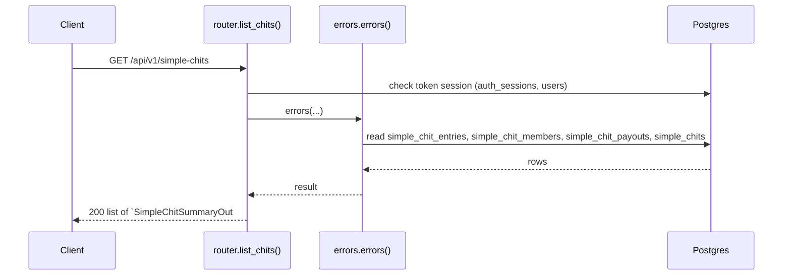
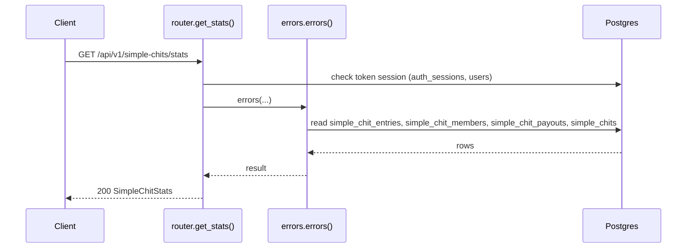
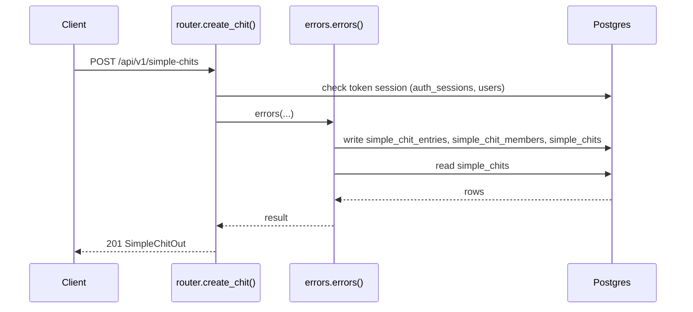
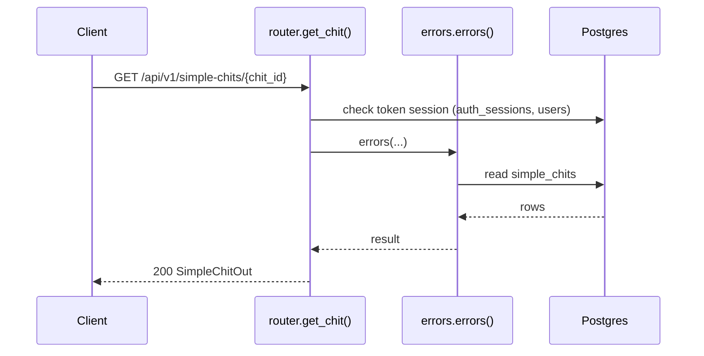
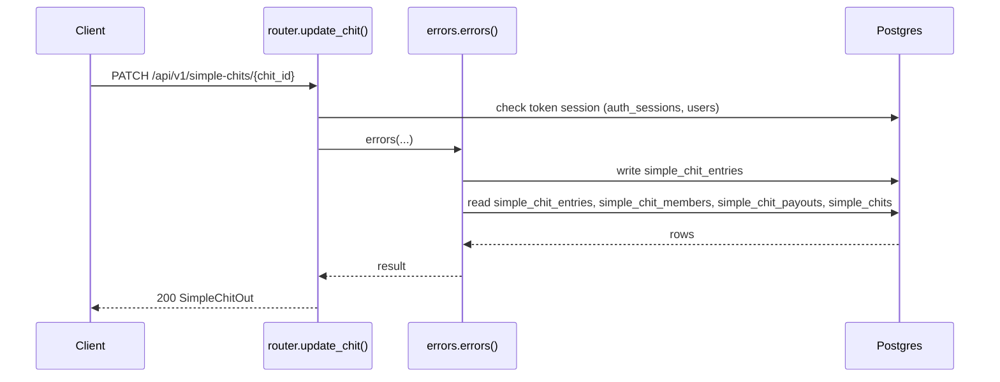
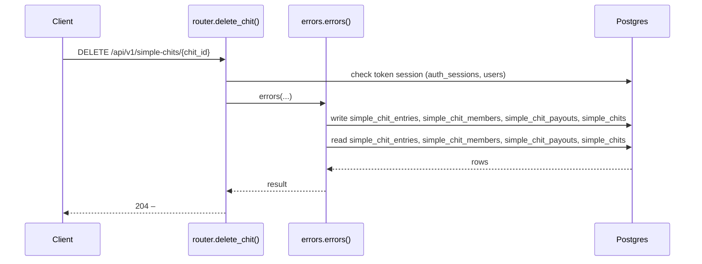
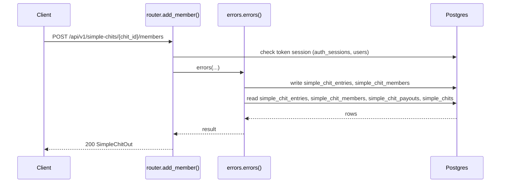
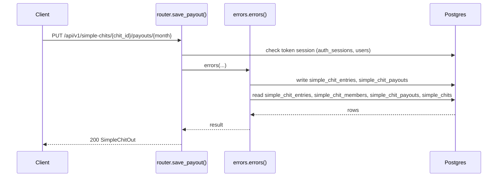
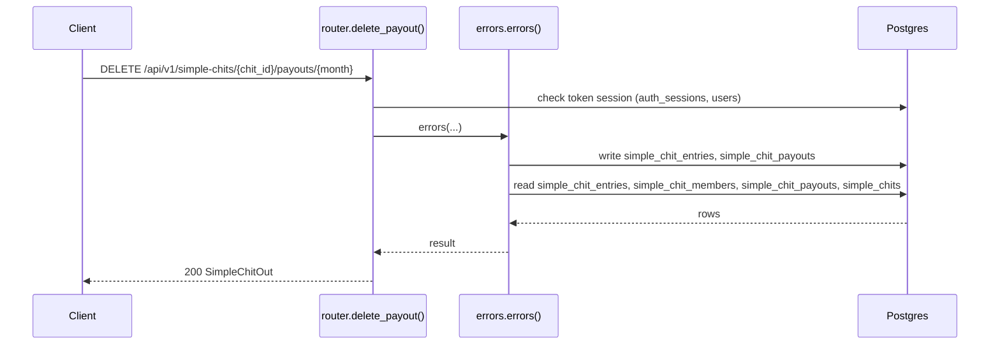

# Simple chits API

> Generated by `scripts/gen_api_docs.py` from the code. Do not edit by hand; run `scripts/gen-docs.sh`.

## Overview

> Simple Chits: a chit run by one owner (the signed-in user) for a list of named members.
>
> Rules:
> - Each member pays `per_share_amount x shares` every month from their start month to the end.
> - Months before a member's start month have no entry at all (not a zero).
> - Payout escalation: when enabled, recording a payout adds `total_amount x escalation_percent / 100`
>   to every *later* month of the taker. The exact bump is stored on the payout so deleting or
>   replacing it reverses precisely.

## Endpoints

| Method | Path | Summary |
|---|---|---|
| GET | [`/api/v1/simple-chits`](#get-apiv1simple-chits) | List my chits with totals |
| GET | [`/api/v1/simple-chits/stats`](#get-apiv1simple-chitsstats) | Totals, monthly series and pending dues |
| POST | [`/api/v1/simple-chits`](#post-apiv1simple-chits) | Create a chit |
| GET | [`/api/v1/simple-chits/{chit_id}`](#get-apiv1simple-chitschit_id) | Get one chit with its full grid |
| PATCH | [`/api/v1/simple-chits/{chit_id}`](#patch-apiv1simple-chitschit_id) | Update settings and/or grid cells |
| DELETE | [`/api/v1/simple-chits/{chit_id}`](#delete-apiv1simple-chitschit_id) | Delete a chit |
| POST | [`/api/v1/simple-chits/{chit_id}/members`](#post-apiv1simple-chitschit_idmembers) | Add a member (late joiners allowed) |
| PUT | [`/api/v1/simple-chits/{chit_id}/payouts/{month}`](#put-apiv1simple-chitschit_idpayoutsmonth) | Record or replace a payout |
| DELETE | [`/api/v1/simple-chits/{chit_id}/payouts/{month}`](#delete-apiv1simple-chitschit_idpayoutsmonth) | Delete a payout |

## Details

### `GET /api/v1/simple-chits`

List my chits with totals

- **Auth:** Bearer access token
- **Success:** `200` → list of `SimpleChitSummaryOut`
- **Router:** [`list_chits`](../../apps/api/src/chitbook_api/modules/simple_chits/router.py#L21) (router.py:21)
- **Calls:** [`errors`](../../apps/api/src/chitbook_api/core/errors.py#L234) (errors.py:234), [`list_mine`](../../apps/api/src/chitbook_api/modules/simple_chits/service.py#L230) (service.py:230), [`find_mine`](../../apps/api/src/chitbook_api/modules/simple_chits/service.py#L235) (service.py:235), [`list_owned`](../../apps/api/src/chitbook_api/modules/simple_chits/repository.py#L18) (repository.py:18), [`to_summary`](../../apps/api/src/chitbook_api/modules/simple_chits/service.py#L381) (service.py:381), [`summary`](../../apps/api/src/chitbook_api/modules/simple_chits/math.py#L97) (math.py:97), [`months`](../../apps/api/src/chitbook_api/modules/simple_chits/math.py#L58) (math.py:58), [`money`](../../apps/api/src/chitbook_api/modules/simple_chits/math.py#L25) (math.py:25)

**Response `200`**

| Field | Type | Required | Notes |
|---|---|---|---|
| `id` | integer | yes |  |
| `name` | string | yes |  |
| `totalAmount` | number | yes |  |
| `months` | integer | yes |  |
| `startMonth` | string | yes |  |
| `memberCount` | integer | yes |  |
| `commissionPercent` | number | yes |  |
| `monthsElapsed` | integer | yes |  |
| `dueToDate` | number | yes |  |
| `collected` | number | yes |  |
| `pending` | number | yes |  |
| `overdue` | number | yes |  |
| `payoutsDone` | integer | yes |  |
| `paidOut` | number | yes |  |
| `profit` | number | yes |  |
| `createdAt` | string | yes |  |

```json
[
  {
    "id": 1,
    "name": "Ravi Kumar",
    "totalAmount": 25000.0,
    "months": 20,
    "startMonth": "2026-08",
    "memberCount": 1,
    "commissionPercent": 5.0,
    "monthsElapsed": 1,
    "dueToDate": 25000.0,
    "collected": 25000.0,
    "pending": 25000.0,
    "overdue": 25000.0,
    "payoutsDone": 1,
    "paidOut": 25000.0,
    "profit": 25000.0,
    "createdAt": "2026-08-01T10:30:00+05:30"
  }
]
```

**Database**

- Writes: –
- Reads: `simple_chit_entries`, `simple_chit_members`, `simple_chit_payouts`, `simple_chits`
- Token check reads `auth_sessions` + `users` (every signed-in request)

**Flow**



**Errors** (declared in the router with `responses=errors(...)`)

| HTTP | Code | Message | Exact problem / fix |
|---|---|---|---|
| 401 | `AUTH_REQUIRED` | Authentication required | No `Authorization: Bearer <token>` header. |
| 401 | `AUTH_TOKEN_INVALID` | Access token is invalid | Token malformed, signed with another JWT_SECRET (secret changed?), or user deleted. |
| 401 | `AUTH_TOKEN_EXPIRED` | Access token has expired | Access token older than ACCESS_TOKEN_TTL_MINUTES. Client should call /auth/refresh. |
| 401 | `AUTH_SESSION_REVOKED` | Session has been signed out | Device was signed out (logout, remote sign-out, password change or refresh-token reuse). |
| 500 | `INTERNAL_ERROR` | An unexpected internal error occurred | A bug. Search `docker compose logs api` for the `requestId` and read the `request.unhandled_exception` line: it has the exception and stack trace. |
| 503 | `DB_UNAVAILABLE` | Database is unavailable | Postgres unreachable: host Postgres down, pg_hba.conf missing the Docker subnet, or wrong DB_* values in .env. See the `db.unavailable` log line. |

**Diagnose**

- Every response carries `X-Request-ID`; errors also return it as `error.requestId`.
- `docker compose logs api | grep <request_id>` shows the access line (`http.request`) and any error lines.
- Each error's exact problem is in the table above (from the router's `responses=errors(...)`).
- 500 / 503: see [logging & debugging](../operations/logging-and-debugging.md).

---

### `GET /api/v1/simple-chits/stats`

Totals, monthly series and pending dues

- **Auth:** Bearer access token
- **Success:** `200` → `SimpleChitStats`
- **Router:** [`get_stats`](../../apps/api/src/chitbook_api/modules/simple_chits/router.py#L31) (router.py:31)
- **Calls:** [`errors`](../../apps/api/src/chitbook_api/core/errors.py#L234) (errors.py:234), [`for_owner`](../../apps/api/src/chitbook_api/modules/simple_chits/stats.py#L26) (stats.py:26), [`money`](../../apps/api/src/chitbook_api/modules/simple_chits/math.py#L25) (math.py:25), [`_series`](../../apps/api/src/chitbook_api/modules/simple_chits/stats.py#L101) (stats.py:101), [`_totals`](../../apps/api/src/chitbook_api/modules/simple_chits/stats.py#L82) (stats.py:82), [`to_summary`](../../apps/api/src/chitbook_api/modules/simple_chits/service.py#L381) (service.py:381), [`summary`](../../apps/api/src/chitbook_api/modules/simple_chits/math.py#L97) (math.py:97), [`months`](../../apps/api/src/chitbook_api/modules/simple_chits/math.py#L58) (math.py:58)

**Response `200`**

| Field | Type | Required | Notes |
|---|---|---|---|
| `totals` | StatsTotals | yes |  |
| `monthly` | list[StatsMonthPoint] | yes |  |
| `perChit` | list[SimpleChitSummaryOut] | yes |  |
| `pendingDues` | list[PendingDue] | yes |  |

```json
{
  "totals": {
    "chits": 1,
    "dueToDate": 25000.0,
    "collected": 25000.0,
    "pending": 25000.0,
    "overdue": 25000.0,
    "paidOut": 25000.0,
    "cashInHand": 25000.0,
    "profit": 25000.0,
    "expectedCommission": 25000.0,
    "collectionRate": 5.0
  },
  "monthly": [
    {
      "month": "2026-08",
      "due": 25000.0,
      "collected": 25000.0,
      "payout": 25000.0,
      "pnl": 25000.0,
      "cumulativePnl": 25000.0
    }
  ],
  "perChit": [
    {
      "id": 1,
      "name": "Ravi Kumar",
      "totalAmount": 25000.0,
      "months": 20,
      "startMonth": "2026-08",
      "memberCount": 1,
      "commissionPercent": 5.0,
      "monthsElapsed": 1,
      "dueToDate": 25000.0,
      "collected": 25000.0,
      "pending": 25000.0,
      "overdue": 25000.0,
      "payoutsDone": 1,
      "paidOut": 25000.0,
      "profit": 25000.0,
      "createdAt": "2026-08-01T10:30:00+05:30"
    }
  ],
  "pendingDues": [
    {
      "chitId": 1,
      "chitName": "string",
      "memberId": 1,
      "memberName": "Ramesh",
      "month": 5,
      "calendarMonth": "2026-09",
      "amount": 25000.0,
      "overdue": true,
      "daysOverdue": 1
    }
  ]
}
```

**Database**

- Writes: –
- Reads: `simple_chit_entries`, `simple_chit_members`, `simple_chit_payouts`, `simple_chits`
- Token check reads `auth_sessions` + `users` (every signed-in request)

**Flow**



**Errors** (declared in the router with `responses=errors(...)`)

| HTTP | Code | Message | Exact problem / fix |
|---|---|---|---|
| 401 | `AUTH_REQUIRED` | Authentication required | No `Authorization: Bearer <token>` header. |
| 401 | `AUTH_TOKEN_INVALID` | Access token is invalid | Token malformed, signed with another JWT_SECRET (secret changed?), or user deleted. |
| 401 | `AUTH_TOKEN_EXPIRED` | Access token has expired | Access token older than ACCESS_TOKEN_TTL_MINUTES. Client should call /auth/refresh. |
| 401 | `AUTH_SESSION_REVOKED` | Session has been signed out | Device was signed out (logout, remote sign-out, password change or refresh-token reuse). |
| 500 | `INTERNAL_ERROR` | An unexpected internal error occurred | A bug. Search `docker compose logs api` for the `requestId` and read the `request.unhandled_exception` line: it has the exception and stack trace. |
| 503 | `DB_UNAVAILABLE` | Database is unavailable | Postgres unreachable: host Postgres down, pg_hba.conf missing the Docker subnet, or wrong DB_* values in .env. See the `db.unavailable` log line. |

**Diagnose**

- Every response carries `X-Request-ID`; errors also return it as `error.requestId`.
- `docker compose logs api | grep <request_id>` shows the access line (`http.request`) and any error lines.
- Each error's exact problem is in the table above (from the router's `responses=errors(...)`).
- 500 / 503: see [logging & debugging](../operations/logging-and-debugging.md).

---

### `POST /api/v1/simple-chits`

Create a chit

- **Auth:** Bearer access token
- **Success:** `201` → `SimpleChitOut`
- **Router:** [`create_chit`](../../apps/api/src/chitbook_api/modules/simple_chits/router.py#L41) (router.py:41)
- **Calls:** [`errors`](../../apps/api/src/chitbook_api/core/errors.py#L234) (errors.py:234), [`create`](../../apps/api/src/chitbook_api/modules/simple_chits/service.py#L161) (service.py:161), [`_require_percent`](../../apps/api/src/chitbook_api/modules/simple_chits/service.py#L79) (service.py:79), [`_invalid`](../../apps/api/src/chitbook_api/modules/simple_chits/service.py#L54) (service.py:54), [`_require_commission`](../../apps/api/src/chitbook_api/modules/simple_chits/service.py#L73) (service.py:73), [`_resolve_start_index`](../../apps/api/src/chitbook_api/modules/simple_chits/service.py#L99) (service.py:99), [`_parse_year_month`](../../apps/api/src/chitbook_api/modules/simple_chits/service.py#L92) (service.py:92), [`_require_shares`](../../apps/api/src/chitbook_api/modules/simple_chits/service.py#L85) (service.py:85)

**Request body**

| Field | Type | Required | Notes |
|---|---|---|---|
| `name` | string or null | no |  |
| `totalAmount` | number or string or null | no |  |
| `months` | integer or null | no |  |
| `startMonth` | string or null | no | yyyy-MM (default current month) |
| `perShareAmount` | number or string or null | no | Default total_amount / months |
| `members` | list[MemberInput] or null | no |  |
| `commissionPercent` | number or string or null | no | 0-20, default 5 |
| `escalationEnabled` | boolean or null | no |  |
| `escalationPercent` | number or string or null | no | 0-100, default 1 |

```json
{
  "name": "Ravi Kumar",
  "totalAmount": 25000.0,
  "months": 20,
  "startMonth": "2026-08",
  "perShareAmount": 25000.0,
  "members": [
    {
      "name": "Ravi Kumar",
      "shares": 2,
      "startMonth": "2026-08"
    }
  ],
  "commissionPercent": 5.0,
  "escalationEnabled": true,
  "escalationPercent": 5.0
}
```

**Response `201`**

| Field | Type | Required | Notes |
|---|---|---|---|
| `id` | integer | yes |  |
| `name` | string | yes |  |
| `totalAmount` | number | yes |  |
| `months` | integer | yes |  |
| `startMonth` | string | yes |  |
| `commissionPercent` | number | yes |  |
| `perShareAmount` | number | yes |  |
| `escalationEnabled` | boolean | yes |  |
| `escalationPercent` | number | yes |  |
| `members` | list[MemberOut] | yes |  |
| `payouts` | list[PayoutOut] | yes |  |
| `monthSummaries` | list[MonthSummaryOut] | yes |  |
| `createdAt` | string | yes |  |
| `updatedAt` | string | yes |  |

```json
{
  "id": 1,
  "name": "Ravi Kumar",
  "totalAmount": 25000.0,
  "months": 20,
  "startMonth": "2026-08",
  "commissionPercent": 5.0,
  "perShareAmount": 25000.0,
  "escalationEnabled": true,
  "escalationPercent": 5.0,
  "members": [
    {
      "id": 1,
      "name": "Ravi Kumar",
      "shares": 2,
      "startMonth": "2026-08",
      "amounts": [
        25000.0
      ],
      "paid": [
        false
      ]
    }
  ],
  "payouts": [
    {
      "month": 5,
      "memberId": 1,
      "memberName": "Ramesh",
      "amount": 25000.0,
      "paidOn": "2026-08-01"
    }
  ],
  "monthSummaries": [
    {
      "month": 5,
      "calendarMonth": "2026-09",
      "due": 25000.0,
      "collected": 25000.0,
      "pending": 25000.0,
      "payout": 25000.0,
      "pnl": 25000.0,
      "isDue": false
    }
  ],
  "createdAt": "2026-08-01T10:30:00+05:30",
  "updatedAt": "2026-08-01T10:30:00+05:30"
}
```

**Database**

- Writes: `simple_chit_entries`, `simple_chit_members`, `simple_chits`
- Reads: `simple_chits`
- Token check reads `auth_sessions` + `users` (every signed-in request)

**Flow**



**Errors** (declared in the router with `responses=errors(...)`)

| HTTP | Code | Message | Exact problem / fix |
|---|---|---|---|
| 400 | `CHIT_INVALID_INPUT` | Chit data is invalid | A chit rule failed; `message` names it (amount > 0, months 1-120, commission 0-20%, ...). |
| 401 | `AUTH_REQUIRED` | Authentication required | No `Authorization: Bearer <token>` header. |
| 401 | `AUTH_TOKEN_INVALID` | Access token is invalid | Token malformed, signed with another JWT_SECRET (secret changed?), or user deleted. |
| 401 | `AUTH_TOKEN_EXPIRED` | Access token has expired | Access token older than ACCESS_TOKEN_TTL_MINUTES. Client should call /auth/refresh. |
| 401 | `AUTH_SESSION_REVOKED` | Session has been signed out | Device was signed out (logout, remote sign-out, password change or refresh-token reuse). |
| 422 | `VALIDATION_ERROR` | Request data is invalid | Body/query/path does not match the schema. `details` lists each bad field and why. |
| 500 | `INTERNAL_ERROR` | An unexpected internal error occurred | A bug. Search `docker compose logs api` for the `requestId` and read the `request.unhandled_exception` line: it has the exception and stack trace. |
| 503 | `DB_UNAVAILABLE` | Database is unavailable | Postgres unreachable: host Postgres down, pg_hba.conf missing the Docker subnet, or wrong DB_* values in .env. See the `db.unavailable` log line. |

**Diagnose**

- Every response carries `X-Request-ID`; errors also return it as `error.requestId`.
- `docker compose logs api | grep <request_id>` shows the access line (`http.request`) and any error lines.
- Each error's exact problem is in the table above (from the router's `responses=errors(...)`).
- Log events on success: `simple_chit.created (info)`
- 500 / 503: see [logging & debugging](../operations/logging-and-debugging.md).

---

### `GET /api/v1/simple-chits/{chit_id}`

Get one chit with its full grid

- **Auth:** Bearer access token
- **Success:** `200` → `SimpleChitOut`
- **Router:** [`get_chit`](../../apps/api/src/chitbook_api/modules/simple_chits/router.py#L52) (router.py:52)
- **Calls:** [`errors`](../../apps/api/src/chitbook_api/core/errors.py#L234) (errors.py:234), [`get`](../../apps/api/src/chitbook_api/modules/simple_chits/service.py#L239) (service.py:239), [`_owned`](../../apps/api/src/chitbook_api/modules/simple_chits/service.py#L145) (service.py:145), [`get_owned`](../../apps/api/src/chitbook_api/modules/simple_chits/repository.py#L11) (repository.py:11), [`to_out`](../../apps/api/src/chitbook_api/modules/simple_chits/service.py#L331) (service.py:331), [`months`](../../apps/api/src/chitbook_api/modules/simple_chits/math.py#L58) (math.py:58), [`money`](../../apps/api/src/chitbook_api/modules/simple_chits/math.py#L25) (math.py:25), [`start_of`](../../apps/api/src/chitbook_api/modules/simple_chits/math.py#L54) (math.py:54)

**Parameters**

| Name | In | Type | Required |
|---|---|---|---|
| `chit_id` | path | integer | yes |

**Response `200`**

| Field | Type | Required | Notes |
|---|---|---|---|
| `id` | integer | yes |  |
| `name` | string | yes |  |
| `totalAmount` | number | yes |  |
| `months` | integer | yes |  |
| `startMonth` | string | yes |  |
| `commissionPercent` | number | yes |  |
| `perShareAmount` | number | yes |  |
| `escalationEnabled` | boolean | yes |  |
| `escalationPercent` | number | yes |  |
| `members` | list[MemberOut] | yes |  |
| `payouts` | list[PayoutOut] | yes |  |
| `monthSummaries` | list[MonthSummaryOut] | yes |  |
| `createdAt` | string | yes |  |
| `updatedAt` | string | yes |  |

```json
{
  "id": 1,
  "name": "Ravi Kumar",
  "totalAmount": 25000.0,
  "months": 20,
  "startMonth": "2026-08",
  "commissionPercent": 5.0,
  "perShareAmount": 25000.0,
  "escalationEnabled": true,
  "escalationPercent": 5.0,
  "members": [
    {
      "id": 1,
      "name": "Ravi Kumar",
      "shares": 2,
      "startMonth": "2026-08",
      "amounts": [
        25000.0
      ],
      "paid": [
        false
      ]
    }
  ],
  "payouts": [
    {
      "month": 5,
      "memberId": 1,
      "memberName": "Ramesh",
      "amount": 25000.0,
      "paidOn": "2026-08-01"
    }
  ],
  "monthSummaries": [
    {
      "month": 5,
      "calendarMonth": "2026-09",
      "due": 25000.0,
      "collected": 25000.0,
      "pending": 25000.0,
      "payout": 25000.0,
      "pnl": 25000.0,
      "isDue": false
    }
  ],
  "createdAt": "2026-08-01T10:30:00+05:30",
  "updatedAt": "2026-08-01T10:30:00+05:30"
}
```

**Database**

- Writes: –
- Reads: `simple_chits`
- Token check reads `auth_sessions` + `users` (every signed-in request)

**Flow**



**Errors** (declared in the router with `responses=errors(...)`)

| HTTP | Code | Message | Exact problem / fix |
|---|---|---|---|
| 401 | `AUTH_REQUIRED` | Authentication required | No `Authorization: Bearer <token>` header. |
| 401 | `AUTH_TOKEN_INVALID` | Access token is invalid | Token malformed, signed with another JWT_SECRET (secret changed?), or user deleted. |
| 401 | `AUTH_TOKEN_EXPIRED` | Access token has expired | Access token older than ACCESS_TOKEN_TTL_MINUTES. Client should call /auth/refresh. |
| 401 | `AUTH_SESSION_REVOKED` | Session has been signed out | Device was signed out (logout, remote sign-out, password change or refresh-token reuse). |
| 404 | `CHIT_NOT_FOUND` | Chit not found | No chit with that id owned by the caller (other owners' chits look missing on purpose). |
| 422 | `VALIDATION_ERROR` | Request data is invalid | Body/query/path does not match the schema. `details` lists each bad field and why. |
| 500 | `INTERNAL_ERROR` | An unexpected internal error occurred | A bug. Search `docker compose logs api` for the `requestId` and read the `request.unhandled_exception` line: it has the exception and stack trace. |
| 503 | `DB_UNAVAILABLE` | Database is unavailable | Postgres unreachable: host Postgres down, pg_hba.conf missing the Docker subnet, or wrong DB_* values in .env. See the `db.unavailable` log line. |

**Diagnose**

- Every response carries `X-Request-ID`; errors also return it as `error.requestId`.
- `docker compose logs api | grep <request_id>` shows the access line (`http.request`) and any error lines.
- Each error's exact problem is in the table above (from the router's `responses=errors(...)`).
- 500 / 503: see [logging & debugging](../operations/logging-and-debugging.md).

---

### `PATCH /api/v1/simple-chits/{chit_id}`

Update settings and/or grid cells

- **Auth:** Bearer access token
- **Success:** `200` → `SimpleChitOut`
- **Router:** [`update_chit`](../../apps/api/src/chitbook_api/modules/simple_chits/router.py#L62) (router.py:62)
- **Calls:** [`errors`](../../apps/api/src/chitbook_api/core/errors.py#L234) (errors.py:234), [`update`](../../apps/api/src/chitbook_api/modules/simple_chits/service.py#L243) (service.py:243), [`now`](../../apps/api/src/chitbook_api/core/time.py#L14) (time.py:14), [`_invalid`](../../apps/api/src/chitbook_api/modules/simple_chits/service.py#L54) (service.py:54), [`money`](../../apps/api/src/chitbook_api/modules/simple_chits/math.py#L25) (math.py:25), [`_saved`](../../apps/api/src/chitbook_api/modules/simple_chits/service.py#L152) (service.py:152), [`to_out`](../../apps/api/src/chitbook_api/modules/simple_chits/service.py#L331) (service.py:331), [`months`](../../apps/api/src/chitbook_api/modules/simple_chits/math.py#L58) (math.py:58)

**Parameters**

| Name | In | Type | Required |
|---|---|---|---|
| `chit_id` | path | integer | yes |

**Request body**

| Field | Type | Required | Notes |
|---|---|---|---|
| `totalAmount` | number or string or null | no |  |
| `commissionPercent` | number or string or null | no |  |
| `perShareAmount` | number or string or null | no |  |
| `escalationEnabled` | boolean or null | no |  |
| `escalationPercent` | number or string or null | no |  |
| `entries` | list[EntryChange] or null | no |  |

```json
{
  "totalAmount": 25000.0,
  "commissionPercent": 5.0,
  "perShareAmount": 25000.0,
  "escalationEnabled": true,
  "escalationPercent": 5.0,
  "entries": [
    {
      "memberId": 1,
      "month": 5,
      "amount": 25000.0,
      "paid": false
    }
  ]
}
```

**Response `200`**

| Field | Type | Required | Notes |
|---|---|---|---|
| `id` | integer | yes |  |
| `name` | string | yes |  |
| `totalAmount` | number | yes |  |
| `months` | integer | yes |  |
| `startMonth` | string | yes |  |
| `commissionPercent` | number | yes |  |
| `perShareAmount` | number | yes |  |
| `escalationEnabled` | boolean | yes |  |
| `escalationPercent` | number | yes |  |
| `members` | list[MemberOut] | yes |  |
| `payouts` | list[PayoutOut] | yes |  |
| `monthSummaries` | list[MonthSummaryOut] | yes |  |
| `createdAt` | string | yes |  |
| `updatedAt` | string | yes |  |

```json
{
  "id": 1,
  "name": "Ravi Kumar",
  "totalAmount": 25000.0,
  "months": 20,
  "startMonth": "2026-08",
  "commissionPercent": 5.0,
  "perShareAmount": 25000.0,
  "escalationEnabled": true,
  "escalationPercent": 5.0,
  "members": [
    {
      "id": 1,
      "name": "Ravi Kumar",
      "shares": 2,
      "startMonth": "2026-08",
      "amounts": [
        25000.0
      ],
      "paid": [
        false
      ]
    }
  ],
  "payouts": [
    {
      "month": 5,
      "memberId": 1,
      "memberName": "Ramesh",
      "amount": 25000.0,
      "paidOn": "2026-08-01"
    }
  ],
  "monthSummaries": [
    {
      "month": 5,
      "calendarMonth": "2026-09",
      "due": 25000.0,
      "collected": 25000.0,
      "pending": 25000.0,
      "payout": 25000.0,
      "pnl": 25000.0,
      "isDue": false
    }
  ],
  "createdAt": "2026-08-01T10:30:00+05:30",
  "updatedAt": "2026-08-01T10:30:00+05:30"
}
```

**Database**

- Writes: `simple_chit_entries`
- Reads: `simple_chit_entries`, `simple_chit_members`, `simple_chit_payouts`, `simple_chits`
- Token check reads `auth_sessions` + `users` (every signed-in request)

**Flow**



**Errors** (declared in the router with `responses=errors(...)`)

| HTTP | Code | Message | Exact problem / fix |
|---|---|---|---|
| 400 | `CHIT_INVALID_INPUT` | Chit data is invalid | A chit rule failed; `message` names it (amount > 0, months 1-120, commission 0-20%, ...). |
| 400 | `CHIT_MEMBER_NOT_FOUND` | Member is not part of this chit | `memberId` belongs to another chit. |
| 400 | `CHIT_MONTH_OUT_OF_RANGE` | Month is outside the chit's duration | Month index outside 1..months. |
| 401 | `AUTH_REQUIRED` | Authentication required | No `Authorization: Bearer <token>` header. |
| 401 | `AUTH_TOKEN_INVALID` | Access token is invalid | Token malformed, signed with another JWT_SECRET (secret changed?), or user deleted. |
| 401 | `AUTH_TOKEN_EXPIRED` | Access token has expired | Access token older than ACCESS_TOKEN_TTL_MINUTES. Client should call /auth/refresh. |
| 401 | `AUTH_SESSION_REVOKED` | Session has been signed out | Device was signed out (logout, remote sign-out, password change or refresh-token reuse). |
| 404 | `CHIT_NOT_FOUND` | Chit not found | No chit with that id owned by the caller (other owners' chits look missing on purpose). |
| 422 | `VALIDATION_ERROR` | Request data is invalid | Body/query/path does not match the schema. `details` lists each bad field and why. |
| 500 | `INTERNAL_ERROR` | An unexpected internal error occurred | A bug. Search `docker compose logs api` for the `requestId` and read the `request.unhandled_exception` line: it has the exception and stack trace. |
| 503 | `DB_UNAVAILABLE` | Database is unavailable | Postgres unreachable: host Postgres down, pg_hba.conf missing the Docker subnet, or wrong DB_* values in .env. See the `db.unavailable` log line. |

**Diagnose**

- Every response carries `X-Request-ID`; errors also return it as `error.requestId`.
- `docker compose logs api | grep <request_id>` shows the access line (`http.request`) and any error lines.
- Each error's exact problem is in the table above (from the router's `responses=errors(...)`).
- Log events on success: `simple_chit.updated (info)`
- 500 / 503: see [logging & debugging](../operations/logging-and-debugging.md).

---

### `DELETE /api/v1/simple-chits/{chit_id}`

Delete a chit

- **Auth:** Bearer access token
- **Success:** `204` → –
- **Router:** [`delete_chit`](../../apps/api/src/chitbook_api/modules/simple_chits/router.py#L79) (router.py:79)
- **Calls:** [`errors`](../../apps/api/src/chitbook_api/core/errors.py#L234) (errors.py:234), [`delete`](../../apps/api/src/chitbook_api/modules/simple_chits/service.py#L322) (service.py:322), [`_owned`](../../apps/api/src/chitbook_api/modules/simple_chits/service.py#L145) (service.py:145), [`get_owned`](../../apps/api/src/chitbook_api/modules/simple_chits/repository.py#L11) (repository.py:11)

**Parameters**

| Name | In | Type | Required |
|---|---|---|---|
| `chit_id` | path | integer | yes |

**Response `204`**: no body.

**Database**

- Writes: `simple_chit_entries`, `simple_chit_members`, `simple_chit_payouts`, `simple_chits`
- Reads: `simple_chit_entries`, `simple_chit_members`, `simple_chit_payouts`, `simple_chits`
- Token check reads `auth_sessions` + `users` (every signed-in request)
- Child rows are removed by `ON DELETE CASCADE` (see docs/database.md)

**Flow**



**Errors** (declared in the router with `responses=errors(...)`)

| HTTP | Code | Message | Exact problem / fix |
|---|---|---|---|
| 401 | `AUTH_REQUIRED` | Authentication required | No `Authorization: Bearer <token>` header. |
| 401 | `AUTH_TOKEN_INVALID` | Access token is invalid | Token malformed, signed with another JWT_SECRET (secret changed?), or user deleted. |
| 401 | `AUTH_TOKEN_EXPIRED` | Access token has expired | Access token older than ACCESS_TOKEN_TTL_MINUTES. Client should call /auth/refresh. |
| 401 | `AUTH_SESSION_REVOKED` | Session has been signed out | Device was signed out (logout, remote sign-out, password change or refresh-token reuse). |
| 404 | `CHIT_NOT_FOUND` | Chit not found | No chit with that id owned by the caller (other owners' chits look missing on purpose). |
| 422 | `VALIDATION_ERROR` | Request data is invalid | Body/query/path does not match the schema. `details` lists each bad field and why. |
| 500 | `INTERNAL_ERROR` | An unexpected internal error occurred | A bug. Search `docker compose logs api` for the `requestId` and read the `request.unhandled_exception` line: it has the exception and stack trace. |
| 503 | `DB_UNAVAILABLE` | Database is unavailable | Postgres unreachable: host Postgres down, pg_hba.conf missing the Docker subnet, or wrong DB_* values in .env. See the `db.unavailable` log line. |

**Diagnose**

- Every response carries `X-Request-ID`; errors also return it as `error.requestId`.
- `docker compose logs api | grep <request_id>` shows the access line (`http.request`) and any error lines.
- Each error's exact problem is in the table above (from the router's `responses=errors(...)`).
- Log events on success: `simple_chit.deleted (info)`
- 500 / 503: see [logging & debugging](../operations/logging-and-debugging.md).

---

### `POST /api/v1/simple-chits/{chit_id}/members`

Add a member (late joiners allowed)

- **Auth:** Bearer access token
- **Success:** `200` → `SimpleChitOut`
- **Router:** [`add_member`](../../apps/api/src/chitbook_api/modules/simple_chits/router.py#L89) (router.py:89)
- **Calls:** [`errors`](../../apps/api/src/chitbook_api/core/errors.py#L234) (errors.py:234), [`add_member`](../../apps/api/src/chitbook_api/modules/simple_chits/service.py#L216) (service.py:216), [`_saved`](../../apps/api/src/chitbook_api/modules/simple_chits/service.py#L152) (service.py:152), [`to_out`](../../apps/api/src/chitbook_api/modules/simple_chits/service.py#L331) (service.py:331), [`months`](../../apps/api/src/chitbook_api/modules/simple_chits/math.py#L58) (math.py:58), [`money`](../../apps/api/src/chitbook_api/modules/simple_chits/math.py#L25) (math.py:25), [`start_of`](../../apps/api/src/chitbook_api/modules/simple_chits/math.py#L54) (math.py:54), [`_owned`](../../apps/api/src/chitbook_api/modules/simple_chits/service.py#L145) (service.py:145)

**Parameters**

| Name | In | Type | Required |
|---|---|---|---|
| `chit_id` | path | integer | yes |

**Request body**

| Field | Type | Required | Notes |
|---|---|---|---|
| `name` | string or null | no |  |
| `shares` | integer or null | no |  |
| `startMonth` | string or null | no | yyyy-MM (default current month, clamped) |

```json
{
  "name": "Ravi Kumar",
  "shares": 2,
  "startMonth": "2026-08"
}
```

**Response `200`**

| Field | Type | Required | Notes |
|---|---|---|---|
| `id` | integer | yes |  |
| `name` | string | yes |  |
| `totalAmount` | number | yes |  |
| `months` | integer | yes |  |
| `startMonth` | string | yes |  |
| `commissionPercent` | number | yes |  |
| `perShareAmount` | number | yes |  |
| `escalationEnabled` | boolean | yes |  |
| `escalationPercent` | number | yes |  |
| `members` | list[MemberOut] | yes |  |
| `payouts` | list[PayoutOut] | yes |  |
| `monthSummaries` | list[MonthSummaryOut] | yes |  |
| `createdAt` | string | yes |  |
| `updatedAt` | string | yes |  |

```json
{
  "id": 1,
  "name": "Ravi Kumar",
  "totalAmount": 25000.0,
  "months": 20,
  "startMonth": "2026-08",
  "commissionPercent": 5.0,
  "perShareAmount": 25000.0,
  "escalationEnabled": true,
  "escalationPercent": 5.0,
  "members": [
    {
      "id": 1,
      "name": "Ravi Kumar",
      "shares": 2,
      "startMonth": "2026-08",
      "amounts": [
        25000.0
      ],
      "paid": [
        false
      ]
    }
  ],
  "payouts": [
    {
      "month": 5,
      "memberId": 1,
      "memberName": "Ramesh",
      "amount": 25000.0,
      "paidOn": "2026-08-01"
    }
  ],
  "monthSummaries": [
    {
      "month": 5,
      "calendarMonth": "2026-09",
      "due": 25000.0,
      "collected": 25000.0,
      "pending": 25000.0,
      "payout": 25000.0,
      "pnl": 25000.0,
      "isDue": false
    }
  ],
  "createdAt": "2026-08-01T10:30:00+05:30",
  "updatedAt": "2026-08-01T10:30:00+05:30"
}
```

**Database**

- Writes: `simple_chit_entries`, `simple_chit_members`
- Reads: `simple_chit_entries`, `simple_chit_members`, `simple_chit_payouts`, `simple_chits`
- Token check reads `auth_sessions` + `users` (every signed-in request)

**Flow**



**Errors** (declared in the router with `responses=errors(...)`)

| HTTP | Code | Message | Exact problem / fix |
|---|---|---|---|
| 400 | `CHIT_INVALID_INPUT` | Chit data is invalid | A chit rule failed; `message` names it (amount > 0, months 1-120, commission 0-20%, ...). |
| 401 | `AUTH_REQUIRED` | Authentication required | No `Authorization: Bearer <token>` header. |
| 401 | `AUTH_TOKEN_INVALID` | Access token is invalid | Token malformed, signed with another JWT_SECRET (secret changed?), or user deleted. |
| 401 | `AUTH_TOKEN_EXPIRED` | Access token has expired | Access token older than ACCESS_TOKEN_TTL_MINUTES. Client should call /auth/refresh. |
| 401 | `AUTH_SESSION_REVOKED` | Session has been signed out | Device was signed out (logout, remote sign-out, password change or refresh-token reuse). |
| 404 | `CHIT_NOT_FOUND` | Chit not found | No chit with that id owned by the caller (other owners' chits look missing on purpose). |
| 422 | `VALIDATION_ERROR` | Request data is invalid | Body/query/path does not match the schema. `details` lists each bad field and why. |
| 500 | `INTERNAL_ERROR` | An unexpected internal error occurred | A bug. Search `docker compose logs api` for the `requestId` and read the `request.unhandled_exception` line: it has the exception and stack trace. |
| 503 | `DB_UNAVAILABLE` | Database is unavailable | Postgres unreachable: host Postgres down, pg_hba.conf missing the Docker subnet, or wrong DB_* values in .env. See the `db.unavailable` log line. |

**Diagnose**

- Every response carries `X-Request-ID`; errors also return it as `error.requestId`.
- `docker compose logs api | grep <request_id>` shows the access line (`http.request`) and any error lines.
- Each error's exact problem is in the table above (from the router's `responses=errors(...)`).
- Log events on success: `simple_chit.member_added (info)`
- 500 / 503: see [logging & debugging](../operations/logging-and-debugging.md).

---

### `PUT /api/v1/simple-chits/{chit_id}/payouts/{month}`

Record or replace a payout

- **Auth:** Bearer access token
- **Success:** `200` → `SimpleChitOut`
- **Router:** [`save_payout`](../../apps/api/src/chitbook_api/modules/simple_chits/router.py#L101) (router.py:101)
- **Calls:** [`errors`](../../apps/api/src/chitbook_api/core/errors.py#L234) (errors.py:234), [`save_payout`](../../apps/api/src/chitbook_api/modules/simple_chits/service.py#L276) (service.py:276), [`_saved`](../../apps/api/src/chitbook_api/modules/simple_chits/service.py#L152) (service.py:152), [`to_out`](../../apps/api/src/chitbook_api/modules/simple_chits/service.py#L331) (service.py:331), [`months`](../../apps/api/src/chitbook_api/modules/simple_chits/math.py#L58) (math.py:58), [`money`](../../apps/api/src/chitbook_api/modules/simple_chits/math.py#L25) (math.py:25), [`start_of`](../../apps/api/src/chitbook_api/modules/simple_chits/math.py#L54) (math.py:54), [`_adjust_later_months`](../../apps/api/src/chitbook_api/modules/simple_chits/service.py#L137) (service.py:137)

**Parameters**

| Name | In | Type | Required |
|---|---|---|---|
| `chit_id` | path | integer | yes |
| `month` | path | integer | yes |

**Request body**

| Field | Type | Required | Notes |
|---|---|---|---|
| `memberId` | integer or null | no |  |
| `amount` | number or string or null | no |  |
| `paidOn` | date or null | no | Default today (IST) |

```json
{
  "memberId": 1,
  "amount": 25000.0,
  "paidOn": "2026-08-01"
}
```

**Response `200`**

| Field | Type | Required | Notes |
|---|---|---|---|
| `id` | integer | yes |  |
| `name` | string | yes |  |
| `totalAmount` | number | yes |  |
| `months` | integer | yes |  |
| `startMonth` | string | yes |  |
| `commissionPercent` | number | yes |  |
| `perShareAmount` | number | yes |  |
| `escalationEnabled` | boolean | yes |  |
| `escalationPercent` | number | yes |  |
| `members` | list[MemberOut] | yes |  |
| `payouts` | list[PayoutOut] | yes |  |
| `monthSummaries` | list[MonthSummaryOut] | yes |  |
| `createdAt` | string | yes |  |
| `updatedAt` | string | yes |  |

```json
{
  "id": 1,
  "name": "Ravi Kumar",
  "totalAmount": 25000.0,
  "months": 20,
  "startMonth": "2026-08",
  "commissionPercent": 5.0,
  "perShareAmount": 25000.0,
  "escalationEnabled": true,
  "escalationPercent": 5.0,
  "members": [
    {
      "id": 1,
      "name": "Ravi Kumar",
      "shares": 2,
      "startMonth": "2026-08",
      "amounts": [
        25000.0
      ],
      "paid": [
        false
      ]
    }
  ],
  "payouts": [
    {
      "month": 5,
      "memberId": 1,
      "memberName": "Ramesh",
      "amount": 25000.0,
      "paidOn": "2026-08-01"
    }
  ],
  "monthSummaries": [
    {
      "month": 5,
      "calendarMonth": "2026-09",
      "due": 25000.0,
      "collected": 25000.0,
      "pending": 25000.0,
      "payout": 25000.0,
      "pnl": 25000.0,
      "isDue": false
    }
  ],
  "createdAt": "2026-08-01T10:30:00+05:30",
  "updatedAt": "2026-08-01T10:30:00+05:30"
}
```

**Database**

- Writes: `simple_chit_entries`, `simple_chit_payouts`
- Reads: `simple_chit_entries`, `simple_chit_members`, `simple_chit_payouts`, `simple_chits`
- Token check reads `auth_sessions` + `users` (every signed-in request)

**Flow**



**Errors** (declared in the router with `responses=errors(...)`)

| HTTP | Code | Message | Exact problem / fix |
|---|---|---|---|
| 400 | `CHIT_MONTH_OUT_OF_RANGE` | Month is outside the chit's duration | Month index outside 1..months. |
| 400 | `CHIT_MEMBER_NOT_FOUND` | Member is not part of this chit | `memberId` belongs to another chit. |
| 400 | `CHIT_INVALID_INPUT` | Chit data is invalid | A chit rule failed; `message` names it (amount > 0, months 1-120, commission 0-20%, ...). |
| 401 | `AUTH_REQUIRED` | Authentication required | No `Authorization: Bearer <token>` header. |
| 401 | `AUTH_TOKEN_INVALID` | Access token is invalid | Token malformed, signed with another JWT_SECRET (secret changed?), or user deleted. |
| 401 | `AUTH_TOKEN_EXPIRED` | Access token has expired | Access token older than ACCESS_TOKEN_TTL_MINUTES. Client should call /auth/refresh. |
| 401 | `AUTH_SESSION_REVOKED` | Session has been signed out | Device was signed out (logout, remote sign-out, password change or refresh-token reuse). |
| 404 | `CHIT_NOT_FOUND` | Chit not found | No chit with that id owned by the caller (other owners' chits look missing on purpose). |
| 422 | `VALIDATION_ERROR` | Request data is invalid | Body/query/path does not match the schema. `details` lists each bad field and why. |
| 500 | `INTERNAL_ERROR` | An unexpected internal error occurred | A bug. Search `docker compose logs api` for the `requestId` and read the `request.unhandled_exception` line: it has the exception and stack trace. |
| 503 | `DB_UNAVAILABLE` | Database is unavailable | Postgres unreachable: host Postgres down, pg_hba.conf missing the Docker subnet, or wrong DB_* values in .env. See the `db.unavailable` log line. |

**Diagnose**

- Every response carries `X-Request-ID`; errors also return it as `error.requestId`.
- `docker compose logs api | grep <request_id>` shows the access line (`http.request`) and any error lines.
- Each error's exact problem is in the table above (from the router's `responses=errors(...)`).
- Log events on success: `simple_chit.payout_saved (info)`
- 500 / 503: see [logging & debugging](../operations/logging-and-debugging.md).

---

### `DELETE /api/v1/simple-chits/{chit_id}/payouts/{month}`

Delete a payout

- **Auth:** Bearer access token
- **Success:** `200` → `SimpleChitOut`
- **Router:** [`delete_payout`](../../apps/api/src/chitbook_api/modules/simple_chits/router.py#L120) (router.py:120)
- **Calls:** [`errors`](../../apps/api/src/chitbook_api/core/errors.py#L234) (errors.py:234), [`delete_payout`](../../apps/api/src/chitbook_api/modules/simple_chits/service.py#L308) (service.py:308), [`_saved`](../../apps/api/src/chitbook_api/modules/simple_chits/service.py#L152) (service.py:152), [`to_out`](../../apps/api/src/chitbook_api/modules/simple_chits/service.py#L331) (service.py:331), [`months`](../../apps/api/src/chitbook_api/modules/simple_chits/math.py#L58) (math.py:58), [`money`](../../apps/api/src/chitbook_api/modules/simple_chits/math.py#L25) (math.py:25), [`start_of`](../../apps/api/src/chitbook_api/modules/simple_chits/math.py#L54) (math.py:54), [`_adjust_later_months`](../../apps/api/src/chitbook_api/modules/simple_chits/service.py#L137) (service.py:137)

**Parameters**

| Name | In | Type | Required |
|---|---|---|---|
| `chit_id` | path | integer | yes |
| `month` | path | integer | yes |

**Response `200`**

| Field | Type | Required | Notes |
|---|---|---|---|
| `id` | integer | yes |  |
| `name` | string | yes |  |
| `totalAmount` | number | yes |  |
| `months` | integer | yes |  |
| `startMonth` | string | yes |  |
| `commissionPercent` | number | yes |  |
| `perShareAmount` | number | yes |  |
| `escalationEnabled` | boolean | yes |  |
| `escalationPercent` | number | yes |  |
| `members` | list[MemberOut] | yes |  |
| `payouts` | list[PayoutOut] | yes |  |
| `monthSummaries` | list[MonthSummaryOut] | yes |  |
| `createdAt` | string | yes |  |
| `updatedAt` | string | yes |  |

```json
{
  "id": 1,
  "name": "Ravi Kumar",
  "totalAmount": 25000.0,
  "months": 20,
  "startMonth": "2026-08",
  "commissionPercent": 5.0,
  "perShareAmount": 25000.0,
  "escalationEnabled": true,
  "escalationPercent": 5.0,
  "members": [
    {
      "id": 1,
      "name": "Ravi Kumar",
      "shares": 2,
      "startMonth": "2026-08",
      "amounts": [
        25000.0
      ],
      "paid": [
        false
      ]
    }
  ],
  "payouts": [
    {
      "month": 5,
      "memberId": 1,
      "memberName": "Ramesh",
      "amount": 25000.0,
      "paidOn": "2026-08-01"
    }
  ],
  "monthSummaries": [
    {
      "month": 5,
      "calendarMonth": "2026-09",
      "due": 25000.0,
      "collected": 25000.0,
      "pending": 25000.0,
      "payout": 25000.0,
      "pnl": 25000.0,
      "isDue": false
    }
  ],
  "createdAt": "2026-08-01T10:30:00+05:30",
  "updatedAt": "2026-08-01T10:30:00+05:30"
}
```

**Database**

- Writes: `simple_chit_entries`, `simple_chit_payouts`
- Reads: `simple_chit_entries`, `simple_chit_members`, `simple_chit_payouts`, `simple_chits`
- Token check reads `auth_sessions` + `users` (every signed-in request)
- Child rows are removed by `ON DELETE CASCADE` (see docs/database.md)

**Flow**



**Errors** (declared in the router with `responses=errors(...)`)

| HTTP | Code | Message | Exact problem / fix |
|---|---|---|---|
| 400 | `CHIT_MONTH_OUT_OF_RANGE` | Month is outside the chit's duration | Month index outside 1..months. |
| 401 | `AUTH_REQUIRED` | Authentication required | No `Authorization: Bearer <token>` header. |
| 401 | `AUTH_TOKEN_INVALID` | Access token is invalid | Token malformed, signed with another JWT_SECRET (secret changed?), or user deleted. |
| 401 | `AUTH_TOKEN_EXPIRED` | Access token has expired | Access token older than ACCESS_TOKEN_TTL_MINUTES. Client should call /auth/refresh. |
| 401 | `AUTH_SESSION_REVOKED` | Session has been signed out | Device was signed out (logout, remote sign-out, password change or refresh-token reuse). |
| 404 | `CHIT_NOT_FOUND` | Chit not found | No chit with that id owned by the caller (other owners' chits look missing on purpose). |
| 404 | `CHIT_PAYOUT_NOT_FOUND` | No payout recorded for this month | Nothing recorded for that month. |
| 422 | `VALIDATION_ERROR` | Request data is invalid | Body/query/path does not match the schema. `details` lists each bad field and why. |
| 500 | `INTERNAL_ERROR` | An unexpected internal error occurred | A bug. Search `docker compose logs api` for the `requestId` and read the `request.unhandled_exception` line: it has the exception and stack trace. |
| 503 | `DB_UNAVAILABLE` | Database is unavailable | Postgres unreachable: host Postgres down, pg_hba.conf missing the Docker subnet, or wrong DB_* values in .env. See the `db.unavailable` log line. |

**Diagnose**

- Every response carries `X-Request-ID`; errors also return it as `error.requestId`.
- `docker compose logs api | grep <request_id>` shows the access line (`http.request`) and any error lines.
- Each error's exact problem is in the table above (from the router's `responses=errors(...)`).
- Log events on success: `simple_chit.payout_deleted (info)`
- 500 / 503: see [logging & debugging](../operations/logging-and-debugging.md).

---

