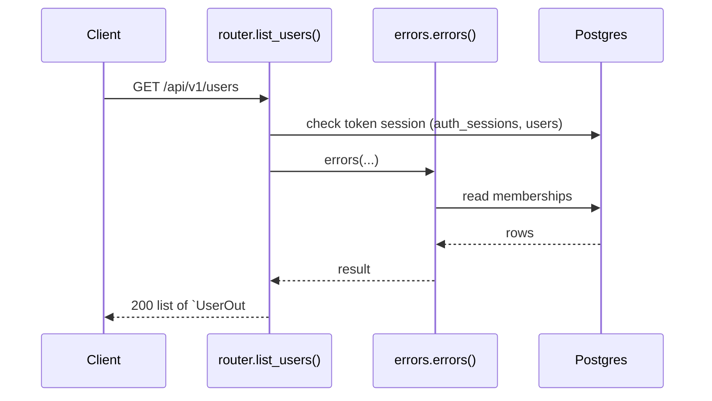
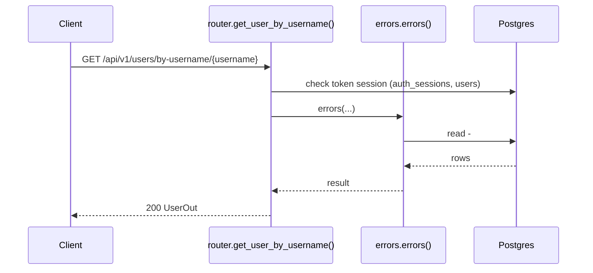
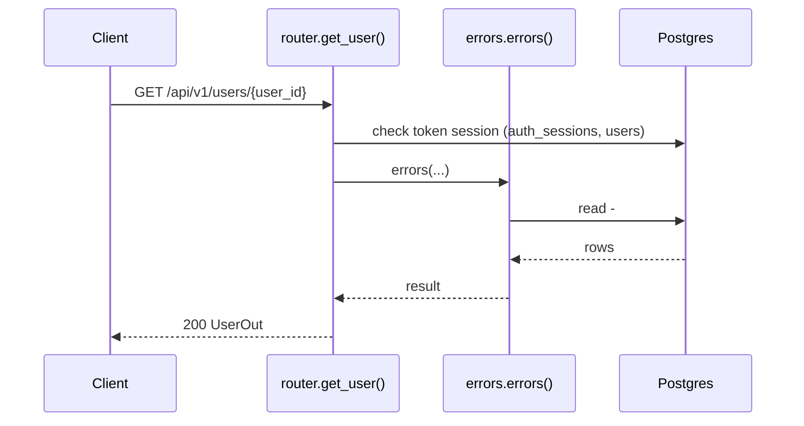
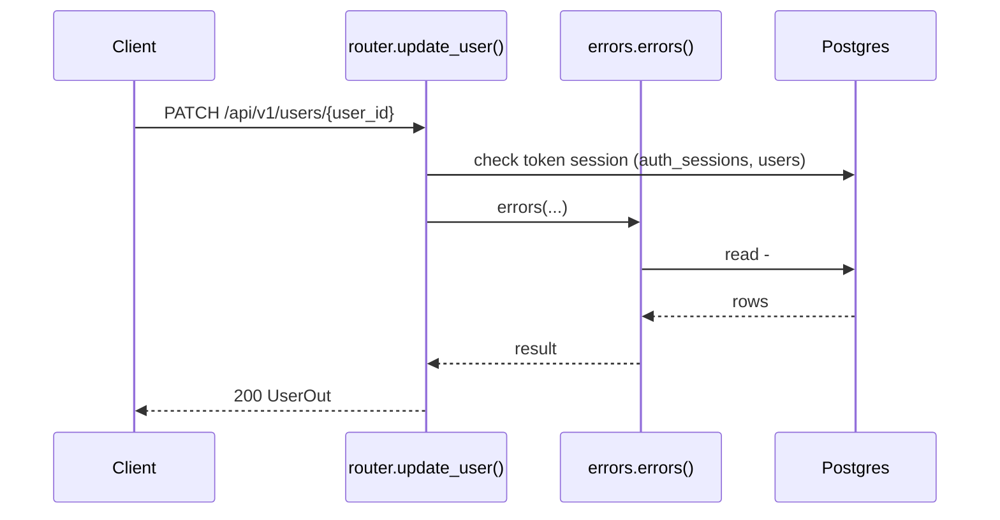
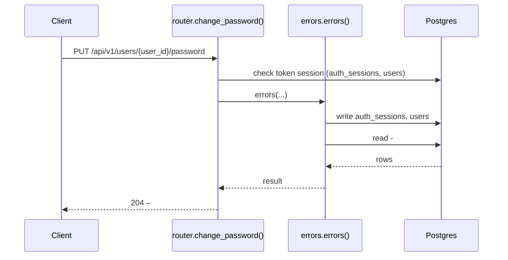
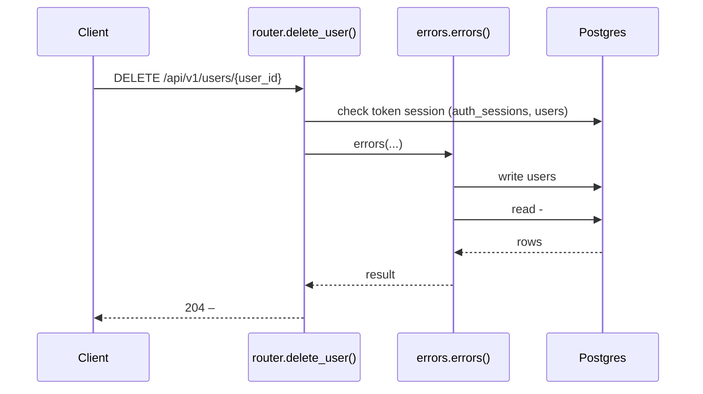

# Users API

> Generated by `scripts/gen_api_docs.py` from the code. Do not edit by hand; run `scripts/gen-docs.sh`.

## Overview

> User registration, profile and password management.

## Endpoints

| Method | Path | Summary |
|---|---|---|
| GET | [`/api/v1/users`](#get-apiv1users) | List users visible to me |
| GET | [`/api/v1/users/by-username/{username}`](#get-apiv1usersby-usernameusername) | Get a user by username |
| GET | [`/api/v1/users/{user_id}`](#get-apiv1usersuser_id) | Get a user |
| PATCH | [`/api/v1/users/{user_id}`](#patch-apiv1usersuser_id) | Update name, phone or email |
| PUT | [`/api/v1/users/{user_id}/password`](#put-apiv1usersuser_idpassword) | Change password |
| DELETE | [`/api/v1/users/{user_id}`](#delete-apiv1usersuser_id) | Delete a user |

## Details

### `GET /api/v1/users`

List users visible to me

- **Auth:** Bearer access token
- **Success:** `200` → list of `UserOut`
- **Router:** [`list_users`](../../apps/api/src/chitbook_api/modules/users/router.py#L16) (router.py:16)
- **Calls:** [`errors`](../../apps/api/src/chitbook_api/core/errors.py#L234) (errors.py:234), [`list_visible`](../../apps/api/src/chitbook_api/modules/users/service.py#L64) (service.py:64), [`list_all`](../../apps/api/src/chitbook_api/modules/users/repository.py#L25) (repository.py:25), [`list_visible_to`](../../apps/api/src/chitbook_api/modules/users/repository.py#L29) (repository.py:29)

**Response `200`**

| Field | Type | Required | Notes |
|---|---|---|---|
| `id` | integer | yes |  |
| `name` | string | yes |  |
| `username` | string | yes |  |
| `phone` | string or null | yes |  |
| `email` | string | yes |  |
| `role` | UserRole | yes |  |
| `createdAt` | string | yes |  |
| `updatedAt` | string | yes |  |

```json
[
  {
    "id": 1,
    "name": "Ravi Kumar",
    "username": "ravi",
    "phone": "9876543210",
    "email": "ravi@example.com",
    "role": "ADMIN",
    "createdAt": "2026-08-01T10:30:00+05:30",
    "updatedAt": "2026-08-01T10:30:00+05:30"
  }
]
```

**Database**

- Writes: –
- Reads: `memberships`
- Token check reads `auth_sessions` + `users` (every signed-in request)

**Flow**



**Errors** (declared in the router with `responses=errors(...)`)

| HTTP | Code | Message | Exact problem / fix |
|---|---|---|---|
| 401 | `AUTH_REQUIRED` | Authentication required | No `Authorization: Bearer <token>` header. |
| 401 | `AUTH_TOKEN_INVALID` | Access token is invalid | Token malformed, signed with another JWT_SECRET (secret changed?), or user deleted. |
| 401 | `AUTH_TOKEN_EXPIRED` | Access token has expired | Access token older than ACCESS_TOKEN_TTL_MINUTES. Client should call /auth/refresh. |
| 401 | `AUTH_SESSION_REVOKED` | Session has been signed out | Device was signed out (logout, remote sign-out, password change or refresh-token reuse). |
| 500 | `INTERNAL_ERROR` | An unexpected internal error occurred | A bug. Search `docker compose logs api` for the `requestId` and read the `request.unhandled_exception` line: it has the exception and stack trace. |
| 503 | `DB_UNAVAILABLE` | Database is unavailable | Postgres unreachable: host Postgres down, pg_hba.conf missing the Docker subnet, or wrong DB_* values in .env. See the `db.unavailable` log line. |

**Diagnose**

- Every response carries `X-Request-ID`; errors also return it as `error.requestId`.
- `docker compose logs api | grep <request_id>` shows the access line (`http.request`) and any error lines.
- Each error's exact problem is in the table above (from the router's `responses=errors(...)`).
- 500 / 503: see [logging & debugging](../operations/logging-and-debugging.md).

---

### `GET /api/v1/users/by-username/{username}`

Get a user by username

- **Auth:** Bearer access token
- **Success:** `200` → `UserOut`
- **Router:** [`get_user_by_username`](../../apps/api/src/chitbook_api/modules/users/router.py#L21) (router.py:21)
- **Calls:** [`errors`](../../apps/api/src/chitbook_api/core/errors.py#L234) (errors.py:234), [`get_by_username`](../../apps/api/src/chitbook_api/modules/users/service.py#L56) (service.py:56), [`get_by_username`](../../apps/api/src/chitbook_api/modules/users/repository.py#L17) (repository.py:17)
- **Access checks:** `require_self_or_platform_admin`

**Parameters**

| Name | In | Type | Required |
|---|---|---|---|
| `username` | path | string | yes |

**Response `200`**

| Field | Type | Required | Notes |
|---|---|---|---|
| `id` | integer | yes |  |
| `name` | string | yes |  |
| `username` | string | yes |  |
| `phone` | string or null | yes |  |
| `email` | string | yes |  |
| `role` | UserRole | yes |  |
| `createdAt` | string | yes |  |
| `updatedAt` | string | yes |  |

```json
{
  "id": 1,
  "name": "Ravi Kumar",
  "username": "ravi",
  "phone": "9876543210",
  "email": "ravi@example.com",
  "role": "ADMIN",
  "createdAt": "2026-08-01T10:30:00+05:30",
  "updatedAt": "2026-08-01T10:30:00+05:30"
}
```

**Database**: no SQL recorded (the endpoint does not use the database, or no test calls it).

**Flow**



**Errors** (declared in the router with `responses=errors(...)`)

| HTTP | Code | Message | Exact problem / fix |
|---|---|---|---|
| 401 | `AUTH_REQUIRED` | Authentication required | No `Authorization: Bearer <token>` header. |
| 401 | `AUTH_TOKEN_INVALID` | Access token is invalid | Token malformed, signed with another JWT_SECRET (secret changed?), or user deleted. |
| 401 | `AUTH_TOKEN_EXPIRED` | Access token has expired | Access token older than ACCESS_TOKEN_TTL_MINUTES. Client should call /auth/refresh. |
| 401 | `AUTH_SESSION_REVOKED` | Session has been signed out | Device was signed out (logout, remote sign-out, password change or refresh-token reuse). |
| 403 | `FORBIDDEN` | You do not have access to this resource | You may only access your own user data (unless platform ADMIN). |
| 404 | `USER_NOT_FOUND` | User not found | No user with that id/username. |
| 422 | `VALIDATION_ERROR` | Request data is invalid | Body/query/path does not match the schema. `details` lists each bad field and why. |
| 500 | `INTERNAL_ERROR` | An unexpected internal error occurred | A bug. Search `docker compose logs api` for the `requestId` and read the `request.unhandled_exception` line: it has the exception and stack trace. |
| 503 | `DB_UNAVAILABLE` | Database is unavailable | Postgres unreachable: host Postgres down, pg_hba.conf missing the Docker subnet, or wrong DB_* values in .env. See the `db.unavailable` log line. |

**Diagnose**

- Every response carries `X-Request-ID`; errors also return it as `error.requestId`.
- `docker compose logs api | grep <request_id>` shows the access line (`http.request`) and any error lines.
- Each error's exact problem is in the table above (from the router's `responses=errors(...)`).
- 500 / 503: see [logging & debugging](../operations/logging-and-debugging.md).

---

### `GET /api/v1/users/{user_id}`

Get a user

- **Auth:** Bearer access token
- **Success:** `200` → `UserOut`
- **Router:** [`get_user`](../../apps/api/src/chitbook_api/modules/users/router.py#L31) (router.py:31)
- **Calls:** [`errors`](../../apps/api/src/chitbook_api/core/errors.py#L234) (errors.py:234), [`get`](../../apps/api/src/chitbook_api/modules/users/service.py#L48) (service.py:48), [`get_by_id`](../../apps/api/src/chitbook_api/modules/users/repository.py#L13) (repository.py:13)
- **Access checks:** `require_self_or_platform_admin`

**Parameters**

| Name | In | Type | Required |
|---|---|---|---|
| `user_id` | path | integer | yes |

**Response `200`**

| Field | Type | Required | Notes |
|---|---|---|---|
| `id` | integer | yes |  |
| `name` | string | yes |  |
| `username` | string | yes |  |
| `phone` | string or null | yes |  |
| `email` | string | yes |  |
| `role` | UserRole | yes |  |
| `createdAt` | string | yes |  |
| `updatedAt` | string | yes |  |

```json
{
  "id": 1,
  "name": "Ravi Kumar",
  "username": "ravi",
  "phone": "9876543210",
  "email": "ravi@example.com",
  "role": "ADMIN",
  "createdAt": "2026-08-01T10:30:00+05:30",
  "updatedAt": "2026-08-01T10:30:00+05:30"
}
```

**Database**

- Writes: –
- Reads: –
- Token check reads `auth_sessions` + `users` (every signed-in request)

**Flow**



**Errors** (declared in the router with `responses=errors(...)`)

| HTTP | Code | Message | Exact problem / fix |
|---|---|---|---|
| 401 | `AUTH_REQUIRED` | Authentication required | No `Authorization: Bearer <token>` header. |
| 401 | `AUTH_TOKEN_INVALID` | Access token is invalid | Token malformed, signed with another JWT_SECRET (secret changed?), or user deleted. |
| 401 | `AUTH_TOKEN_EXPIRED` | Access token has expired | Access token older than ACCESS_TOKEN_TTL_MINUTES. Client should call /auth/refresh. |
| 401 | `AUTH_SESSION_REVOKED` | Session has been signed out | Device was signed out (logout, remote sign-out, password change or refresh-token reuse). |
| 403 | `FORBIDDEN` | You do not have access to this resource | You may only access your own user data (unless platform ADMIN). |
| 404 | `USER_NOT_FOUND` | User not found | No user with that id/username. |
| 422 | `VALIDATION_ERROR` | Request data is invalid | Body/query/path does not match the schema. `details` lists each bad field and why. |
| 500 | `INTERNAL_ERROR` | An unexpected internal error occurred | A bug. Search `docker compose logs api` for the `requestId` and read the `request.unhandled_exception` line: it has the exception and stack trace. |
| 503 | `DB_UNAVAILABLE` | Database is unavailable | Postgres unreachable: host Postgres down, pg_hba.conf missing the Docker subnet, or wrong DB_* values in .env. See the `db.unavailable` log line. |

**Diagnose**

- Every response carries `X-Request-ID`; errors also return it as `error.requestId`.
- `docker compose logs api | grep <request_id>` shows the access line (`http.request`) and any error lines.
- Each error's exact problem is in the table above (from the router's `responses=errors(...)`).
- 500 / 503: see [logging & debugging](../operations/logging-and-debugging.md).

---

### `PATCH /api/v1/users/{user_id}`

Update name, phone or email

- **Auth:** Bearer access token
- **Success:** `200` → `UserOut`
- **Router:** [`update_user`](../../apps/api/src/chitbook_api/modules/users/router.py#L41) (router.py:41)
- **Calls:** [`errors`](../../apps/api/src/chitbook_api/core/errors.py#L234) (errors.py:234), [`update_profile`](../../apps/api/src/chitbook_api/modules/users/service.py#L70) (service.py:70), [`get_by_email`](../../apps/api/src/chitbook_api/modules/users/repository.py#L21) (repository.py:21), [`get`](../../apps/api/src/chitbook_api/modules/users/service.py#L48) (service.py:48), [`get_by_id`](../../apps/api/src/chitbook_api/modules/users/repository.py#L13) (repository.py:13)
- **Access checks:** `require_self_or_platform_admin`

**Parameters**

| Name | In | Type | Required |
|---|---|---|---|
| `user_id` | path | integer | yes |

**Request body**

| Field | Type | Required | Notes |
|---|---|---|---|
| `name` | string or null | no | minLength=1; maxLength=100 |
| `phone` | string or null | no | pattern=^\+?[0-9]{10,15}$ |
| `email` | email or null | no |  |

```json
{
  "name": "Ravi Kumar",
  "phone": "9876543210",
  "email": "ravi@example.com"
}
```

**Response `200`**

| Field | Type | Required | Notes |
|---|---|---|---|
| `id` | integer | yes |  |
| `name` | string | yes |  |
| `username` | string | yes |  |
| `phone` | string or null | yes |  |
| `email` | string | yes |  |
| `role` | UserRole | yes |  |
| `createdAt` | string | yes |  |
| `updatedAt` | string | yes |  |

```json
{
  "id": 1,
  "name": "Ravi Kumar",
  "username": "ravi",
  "phone": "9876543210",
  "email": "ravi@example.com",
  "role": "ADMIN",
  "createdAt": "2026-08-01T10:30:00+05:30",
  "updatedAt": "2026-08-01T10:30:00+05:30"
}
```

**Database**: no SQL recorded (the endpoint does not use the database, or no test calls it).

**Flow**



**Errors** (declared in the router with `responses=errors(...)`)

| HTTP | Code | Message | Exact problem / fix |
|---|---|---|---|
| 401 | `AUTH_REQUIRED` | Authentication required | No `Authorization: Bearer <token>` header. |
| 401 | `AUTH_TOKEN_INVALID` | Access token is invalid | Token malformed, signed with another JWT_SECRET (secret changed?), or user deleted. |
| 401 | `AUTH_TOKEN_EXPIRED` | Access token has expired | Access token older than ACCESS_TOKEN_TTL_MINUTES. Client should call /auth/refresh. |
| 401 | `AUTH_SESSION_REVOKED` | Session has been signed out | Device was signed out (logout, remote sign-out, password change or refresh-token reuse). |
| 403 | `FORBIDDEN` | You do not have access to this resource | You may only access your own user data (unless platform ADMIN). |
| 404 | `USER_NOT_FOUND` | User not found | No user with that id/username. |
| 409 | `EMAIL_TAKEN` | Email is already registered | Email already registered. |
| 422 | `VALIDATION_ERROR` | Request data is invalid | Body/query/path does not match the schema. `details` lists each bad field and why. |
| 500 | `INTERNAL_ERROR` | An unexpected internal error occurred | A bug. Search `docker compose logs api` for the `requestId` and read the `request.unhandled_exception` line: it has the exception and stack trace. |
| 503 | `DB_UNAVAILABLE` | Database is unavailable | Postgres unreachable: host Postgres down, pg_hba.conf missing the Docker subnet, or wrong DB_* values in .env. See the `db.unavailable` log line. |

**Diagnose**

- Every response carries `X-Request-ID`; errors also return it as `error.requestId`.
- `docker compose logs api | grep <request_id>` shows the access line (`http.request`) and any error lines.
- Each error's exact problem is in the table above (from the router's `responses=errors(...)`).
- Log events on success: `user.updated (info)`
- 500 / 503: see [logging & debugging](../operations/logging-and-debugging.md).

---

### `PUT /api/v1/users/{user_id}/password`

Change password

- **Auth:** Bearer access token
- **Success:** `204` → –
- **Router:** [`change_password`](../../apps/api/src/chitbook_api/modules/users/router.py#L51) (router.py:51)
- **Calls:** [`errors`](../../apps/api/src/chitbook_api/core/errors.py#L234) (errors.py:234), [`change_password`](../../apps/api/src/chitbook_api/modules/users/service.py#L87) (service.py:87), [`now`](../../apps/api/src/chitbook_api/core/time.py#L14) (time.py:14), [`verify_password`](../../apps/api/src/chitbook_api/core/security.py#L37) (security.py:37), [`get`](../../apps/api/src/chitbook_api/modules/users/service.py#L48) (service.py:48), [`get_by_id`](../../apps/api/src/chitbook_api/modules/users/repository.py#L13) (repository.py:13), [`hash_password`](../../apps/api/src/chitbook_api/core/security.py#L33) (security.py:33), [`validate_password_strength`](../../apps/api/src/chitbook_api/core/security.py#L48) (security.py:48)
- **Access checks:** `require_self_or_platform_admin`

**Parameters**

| Name | In | Type | Required |
|---|---|---|---|
| `user_id` | path | integer | yes |

**Request body**

| Field | Type | Required | Notes |
|---|---|---|---|
| `currentPassword` | string | yes | minLength=1; maxLength=128 |
| `newPassword` | string | yes | minLength=1; maxLength=128 |

```json
{
  "currentPassword": "Old-pass-1",
  "newPassword": "New-pass-2026"
}
```

**Response `204`**: no body.

**Database**

- Writes: `auth_sessions`, `users`
- Reads: `auth_sessions`, `users`
- Token check reads `auth_sessions` + `users` (every signed-in request)

**Flow**



**Errors** (declared in the router with `responses=errors(...)`)

| HTTP | Code | Message | Exact problem / fix |
|---|---|---|---|
| 400 | `AUTH_WRONG_CURRENT_PASSWORD` | Current password is incorrect | `currentPassword` does not match. |
| 401 | `AUTH_REQUIRED` | Authentication required | No `Authorization: Bearer <token>` header. |
| 401 | `AUTH_TOKEN_INVALID` | Access token is invalid | Token malformed, signed with another JWT_SECRET (secret changed?), or user deleted. |
| 401 | `AUTH_TOKEN_EXPIRED` | Access token has expired | Access token older than ACCESS_TOKEN_TTL_MINUTES. Client should call /auth/refresh. |
| 401 | `AUTH_SESSION_REVOKED` | Session has been signed out | Device was signed out (logout, remote sign-out, password change or refresh-token reuse). |
| 403 | `FORBIDDEN` | You do not have access to this resource | You may only access your own user data (unless platform ADMIN). |
| 404 | `USER_NOT_FOUND` | User not found | No user with that id/username. |
| 422 | `VALIDATION_ERROR` | Request data is invalid | Body/query/path does not match the schema. `details` lists each bad field and why. |
| 422 | `AUTH_WEAK_PASSWORD` | Password does not meet the password policy | Password under 8 chars, no letter+digit, too common, or equal to the username. |
| 500 | `INTERNAL_ERROR` | An unexpected internal error occurred | A bug. Search `docker compose logs api` for the `requestId` and read the `request.unhandled_exception` line: it has the exception and stack trace. |
| 503 | `DB_UNAVAILABLE` | Database is unavailable | Postgres unreachable: host Postgres down, pg_hba.conf missing the Docker subnet, or wrong DB_* values in .env. See the `db.unavailable` log line. |

**Diagnose**

- Every response carries `X-Request-ID`; errors also return it as `error.requestId`.
- `docker compose logs api | grep <request_id>` shows the access line (`http.request`) and any error lines.
- Each error's exact problem is in the table above (from the router's `responses=errors(...)`).
- Log events on success: `user.password_changed (info)`
- 500 / 503: see [logging & debugging](../operations/logging-and-debugging.md).

---

### `DELETE /api/v1/users/{user_id}`

Delete a user

- **Auth:** Bearer access token
- **Success:** `204` → –
- **Router:** [`delete_user`](../../apps/api/src/chitbook_api/modules/users/router.py#L67) (router.py:67)
- **Calls:** [`errors`](../../apps/api/src/chitbook_api/core/errors.py#L234) (errors.py:234), [`delete`](../../apps/api/src/chitbook_api/modules/users/service.py#L102) (service.py:102), [`get`](../../apps/api/src/chitbook_api/modules/users/service.py#L48) (service.py:48), [`get_by_id`](../../apps/api/src/chitbook_api/modules/users/repository.py#L13) (repository.py:13)
- **Access checks:** `require_self_or_platform_admin`

**Parameters**

| Name | In | Type | Required |
|---|---|---|---|
| `user_id` | path | integer | yes |

**Response `204`**: no body.

**Database**

- Writes: `users`
- Reads: `users`
- Token check reads `auth_sessions` + `users` (every signed-in request)
- Child rows are removed by `ON DELETE CASCADE` (see docs/database.md)

**Flow**



**Errors** (declared in the router with `responses=errors(...)`)

| HTTP | Code | Message | Exact problem / fix |
|---|---|---|---|
| 401 | `AUTH_REQUIRED` | Authentication required | No `Authorization: Bearer <token>` header. |
| 401 | `AUTH_TOKEN_INVALID` | Access token is invalid | Token malformed, signed with another JWT_SECRET (secret changed?), or user deleted. |
| 401 | `AUTH_TOKEN_EXPIRED` | Access token has expired | Access token older than ACCESS_TOKEN_TTL_MINUTES. Client should call /auth/refresh. |
| 401 | `AUTH_SESSION_REVOKED` | Session has been signed out | Device was signed out (logout, remote sign-out, password change or refresh-token reuse). |
| 403 | `FORBIDDEN` | You do not have access to this resource | You may only access your own user data (unless platform ADMIN). |
| 404 | `USER_NOT_FOUND` | User not found | No user with that id/username. |
| 422 | `VALIDATION_ERROR` | Request data is invalid | Body/query/path does not match the schema. `details` lists each bad field and why. |
| 500 | `INTERNAL_ERROR` | An unexpected internal error occurred | A bug. Search `docker compose logs api` for the `requestId` and read the `request.unhandled_exception` line: it has the exception and stack trace. |
| 503 | `DB_UNAVAILABLE` | Database is unavailable | Postgres unreachable: host Postgres down, pg_hba.conf missing the Docker subnet, or wrong DB_* values in .env. See the `db.unavailable` log line. |

**Diagnose**

- Every response carries `X-Request-ID`; errors also return it as `error.requestId`.
- `docker compose logs api | grep <request_id>` shows the access line (`http.request`) and any error lines.
- Each error's exact problem is in the table above (from the router's `responses=errors(...)`).
- Log events on success: `user.deleted (info)`
- 500 / 503: see [logging & debugging](../operations/logging-and-debugging.md).

---

