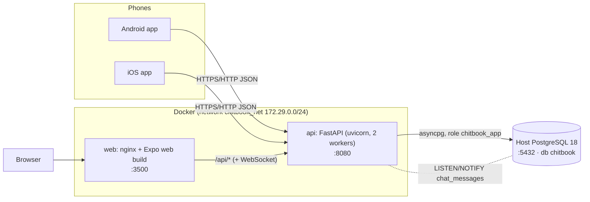
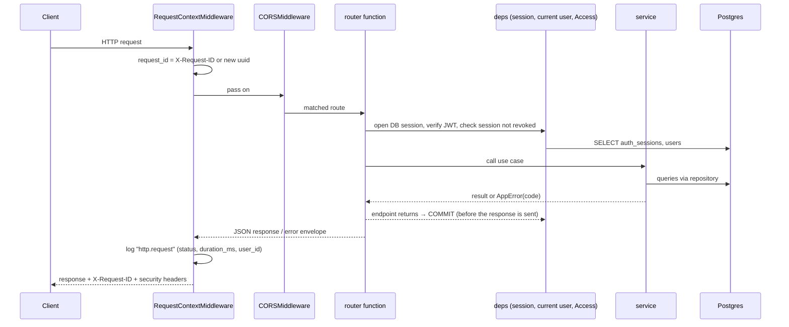
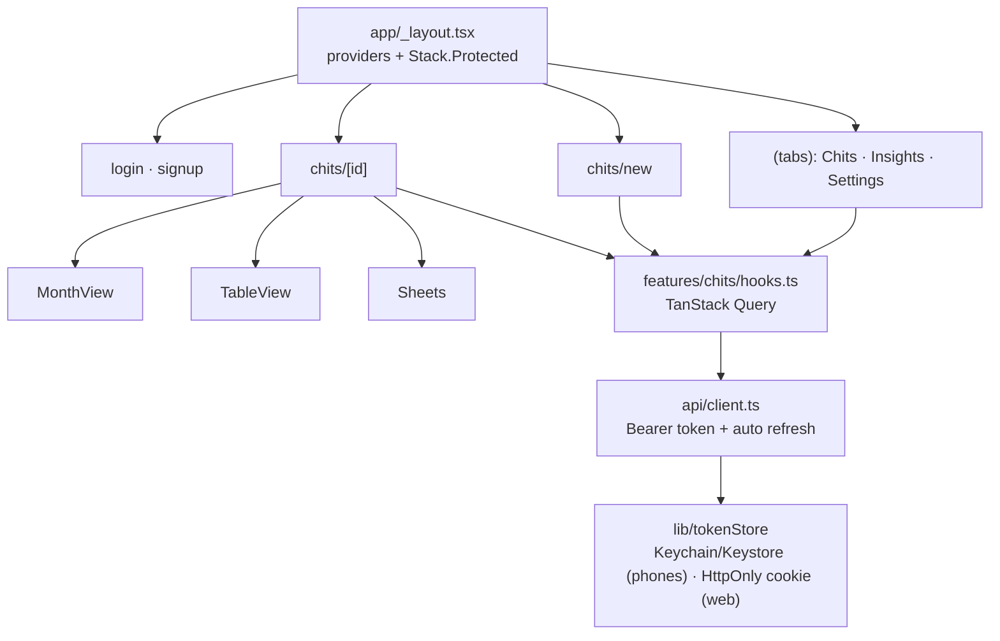

# Architecture

## System at a glance



- **Phones** call the API directly, at `EXPO_PUBLIC_API_BASE_URL`.
- **Browsers** load the web build from nginx. nginx proxies `/api` to the API, so everything is one origin and no CORS is needed.
- **Database:** the Postgres already installed on the host. The API container reaches it at `host.docker.internal:5432`.
- **Live chat:** messages are fanned out with Postgres `LISTEN/NOTIFY`, so every API worker can push them to its WebSocket clients.

## Repository layout

```
chitbook/
├── apps/
│   ├── api/                 Python FastAPI backend
│   │   ├── src/chitbook_api/
│   │   │   ├── main.py      app factory: middleware, error handlers, routers
│   │   │   ├── core/        config, db, security, deps (auth + access), errors, logging, middleware
│   │   │   └── modules/     one folder per feature (see below)
│   │   ├── migrations/      Alembic (database schema history)
│   │   └── tests/           unit/ (pure logic) + integration/ (HTTP + real Postgres)
│   └── mobile/              Expo (React Native) app: Android, iOS, web
│       └── src/
│           ├── app/         screens (expo-router: file = route)
│           ├── features/    feature logic + components (chits, insights)
│           ├── components/  shared UI kit
│           ├── api/         HTTP client, endpoints, generated types
│           ├── auth/        session provider
│           ├── i18n/        English + Telugu
│           └── lib/, theme/
├── infra/                   nginx template, Postgres setup SQL
├── scripts/                 setup-db, gen-api-types, gen-docs, smoke test
├── docs/                    this documentation
├── .claude/                 Claude Code project setup (rules, skills, agents, hooks)
└── docker-compose.yml
```

## Backend module pattern

Every feature folder in `apps/api/src/chitbook_api/modules/<feature>/` has the same files:

| File | Job | Example |
|---|---|---|
| `models.py` | SQLAlchemy tables | `SimpleChit`, `SimpleChitMember` |
| `schemas.py` | Pydantic request/response bodies (camelCase JSON) | `SimpleChitCreate`, `SimpleChitOut` |
| `repository.py` | Database queries, no rules | `get_owned(session, chit_id, owner_id)` |
| `service.py` | Business rules and access checks; raises `AppError` | `save_payout(...)` |
| `router.py` | HTTP layer only: parse → call service → return | `PUT /simple-chits/{id}/payouts/{month}` |

Modules: `auth`, `users`, `simple_chits`, `groups`, `funds`, `payments`, `ledger`, `auctions`, `loans`,
`reports`, `notifications`, `polls`, `media`, `chat`, `health`.

## Life of a request



- **Commit timing:** the transaction commits **before** the response is sent (`Depends(get_session, scope="function")`). A client that sends a follow-up request immediately always sees the committed data.
- **Known errors:** any `AppError` becomes the standard error envelope, with its HTTP status.
- **Unexpected errors:** the middleware catches them, logs the stack trace with the request id, and returns `INTERNAL_ERROR`.

## Mobile app structure



## Key technology choices

| Area | Choice | Why (see [adr/](adr/)) |
|---|---|---|
| API | FastAPI + SQLAlchemy 2 (async) + Alembic | typed, fast, auto OpenAPI, mature migrations |
| DB | PostgreSQL | strong typing (NUMERIC money, timestamptz), LISTEN/NOTIFY |
| Auth | JWT access + rotating refresh tokens | stateless checks, revocable sessions, theft detection |
| App | React Native + Expo | one TypeScript codebase for Android, iOS and web; cloud builds |
| Logs | structlog JSON | one line per event, searchable by request_id |
