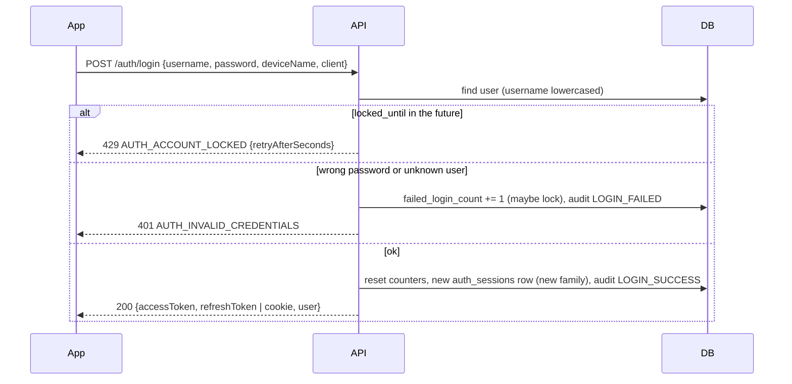
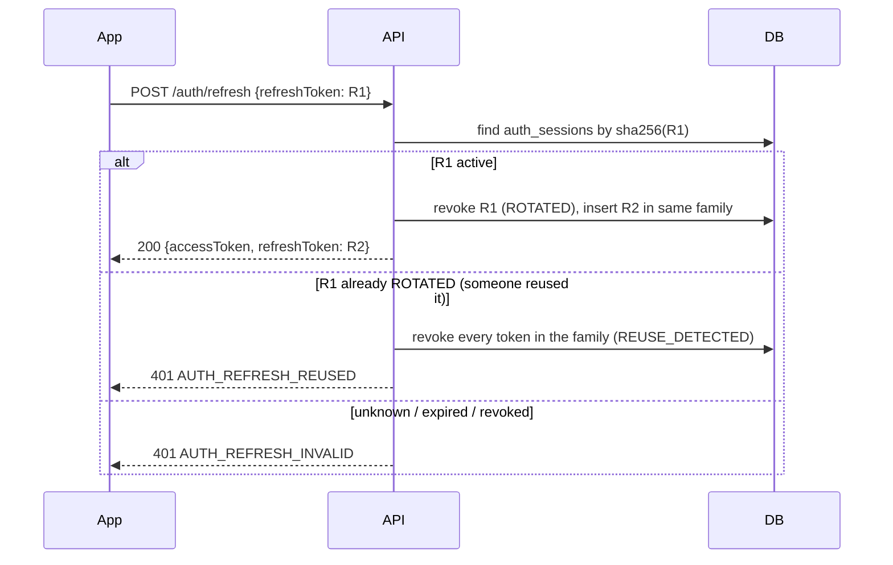

# Authentication & sessions

## Summary

| Piece | How |
|---|---|
| Passwords | Argon2id hash; at least 8 characters, with a letter and a digit; not a common password; not equal to the username |
| Access token | JWT (HS256, `JWT_SECRET`), valid `ACCESS_TOKEN_TTL_MINUTES` (15). Claims: `sub`, `role`, `sid`, `jti`, `iss`, `iat`, `exp` |
| Refresh token | Random 48-byte string, stored only as a SHA-256 hash in `auth_sessions`; valid `REFRESH_TOKEN_TTL_DAYS` (30) |
| Rotation | Every refresh revokes the old token and issues a new one |
| Theft detection | Reusing an already-rotated token revokes the whole session chain (`AUTH_REFRESH_REUSED`) |
| Immediate sign-out | Every request checks that the token's session (`sid`) is still active |
| Lockout | After `LOGIN_MAX_FAILED_ATTEMPTS` (5) failures: locked 5 min, then 10, 20 … up to 24 h |
| Rate limit | `RATE_LIMIT_AUTH_PER_MINUTE` (10) per IP on login, register and refresh |
| Audit | `auth_audit_log`: registered, login ok/failed/locked, refreshed, reuse detected, logout, session revoked, password changed |

Code: [core/security.py](../apps/api/src/chitbook_api/core/security.py) ·
[core/deps.py](../apps/api/src/chitbook_api/core/deps.py) ·
[modules/auth/service.py](../apps/api/src/chitbook_api/modules/auth/service.py) ·
[modules/auth/router.py](../apps/api/src/chitbook_api/modules/auth/router.py)

## Where tokens live

| Client | Access token | Refresh token |
|---|---|---|
| Android / iOS app | memory only | iOS Keychain / Android Keystore (`expo-secure-store`, `WHEN_UNLOCKED_THIS_DEVICE_ONLY`) |
| Web app | memory only | `HttpOnly; SameSite=Strict` cookie `chitbook_refresh` on path `/api/v1/auth`. JavaScript can never read it. |

- Nothing is stored in `localStorage` or `sessionStorage`.
- Web cookie refresh also needs the header `X-Chitbook-Client: web`, which blocks CSRF.

## Login

- Unknown usernames still run a full password hash, so response timing doesn't reveal which accounts exist.

## Refresh (rotation + reuse detection)

Example: a thief copies refresh token R1. The real app refreshes first and gets R2. The thief then sends R1 and gets 401. The whole family is revoked, so the real app's next request also fails, and the user logs in again with a new, clean session.

## The mobile client

- [`api/client.ts`](../apps/mobile/src/api/client.ts):
  - Adds `Authorization: Bearer`.
  - On `401 AUTH_TOKEN_EXPIRED` it refreshes **once**, even when many requests fail at the same moment (single flight), then retries the request.
  - When the session has ended, it clears the tokens and sends the user to the login screen.
- [`auth/AuthProvider.tsx`](../apps/mobile/src/auth/AuthProvider.tsx): on app start it tries a refresh to restore the session.

## Devices (sessions)

- `GET /auth/sessions`: active devices (one per family), with `current: true` for this one.
- `DELETE /auth/sessions/{id}`: signs that device out. Its next request gets `AUTH_SESSION_REVOKED`.
- Changing the password revokes **all** sessions of that user.

## Roles

| Level | Values | Meaning |
|---|---|---|
| Platform (`users.role`) | `ADMIN`, `MEMBER`, `ACCOUNTANT` | ADMIN passes every check. ACCOUNTANT can record and verify payments in any group. |
| Group (`memberships.role`) | `ADMIN`, `MEMBER` | Group admin manages members, payments, auctions, loans, ledger and funds |
| Membership status | `PENDING`, `ACTIVE`, `SUSPENDED`, `INACTIVE` | Only `ACTIVE` counts for group access |

- Checks live in `Access` ([core/deps.py](../apps/api/src/chitbook_api/core/deps.py)): `require_platform_admin`, `require_self_or_platform_admin`, `require_group_member`, `require_group_admin`, `require_self_or_group_admin`.
- Public sign-up always creates a `MEMBER`.
- The platform admin is created at startup from `ADMIN_*` in `.env`.

## Hardening checklist for production

- Serve the API over **HTTPS** only, behind a reverse proxy. Then set `REFRESH_COOKIE_SECURE=true`.
- Don't publish port 8080 to the internet; expose only the proxy.
- Use a long, random `JWT_SECRET`. Changing it signs everyone out.
- Set `API_DOCS_ENABLED=false` to hide Swagger in production.
- Keep `CORS_ALLOWED_ORIGINS` to the exact web origins.
