# Database

> Generated from the SQLAlchemy models (`apps/api/src/chitbook_api/modules/*/models.py`)
> and the SQL recorded during tests. Schema changes go through Alembic migrations.

- Engine: PostgreSQL 18 on the host (port 5432), database `chitbook`, role `chitbook_app`
- Time: every timestamp is `timestamptz`; the role's session timezone is `Asia/Kolkata`
- Money: `NUMERIC(14,2)`; percents `NUMERIC(5,2)`

## Entity relationships

```mermaid
erDiagram
    chit_groups ||--o{ auctions : "chit_group_id"
    users ||--o{ auctions : "winning_member_id"
    users ||--o{ auth_audit_log : "user_id"
    users ||--o{ auth_sessions : "user_id"
    chit_groups ||--o{ chat_messages : "chit_group_id"
    users ||--o{ chat_messages : "sender_id"
    chit_groups ||--o{ funds : "chit_group_id"
    chit_groups ||--o{ group_media : "chit_group_id"
    users ||--o{ group_media : "uploaded_by_id"
    chit_groups ||--o{ ledger_entries : "chit_group_id"
    users ||--o{ ledger_entries : "user_id"
    chit_groups ||--o{ member_loans : "chit_group_id"
    users ||--o{ member_loans : "user_id"
    chit_groups ||--o{ memberships : "chit_group_id"
    users ||--o{ memberships : "user_id"
    chit_groups ||--o{ notification_configs : "chit_group_id"
    users ||--o{ notifications : "user_id"
    chit_groups ||--o{ payments : "chit_group_id"
    users ||--o{ payments : "user_id"
    users ||--o{ payments : "verified_by_id"
    polls ||--o{ poll_options : "poll_id"
    poll_options ||--o{ poll_votes : "option_id"
    polls ||--o{ poll_votes : "poll_id"
    users ||--o{ poll_votes : "user_id"
    chit_groups ||--o{ polls : "chit_group_id"
    users ||--o{ polls : "created_by_id"
    simple_chit_members ||--o{ simple_chit_entries : "member_id"
    simple_chits ||--o{ simple_chit_members : "chit_id"
    simple_chits ||--o{ simple_chit_payouts : "chit_id"
    simple_chit_members ||--o{ simple_chit_payouts : "member_id"
    users ||--o{ simple_chits : "owner_id"
```

## `auctions`

| Column | Type | Null | Key / default |
|---|---|---|---|
| `id` | BIGINT | no | PK; auto-increment |
| `chit_group_id` | BIGINT | no | FK → chit_groups.id (on delete CASCADE) |
| `winning_member_id` | BIGINT | no | FK → users.id (on delete CASCADE) |
| `month` | VARCHAR(20) | no |  |
| `winning_amount` | NUMERIC(14, 2) | no |  |
| `commission` | NUMERIC(14, 2) | no |  |
| `auction_date` | DATETIME | no |  |
| `remark` | VARCHAR(200) | yes |  |
| `updated_at` | DATETIME | no | default now() |
| `created_at` | DATETIME | no | default now() |

Unique together: `chit_group_id`, `month`

Indexes: `ix_auctions_winning_member_id` (winning_member_id)

Written by: `DELETE /auctions/{auction_id}`, `POST /auctions`

Read by: `GET /auctions/group/{group_id}`, `GET /auctions/winner/{user_id}`, `GET /auctions/{auction_id}`

## `auth_audit_log`

| Column | Type | Null | Key / default |
|---|---|---|---|
| `id` | BIGINT | no | PK; auto-increment |
| `user_id` | BIGINT | yes | FK → users.id (on delete SET NULL) |
| `username` | VARCHAR(100) | yes |  |
| `event` | VARCHAR(40) | no |  |
| `ip_address` | VARCHAR(64) | yes |  |
| `user_agent` | VARCHAR(300) | yes |  |
| `details` | JSONB | yes |  |
| `created_at` | DATETIME | no | default now() |

Indexes: `ix_auth_audit_log_user_created` (user_id, created_at)

Written by: `DELETE /auth/sessions/{session_id}`, `POST /auth/login`, `POST /auth/logout`, `POST /auth/refresh`, `POST /auth/register`

## `auth_sessions`

| Column | Type | Null | Key / default |
|---|---|---|---|
| `id` | CHAR(32) | no | PK |
| `user_id` | BIGINT | no | FK → users.id (on delete CASCADE) |
| `family_id` | CHAR(32) | no |  |
| `token_hash` | VARCHAR(64) | no | unique |
| `device_name` | VARCHAR(100) | yes |  |
| `user_agent` | VARCHAR(300) | yes |  |
| `ip_address` | VARCHAR(64) | yes |  |
| `last_used_at` | DATETIME | yes |  |
| `expires_at` | DATETIME | no |  |
| `revoked_at` | DATETIME | yes |  |
| `revoke_reason` | VARCHAR(30) | yes |  |
| `created_at` | DATETIME | no | default now() |

Indexes: `ix_auth_sessions_family_id` (family_id), `ix_auth_sessions_user_id` (user_id)

Written by: `DELETE /auth/sessions/{session_id}`, `POST /auth/login`, `POST /auth/logout`, `POST /auth/refresh`, `PUT /users/{user_id}/password`

Read by: every signed-in request (token/session check).

## `chat_messages`

| Column | Type | Null | Key / default |
|---|---|---|---|
| `id` | BIGINT | no | PK; auto-increment |
| `chit_group_id` | BIGINT | no | FK → chit_groups.id (on delete CASCADE) |
| `sender_id` | BIGINT | no | FK → users.id (on delete CASCADE) |
| `content` | VARCHAR(1000) | no |  |
| `message_type` | VARCHAR(20) | no |  |
| `created_at` | DATETIME | no | default now() |

Indexes: `ix_chat_messages_group_id_id` (chit_group_id, id)

Written by: `POST /chat/group/{group_id}/messages`

Read by: `GET /chat/group/{group_id}/messages`

## `chit_groups`

| Column | Type | Null | Key / default |
|---|---|---|---|
| `id` | BIGINT | no | PK; auto-increment |
| `group_code` | VARCHAR(20) | no | unique |
| `name` | VARCHAR(100) | no |  |
| `duration` | INTEGER | no |  |
| `monthly_amount` | NUMERIC(14, 2) | no |  |
| `total_members` | INTEGER | no |  |
| `start_date` | DATETIME | no |  |
| `status` | VARCHAR(20) | no |  |
| `updated_at` | DATETIME | no | default now() |
| `created_at` | DATETIME | no | default now() |

Written by: `DELETE /groups/{group_id}`, `POST /groups`

Read by: `DELETE /auctions/{auction_id}`, `DELETE /groups/{group_id}/members/{user_id}`, `DELETE /media/{media_id}`, `GET /auctions/group/{group_id}`, `GET /auctions/winner/{user_id}`, `GET /auctions/{auction_id}`, `GET /chat/group/{group_id}/messages`, `GET /funds`, `GET /funds/group/{group_id}`, `GET /groups`, `GET /groups/{group_id}`, `GET /groups/{group_id}/members`, `GET /ledger`, `GET /ledger/pdf`, `GET /loans/group/{group_id}/user/{user_id}/payable`, `GET /loans/user/{user_id}`, `GET /payments/group/{group_id}`, `GET /payments/group/{group_id}/user/{user_id}`, `GET /polls/group/{group_id}`, `GET /reports/group/{group_id}/audit`, `GET /reports/group/{group_id}/summary`, `GET /reports/user/{user_id}`, `PATCH /funds/{fund_id}`, `PATCH /groups/{group_id}`, `POST /auctions`, `POST /chat/group/{group_id}/messages`, `POST /groups/join`, `POST /groups/{group_id}/members`, `POST /ledger`, `POST /loans`, `POST /media`, `POST /payments`, `POST /payments/{payment_id}/verify`, `POST /polls`, `POST /polls/vote`, `PUT /groups/{group_id}/members/{user_id}/status`, `PUT /loans/{loan_id}/status`, `PUT /polls/{poll_id}/close`

## `funds`

| Column | Type | Null | Key / default |
|---|---|---|---|
| `id` | BIGINT | no | PK; auto-increment |
| `chit_group_id` | BIGINT | no | FK → chit_groups.id (on delete CASCADE); unique |
| `name` | VARCHAR(150) | no |  |
| `total_amount` | NUMERIC(14, 2) | no |  |
| `cycle_period` | INTEGER | no |  |
| `interest_rate` | NUMERIC(5, 2) | no |  |
| `updated_at` | DATETIME | no | default now() |
| `created_at` | DATETIME | no | default now() |

Written by: `PATCH /funds/{fund_id}`, `POST /groups`

Read by: `GET /funds`, `GET /funds/group/{group_id}`, `GET /groups`, `GET /groups/{group_id}`, `GET /reports/group/{group_id}/summary`, `GET /reports/user/{user_id}`

## `group_media`

| Column | Type | Null | Key / default |
|---|---|---|---|
| `id` | BIGINT | no | PK; auto-increment |
| `chit_group_id` | BIGINT | no | FK → chit_groups.id (on delete CASCADE) |
| `uploaded_by_id` | BIGINT | no | FK → users.id (on delete CASCADE) |
| `url` | VARCHAR(1000) | no |  |
| `caption` | VARCHAR(255) | no |  |
| `media_type` | VARCHAR(10) | no |  |
| `created_at` | DATETIME | no | default now() |

Indexes: `ix_group_media_chit_group_id` (chit_group_id)

Written by: `DELETE /media/{media_id}`, `POST /media`

## `ledger_entries`

| Column | Type | Null | Key / default |
|---|---|---|---|
| `id` | BIGINT | no | PK; auto-increment |
| `user_id` | BIGINT | no | FK → users.id (on delete CASCADE) |
| `chit_group_id` | BIGINT | no | FK → chit_groups.id (on delete CASCADE) |
| `entry_type` | VARCHAR(10) | no |  |
| `amount` | NUMERIC(14, 2) | no |  |
| `entry_date` | DATETIME | no |  |
| `remark` | VARCHAR(255) | yes |  |
| `reference_id` | VARCHAR(50) | yes |  |
| `updated_at` | DATETIME | no | default now() |
| `created_at` | DATETIME | no | default now() |

Indexes: `ix_ledger_entries_chit_group_id` (chit_group_id), `ix_ledger_entries_user_id` (user_id)

Written by: `POST /ledger`

Read by: `GET /ledger`, `GET /ledger/pdf`

## `member_loans`

| Column | Type | Null | Key / default |
|---|---|---|---|
| `id` | BIGINT | no | PK; auto-increment |
| `user_id` | BIGINT | no | FK → users.id (on delete CASCADE) |
| `chit_group_id` | BIGINT | no | FK → chit_groups.id (on delete CASCADE) |
| `principal` | NUMERIC(14, 2) | no |  |
| `interest_rate` | NUMERIC(5, 2) | no |  |
| `tenure_months` | NUMERIC(6, 2) | no |  |
| `current_payable` | NUMERIC(14, 2) | no |  |
| `start_date` | DATETIME | no |  |
| `end_date` | DATETIME | yes |  |
| `status` | VARCHAR(20) | no |  |
| `updated_at` | DATETIME | no | default now() |
| `created_at` | DATETIME | no | default now() |

Indexes: `ix_member_loans_chit_group_id` (chit_group_id), `ix_member_loans_user_id` (user_id)

Written by: `POST /loans`, `PUT /loans/{loan_id}/status`

Read by: `GET /loans/group/{group_id}/user/{user_id}/payable`, `GET /loans/user/{user_id}`, `GET /reports/group/{group_id}/summary`, `GET /reports/user/{user_id}`

## `memberships`

| Column | Type | Null | Key / default |
|---|---|---|---|
| `id` | BIGINT | no | PK; auto-increment |
| `user_id` | BIGINT | no | FK → users.id (on delete CASCADE) |
| `chit_group_id` | BIGINT | no | FK → chit_groups.id (on delete CASCADE) |
| `join_date` | DATETIME | no |  |
| `status` | VARCHAR(20) | no |  |
| `role` | VARCHAR(20) | no |  |

Unique together: `user_id`, `chit_group_id`

Indexes: `ix_memberships_chit_group_id` (chit_group_id), `ix_memberships_user_id` (user_id)

Written by: `DELETE /groups/{group_id}/members/{user_id}`, `POST /groups`, `POST /groups/join`, `POST /groups/{group_id}/members`, `PUT /groups/{group_id}/members/{user_id}/status`

Read by: `DELETE /auctions/{auction_id}`, `DELETE /groups/{group_id}`, `DELETE /media/{media_id}`, `GET /auctions/group/{group_id}`, `GET /auctions/{auction_id}`, `GET /chat/group/{group_id}/messages`, `GET /funds`, `GET /funds/group/{group_id}`, `GET /groups`, `GET /groups/{group_id}`, `GET /groups/{group_id}/members`, `GET /ledger`, `GET /ledger/pdf`, `GET /loans/group/{group_id}/user/{user_id}/payable`, `GET /payments/group/{group_id}`, `GET /payments/group/{group_id}/user/{user_id}`, `GET /polls/group/{group_id}`, `GET /reports/group/{group_id}/audit`, `GET /reports/group/{group_id}/summary`, `GET /reports/user/{user_id}`, `GET /users`, `PATCH /funds/{fund_id}`, `PATCH /groups/{group_id}`, `POST /auctions`, `POST /chat/group/{group_id}/messages`, `POST /ledger`, `POST /loans`, `POST /media`, `POST /payments`, `POST /payments/{payment_id}/verify`, `POST /polls`, `POST /polls/vote`, `PUT /loans/{loan_id}/status`

## `notification_configs`

| Column | Type | Null | Key / default |
|---|---|---|---|
| `id` | BIGINT | no | PK; auto-increment |
| `chit_group_id` | BIGINT | no | FK → chit_groups.id (on delete CASCADE) |
| `notification_type` | VARCHAR(50) | no |  |
| `advance_days` | INTEGER | no |  |
| `enabled` | BOOLEAN | no |  |
| `message_template` | VARCHAR(500) | yes |  |
| `recurring_day` | INTEGER | yes |  |
| `updated_at` | DATETIME | no | default now() |
| `created_at` | DATETIME | no | default now() |

Unique together: `chit_group_id`, `notification_type`

## `notifications`

| Column | Type | Null | Key / default |
|---|---|---|---|
| `id` | BIGINT | no | PK; auto-increment |
| `user_id` | BIGINT | no | FK → users.id (on delete CASCADE) |
| `message` | VARCHAR(250) | no |  |
| `type` | VARCHAR(30) | no |  |
| `status` | VARCHAR(10) | no |  |
| `created_at` | DATETIME | no | default now() |

Indexes: `ix_notifications_user_status` (user_id, status)

Written by: `POST /groups/join`, `PUT /notifications/{notification_id}/read`

Read by: `GET /notifications/user/{user_id}`, `GET /notifications/user/{user_id}/unread-count`

## `payments`

| Column | Type | Null | Key / default |
|---|---|---|---|
| `id` | BIGINT | no | PK; auto-increment |
| `user_id` | BIGINT | no | FK → users.id (on delete CASCADE) |
| `chit_group_id` | BIGINT | no | FK → chit_groups.id (on delete CASCADE) |
| `month` | VARCHAR(15) | no |  |
| `amount_paid` | NUMERIC(14, 2) | no |  |
| `payment_date` | DATETIME | no |  |
| `mode` | VARCHAR(20) | no |  |
| `status` | VARCHAR(20) | no |  |
| `verified` | BOOLEAN | no |  |
| `verified_by_id` | BIGINT | yes | FK → users.id (on delete SET NULL) |
| `verified_at` | DATETIME | yes |  |
| `updated_at` | DATETIME | no | default now() |
| `created_at` | DATETIME | no | default now() |

Indexes: `ix_payments_group_user` (chit_group_id, user_id)

Written by: `POST /payments`, `POST /payments/{payment_id}/verify`

Read by: `GET /payments/group/{group_id}`, `GET /payments/group/{group_id}/user/{user_id}`, `GET /reports/group/{group_id}/audit`, `GET /reports/group/{group_id}/summary`, `GET /reports/user/{user_id}`

## `poll_options`

| Column | Type | Null | Key / default |
|---|---|---|---|
| `id` | BIGINT | no | PK; auto-increment |
| `poll_id` | BIGINT | no | FK → polls.id (on delete CASCADE) |
| `option_text` | VARCHAR(255) | no |  |

Indexes: `ix_poll_options_poll_id` (poll_id)

Written by: `POST /polls`

Read by: `POST /polls/vote`, `PUT /polls/{poll_id}/close`

## `poll_votes`

| Column | Type | Null | Key / default |
|---|---|---|---|
| `id` | BIGINT | no | PK; auto-increment |
| `poll_id` | BIGINT | no | FK → polls.id (on delete CASCADE) |
| `option_id` | BIGINT | no | FK → poll_options.id (on delete CASCADE) |
| `user_id` | BIGINT | no | FK → users.id (on delete CASCADE) |
| `created_at` | DATETIME | no | default now() |

Unique together: `poll_id`, `user_id`

Indexes: `ix_poll_votes_option_id` (option_id)

Written by: `POST /polls/vote`

Read by: `POST /polls`, `PUT /polls/{poll_id}/close`

## `polls`

| Column | Type | Null | Key / default |
|---|---|---|---|
| `id` | BIGINT | no | PK; auto-increment |
| `chit_group_id` | BIGINT | no | FK → chit_groups.id (on delete CASCADE) |
| `created_by_id` | BIGINT | no | FK → users.id (on delete CASCADE) |
| `question` | VARCHAR(255) | no |  |
| `status` | VARCHAR(10) | no |  |
| `expires_at` | DATETIME | yes |  |
| `created_at` | DATETIME | no | default now() |

Indexes: `ix_polls_chit_group_id` (chit_group_id)

Written by: `POST /polls`, `PUT /polls/{poll_id}/close`

Read by: `POST /polls/vote`

## `simple_chit_entries`

| Column | Type | Null | Key / default |
|---|---|---|---|
| `id` | BIGINT | no | PK; auto-increment |
| `member_id` | BIGINT | no | FK → simple_chit_members.id (on delete CASCADE) |
| `month_index` | INTEGER | no |  |
| `amount` | NUMERIC(14, 2) | no |  |
| `paid` | BOOLEAN | no |  |
| `paid_at` | DATETIME | yes |  |

Unique together: `member_id`, `month_index`

Written by: `DELETE /simple-chits/{chit_id}`, `DELETE /simple-chits/{chit_id}/payouts/{month}`, `PATCH /simple-chits/{chit_id}`, `POST /simple-chits`, `POST /simple-chits/{chit_id}/members`, `PUT /simple-chits/{chit_id}/payouts/{month}`

Read by: `GET /simple-chits`, `GET /simple-chits/stats`

## `simple_chit_members`

| Column | Type | Null | Key / default |
|---|---|---|---|
| `id` | BIGINT | no | PK; auto-increment |
| `chit_id` | BIGINT | no | FK → simple_chits.id (on delete CASCADE) |
| `name` | VARCHAR(100) | no |  |
| `position` | INTEGER | no |  |
| `shares` | INTEGER | no |  |
| `start_month_index` | INTEGER | no |  |

Indexes: `ix_simple_chit_members_chit_id` (chit_id)

Written by: `DELETE /simple-chits/{chit_id}`, `POST /simple-chits`, `POST /simple-chits/{chit_id}/members`

Read by: `DELETE /simple-chits/{chit_id}/payouts/{month}`, `GET /simple-chits`, `GET /simple-chits/stats`, `PATCH /simple-chits/{chit_id}`, `PUT /simple-chits/{chit_id}/payouts/{month}`

## `simple_chit_payouts`

| Column | Type | Null | Key / default |
|---|---|---|---|
| `id` | BIGINT | no | PK; auto-increment |
| `chit_id` | BIGINT | no | FK → simple_chits.id (on delete CASCADE) |
| `month_index` | INTEGER | no |  |
| `member_id` | BIGINT | no | FK → simple_chit_members.id (on delete CASCADE) |
| `amount` | NUMERIC(14, 2) | no |  |
| `paid_on` | DATE | no |  |
| `escalation_applied` | NUMERIC(14, 2) | no |  |

Unique together: `chit_id`, `month_index`

Indexes: `ix_simple_chit_payouts_member_id` (member_id)

Written by: `DELETE /simple-chits/{chit_id}`, `DELETE /simple-chits/{chit_id}/payouts/{month}`, `PUT /simple-chits/{chit_id}/payouts/{month}`

Read by: `GET /simple-chits`, `GET /simple-chits/stats`, `PATCH /simple-chits/{chit_id}`, `POST /simple-chits/{chit_id}/members`

## `simple_chits`

| Column | Type | Null | Key / default |
|---|---|---|---|
| `id` | BIGINT | no | PK; auto-increment |
| `owner_id` | BIGINT | no | FK → users.id (on delete CASCADE) |
| `name` | VARCHAR(100) | no |  |
| `total_amount` | NUMERIC(14, 2) | no |  |
| `months` | INTEGER | no |  |
| `start_month` | VARCHAR(7) | no |  |
| `per_share_amount` | NUMERIC(14, 2) | no |  |
| `commission_percent` | NUMERIC(5, 2) | no |  |
| `escalation_enabled` | BOOLEAN | no |  |
| `escalation_percent` | NUMERIC(5, 2) | no |  |
| `updated_at` | DATETIME | no | default now() |
| `created_at` | DATETIME | no | default now() |

Indexes: `ix_simple_chits_owner_id` (owner_id)

Written by: `DELETE /simple-chits/{chit_id}`, `POST /simple-chits`

Read by: `DELETE /simple-chits/{chit_id}/payouts/{month}`, `GET /simple-chits`, `GET /simple-chits/stats`, `GET /simple-chits/{chit_id}`, `PATCH /simple-chits/{chit_id}`, `POST /simple-chits/{chit_id}/members`, `PUT /simple-chits/{chit_id}/payouts/{month}`

## `users`

| Column | Type | Null | Key / default |
|---|---|---|---|
| `id` | BIGINT | no | PK; auto-increment |
| `name` | VARCHAR(100) | no |  |
| `username` | VARCHAR(30) | no | unique |
| `phone` | VARCHAR(15) | yes |  |
| `email` | VARCHAR(255) | no | unique |
| `password_hash` | VARCHAR(255) | no |  |
| `role` | VARCHAR(20) | no |  |
| `failed_login_count` | INTEGER | no | default 0 |
| `locked_until` | DATETIME | yes |  |
| `last_login_at` | DATETIME | yes |  |
| `updated_at` | DATETIME | no | default now() |
| `created_at` | DATETIME | no | default now() |

Written by: `DELETE /users/{user_id}`, `POST /auth/login`, `POST /auth/register`, `PUT /users/{user_id}/password`

Read by: every signed-in request (token/session check).

