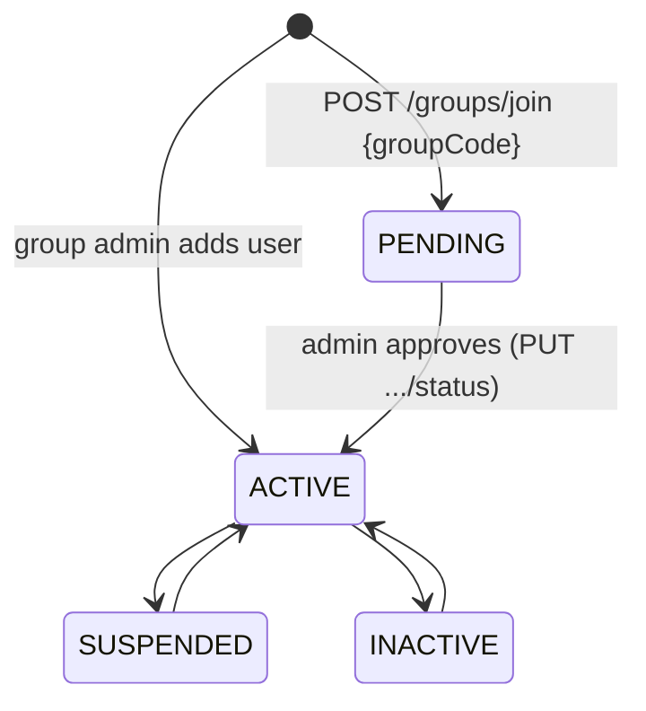

# Chit groups: business rules

A **chit group** is a chit where every member is an app user with their own login. It covers memberships, payments, the group fund, auctions, loans, the ledger, reports, reminders, polls, media and chat.

> The mobile app does not have screens for these modules yet (see [../project-status.md](../project-status.md)). They are fully available through the API.

## Groups & memberships ([api](../api/groups.md))



- **Creating a group** makes the creator its `ADMIN` (status `ACTIVE`). It also creates the group's **fund** (₹0, 0% interest).
- **Group code:** `CHIT` followed by 6 hex characters, e.g. `CHIT3F5A7C`. Lookups ignore case.
- **Member limit:** `total_members`.
  - Adding a member counts **all** memberships.
  - Joining and approving count **active** memberships.
- **Join request:** creates a `PENDING` membership and an in-app notification (`JOIN_REQUEST`) for every active group admin.
- **Who sees whom:** members see `ACTIVE` members only. Group admins and platform admins also see `PENDING`, `SUSPENDED` and `INACTIVE` ones.
- **Group status:** `PENDING`, `ACTIVE`, `COMPLETED`, `INACTIVE`. It's set by group admins and has no automatic transitions.

## Payments ([api](../api/payments.md))

- A payment can only be recorded for an **active** member.
- Members can record only their own payments. Group admins, `ACCOUNTANT` users and platform admins can record payments for anyone.
- New payments are `COMPLETED` and `verified = false`.
- **Verify:** done by a group admin, an `ACCOUNTANT` or a platform admin. It sets `verified`, `verified_by` and `verified_at`.

## Fund ([api](../api/funds.md))

- One fund per group, holding `total_amount` (₹) and `interest_rate` (annual %).
- Members can read it. Group admins update it.

## Auctions ([api](../api/auctions.md))

- One auction per group per `month`.
- The winner must be an active member.
- Only group admins create or delete auctions.

## Loans ([api](../api/loans.md))

Simple daily interest:

```
current_payable = principal + principal × interest_rate × days_elapsed ÷ 36500
```

Example: ₹1,00,000 at 12% for 73 days gives 1,00,000 × 12 × 73 ÷ 36500 = ₹2,400 interest, so **₹1,02,400** is payable.

- `days_elapsed` counts IST calendar days from `start_date`.
- Status is `ACTIVE`, `OVERDUE`, `PAID` or `CLOSED`. Moving to PAID or CLOSED **freezes** `current_payable`.
- Only group admins create loans or change their status. The borrower must be an active member.

## Ledger ([api](../api/ledger.md))

- One `CREDIT` or `DEBIT` row per money movement, with an optional `reference_id` (a payment or auction id).
- Only group admins add entries.
- **Who can read what:**
  - group + user: that member or a group admin
  - group only: a group admin
  - user only: that user
  - no filter: platform admin only
- `GET /ledger/pdf` returns the same selection as an A4 PDF, with totals.

## Reports ([api](../api/reports.md))

| Report | Formula |
|---|---|
| contributions | sum of `COMPLETED` payments dated up to the end of today (IST) |
| loans outstanding | sum of `current_payable` of the group's loans |
| fund balance | the fund's `total_amount` (or contributions − loans if there is no fund) |
| member profit share | (fund balance − contributions + loans outstanding) ÷ active members |
| audit | count and sum of unverified payments, plus the 10 most recent |

## Notifications ([api](../api/notifications.md))

- **In-app notifications** are `UNREAD` until marked read. Users see only their own.
- **Reminder rules** (`notification_configs`): one per group per type, e.g. `PAYMENT_REMINDER`, with `advance_days`, `recurring_day` and `message_template`. Group admins manage them.
  - The rules are stored for a future scheduler. Nothing sends reminders yet.

## Polls, media, chat

- **Polls** ([api](../api/polls.md)):
  - Any active member creates one, with 2–10 options. One vote per user.
  - Closed when its status is `CLOSED` or `expires_at` has passed.
  - The creator or a group admin can close it.
- **Media** ([api](../api/media.md)):
  - Stores links (http/https) to photos or videos hosted elsewhere.
  - The uploader or a group admin can delete.
- **Chat** ([api](../api/chat.md)):
  - REST to send and list (`afterId` for "newer than").
  - Plus a WebSocket for live updates at `/api/v1/chat/ws/groups/{id}`:

```
client → {"type":"auth","token":"<access token>"}     (within 10 s)
server → {"type":"ready"}
client → {"type":"send","content":"hello"}            (optional)
server → {"type":"message","data":{...ChatMessageOut}} (every new message)
close codes: 4401 bad/expired token · 4403 not a member
```
