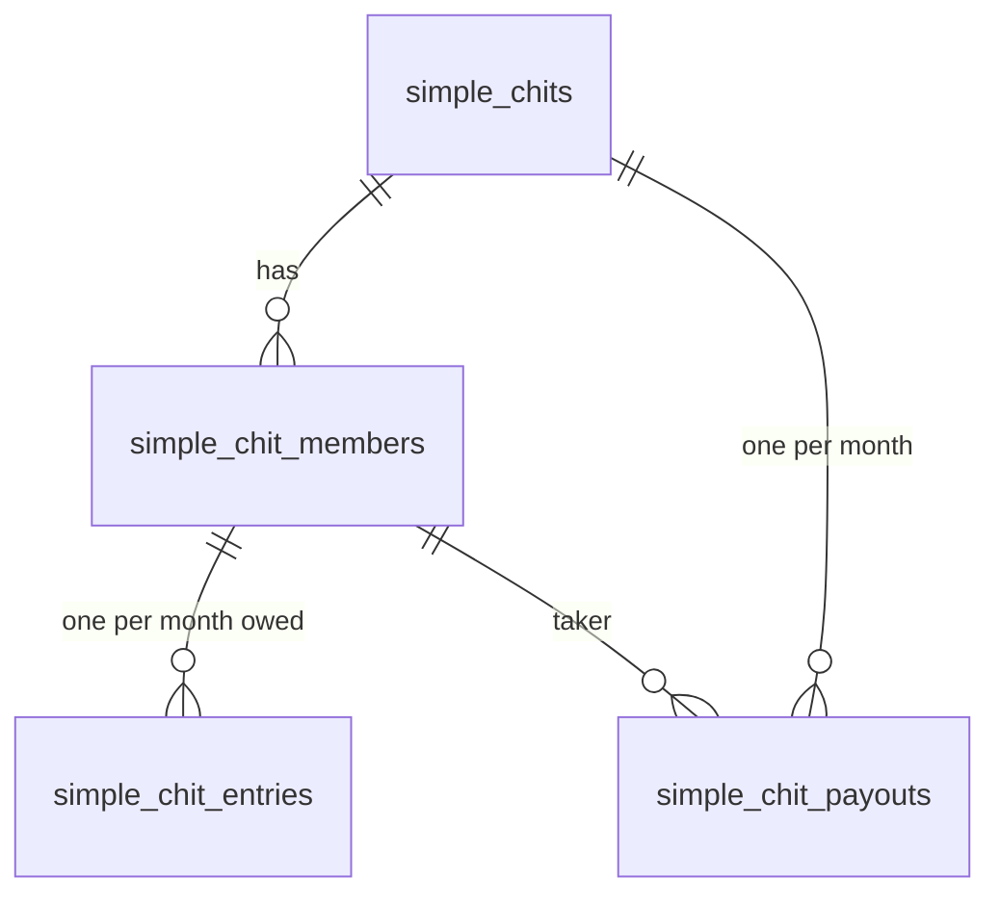

# Simple chits: business rules

A **simple chit** is run by one owner (the signed-in user) for a list of named members. Members are just names, not app users. This is the module the mobile app's Chits, Insights and New Chit screens use.

Code: [service.py](../../apps/api/src/chitbook_api/modules/simple_chits/service.py) ·
[math.py](../../apps/api/src/chitbook_api/modules/simple_chits/math.py) ·
[stats.py](../../apps/api/src/chitbook_api/modules/simple_chits/stats.py) ·
API: [../api/simple-chits.md](../api/simple-chits.md)

## Data model

| Table | One row = |
|---|---|
| `simple_chits` | the chit: total amount, months, start month, per-share amount, commission %, escalation settings |
| `simple_chit_members` | a person: name, shares, the month they join (`start_month_index`) |
| `simple_chit_entries` | what one member owes in one month, and whether it's paid |
| `simple_chit_payouts` | who took the pot in a month, how much, when, and the exact escalation applied |

## Rules

1. **Per-share amount:** one common amount for the whole chit. It defaults to `total_amount ÷ months`, rounded to paise.
2. **Shares:** a member's monthly amount is `per_share_amount × shares`.
3. **Late joiners:** a member has entries only from their start month onwards. Earlier months have **no row** (not ₹0), so they don't count as due.
4. **Month index:** months are numbered 1…`months`. Month 1 is `start_month`.
5. **Due / overdue:** a month is *due* once its calendar month has started (IST), and *overdue* once it's over.
6. **Payout escalation** (optional):
   - Recording a payout adds `total_amount × escalation_percent ÷ 100` to every **later** month of the **member who took the pot**.
   - The exact bump is stored in `escalation_applied`.
   - Replacing or deleting the payout first subtracts exactly that amount.
7. **Limits:** 1 to 120 months · 1 to 100 members · commission 0–20% (default 5) · escalation 0–100% (default 1) · names up to 100 characters.
8. **Ownership:** only the owner sees or changes a chit. Anyone else gets `CHIT_NOT_FOUND`, so other people's chit ids aren't revealed.

## Month figures

| Figure | Formula |
|---|---|
| due | sum of all entries in the month |
| collected | sum of entries marked paid |
| pending | max(due − collected, 0) |
| payout | the payout amount (or none) |
| P/L | collected − payout (only when a payout exists) |

Chit totals (dashboard cards):

- `dueToDate` = sum of due over months that are due
- `collected` = all paid entries, including ones paid ahead of time
- `pending` = sum of pending over due months
- `overdue` = sum of pending over finished months
- `paidOut` = sum of payouts
- `profit` = sum of P/L

## Worked example

Family chit: ₹5,00,000 over 20 months, starting 2026-08. Escalation is on at 1%.

| Member | Shares | Joins | Monthly amount |
|---|---|---|---|
| Ramesh | 2 | 2026-08 (month 1) | 2 × ₹25,000 = **₹50,000** |
| Priya | 1 | 2026-08 | ₹25,000 |
| Late | 1 | 2026-11 (month 4) | ₹25,000 from month 4; months 1–3 have no entry |

- Per share = 5,00,000 ÷ 20 = **₹25,000**.
- Month 1 due = 50,000 + 25,000 = **₹75,000**. Late isn't counted yet.
- Month 4 due = 50,000 + 25,000 + 25,000 = **₹1,00,000**.

**Payout in month 5 to Ramesh, ₹5,00,000:**

- bump = 5,00,000 × 1% = **₹5,000**
- Ramesh, months 6–20: 50,000 → **55,000**. His months 1–5 stay the same.
- Priya and Late don't change.
- `escalation_applied = 5000` is stored on the payout.

**Replace that payout with Priya:**

1. Undo Ramesh: months 6–20 go back to **50,000**.
2. Apply to Priya: months 6–20 go 25,000 → **30,000**. The bump is applied once, never doubled.

**Delete the payout:** Priya's months 6–20 go back to 25,000.

## Insights (`GET /simple-chits/stats`)

- `totals`:
  - The sums above across all of the owner's chits.
  - `cashInHand = collected − paidOut`.
  - `expectedCommission = Σ total × commission% × months`.
  - `collectionRate = min(collected, due) ÷ due`.
- `monthly`: one point per calendar month (due, collected, payout, P/L, cumulative P/L). It runs from the first month to at most 2 months ahead of today, and is trimmed to the last 18 months. The cumulative total is computed **before** trimming.
- `pendingDues`: every unpaid, non-zero entry whose month has started. It is sorted oldest first, and `daysOverdue` is counted from the 1st of the following month.

## Tests that pin these rules

- [tests/integration/test_simple_chits.py](../../apps/api/tests/integration/test_simple_chits.py): shares, late joiners, escalation, reversal, replacement, stats, ownership, validation.
- [tests/unit/test_simple_chit_math.py](../../apps/api/tests/unit/test_simple_chit_math.py): month math.
- [apps/mobile/src/features/chits/gridDraft.test.ts](../../apps/mobile/src/features/chits/gridDraft.test.ts): the app's live figures use the same formulas.
