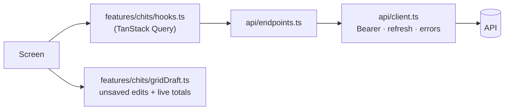

# Mobile app (Android · iOS · web)

One TypeScript codebase (`apps/mobile`): **Expo SDK 58**, React Native 0.88 and expo-router.

## Screens

| Route | File | What it does |
|---|---|---|
| `/login` | [src/app/login.tsx](../apps/mobile/src/app/login.tsx) | sign in, language switch |
| `/signup` | [src/app/signup.tsx](../apps/mobile/src/app/signup.tsx) | create an account (same rules as the API) |
| `/` (tab Chits) | [src/app/(tabs)/index.tsx](../apps/mobile/src/app/(tabs)/index.tsx) | totals and chit cards, pull to refresh |
| `/insights` | [src/app/(tabs)/insights.tsx](../apps/mobile/src/app/(tabs)/insights.tsx) | profit, collections charts, chit health, pending dues |
| `/settings` | [src/app/(tabs)/settings.tsx](../apps/mobile/src/app/(tabs)/settings.tsx) | account, language, signed-in devices, log out |
| `/chits/new` | [src/app/chits/new.tsx](../apps/mobile/src/app/chits/new.tsx) | create a chit with a live preview |
| `/chits/:id` | [src/app/chits/[id].tsx](../apps/mobile/src/app/chits/[id].tsx) | month cards (tick paid, edit amounts, payout), table view, add member, delete |

- Signed-out users can only reach `/login` and `/signup`. Signed-in users can't reach them. This is done with `Stack.Protected` in [src/app/_layout.tsx](../apps/mobile/src/app/_layout.tsx).

## How data flows



- **Server data** comes only through query hooks. After any change, the chit detail cache is updated and the lists and stats are refetched.
- **Unsaved grid edits** live in a `Draft`:
  - The save bar shows how many changes are pending, and leaving with unsaved edits asks first.
  - Save sends **one** `PATCH` with only the changed cells.
- **Errors** are shown through `tError(err)`, which uses the API error `code`, so Telugu users see Telugu text.

## Types from the API

- `src/api/schema.d.ts` is generated from the API's OpenAPI document. Don't edit it by hand.
- After an API change, regenerate it while the API is running:

```bash
scripts/gen-api-types.sh
```

- Friendly names are in [src/api/types.ts](../apps/mobile/src/api/types.ts).

## Languages

- `src/i18n/en.ts` is the source of keys. `te.ts` must have the same keys; a test checks this.
- Use `t('key', {param})`, `tn('base', count)` and `tError(error)`.
- The choice is stored on the device (secure store on phones, `localStorage` on web; it's not secret).

## Running

```bash
cd apps/mobile && npm install
EXPO_PUBLIC_API_BASE_URL=http://<server-ip>:8080 npx expo start   # scan QR with Expo Go
npm test && npm run typecheck && npm run lint
```

## Building for stores (EAS)

| Profile ([eas.json](../apps/mobile/eas.json)) | Output |
|---|---|
| `development` | development client for debugging native code |
| `preview` | Android **APK** to share and install directly |
| `production` | Play Store AAB / App Store build |

```bash
npx eas-cli@latest build -p android --profile preview
npx eas-cli@latest build -p ios --profile production     # Apple Developer account required
npx eas-cli@latest update --branch production            # ship a JS-only fix without a store release
```

- `EXPO_PUBLIC_API_BASE_URL` must point at the public API (HTTPS in production).
- Android package / iOS bundle id: `com.chitbook.app` (in [app.json](../apps/mobile/app.json)).
