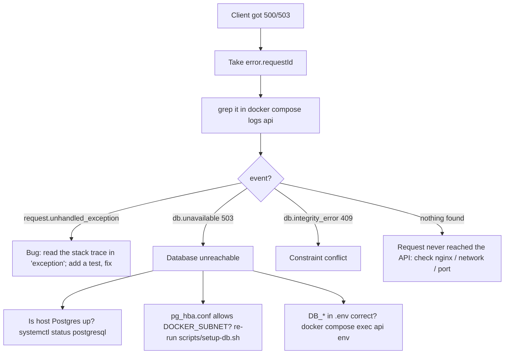

# Logging & debugging

## First stop: the error itself

- Every error response says what went wrong and its status:

```json
{"error": {"code": "CHIT_NOT_FOUND", "message": "Chit not found", "details": null, "requestId": "7060bd99..."}}
```

- Each route lists **every error it can return** in its router, next to the route:

```python
@router.get(
    "/{chit_id}",
    response_model=SimpleChitOut,
    summary="Get one chit with its full grid",
    responses=errors(*AUTHED, ErrorCode.VALIDATION_ERROR, ErrorCode.CHIT_NOT_FOUND),
)
```

- Each `ErrorCode` in [errors.py](../../apps/api/src/chitbook_api/core/errors.py) holds `(HTTP status, message, exact problem / fix)`:

```python
CHIT_NOT_FOUND = (404, "Chit not found", "No chit with that id owned by the caller (...)")
```

- The same list appears in Swagger (`/api/docs`, one example per code) and in each endpoint's **Errors** table in `docs/api/<module>.md`.
- `scripts/gen_api_docs.py` fails if a router's list does not match the errors its code can raise, so the list stays exact.

## Where logs are

- No log files are written. The API logs JSON lines to **stdout**; Docker keeps them and rotates at `LOG_MAX_SIZE` × `LOG_MAX_FILES`.

| Where | What |
|---|---|
| `docker compose logs -f api` | every API log line |
| `docker compose logs -f web` | nginx access/error log |
| `auth_audit_log` table | security events (logins, lockouts, token reuse …) |

## Log format

One JSON object per line:

```json
{"method": "PUT", "path": "/api/v1/simple-chits/7/payouts/5", "status": 200, "duration_ms": 41.3,
 "client_ip": "172.29.0.1", "event": "http.request", "request_id": "7060bd99e03841eda7bc77321b0df7b1",
 "user_id": 3, "level": "info", "logger": "chitbook.http", "timestamp": "2026-11-01T12:17:10.615+05:30"}
```

| Field | Meaning |
|---|---|
| `event` | what happened, e.g. `http.request`, `simple_chit.payout_saved`, `auth.login_failed` |
| `request_id` | same as the `X-Request-ID` response header and `error.requestId` |
| `user_id` | the signed-in user (once the token is checked) |
| `level` | `info`, `warning` (4xx, security events), `error` (5xx) |
| `timestamp` | IST |

- Passwords, tokens, cookies and secrets are **replaced with `***`** before writing.
- Each module logs its own events. The generated API docs list them per endpoint under **Diagnose**.

## Follow one request

1. Get the request id from the app error, the `X-Request-ID` header, or `error.requestId`.
2. Search for it:

```bash
docker compose logs --no-log-prefix api | grep 7060bd99e03841eda7bc77321b0df7b1 | python3 -m json.tool --json-lines
```

3. You'll see the domain events, any `request.failed` / `request.unhandled_exception` line, and the final `http.request` line.

Useful searches:

```bash
docker compose logs --no-log-prefix api | grep '"level": "error"' | tail             # all server errors
docker compose logs --no-log-prefix api | grep '"event": "auth.login_failed"' | tail  # failed logins
docker compose logs --no-log-prefix api | grep '"status": 5' | tail                  # 5xx responses
docker compose logs --since 1h --no-log-prefix api | grep '"user_id": 3'            # one user, last hour
```

## Diagnosing 500 / 503



| Symptom (log) | Likely cause | Fix |
|---|---|---|
| `db.unavailable` with `ConnectionRefusedError` | host Postgres stopped | `sudo systemctl start postgresql` |
| `db.unavailable` with `no pg_hba.conf entry` | Docker subnet not allowed | `scripts/setup-db.sh` |
| `db.unavailable` with `password authentication failed` | `DB_PASSWORD` differs from the role | `scripts/setup-db.sh` (re-syncs the password) |
| `UndefinedTableError` / `UndefinedColumnError` in a stack trace | migrations not applied | restart the api container, or `alembic upgrade head` |
| Container exits at start with `ValidationError ... Field required` | a variable is missing in `.env` | compare with `.env.example` |
| Container exits with `AUTH_WEAK_PASSWORD` at bootstrap | `ADMIN_PASSWORD` fails the policy | use 8+ characters with letters and digits |
| `request.unhandled_exception` | code bug | stack trace is in the line; reproduce with a test |
| Every request `AUTH_TOKEN_INVALID` after a deploy | `JWT_SECRET` changed | expected; users log in again |
| `rate_limit.exceeded` | too many auth calls from one IP | wait 60 s; check for loops in clients |

## Health checks

- `GET /health`: the process is up (used by Docker's healthcheck).
- `GET /health/ready`: the database answers, and its session timezone is shown.

## Security events

```sql
SELECT created_at, event, username, ip_address, details
FROM auth_audit_log ORDER BY created_at DESC LIMIT 50;
```

- If you see `REFRESH_REUSED`, a refresh token was used twice. Treat it as possible theft: the affected sessions have already been revoked.
